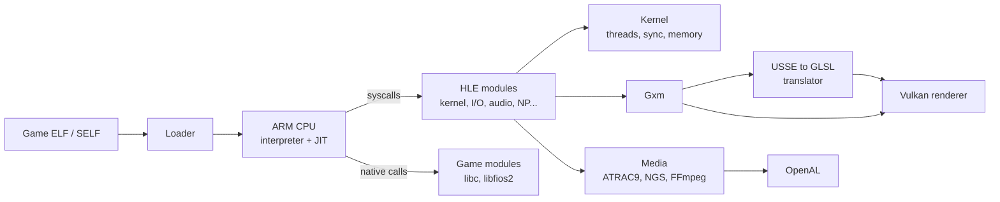

<div align="center">


### An experimental PlayStation Vita emulator written in C#

[](LICENSE)
[](https://dotnet.microsoft.com/)
[](https://www.vulkan.org/)
[](#requirements)
[](#compatibility)

[Features](#features) ·
[Compatibility](#compatibility) ·
[Getting started](#getting-started) ·
[Usage](#usage) ·
[Architecture](#architecture) ·
[Contributing](#contributing) ·
[License](#license)

<br>


<sub><i>God of War Collection in-game on VitaSharp.</i></sub>

</div>

---

## About

VitaSharp emulates the Sony PlayStation Vita on a desktop PC. It runs the console's ARMv7 code with an
interpreter and a block JIT built on .NET, translates the Vita's SGX543 GPU shaders to Vulkan, and reimplements
the system libraries that games call (high-level emulation, HLE).

The whole emulator is managed C#: no native emulation core, no C++ toolchain. It is a research project in active
development. Several commercial games already reach gameplay, and many others still stop at boot.

> [!IMPORTANT]
> VitaSharp does not include any game, firmware or Sony code. You must dump your own games and licenses from a
> console you own. Piracy is not supported.

## Features

<table>
<tr>
<td width="50%" valign="top">

**CPU**
- ARMv7 Thumb-2 / A32 interpreter with VFPv3 and NEON
- Block JIT: hot guest blocks become IL `DynamicMethod`s compiled on background threads
- Multi-core guest scheduler with configurable CPU speed

**Graphics**
- SceGxm reimplemented on top of a Vulkan 1.3 renderer
- USSE shader decoder that translates the Vita's GPU programs to GLSL, then SPIR-V (shaderc)
- Texture decoding for Vita formats, including PVRTC, with swizzled and tiled layouts
- Persistent shader cache

</td>
<td width="50%" valign="top">

**System**
- Over 1,100 system functions reimplemented (kernel, threads, I/O, Gxm, audio, NGS, network, NP, dialogs...)
- Game-shipped modules (`libc`, `libfios2`, ...) loaded natively (LLE)
- SELF decryption and PKG installation with `work.bin` / `.rif` licenses
- Save data, trophies and common dialogs

**Media and input**
- ATRAC9 audio decoder and NGS audio engine, output through OpenAL
- H.264 video (SceVideodec / SceAvPlayer) and MP3 / AAC decoding through FFmpeg
- Keyboard, gamepad, and front / rear touch through the mouse
- Avalonia game library with icons, metadata and one-click launch

</td>
</tr>
</table>

<div align="center">


<sub><i>The game library: install PKGs, browse installed titles and launch them.</i></sub>
</div>

## Compatibility

VitaSharp is tested against a small set of commercial games through automated scenarios (see
[Testing](#testing)). The table lists what has been observed so far; it is not a promise.

| Game | Title ID | Status |
| --- | --- | --- |
| F1 2011 | PCSE00002 | In-game: races run with HUD, menus and video |
| God of War Collection | PCSA00126 | In-game: combat, cutscenes and audio |
| Killzone: Mercenary | PCSC00045 | In-game: first-person gameplay |
| J.League Pro Soccer Club wo Tsukurou! (Sakatsuku) 2013 | PCSG00198 | Menus and save flow |

Missing system functions are tracked one by one in [`docs/hle`](docs/hle/README.md), with priorities based on what
the tested games actually import.

## Getting started

### Requirements

| | Minimum |
| --- | --- |
| OS | Windows 10 or 11, x64 |
| GPU | Vulkan 1.3 support (any recent NVIDIA, AMD or Intel GPU with current drivers) |
| SDK | [.NET 10 SDK](https://dotnet.microsoft.com/download/dotnet/10.0) (to build) |
| CPU | A modern multi-core x64 CPU; the guest runs on several host threads |

The first build downloads FFmpeg 8.1 (LGPL) for your platform, checks its SHA-256 and copies it to an `ffmpeg` folder
next to the executable; later builds reuse the cached copy. Windows and Linux (x64 and ARM64) get prebuilt
libraries; on macOS install FFmpeg with `brew install ffmpeg`. To build offline, pass `-p:VitaSharpSkipFFmpeg=true`
(videos and MP3/AAC audio are then disabled). Details in [`third_party/ffmpeg`](third_party/ffmpeg/README.md).

### Build

```powershell
git clone <repository-url> VitaSharp
cd VitaSharp
dotnet build -c Release
```

### Run

```powershell
dotnet run --project src/VitaSharp.Desktop -c Release
```

The game library opens. Use **Install PKG...** to install a game package together with its `work.bin` or `.rif`
license, or **Add game folder...** for an already-extracted game, then press **Play**.

## Usage

### Command line

The same executable has a command-line mode, handy for testing and debugging:

| Command | Description |
| --- | --- |
| *(no arguments)* | Open the game library window |
| `install <game.pkg> <work.bin\|.rif>` | Install a package into the virtual `ux0:` |
| `run <TITLEID\|folder> [options]` | Boot a title directly |
| `test <scenario.txt>` | Run an automated scenario: frames, contact sheet and report |
| `imports <TITLEID\|folder>` | List the system functions a title imports and which ones are still missing |
| `self2elf <in> <out> [license]` | Decrypt a SELF executable to ELF |

Common `run` options:

| Option | Effect |
| --- | --- |
| `--fullscreen`, `--scale <n>` | Window mode and size |
| `--no-vsync` | Uncap presentation |
| `--no-jit` | Interpreter only |
| `--cores <n>`, `--cpu-mhz <n>`, `--speed <x>` | Guest CPU cores, pacing and speed |
| `--headless`, `--seconds <n>`, `--frames <n>` | Run without a window for a fixed time or number of frames |
| `--input <script>` | Scripted input, e.g. `start@f3400,cross@f3600` |
| `--dump-frames`, `--dump-every <n>` | Save rendered frames to disk |
| `--trace-hle`, `--trace-hle-only <a+b>` | Log system calls |
| `--validation` | Enable the Vulkan validation layers |
| `--log <file>`, `--debug` | Log destination and verbosity |

### Controls

| PS Vita | Keyboard |
| --- | --- |
| D-pad | Arrow keys |
| Cross / Circle / Square / Triangle | `X` (or `Space`) / `C` / `Z` / `V` |
| L / R | `Q` / `E` |
| Start / Select | `Enter` / `Backspace` |
| Left stick | `W` `A` `S` `D` |
| Right stick | `I` `J` `K` `L` |
| Front touch / rear touch | Left / right mouse button |
| Fullscreen | `F11` |

Gamepads are detected automatically.

### Data folder

Everything the emulator writes lives in `%APPDATA%\VitaSharp` (override with the `VITASHARP_DATA` environment
variable):

```text
VitaSharp/
├── fs/            virtual Vita file system (ux0:, vs0:, ...), installed games in fs/ux0/app/<TITLEID>
├── shadercache/   translated shaders
├── logs/          last.log of the most recent run
└── tests/         output of automated scenarios
```

## Architecture



| Project | Role |
| --- | --- |
| [`src/VitaSharp.Core`](src/VitaSharp.Core) | Emulator core: CPU (`Cpu/`), memory, kernel, loader and SELF crypto, Gxm and shader translation, HLE modules (`Hle/`), media |
| [`src/VitaSharp.Renderer.Vulkan`](src/VitaSharp.Renderer.Vulkan) | Vulkan 1.3 backend: draws, textures and formats, swapchain, writeback of render targets |
| [`src/VitaSharp.Desktop`](src/VitaSharp.Desktop) | Executable: Avalonia game library, window and input, OpenAL audio, command line and test runner |
| [`tests/VitaSharp.Tests`](tests/VitaSharp.Tests) | Unit tests, including CPU fuzzing against Unicorn |
| [`tests/scenarios`](tests/scenarios) | Automated game scenarios |
| [`docs/hle`](docs/hle/README.md) | Function-by-function specs of the system functions still to implement |

## Testing

Unit tests:

```powershell
dotnet test tests/VitaSharp.Tests
```

Game scenarios boot a title headless, feed scripted input and write frames, a contact sheet, metrics and a report
to the data folder:

```text
title=PCSE00002
args=--frames=8600 --dump-every=50 --input=start@f3400,cross@f3600
```

```powershell
dotnet run --project src/VitaSharp.Desktop -c Release -- test tests/scenarios/f1_drive.txt
```

## Contributing

Contributions are welcome, from bug reports to new system functions.

1. Pick a function from [`docs/hle`](docs/hle/README.md). Each one has its prototype, expected behaviour, error
   codes and where it goes in the code.
2. Implement it as an `[Hle]` method in `src/VitaSharp.Core/Hle/Modules`. Registration is automatic.
3. Check it with `imports <TITLEID>` and the scenarios of the affected game.
4. Open a pull request describing what changed and which games it affects.

When reporting a bug, attach `logs/last.log` and say which game (title ID and version) and which hardware you used.

## Acknowledgements

VitaSharp stands on the work of the PS Vita homebrew and emulation community:

- [Vita3K](https://github.com/Vita3K/Vita3K): the reference for system behaviour, the NID database and the USSE register model
- [VitaSDK](https://vitasdk.org/) and [vita-headers](https://github.com/vitasdk/vita-headers): prototypes and NIDs of the system libraries
- [PS Vita Developer wiki](https://wiki.henkaku.xyz/): hardware and firmware documentation
- [VGAudio](https://github.com/Thealexbarney/VGAudio): the ATRAC9 decoder (MIT)
- [Silk.NET](https://github.com/dotnet/Silk.NET), [Avalonia](https://avaloniaui.net/) and [FFmpeg](https://ffmpeg.org/)

## License

VitaSharp is free software: you can redistribute it and/or modify it under the terms of the
**GNU General Public License version 3**, as published by the Free Software Foundation. See [LICENSE](LICENSE).

Third-party components keep their own licenses:

| Component | License |
| --- | --- |
| ATRAC9 decoder, from VGAudio (`src/VitaSharp.Core/Hle/Audio/Atrac9`) | MIT |
| FFmpeg (downloaded at build time, see `third_party/ffmpeg`) | LGPL 2.1 or later |
| Silk.NET, Avalonia, FFmpeg.AutoGen (NuGet) | MIT / LGPL, see each package |

PlayStation and PS Vita are trademarks of Sony Interactive Entertainment. VitaSharp is not affiliated with or
endorsed by Sony. Game screenshots belong to their respective owners and are shown only to document emulation
progress.
