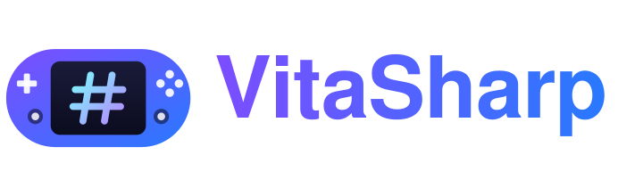
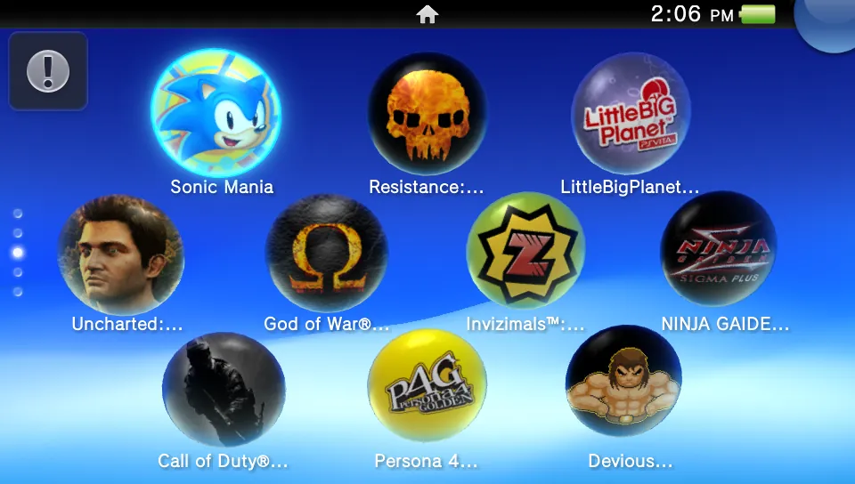
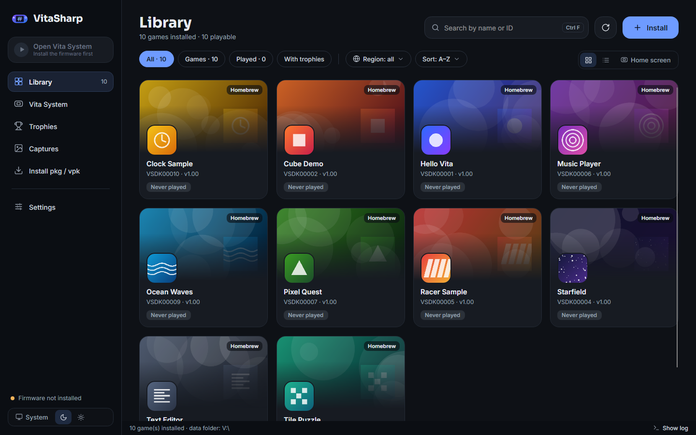
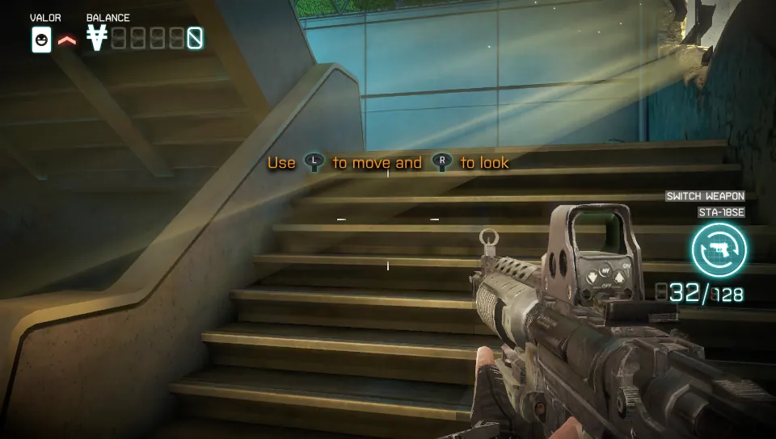
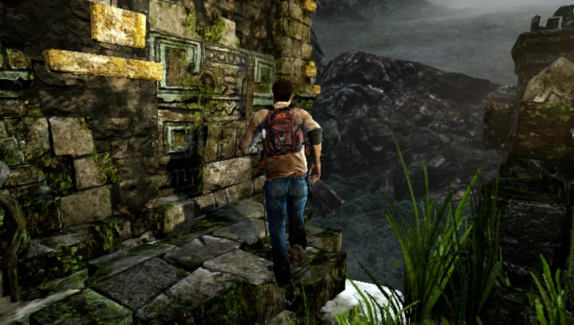
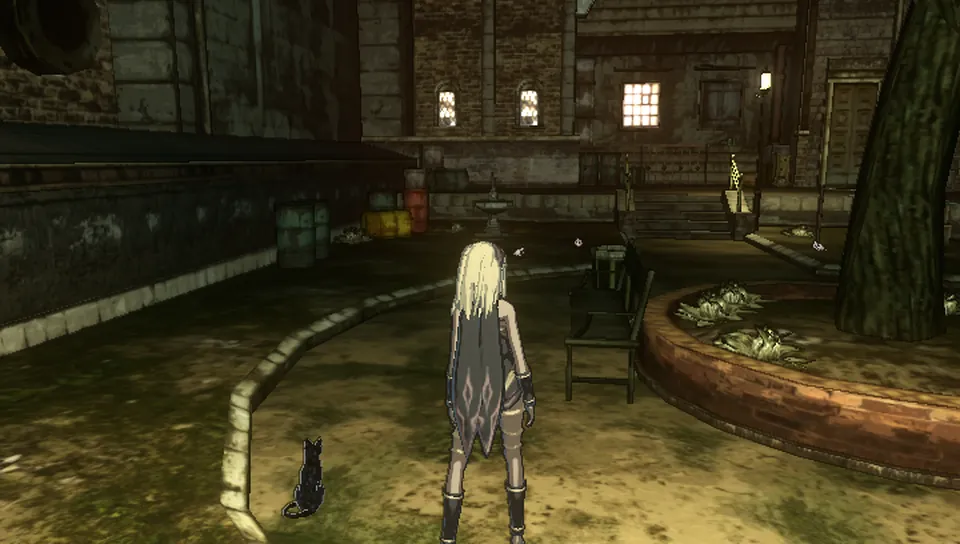
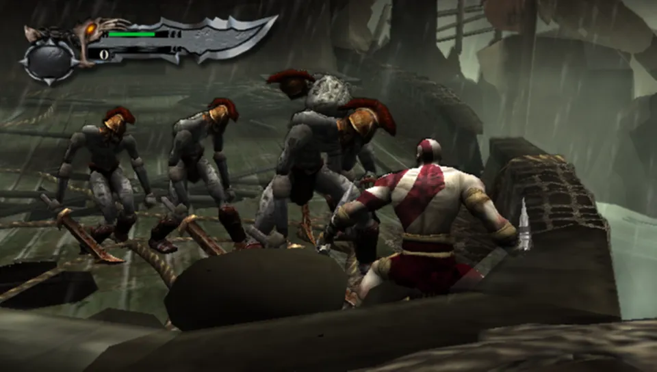
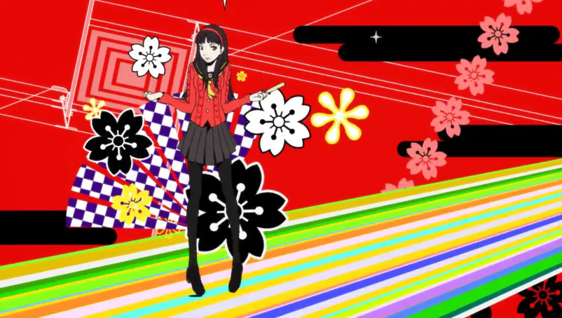
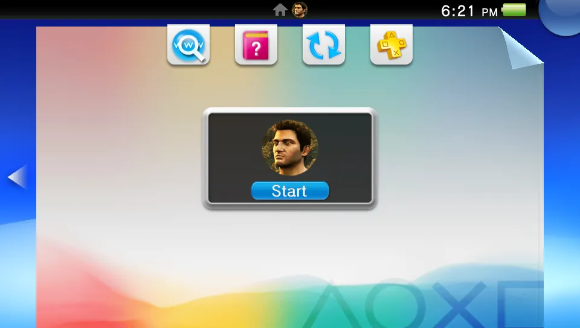
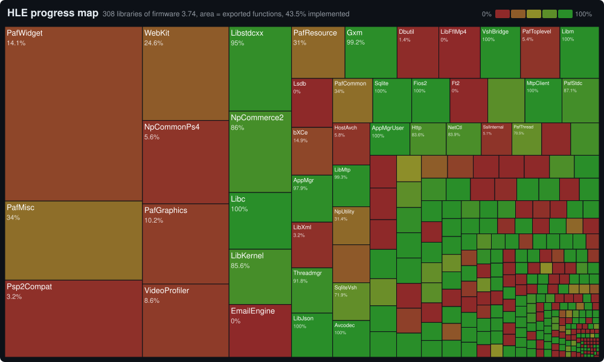

<!-- pair: README.pt-BR.md sha256=44b2a412395ed0c7facbc1dd3a19c5194ac6f28479d0e5cb470cc8fce74012e2 -->
<div align="center">

**English** | [Português](README.pt-BR.md)



### A PlayStation Vita emulator written in C#

Runs commercial Vita games and the console's own system software, with no native core: an ARMv7 JIT, a Vulkan
renderer and more than 1,100 system functions reimplemented, all in .NET 10.

[](LICENSE)
[](https://dotnet.microsoft.com/)
[](https://www.vulkan.org/)
[](docs/compatibility.md)

<br>



<sub><i>The real PS Vita home screen (the firmware's <code>shell.self</code>) running in VitaSharp.</i></sub>

<br><br>

<picture>
  <source media="(prefers-color-scheme: light)" srcset="docs/assets/launcher-light.png">
  
</picture>

<sub><i>The desktop launcher's game library (sample homebrew entries; the light theme follows your GitHub theme).</i></sub>

</div>

---

## What it is

VitaSharp emulates the PS Vita. It runs the console's ARMv7 code (an interpreter and native JITs for x86-64 and
ARM64), translates the Vita GPU's shaders to Vulkan and reimplements the system libraries games call (HLE). With the
official firmware installed it also runs the Vita's own software: lock screen, home screen, LiveArea and the games
started from them. It is a research project under active development, all in C#.

> [!IMPORTANT]
> VitaSharp includes no games, firmware or Sony code. Use games and licenses dumped from your own console and
> download the system update (`PSVUPDAT.PUP`) from the PlayStation website. Piracy is not supported.

<table>
<tr>
<td width="33%"><br><sub><b>Killzone: Mercenary</b>, campaign</sub></td>
<td width="33%"><br><sub><b>Uncharted: Golden Abyss</b>, first chapter</sub></td>
<td width="33%"><br><sub><b>Gravity Rush</b>, opening</sub></td>
</tr>
<tr>
<td><br><sub><b>God of War Collection</b>, combat</sub></td>
<td><br><sub><b>Persona 4 Golden</b>, opening</sub></td>
<td><br><sub><b>Vita System</b>, a game's LiveArea</sub></td>
</tr>
</table>

## Status

[](docs/hle/progress.md)
[](docs/hle/progress.md)
[](docs/hle/progress.md)
[](docs/hle/progress.md)

<a href="docs/hle/progress.md">
<picture>
  <source media="(prefers-color-scheme: light)" srcset="docs/assets/status/progress-map-light.svg">
  
</picture>
</a>

[Progress per library](docs/hle/progress.md)

<sub>* Percentages of the functions that firmware 3.74 exports to user code (its user modules and the syscall
libraries of its kernel modules) with an HLE implementation, not of every PS Vita system function. "Games imports":
the exported functions the installed test games import; "system imports": those only the system software imports;
VitaSDK: the user functions of the VitaSDK NID list. "Default": implemented functions that need hardware or a
service the emulator does not have and return the firmware's own result for that case (counted in the percentage, shown
apart). "LLE": functions of libraries the emulator provides by loading and running the real module the program brings
(a game's own libsmart/libface, the libshacccg.suprx the user extracts from their console, the firmware module of a
library the emulator loads for every importer; also counted, shown apart;
list in [`docs/hle/progress.md`](docs/hle/progress.md)). Refreshed with `build/hle-status.ps1`.</sub>

## Games

38 games tested so far ([`docs/compatibility.md`](docs/compatibility.md), with each one's state and test scenario):
25 reach gameplay (among them Killzone: Mercenary, Uncharted: Golden Abyss, Gravity Rush, God of War Collection,
FIFA 13, Persona 4 Golden, LittleBigPlanet, Tearaway, WRC 4, Skullgirls and Devious Dungeon, several that do not
boot on Vita3K) and the rest reach the menus. Known issues and future work are in the [roadmap](docs/roadmap.md).

## Platforms

| Platform | State |
| --- | --- |
| **Windows** (x64) | The most tested: launcher, game window, Vita System, every diagnostic tool |
| **Android** (arm64) | Its own app (library, settings, on-screen controls, pause menu); tested on a Redmi Note 14 (Mali-G57) and the x86_64 emulator. For now the APK is built locally ([`docs/android/README.md`](docs/android/README.md)) |
| Linux, macOS | Build and make packages; Linux x64 tested on Debian 12, macOS not yet tested on a Mac |

PC requirements: a Vulkan 1.3 driver (recent NVIDIA, AMD or Intel) and a multi-core processor.

## Install and play

1. Download the package from the **Releases** page (zip or installer for Windows; see [Releases](#releases)) or build
   it (see [Build and test](#build-and-test)).
2. Open VitaSharp: the launcher (game library) shows up.
3. On **Install pkg / vpk** (or dragging the files onto any screen):
   - **VPK or zip**;
   - **PKG with license**: the package with its license, a `work.bin`/`.rif` file or the pasted zRIF text;
   - **Decrypted folder**: a game folder that is already decrypted.
4. Pick the game and press **Play**.

**Firmware (optional).** Games run without firmware. Install it for the system fonts and libraries (`libSceXml`,
`libSceSqlite`...) and the **Vita System**: on the **Vita System** page, **Install firmware (.PUP)...**, or **Use
Vita3K's firmware** (copies `os0`/`vs0`/`sa0`/`pd0` from a Vita3K installation). From the command line:
`install-firmware <PSVUPDAT.PUP>`.

**Vita System.** With the firmware installed, the launcher's **Open Vita System** button (Ctrl+H, or `boot-shell`)
runs the firmware's `shell.self`: initial setup the first time, lock screen, home screen with the installed games and
LiveArea. A game opened from the LiveArea runs as a second process; the PS button (Home key) goes back to the system
and **Continue** resumes the game. Details and what is missing in [`docs/notes/system-apps.md`](docs/notes/system-apps.md).

**Plugins.** VitaSharp loads the plugins of `fs/ur0/tai/config.txt` (copied from your Vita to `fs/ur0/tai`, listed as
on the Vita: `*KERNEL` for `.skprx` kernel plugins, `*ALL` / `*TITLEID` for `.suprx` user plugins) and runs their own
code. taiHEN (`taihen.skprx`) loads too, but it cannot start: its start needs patches to the firmware's signature and
DRM checks, which VitaSharp does not make work. So everything that needs taiHEN does not run, as on a Vita without
it: plugins built on it (kubridge, fd_fix) and homebrew that calls it or needs such a plugin, among them **Dead Space**
(through kubridge) and **Sonic Mania**. Details in [`docs/notes/plugins.md`](docs/notes/plugins.md).

**Android.** See [Android](#android).

**Language.** The launcher and the game window follow the system's language (English or Brazilian Portuguese);
**Settings > General > Appearance > Language** picks one (on Android: **Settings > Appearance > Language**). Logs stay in English.

Data lives in `%APPDATA%\VitaSharp` on Windows (`~/.local/share/VitaSharp` on Linux,
`~/Library/Application Support/VitaSharp` on macOS; `--data=<folder>` or `VITASHARP_DATA` change the folder): games in
`fs/ux0/app`, firmware in `fs/os0`... , `logs/`, `savestates/`, `captures/` (Record everything), `gpudumps/`,
`diagnostics/`, `shadercache/`.

## Keys

| Key | Function |
| --- | --- |
| Arrows, `W` `A` `S` `D`, `I` `J` `K` `L` | D-pad, left stick, right stick |
| `X` or `Space` / `C` / `Z` / `V` | Cross / Circle / Square / Triangle |
| `Q` / `E`, `Enter` / `Backspace` | L / R, Start / Select |
| `Home` | PS button |
| Left / right mouse button | Touch on the front screen / the rear touchpad |
| `F1` / `Shift+F1` | Next / previous internal resolution while the game runs (1x, 2x, 3x, 4x; this session only, with an on-screen notice) |
| `F2` / `Shift+F2` | Next / previous frame rate while the game runs (native, locked to 30, locked to 60, unlimited) |
| `F3` / `Shift+F3` | Next / previous MSAA mode while the game runs (native, 2x supersampling, off; this session only, with an on-screen notice) |
| `F4` | Mouse mode: gyroscope (middle button), right stick, left stick or off, saved per game (`Esc` releases the cursor) |
| `F5` / `F7` | Save / load the quick state; `Shift+F5` / `Shift+F7` save / load in the chosen slot |
| `F6` | Save state picker over the paused game: the quick slot and slots 1-9 with their picture, date, play time and version; save (overwriting asks, showing the old and the current picture), load (with the picture large), delete (`Del` / Triangle) |
| `F8` | Starts / stops **Record everything** (see [Report a bug](#report-a-bug)) |
| `Ctrl+F8` | Starts / stops a GPU dump (`gpudumps/*.vsgd`; `replay-gpu` redraws it draw by draw, without the game) |
| `F9` | Turns debug mode on / off (detailed logs, 10 s pre-recording, automatic captures) |
| `F10` | Diagnostic capture: the next frame with its draws, textures, targets, screenshot and log (`diagnostics/`) |
| `F11` | Full screen |
| `P` | Pauses / resumes the emulation |

Controllers (SDL2) are detected on their own, with a positional layout (the bottom button is always Cross) and
gyroscope. Everything can be remapped in **Settings > Controls**, per controller ([`docs/notes/controller-config.md`](docs/notes/controller-config.md)).

## Android

The Android app (`src/VitaSharp.Android`) runs the same emulator core as the desktop on arm64 phones (Android 8.0 or
newer, Vulkan), with its own screens: game library, game details (CPU backend, clock, GPU profile, VSync and FPS per
game, saves), trophies, controls, settings, firmware, GPU driver, PSN account and network, and a performance page.
The app's texts are in Portuguese for now. Screens and design: [`docs/android/README.md`](docs/android/README.md#screens).

**Install the APK.** There is no APK on the Releases page yet: build it on a PC (the .NET MAUI Android workload, the
Android SDK and a JDK 17; the device's shader compiler once with `build/build-android-shaderc.ps1` / `.sh`), then
install `io.github.vitasharp-Signed.apk` with `adb install` or by opening it on the phone. Steps and options:
[`docs/android/README.md`](docs/android/README.md#building).

```sh
dotnet build src/VitaSharp.Android -c Release -m:2
adb install -r src/VitaSharp.Android/bin/Release/net10.0-android/io.github.vitasharp-Signed.apk
```

**Games and firmware.** The app asks for no storage permission: files come in through Android's file picker. In
**Biblioteca**, **Instalar jogo** takes a `.vpk` (or `.zip`) or a `.pkg` with its license (`work.bin`, `.rif` or the
pasted zRIF). The firmware is optional, as on the PC: **Ajustes > Firmware > Instalar firmware (.PUP)** with
`PSVUPDAT.PUP`; then **Sistema do Vita** in the library boots the real home screen. Custom GPU drivers (Adreno, through
libadrenotools) are installed in **Ajustes > Driver da GPU**. Data lives in the app's own folder
(`Android/data/io.github.vitasharp/files`, the desktop's layout); uninstalling the app deletes it.

**Controls.** Translucent on-screen controls over the sides of the picture (D-pad, sticks, face buttons, L/R,
SELECT/PS/START, a TRÁS toggle for the rear touchpad); touches on the picture are the front touch screen. Bluetooth or
USB controllers are detected on their own with the desktop's positional layout (the on-screen controls hide while one
is connected), and a hardware keyboard uses the desktop's keys. **Controles** sets the O/X swap, deadzone, opacity,
vibration and auto-hide. The phone's gyroscope and accelerometer feed the Vita's motion sensor (not verified on a
device yet).

**Pause menu.** The PS button (on screen or on the controller) pauses a game started on its own: **Continuar**, **Salvar
estado** / **Carregar estado** (6 slots with a picture), **Ajustes** (rear touch, on-screen controls, pre-recording),
**Recentralizar** (motion), **Gravar tudo** and **Sair do jogo**. **Gravar tudo** records the same bug report as the
desktop's F8 (save state, input, GPU dump, frames, audio and log) into `captures/` until **Parar gravação**; send the
`.zip` as in [Report a bug](#report-a-bug).

**State and limits.** Tested on a Redmi Note 14 (Mali-G57) and on the x86_64 Android emulator; Adreno phones and real
controllers are not verified yet. Performance is the work in progress: lighter games reach their native 30 or 60 fps,
heavy 3D ones do not yet (Killzone: Mercenary, the reference test, runs at about 12-15 fps against its 30). Open items
are in the [roadmap](docs/roadmap.md) (Android section).

## Report a bug

Use **Record everything**: press **F8** while playing (the title bar shows *"● REC | Recording everything (F8 to
stop)"*), play until the problem shows up and press **F8** again. A `.zip` comes out in `captures/` with a save
state, the controls, every picture with its timing, the GPU dump, the audio (the mix and every voice) and the log: the
problem can be reproduced without playing again. On Android: pause menu > **Record everything**. For quick defects,
turn on **Pre-recording** (Settings > General, or debug mode with F9): the file then includes the seconds before the key.

Send the `.zip` with the game's name (title ID) and what happened. Every session also writes `logs/last.log`.
Details in [`docs/notes/session-capture.md`](docs/notes/session-capture.md); whoever analyses it uses
`vitasharp-perf capture <zip>` and `VitaSharp.Desktop rerun <folder>`.

## Build and test

Needs the [.NET 10 SDK](https://dotnet.microsoft.com/download/dotnet/10.0). The first build downloads FFmpeg (videos
and MP3/AAC); the other native libraries come from NuGet.

```sh
dotnet build -c Release
dotnet run --project src/VitaSharp.Desktop -c Release          # opens the launcher
dotnet run --project src/VitaSharp.Desktop -c Release -- run <TITLEID>   # opens a game directly
dotnet test tests/VitaSharp.Tests -c Release --filter "Category!=Slow"  # quick tests (without the CPU fuzz)
build/coverage.ps1                                              # test coverage report (HTML + summary; also .sh)
```

The command line also has `install`, `boot-shell`, `test <scenario>` (automatic scenarios in
[`tests/scenarios`](tests/scenarios)), `replay-gpu`, `rerun`, `imports`, `update` and more: `VitaSharp.Desktop --help`.
The Android app: [`docs/android/README.md`](docs/android/README.md). Ready packages (zip, installer, tar.gz, AppImage,
.app, .dmg; ReadyToRun or Native AOT): `build/publish.ps1` / `build/publish.sh`.

Every script comes as a `.ps1` + `.sh` pair, and the CI checks it. Interface texts live in
`src/VitaSharp.Core/Localization` (`Texts.resx` in English, `Texts.pt-BR.resx`); the external docs come in both
languages too (`README.md` + `README.pt-BR.md`, checked by `ExternalDocPairsTests`). To contribute system functions,
see the specifications in [`docs/hle`](docs/hle/README.md).

### Code style

The C# style is the Ryujinx/Ryubing one, and [`.editorconfig`](.editorconfig) is the rule (what is enforced, what is
off and why). `build/format-check.ps1` (Windows) / `build/format-check.sh` (Linux, macOS) runs
`dotnet format whitespace` and `dotnet format style --severity warn` with `--verify-no-changes` over the tracked `.cs`
files only (`git ls-files`: never `.claude/` with the agents' worktrees, nor untracked files), as the CI job
"Code style" does, with the same exit code (2 when something differs); `-Fix` / `--fix` rewrites the files instead (also running `build/FormatTool`, which splits
the blocks written on one line and keeps `{ get; set; }` on one line). Folders not converted yet are listed in
[`build/format-pending.txt`](build/format-pending.txt) and skipped. `OneLineBlockTests` (in the test suite) rejects
blocks written on one line (`if (x) { a; }`): every body goes on its own lines.

Shell scripts follow the Google Shell Style Guide and must pass ShellCheck (CI job "ShellCheck"; the job
"Scripts on macOS" also runs `build/check-scripts-help.sh` under the system bash 3.2). Install ShellCheck with
`winget install koalaman.shellcheck` (Windows), `sudo apt install shellcheck` / `sudo dnf install ShellCheck`
(Linux) or `brew install shellcheck` (macOS), then `shellcheck --severity=style build/*.sh build/package/*.sh`.

### Developer tools

- IL backend dump: `VITASHARP_IL_DUMP=<folder>` writes the compiled guest blocks as assemblies to read with ILSpy
  (`dotnet tool install -g ilspycmd`, then `ilspycmd -il <file>.dll`); `DOTNET_JitDisasm=<method>` prints the
  machine code RyuJIT generates. See [`docs/notes/il-jit.md`](docs/notes/il-jit.md).
- Vulkan validation: `--validation` (`run`, `test`, `replay-gpu`) or `VITASHARP_VK_VALIDATION=1` (`=sync` adds
  synchronization validation) needs the Khronos layer: the [Vulkan SDK](https://vulkan.lunarg.com/sdk/home)
  (Windows, Linux, macOS), or on Linux the distribution package (`vulkan-validationlayers` / `vulkan-validation-layers`);
  on macOS the SDK also brings MoltenVK. Frame captures: [RenderDoc](https://renderdoc.org) (Windows, Linux) and
  GPU dumps (`replay-gpu`, [`docs/notes/gpu-dump.md`](docs/notes/gpu-dump.md)) on every OS.
- Profiling: `dotnet-trace` / `dotnet-counters` (`dotnet tool install -g dotnet-trace`, every OS); on Windows also
  PerfView and WPR/WPA (Windows Performance Toolkit).

### Test requirements

What `dotnet test tests/VitaSharp.Tests` needs per system; a test whose requirement is missing is skipped and says why.

| | Windows | Linux | macOS |
|---|---|---|---|
| SDK | .NET 10 SDK | .NET 10 SDK | .NET 10 SDK |
| Vulkan device (renderer, GPU dump and game-run tests) | SwiftShader as Microsoft Edge or Google Chrome ship it (found by itself) | Mesa lavapipe: `sudo apt install mesa-vulkan-drivers libvulkan1` (Fedora: `mesa-vulkan-drivers vulkan-loader`) | MoltenVK: the LunarG Vulkan SDK, or `brew install molten-vk vulkan-loader` |
| shaderc (renderer and shader-compile tests; the renderer needs it too) | from the Silk.NET.Shaderc.Native package | from the package; when that copy does not load: `sudo apt install libshaderc-dev` (Fedora, Arch: `shaderc`) | from the package |
| FFmpeg (video and audio decode tests) | downloaded by the first build | downloaded by the first build | the system's: `brew install ffmpeg` |

- Any system: `VK_DRIVER_FILES` (or `VK_ICD_FILENAMES`) set to the ICD manifest of a downloaded SwiftShader or Mesa
  build is used instead.
- Firmware: without it the tests of the real firmware modules (`libSceJson`, `libSceXml`, `libpaf`, the update file
  install) are skipped. `VITASHARP_FIRMWARE_PUP` names a `PSVUPDAT.PUP`, `VITASHARP_FIRMWARE_DIR` a `vs0` or Vita3K
  data folder; the Piglet compiler tests need `libshacccg.suprx` in `ur0:data`.
- The tests never use your data folder: each one makes a scratch folder (`VITASHARP_DATA` for the child processes);
  the game-run tests boot a small executable the tests write themselves.
- Optional: the LunarG Vulkan SDK's validation layers run the renderer workloads under validation with
  `dotnet test tests/VitaSharp.Tests --filter Category=Slow` (`RendererValidationTests`; skipped without the layer).
- The window test runs a hidden window (`VITASHARP_HIDDEN_WINDOW=1`): on Linux it needs a display (`DISPLAY`), on
  Windows the system Vulkan loader (`vulkan-1.dll`, installed with any GPU driver).

## Releases

- **Versions**: a `v*` tag (or **Actions > Release > Run workflow**) publishes a release with the Native AOT packages
  for Windows, Linux and macOS and the `SHA256SUMS.txt`.
- **Automatic builds**: every push to `main` whose CI passed becomes a `build-<commit>` prerelease with that CI run's
  packages (the 10 newest stay).
- **Automatic update**: the packages check for a new version when they open (Settings > General > Updates: on/off,
  channel automatic builds or versions only, **Check now**). The dialog shows the version in use, the new one, its
  date and what's new, with **Skip this version**, **Remind me later** and **Update now**: the platform's package is
  downloaded, checked against `SHA256SUMS.txt` and swapped in (the installer, on Windows installed by the setup), and
  VitaSharp reopens. Only the emulator's files change; the data folder never does. A build compiled from source is
  updated with git (from the command line: `update [--channel=releases] [--apply]`).
- The packages are not signed (Windows SmartScreen warns) and never include firmware.

## Credits and license

VitaSharp builds on the Vita community's work: [Vita3K](https://github.com/Vita3K/Vita3K) (behaviour reference,
NIDs, USSE register model), [VitaSDK](https://vitasdk.org/) and vita-headers, the
[PS Vita development wiki](https://wiki.henkaku.xyz/), [VGAudio](https://github.com/Thealexbarney/VGAudio)
(ATRAC9 decoder, MIT), [RPCN](https://github.com/RipleyTom/rpcn), [Silk.NET](https://github.com/dotnet/Silk.NET),
[Avalonia](https://avaloniaui.net/), [FFmpeg](https://ffmpeg.org/) (LGPL, downloaded at build time) and
[SQLite](https://sqlite.org/) (public domain) through [SQLitePCLRaw](https://github.com/ericsink/SQLitePCL.raw) (Apache-2.0).

License **GPL v3** ([LICENSE](LICENSE)); third-party components keep their own. PlayStation and PS Vita are trademarks
of Sony Interactive Entertainment; VitaSharp is not affiliated with Sony.
