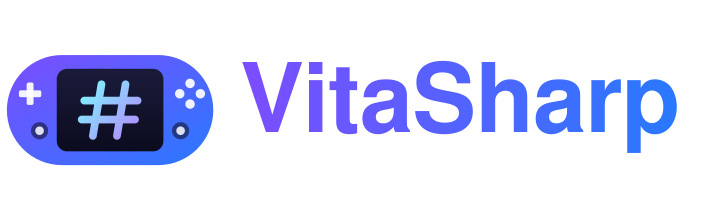
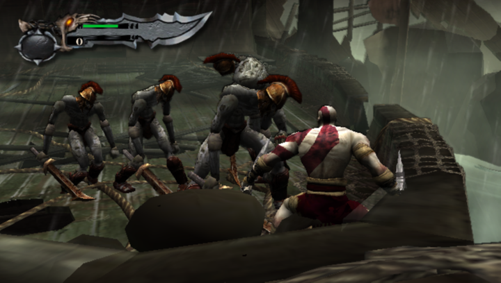
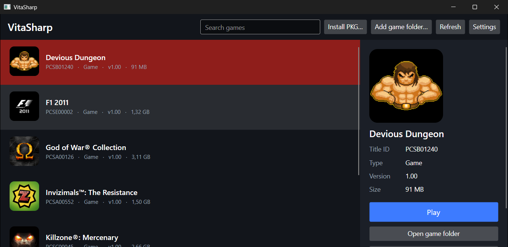
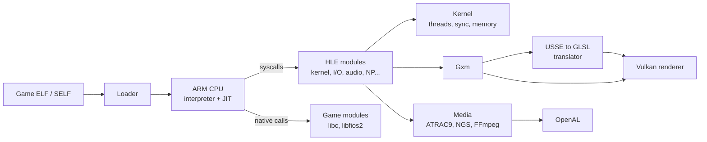

<div align="center">



### An experimental PlayStation Vita emulator written in C#

[](LICENSE)
[](https://dotnet.microsoft.com/)
[](https://www.vulkan.org/)
[](#requirements)
[](#compatibility)

[Features](#features) ·
[Compatibility](#compatibility) ·
[Getting started](#getting-started) ·
[Usage](#usage) ·
[Architecture](#architecture) ·
[Contributing](#contributing) ·
[License](#license)

<br>



<sub><i>God of War Collection in-game on VitaSharp.</i></sub>

</div>

---

## About

VitaSharp emulates the Sony PlayStation Vita on a desktop PC. It runs the console's ARMv7 code with an
interpreter and a block JIT built on .NET, translates the Vita's SGX543 GPU shaders to Vulkan, and reimplements
the system libraries that games call (high-level emulation, HLE).

The whole emulator is managed C#: no native emulation core, no C++ toolchain. It is a research project in active
development. Several commercial games already reach gameplay, and many others still stop at boot.

> [!IMPORTANT]
> VitaSharp does not include any game, firmware or Sony code. You must dump your own games and licenses from a
> console you own. Piracy is not supported.

## Features

<table>
<tr>
<td width="50%" valign="top">

**CPU**
- ARMv7 Thumb-2 / A32 interpreter with VFPv3 and NEON
- Block JIT: hot guest blocks become IL `DynamicMethod`s compiled on background threads
- Multi-core guest scheduler with configurable CPU speed

**Graphics**
- SceGxm reimplemented on top of a Vulkan 1.3 renderer
- USSE shader decoder that translates the Vita's GPU programs to GLSL, then SPIR-V (shaderc)
- Texture decoding for Vita formats, including PVRTC, with swizzled and tiled layouts
- Persistent shader cache

</td>
<td width="50%" valign="top">

**System**
- Over 1,100 system functions reimplemented (kernel, threads, I/O, Gxm, audio, NGS, network, NP, dialogs...)
- Game-shipped modules (`libc`, `libfios2`, ...) loaded natively (LLE)
- SELF decryption and PKG installation with `work.bin` / `.rif` licenses
- Save data, trophies and common dialogs

**Media and input**
- ATRAC9 audio decoder and NGS audio engine, output through OpenAL
- H.264 video (SceVideodec / SceAvPlayer) and MP3 / AAC decoding through FFmpeg
- Keyboard, gamepad, and front / rear touch through the mouse
- Avalonia game library with icons, metadata and one-click launch

</td>
</tr>
</table>

<div align="center">


<sub><i>The game library: install PKGs, browse installed titles and launch them.</i></sub>
</div>

## Compatibility

VitaSharp is tested against a small set of commercial games through automated scenarios (see
[Testing](#testing)). The table lists what has been observed so far; it is not a promise.

| Game | Title ID | Status |
| --- | --- | --- |
| F1 2011 | PCSE00002 | In-game: races run with HUD, menus and video |
| God of War Collection | PCSA00126 | In-game: combat, cutscenes and audio |
| Killzone: Mercenary | PCSC00045 | In-game: first-person gameplay |
| J.League Pro Soccer Club wo Tsukurou! (Sakatsuku) 2013 | PCSG00198 | Menus and save flow |

Missing system functions are tracked one by one in [`docs/hle`](docs/hle/README.md), with priorities based on what
the tested games actually import.

## Getting started

### Requirements

| | Windows | Linux | macOS |
| --- | --- | --- | --- |
| OS | Windows 10 or 11, x64 | x64 or ARM64, glibc distribution (X11 or Wayland) | a macOS release supported by .NET 10, Apple Silicon or Intel |
| GPU | Vulkan 1.3 driver (any recent NVIDIA, AMD or Intel GPU) | Vulkan 1.3 driver: Mesa (RADV, ANV, NVK), NVIDIA, or lavapipe (software, slow) | Vulkan through [MoltenVK](https://github.com/KhronosGroup/MoltenVK) 1.3 or later |
| Vulkan loader | ships with the GPU driver | `libvulkan1` (`sudo apt install libvulkan1 mesa-vulkan-drivers`) | [LunarG Vulkan SDK](https://vulkan.lunarg.com/sdk/home#mac) (system-wide install) or `brew install molten-vk vulkan-loader` |
| FFmpeg | downloaded at build time | downloaded at build time | `brew install ffmpeg` |
| SDK (to build) | [.NET 10 SDK](https://dotnet.microsoft.com/download/dotnet/10.0) | .NET 10 SDK | .NET 10 SDK |

A modern multi-core CPU is recommended: the guest runs on several host threads.

Platform status: Windows is the most tested platform. Linux x64 is tested on Debian 12 (unit tests, headless and
windowed runs on X11 and Wayland, Mesa lavapipe). macOS (x64 and Apple Silicon) builds and publishes, but has not been
run on a Mac yet; reports are welcome.

The first build downloads FFmpeg 8.1 (LGPL) for the target platform, checks its SHA-256 and copies it to an `ffmpeg`
folder next to the executable; later builds reuse the cached copy. Windows and Linux (x64 and ARM64) get prebuilt
libraries; there is no prebuilt macOS build, so VitaSharp uses Homebrew's (`/opt/homebrew/lib`, `/usr/local/lib`) or
the folder named by `VITASHARP_FFMPEG`. To build offline, pass `-p:VitaSharpSkipFFmpeg=true` (videos and MP3/AAC
audio are then disabled). Details in [`third_party/ffmpeg`](third_party/ffmpeg/README.md).

Other native libraries come from NuGet for every platform: GLFW (window), OpenAL Soft (audio), SDL2 (game
controllers), shaderc (shader compiler), Skia (launcher UI). Without SDL2 the keyboard still works and gamepads fall
back to GLFW (no touch pads, no hot-plug list in the settings). The webcam (SceCamera) uses DirectShow / Media Foundation on Windows, V4L2 on Linux and
AVFoundation on macOS; without a camera, or when access is denied, games get "no camera".

### Build

```sh
git clone <repository-url> VitaSharp
cd VitaSharp
dotnet build -c Release
```

The same command works on all three systems.

### Run

```sh
dotnet run --project src/VitaSharp.Desktop -c Release
```

Platform notes:

- **Linux**: desktop installs already have the client libraries VitaSharp loads; on a minimal system (servers,
  containers, WSL) install them with
  `sudo apt install libvulkan1 mesa-vulkan-drivers libx11-6 libxcursor1 libxrandr2 libxi6 libxinerama1 libice6 libsm6 libfontconfig1 libxkbcommon0 libwayland-client0 libwayland-cursor0 libpulse0`
  (Avalonia needs libICE/libSM, GLFW the X11 or Wayland ones, OpenAL Soft libpulse or ALSA). The game window
  (GLFW) runs on Wayland when its libraries are present and on X11/XWayland otherwise;
  `VITASHARP_GLFW_PLATFORM=x11` or `=wayland` forces one. `vulkaninfo --summary` (package `vulkan-tools`) shows which
  driver will be used; with several, pick one with `VK_DRIVER_FILES` (`VK_ICD_FILENAMES` on older loaders).
- **macOS**: VitaSharp needs a Vulkan loader with MoltenVK. If it lives in a folder the dynamic linker does not search
  (Homebrew on Apple Silicon, or an SDK used in place through `VULKAN_SDK`), VitaSharp restarts itself once with that
  folder on `DYLD_FALLBACK_LIBRARY_PATH`. `VITASHARP_VULKAN_LIB=/path/to/libvulkan.1.dylib` (or `libMoltenVK.dylib`)
  forces a specific library. Metal lacks a few Vulkan features the Vita GPU uses; VitaSharp logs them at startup
  ("Vulkan portability subset") and falls back: no sampler LOD bias, wireframe/point fill drawn filled.
- Any platform: `VITASHARP_DATA=<folder>` or `--data=<folder>` moves the data folder.

### Publish

Self-contained single-file builds (no .NET install needed to run them), ReadyToRun-compiled, for any platform from
any host:

```sh
build/publish.sh                        # all: win-x64 linux-x64 linux-arm64 osx-x64 osx-arm64
build/publish.sh linux-x64 osx-arm64    # some
```

```powershell
build\publish.ps1 -Rid win-x64,linux-x64
```

Each platform lands in `artifacts/publish/<rid>/`: the `VitaSharp.Desktop` executable, the native libraries next to
it, and FFmpeg in `ffmpeg/`. macOS builds made on another OS are not code-signed; on the Mac, run
`codesign --force --sign - VitaSharp.Desktop` (and `xattr -dr com.apple.quarantine .` for downloaded copies) before
starting them.

#### Native AOT

`--aot` / `-Aot` compiles the whole application ahead of time into a native executable instead of shipping IL plus
ReadyToRun code: no JIT at run time, faster start, a smaller download and less memory.

```sh
build/publish.sh --aot linux-x64        # on Linux
build/publish.sh --aot osx-arm64        # on macOS (osx-x64 too)
```

```powershell
build\publish.ps1 -Aot -Rid win-x64     # on Windows
```

Native AOT cannot cross-compile between operating systems: each platform is built on its own OS (CI builds win-x64,
linux-x64, linux-arm64, osx-x64 and osx-arm64 on matching runners). For a platform the host cannot build, the scripts
print a warning and publish ReadyToRun instead. Prerequisites besides the .NET 10 SDK:

| Host | Needs |
| --- | --- |
| Windows | MSVC C++ build tools: Visual Studio 2022 (or its Build Tools) with *Desktop development with C++* |
| Linux | `clang` (or `gcc`, picked automatically when clang is missing; tested on Debian 12 / WSL) and `zlib1g-dev` (`sudo apt install clang zlib1g-dev`); Linux AOT builds the host's own architecture |
| macOS | Xcode command-line tools (`xcode-select --install`) |

The output folder has the same layout as a ReadyToRun build (native libraries and `ffmpeg/` next to the executable);
debug symbols (`.pdb`, `.dbg`, `.dSYM`) are moved to `artifacts/publish/<rid>-symbols/`. The underlying switch is
`dotnet publish src/VitaSharp.Desktop -c Release -r <rid> -p:VitaSharpRelease=true -p:VitaSharpAot=true`.

Measured on Windows x64 (October 2026, same machine and shader cache):

| | ReadyToRun | Native AOT |
| --- | --- | --- |
| Executable | 139 MB | 38 MB (+131 MB symbols, kept apart) |
| Folder (with FFmpeg and native libraries) | 288 MB | 187 MB |
| Launcher window shown | ~640-735 ms | ~355 ms |
| CLI start to exit (`imports`) | ~285-365 ms | ~165 ms |
| Launcher working set | ~175 MB | ~135 MB |
| Killzone `kz_skin` (4500 frames) | 28.8 fps, 153 s process CPU, 1162 MB working set | 28.9 fps, 147 s process CPU, 1092 MB working set |

Known limitations of AOT builds:

- The `il` CPU backend (one .NET `DynamicMethod` per guest block) needs Reflection.Emit, which Native AOT does not
  have. `--cpu=il` / `VITASHARP_CPU=il` logs why and falls back to the best available backend, and the launcher does
  not offer it. The default `native` x64 backend and the interpreter are unaffected.
- On ARM64 hosts the native x64 backend does not apply, so AOT and ReadyToRun builds both run the interpreter.
- Webcams on Windows are opened through Media Foundation (or Video for Windows) only: DirectShow, which ReadyToRun
  builds prefer, relies on runtime-generated COM interop.
- Remaining third-party trim warnings during the AOT publish, all harmless for VitaSharp:
  `Silk.NET.Windowing.Common` / `Silk.NET.Input.Common` (IL2104: the reflection-based platform auto-detection; VitaSharp
  registers GLFW explicitly with `GlfwWindowing.RegisterPlatform()` / `GlfwInput.RegisterPlatform()`), and IL3000 /
  IL3002 from `Silk.NET.Core.Loader.DefaultPathResolver` and `Microsoft.Extensions.DependencyModel` (`Assembly.Location`
  and the `.deps.json` lookup are empty in a single-file app; Silk.NET then searches `AppContext.BaseDirectory`, where
  the native libraries are). The analyzers run on every normal build, so new AOT problems in VitaSharp's own code show
  up as build warnings right away.

The game library opens. Use **Install PKG...** to install a game package together with its `work.bin` or `.rif`
license, or **Add game folder...** for an already-extracted game, then press **Play**.

## Usage

### Command line

The same executable has a command-line mode, handy for testing and debugging:

| Command | Description |
| --- | --- |
| *(no arguments)* | Open the game library window |
| `install <game.pkg> <work.bin\|.rif>` | Install a package into the virtual `ux0:` |
| `run <TITLEID\|folder> [options]` | Boot a title directly |
| `test <scenario.txt> [options]` | Run an automated scenario: frames, contact sheet and report (`run` options given here override the scenario's `args=`) |
| `imports <TITLEID\|folder>` | List the system functions a title imports and which ones are still missing |
| `self2elf <in> <out> [license]` | Decrypt a SELF executable to ELF |

Common `run` options:

| Option | Effect |
| --- | --- |
| `--fullscreen`, `--scale <n>` | Window mode and size |
| `--no-vsync` | Uncap presentation |
| `--no-jit` | Interpreter only |
| `--cores <n>`, `--cpu-mhz <n>`, `--speed <x>` | Guest CPU cores, pacing and speed |
| `--cpu=native\|il\|interp` | CPU backend (default: the best one this PC supports) |
| `--shaderc-opt=zero\|size\|perf` | Shader optimisation level. `zero` (default) compiles ~6x faster and stutters far less when new shaders appear, with no measured GPU cost (launcher: *Compilação rápida de shaders*) |
| `--async-shaders=on\|off` | Translate and compile new shaders and build their pipelines on worker threads as soon as the game submits them (default on; launcher: *Compilar shaders e pipelines em segundo plano*). `--async-pipelines=off` keeps only the shader part, `--shader-workers=<n>` sets the pool size (default: half the logical processors, 1-6) |
| `--headless`, `--seconds <n>`, `--frames <n>` | Run without a window for a fixed time or number of frames |
| `--input <script>` | Scripted input, e.g. `start@f3400,cross@f3600` |
| `--dump-frames`, `--dump-every <n>` | Save rendered frames to disk |
| `--audio-dump <dir>` | Write what the game sends to each audio port (after port volume) as one WAV per port, independent of the audio device |
| `--trace-hle`, `--trace-hle-only <a+b>` | Log system calls |
| `--validation` | Enable the Vulkan validation layers |
| `--log <file>`, `--debug` | Log destination and verbosity |

### Controls

| PS Vita | Keyboard |
| --- | --- |
| D-pad | Arrow keys |
| Cross / Circle / Square / Triangle | `X` (or `Space`) / `C` / `Z` / `V` |
| L / R | `Q` / `E` |
| Start / Select | `Enter` / `Backspace` |
| Left stick | `W` `A` `S` `D` |
| Right stick | `I` `J` `K` `L` |
| Front touch / rear touch | Left / right mouse button |
| Fullscreen | `F11` |

These are the defaults. Gamepads are detected automatically (including hot-plug) through SDL2 and its controller
database: the layout is positional, so the bottom face button is Cross on Xbox, PlayStation and Nintendo pads alike,
both bumpers and triggers act as L / R, and a DualShock 4 / DualSense touch pad touches the front screen (the rear pad
while L2 is held, both while R2 is held).

**Settings > Controles** in the launcher shows a live drawing of the Vita's controls for the keyboard or the selected
controller (pressed buttons light up, the stick dots move inside their deadzone ring) and remaps any control: click it,
then press a button, move a stick or press a key. Per controller: swap Cross / Circle, deadzone, sensitivity and
invert Y per stick, a button or key held as a front / rear touch at a chosen point, reset to default. Profiles are kept
per controller (GUID, then name) in `input.json` in the data folder and load automatically when that controller
connects; extra SDL mappings can be added in `<data>/gamecontrollerdb.txt`. `pad-test` lists the connected
controllers and prints their mapped input.

### Data folder

Everything the emulator writes lives in one data folder (override with the `VITASHARP_DATA` environment variable or
`--data=<folder>`):

| Platform | Default data folder |
| --- | --- |
| Windows | `%APPDATA%\VitaSharp` |
| Linux | `$XDG_DATA_HOME/VitaSharp`, i.e. `~/.local/share/VitaSharp` by default |
| macOS | `~/Library/Application Support/VitaSharp` |

The Vita's file systems ignore case and so does VitaSharp, also on case-sensitive Linux/macOS file systems: games
that open `Media/Data.bin` as `media/DATA.BIN` find it.

```text
VitaSharp/
├── fs/            virtual Vita file system (ux0:, vs0:, ...), installed games in fs/ux0/app/<TITLEID>
├── shadercache/   translated shaders
├── logs/          last.log of the most recent run
└── tests/         output of automated scenarios
```

## Architecture



| Project | Role |
| --- | --- |
| [`src/VitaSharp.Core`](src/VitaSharp.Core) | Emulator core: CPU (`Cpu/`), memory, kernel, loader and SELF crypto, Gxm and shader translation, HLE modules (`Hle/`), media |
| [`src/VitaSharp.Renderer.Vulkan`](src/VitaSharp.Renderer.Vulkan) | Vulkan 1.3 backend: draws, textures and formats, swapchain, writeback of render targets |
| [`src/VitaSharp.Desktop`](src/VitaSharp.Desktop) | Executable: Avalonia game library, window and input, OpenAL audio, command line and test runner |
| [`tests/VitaSharp.Tests`](tests/VitaSharp.Tests) | Unit tests, including CPU fuzzing against Unicorn |
| [`tests/scenarios`](tests/scenarios) | Automated game scenarios |
| [`docs/hle`](docs/hle/README.md) | Function-by-function specs of the system functions still to implement |
| [`docs/android`](docs/android/README.md) | Mockups of the planned Android interface |

## Testing

Unit tests:

```sh
dotnet test tests/VitaSharp.Tests
```

The CPU fuzz tests compare the interpreter with [Unicorn](https://www.unicorn-engine.org/); they take several
minutes, and are skipped where Unicorn's native library is not available (macOS on Apple Silicon) or when
`VITASHARP_SKIP_UNICORN=1` is set. CI ([`.github/workflows/ci.yml`](.github/workflows/ci.yml)) builds and tests on
Windows, Ubuntu and macOS and publishes every platform.

Game scenarios boot a title headless, feed scripted input and write frames, a contact sheet, metrics and a report
to the data folder:

```text
title=PCSE00002
args=--frames=8600 --dump-every=50 --input=start@f3400,cross@f3600
```

```sh
dotnet run --project src/VitaSharp.Desktop -c Release -- test tests/scenarios/f1_drive.txt
```

A scenario's `data=` line is ignored when `--data=<folder>` is given or when that folder does not exist on the
machine, so the same scenarios run on Linux against a copy of the data:
`VitaSharp.Desktop test tests/scenarios/dd_boot.txt --data=$HOME/vitadata`. Headless runs need no display; on a
machine without a GPU, Mesa's lavapipe (`mesa-vulkan-drivers`) renders in software.

## Contributing

Contributions are welcome, from bug reports to new system functions.

1. Pick a function from [`docs/hle`](docs/hle/README.md). Each one has its prototype, expected behaviour, error
   codes and where it goes in the code.
2. Implement it as an `[Hle]` method in `src/VitaSharp.Core/Hle/Modules`. Registration is automatic.
3. Check it with `imports <TITLEID>` and the scenarios of the affected game.
4. Open a pull request describing what changed and which games it affects.

When reporting a bug, attach `logs/last.log` and say which game (title ID and version) and which hardware you used.

## Acknowledgements

VitaSharp stands on the work of the PS Vita homebrew and emulation community:

- [Vita3K](https://github.com/Vita3K/Vita3K): the reference for system behaviour, the NID database and the USSE register model
- [VitaSDK](https://vitasdk.org/) and [vita-headers](https://github.com/vitasdk/vita-headers): prototypes and NIDs of the system libraries
- [PS Vita Developer wiki](https://wiki.henkaku.xyz/): hardware and firmware documentation
- [VGAudio](https://github.com/Thealexbarney/VGAudio): the ATRAC9 decoder (MIT)
- [Silk.NET](https://github.com/dotnet/Silk.NET), [Avalonia](https://avaloniaui.net/) and [FFmpeg](https://ffmpeg.org/)

## License

VitaSharp is free software: you can redistribute it and/or modify it under the terms of the
**GNU General Public License version 3**, as published by the Free Software Foundation. See [LICENSE](LICENSE).

Third-party components keep their own licenses:

| Component | License |
| --- | --- |
| ATRAC9 decoder, from VGAudio (`src/VitaSharp.Core/Hle/Audio/Atrac9`) | MIT |
| FFmpeg (downloaded at build time, see `third_party/ffmpeg`) | LGPL 2.1 or later |
| Silk.NET, Avalonia, FFmpeg.AutoGen (NuGet) | MIT / LGPL, see each package |

PlayStation and PS Vita are trademarks of Sony Interactive Entertainment. VitaSharp is not affiliated with or
endorsed by Sony. Game screenshots belong to their respective owners and are shown only to document emulation
progress.
