<div align="center">


### An experimental PlayStation Vita emulator written in C#

Runs commercial Vita games and the console's own system software, with no native emulation core:
an ARMv7 JIT, a Vulkan renderer and over 1,100 reimplemented system functions, all in .NET 10.

[](LICENSE)
[](https://dotnet.microsoft.com/)
[](https://www.vulkan.org/)
[](#requirements)
[](docs/compatibility.md)

<br>

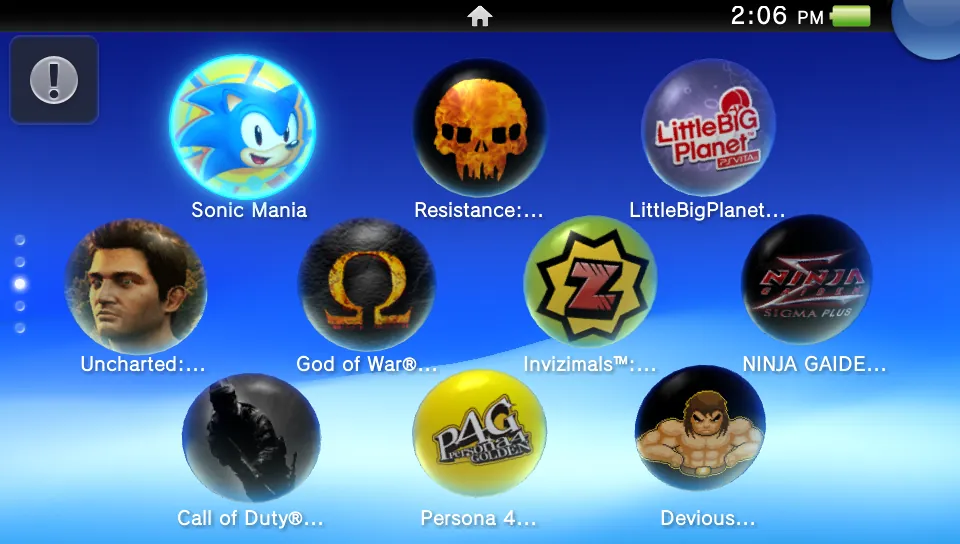

<sub><i>The real PS Vita home screen (the firmware's own <code>shell.self</code>) listing installed games, running in VitaSharp.</i></sub>

<br><br>

[Screenshots](#screenshots) ·
[Features](#features) ·
[Compatibility](#compatibility) ·
[Quick start](#quick-start) ·
[Usage](#usage) ·
[Building](#building-and-packaging) ·
[Architecture](#architecture) ·
[Contributing](#contributing)

</div>

---

## About

VitaSharp emulates the Sony PlayStation Vita on a desktop PC. It runs the console's ARMv7 code with an interpreter
and native JIT compilers, translates the Vita's SGX543 GPU shaders to Vulkan, and reimplements the system libraries
that games call (high-level emulation, HLE). With the official firmware installed, it also boots the Vita's own
system software: the lock screen, the home screen, LiveAreas, and games launched from them.

The whole emulator is managed C#: no native emulation core, no C++ toolchain. It is a research project in active
development. Many commercial games reach gameplay; others still stop in menus or at boot.

> [!IMPORTANT]
> VitaSharp does not include any game, firmware or Sony code. You must dump your own games and licenses from a
> console you own, and download the system update yourself from PlayStation's site. Piracy is not supported.

## Screenshots

### Games

<table>
<tr>
<td width="33%">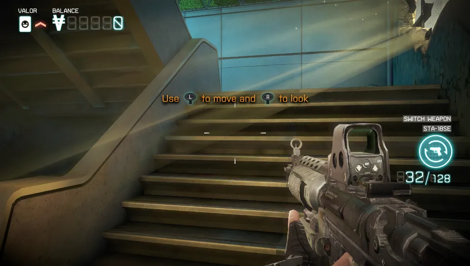<br><sub><b>Killzone: Mercenary</b>, campaign</sub></td>
<td width="33%">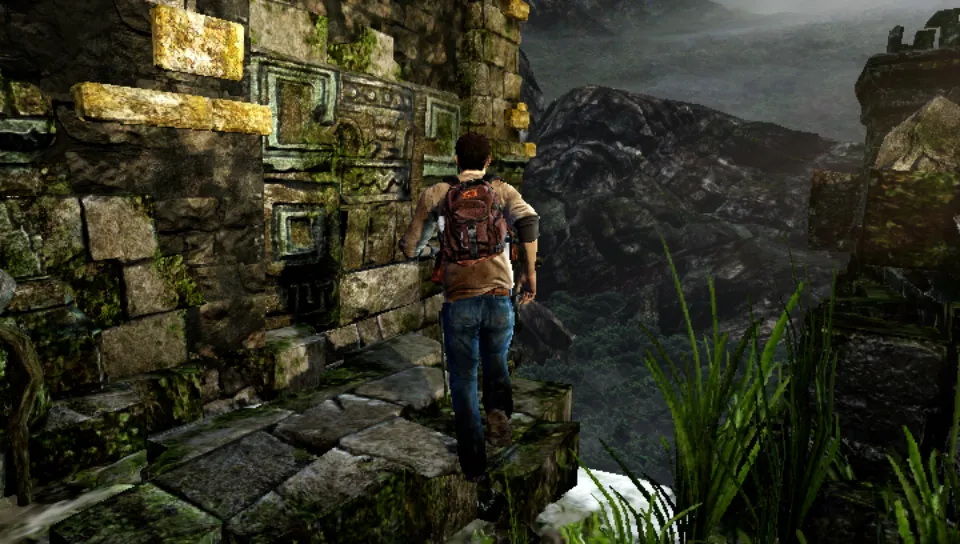<br><sub><b>Uncharted: Golden Abyss</b>, first level</sub></td>
<td width="33%">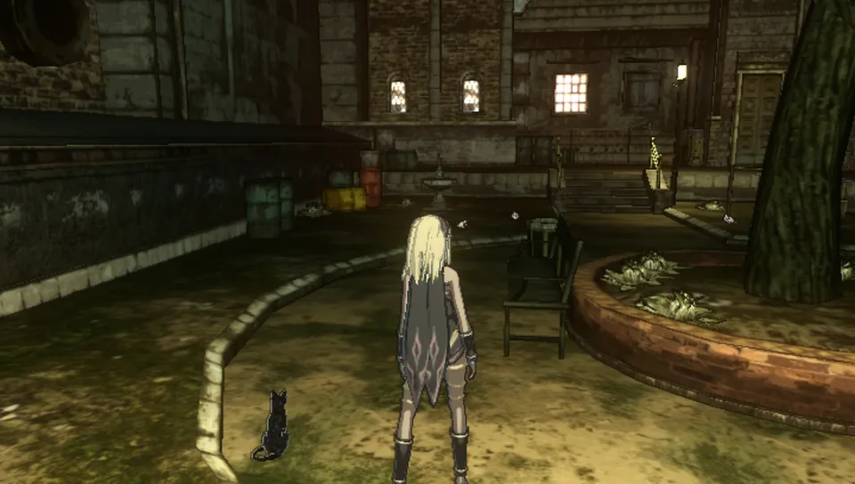<br><sub><b>Gravity Rush</b>, opening</sub></td>
</tr>
<tr>
<td><br><sub><b>God of War Collection</b>, combat</sub></td>
<td>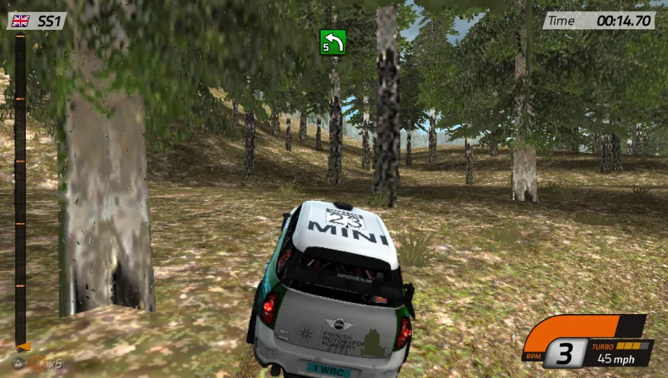<br><sub><b>WRC 4</b>, special stage</sub></td>
<td>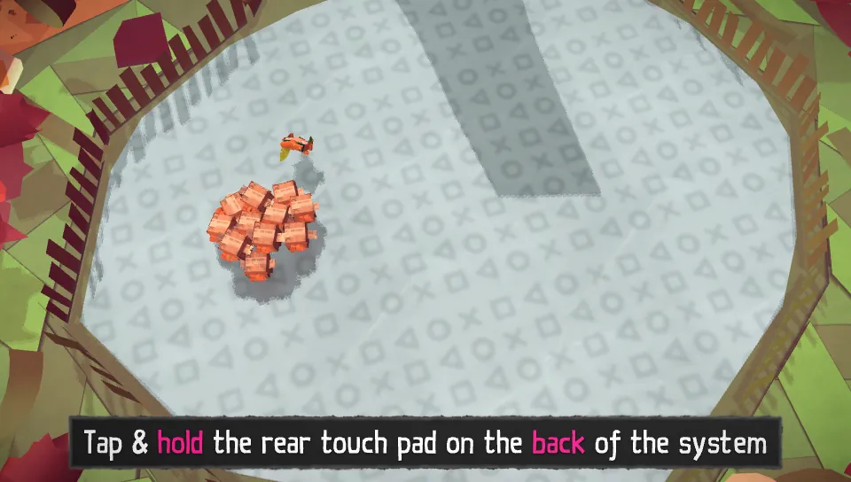<br><sub><b>Tearaway</b>, first papercraft tutorial</sub></td>
</tr>
<tr>
<td><br><sub><b>Persona 4 Golden</b>, opening movie</sub></td>
<td>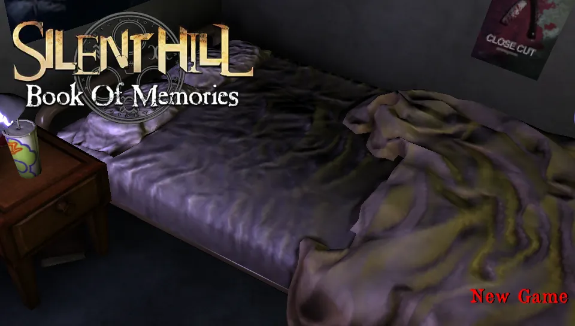<br><sub><b>Silent Hill: Book of Memories</b>, title</sub></td>
<td>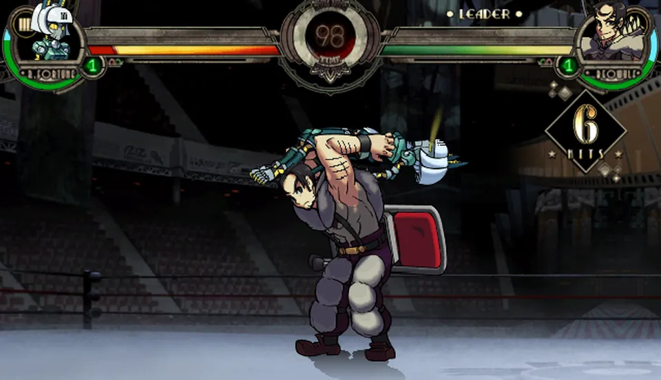<br><sub><b>Skullgirls 2nd Encore</b>, fight</sub></td>
</tr>
</table>

<sub>More games in <a href="docs/compatibility.md">docs/compatibility.md</a>.</sub>

### The PS Vita system

The firmware's own programs, not a recreation: `shell.self` from an installed system update, with games running
next to it as separate processes.

<table>
<tr>
<td width="33%">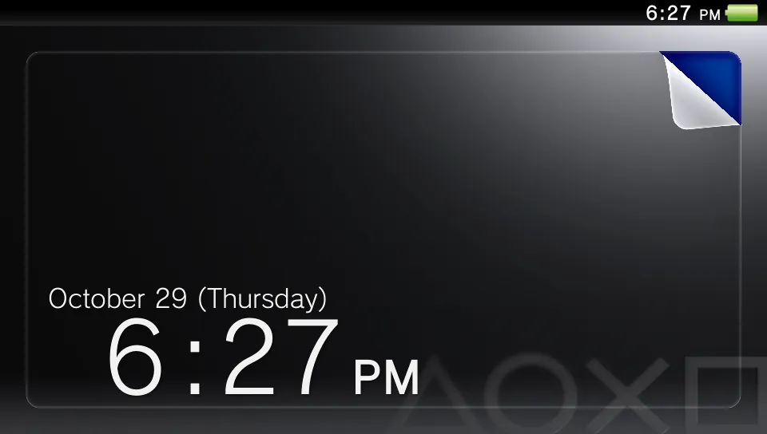<br><sub><b>1.</b> Lock screen (peel the corner to unlock)</sub></td>
<td width="33%">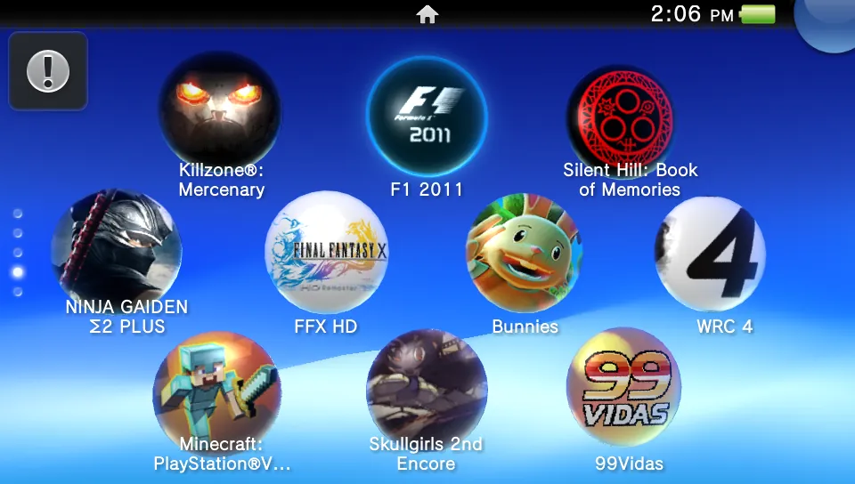<br><sub><b>2.</b> Home screen with the installed games</sub></td>
<td width="33%">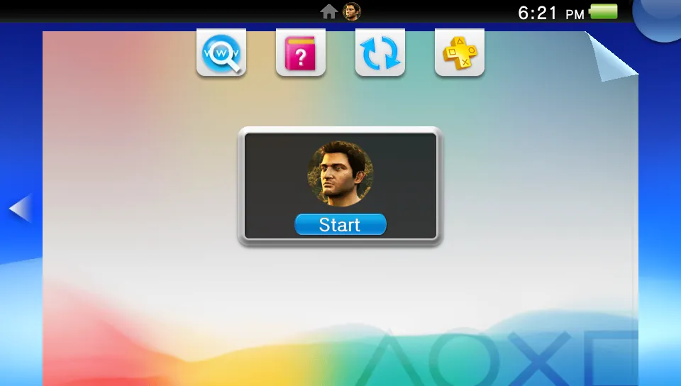<br><sub><b>3.</b> A game's LiveArea</sub></td>
</tr>
<tr>
<td>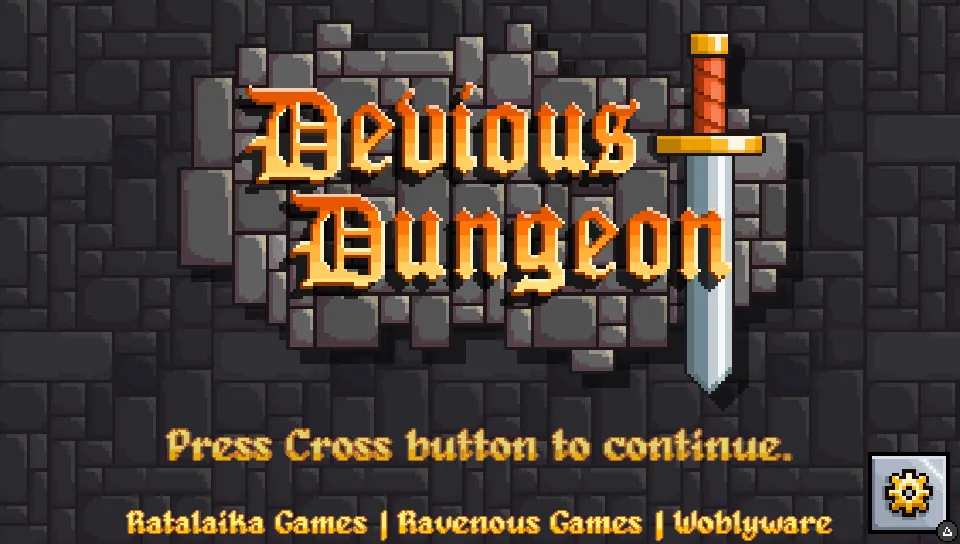<br><sub><b>4.</b> Start: the game runs as a second process</sub></td>
<td>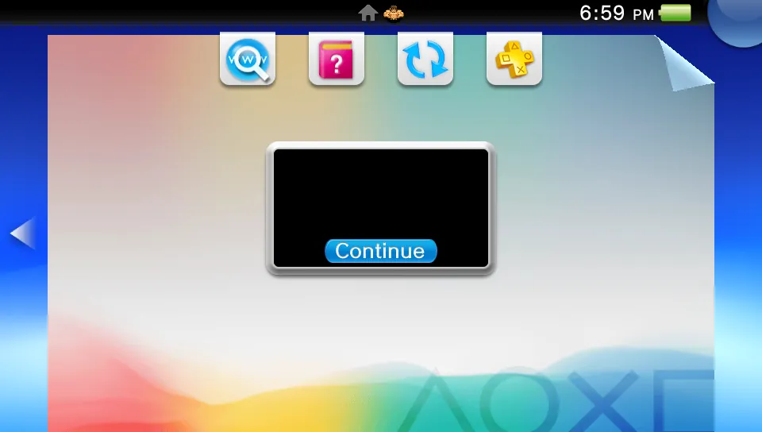<br><sub><b>5.</b> PS button: the game is suspended, Continue resumes it</sub></td>
<td>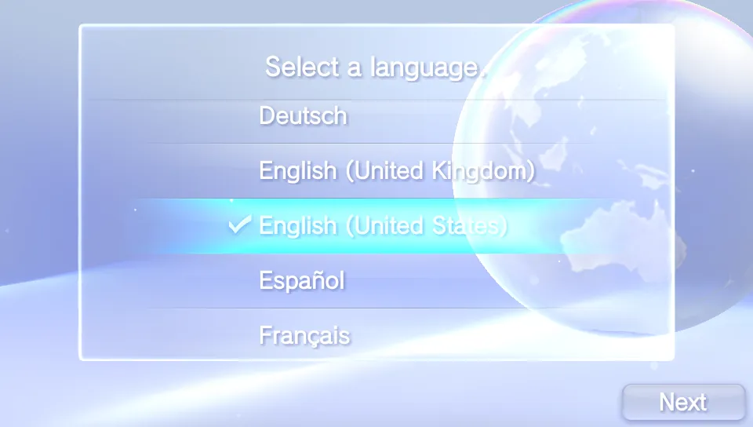<br><sub><b>6.</b> First-boot setup (<code>initialsetup.self</code>)</sub></td>
</tr>
</table>

<details>
<summary>The game library (launcher)</summary>

<div align="center">


<sub><i>The launcher: install VPKs and PKGs, browse installed titles and their trophies, configure, and launch.</i></sub>
</div>
</details>

## Features

**CPU**
- ARMv7 Thumb-2 / A32 interpreter with VFPv3 and NEON, fuzzed against [Unicorn](https://www.unicorn-engine.org/)
- Native JIT backends for **x86-64** and **ARM64** hosts (picked automatically), plus an IL backend (`DynamicMethod`s)
  and the interpreter as fallbacks
- Multi-core guest scheduler with configurable CPU speed and pacing

**Graphics**
- SceGxm reimplemented on a Vulkan 1.3 renderer; USSE shaders translated to GLSL, then SPIR-V (shaderc)
- Texture decoding for Vita formats (PVRTC, BC, swizzled and tiled layouts), real MSAA, persistent shader and
  pipeline cache with background compilation
- A capability and quirk layer for mobile GPUs (Adreno, Mali), prepared for the Android port
  ([`docs/notes/mobile-gpu.md`](docs/notes/mobile-gpu.md))

**System**
- Over 1,100 system functions reimplemented (kernel, threads, I/O, Gxm, audio, NGS, network, NP, dialogs...)
- Game-shipped modules (`libc`, `libfios2`, `libult`...) and firmware modules (`libSceJson`, `libSceXml`,
  `libSceSqlite`, system fonts) loaded natively (LLE)
- SELF decryption, VPK and PKG installation with `work.bin` / `.rif` licenses, save data and common dialogs
- Firmware installer for the official `PSVUPDAT.PUP` (or an existing Vita3K firmware)

**The real PS Vita system**
- Boots the firmware's `shell.self`: lock screen, home screen with the installed games, LiveArea, first-boot setup
- Multiple processes in one emulated kernel: games start from their LiveArea next to the shell; the PS button
  suspends a game and brings back the shell, Continue resumes it
- Status and remaining work in [`docs/notes/system-apps.md`](docs/notes/system-apps.md)

**PSN, trophies and network**
- An emulated, signed-in PSN account and local PSN services: Cross-Save (TUS), rankings, game data and tickets
  stored on disk ([`docs/notes/online-features.md`](docs/notes/online-features.md))
- Trophies: unlock notifications in the game window and per-game progress in the launcher
- Optional real internet for game sockets, DNS and HTTP(S) (off by default, Sony's servers stay blocked), and
  Score / TUS through an [RPCN](https://github.com/RipleyTom/rpcn) server

**Media and input**
- ATRAC9 audio decoder and NGS audio engine, output through OpenAL
- H.264 video (SceVideodec / SceAvPlayer) and MP3 / AAC through FFmpeg
- Keyboard and gamepads (SDL2) with a remapping screen, front / rear touch, motion sensors from controller gyros, and
  the webcam as the Vita camera

**Diagnostics**
- F10 captures a frame with its draws, textures, targets and log; F9 debug mode keeps a replay ring and catches
  anomalies (NaN/Inf, blown-out frames) automatically ([`docs/notes/debug-mode.md`](docs/notes/debug-mode.md))
- F8 records a GPU dump that replays offline, draw by draw, without the game
  ([`docs/notes/gpu-dump.md`](docs/notes/gpu-dump.md))
- Headless test scenarios with scripted input, frame dumps, contact sheets and metrics

**Platforms**
- Windows, Linux (x64, ARM64) and macOS; self-contained ReadyToRun or Native AOT builds, packaged as zip, installer,
  tar.gz, AppImage, `.app` and `.dmg`

## Compatibility

26 games (25 commercial titles and one homebrew port) have been tested so far: 19 reach gameplay and the rest reach their
menus. The full table (status, notes and the test scenario of each game) and more screenshots are in
[`docs/compatibility.md`](docs/compatibility.md). Known bugs and future work are in the [roadmap](docs/roadmap.md).

## Quick start

1. Install the [.NET 10 SDK](https://dotnet.microsoft.com/download/dotnet/10.0) and a Vulkan 1.3 driver
   (see [Requirements](#requirements)).
2. Build and start the launcher:

   ```sh
   git clone <repository-url> VitaSharp
   cd VitaSharp
   dotnet run --project src/VitaSharp.Desktop -c Release
   ```

3. In the game library, use **Add game ▾**: **Install VPK…**, **Install PKG…** (the package with its `work.bin` or
   `.rif` license) or **Add game folder…** for an already-extracted game, then press **Play**.
4. Optional: install the official firmware (see [Firmware](#firmware-optional)) to get the system fonts and
   libraries and the real PS Vita system (**Sistema do Vita**).

Ready-made packages for each platform are built by CI (see [Publish](#publish)).

## Usage

### Command line

The same executable has a command-line mode, handy for testing and debugging:

| Command | Description |
| --- | --- |
| *(no arguments)* | Open the game library window |
| `install <game.vpk>` / `install <game.pkg> <work.bin\|.rif>` | Install a VPK or a package into the virtual `ux0:` |
| `run <TITLEID\|folder> [options]` | Boot a title directly |
| `boot-shell [options]` | Boot the real PS Vita system (needs the firmware, see [The PS Vita system](#the-ps-vita-system)) |
| `test <scenario.txt> [options]` | Run an automated scenario: frames, contact sheet and report (`run` options given here override the scenario's `args=`) |
| `imports <TITLEID\|folder>` | List the system functions a title imports and which ones are still missing |
| `self2elf <in> <out> [license]` | Decrypt a SELF executable to ELF |
| `install-firmware <PSVUPDAT.PUP\|folder\|--vita3k>` | Install the official firmware into `fs/` (see [Firmware](#firmware-optional)) |
| `firmware-info`, `firmware-verify [fs root]` | Show and check the installed firmware |
| `replay-gpu <dump.vsgd>` | Replay a GPU dump (see [Diagnostics](#diagnostics)) |
| `pad-test` | List the connected controllers and print their mapped input |

Common `run` options:

| Option | Effect |
| --- | --- |
| `--fullscreen`, `--scale <n>` | Window mode and size |
| `--no-vsync` | Uncap presentation |
| `--no-jit` | Interpreter only |
| `--cores <n>`, `--cpu-mhz <n>`, `--speed <x>` | Guest CPU cores, pacing and speed |
| `--cpu=native\|il\|interp` | CPU backend (default: the best one this PC supports; `native` is x86-64 or ARM64 code) |
| `--shaderc-opt=zero\|size\|perf` | Shader optimisation level. `zero` (default) compiles ~6x faster and stutters far less when new shaders appear, with no measured GPU cost (launcher: *Compilação rápida de shaders*) |
| `--async-shaders=on\|off` | Translate and compile new shaders and build their pipelines on worker threads as soon as the game submits them (default on; launcher: *Compilar shaders e pipelines em segundo plano*). `--async-pipelines=off` keeps only the shader part, `--shader-workers=<n>` sets the pool size (default: half the logical processors, 1-6) |
| `--headless`, `--seconds <n>`, `--frames <n>` | Run without a window for a fixed time or number of frames |
| `--input <script>` | Scripted input, e.g. `start@f3400,cross@f3600` |
| `--dump-frames`, `--dump-every <n>` | Save rendered frames to disk |
| `--audio-dump <dir>` | Write what the game sends to each audio port (after port volume) as one WAV per port, independent of the audio device |
| `--trace-hle`, `--trace-hle-only <a+b>` | Log system calls |
| `--validation` | Enable the Vulkan validation layers |
| `--debug-mode` | Start in debug mode (same as F9, see [Diagnostics](#diagnostics)) |
| `--gpu-profile=adreno\|mali\|desktop` | Emulate a mobile GPU's limits and driver quirks on a desktop GPU |
| `--lle-modules=<libs>`, `--hle-modules=<libs>` | Firmware libraries to load LLE instead of HLE, or to keep on HLE (see [Firmware](#firmware-optional)) |
| `--psn=on\|off`, `--psn-id=<id>`, `--psn-local=on\|off` | Emulated PSN account (signed in by default) and the local PSN services (TUS / Cross-Save, rankings, tickets) |
| `--net=off\|real` | Real internet for game sockets, DNS and HTTP(S). **Off by default**: nothing leaves the PC. With `real`, Sony's PSN servers stay blocked (and logged); `--net-allow=<hosts>` limits traffic to the listed hosts (launcher: *Internet real*) |
| `--rpcn=<host[:port]>`, `--rpcn-user=<name>` | With `--net=real`, send Score and TUS to an [RPCN](https://github.com/RipleyTom/rpcn) server (RPCS3's open PSN replacement); the password is read from `VITASHARP_RPCN_PASSWORD` |
| `--log <file>`, `--debug` | Log destination and verbosity |

### Firmware (optional)

Games run without any Sony firmware: VitaSharp implements the system libraries itself. A few libraries are not
reimplemented (`SceLibXml`, `SceSqlite`), and the system fonts are Sony files. For those, and for the real PS Vita
system, install the official system update you downloaded from PlayStation's site (`PSVUPDAT.PUP`):

- launcher: **Configurações > Geral > Firmware > Instalar firmware (.PUP)…** (progress bar, can be cancelled), or
  **Usar firmware do Vita3K** when a Vita3K installation with firmware is found (its `os0`/`vs0`/`sa0`/`pd0` are
  copied, never linked);
- command line: `install-firmware <PSVUPDAT.PUP>` (or `install-firmware --vita3k`, or a folder that holds an installed
  firmware), `firmware-info`, `firmware-verify [other fs root]`.

The partitions are extracted into `fs/os0`, `fs/vs0`, `fs/sa0` and `fs/pd0` (the same layout Vita3K uses) and the
version goes to `fs/firmware.json`. The system update holds `os0` and `vs0`; the fonts (`sa0:data/font`) come in the
separate font package, another `.PUP` installed the same way (it is merged into `sa0` and keeps the installed version).

With the firmware installed, `sceSysmoduleLoadModule` loads `libSceJson`, `libSceXml` and `libSceSqlite` from
`vs0:sys/external` (the log shows `Loaded module SceLibJson (vs0:sys/external/libSceJson.suprx)`), and ScePgf/ScePvf
find the system fonts. Without the firmware, `libSceJson` runs on its HLE replacement (checked against the firmware
module); Xml and Sqlite have none. Libraries VitaSharp implements (`libfiber`, `libult`, `libsas`, `libatrac`) stay on
HLE unless the game ships its own copy; `--lle-modules=libsas,...` (`VITASHARP_LLE_MODULES`) loads the firmware's copy
instead, and `--hle-modules=json,...` (file or short names, `VITASHARP_HLE_MODULES`, launcher *Manter em HLE*) keeps a
library on HLE even when a module is available.

### The PS Vita system

With the firmware installed, the launcher's **Sistema do Vita** button (or `boot-shell`) boots the console's own
shell, `vs0:vsh/shell/shell.self`, in the emulator window. On the first boot it runs the firmware's setup
(language, time zone, date...); after that it shows the lock screen and the home screen. VitaSharp writes the same
`ux0:appmeta` entries the Vita's package installer does, so the shell finds the installed games itself and builds its
own database. Starting a game from its LiveArea runs it as a second process of the same emulated system; the PS
button (the controller's PS / guide button, or the **Home** key) suspends it and returns to the shell, and
**Continue** resumes it.

Still missing: games whose executable is linked at fixed addresses (for example Persona 4 Golden) cannot run next to
the shell yet, the Trophy Collection and Settings apps start but do not draw their contents, and a few system
services are stubs. Details in [`docs/notes/system-apps.md`](docs/notes/system-apps.md).

### PSN and online

Games see a signed-in PSN account, so login checks pass. Local PSN services answer from disk what a server would:
Cross-Save and per-user data (TUS), rankings and game data, tickets and DLC entitlements for installed add-ons.
Trophies unlock into `ux0:user/00/trophy/` with a notification in the game window, and the launcher shows each
game's progress. Online multiplayer and other players' data need a real server; real internet is opt-in
(`--net=real`) and RPCN can serve Score and TUS. Per-game survey in
[`docs/notes/online-features.md`](docs/notes/online-features.md), API details in [`docs/hle/E2-np.md`](docs/hle/E2-np.md).

### Controls

| PS Vita | Keyboard |
| --- | --- |
| D-pad | Arrow keys |
| Cross / Circle / Square / Triangle | `X` (or `Space`) / `C` / `Z` / `V` |
| L / R | `Q` / `E` |
| Start / Select | `Enter` / `Backspace` |
| Left stick | `W` `A` `S` `D` |
| Right stick | `I` `J` `K` `L` |
| Front touch / rear touch | Left / right mouse button |
| PS button | `Home` |
| Fullscreen | `F11` |

These are the defaults. Gamepads are detected automatically (including hot-plug) through SDL2 and its controller
database: the layout is positional, so the bottom face button is Cross on Xbox, PlayStation and Nintendo pads alike,
both bumpers and triggers act as L / R, the PS / Xbox / Home button is the PS button, and a DualShock 4 / DualSense
touch pad touches the front screen (the rear pad while L2 is held, both while R2 is held). Controller gyros feed the
Vita's motion sensors.

**Settings > Controles** in the launcher shows a live drawing of the Vita's controls for the keyboard or the selected
controller (pressed buttons light up, the stick dots move inside their deadzone ring) and remaps any control: click it,
then press a button, move a stick or press a key. Per controller: swap Cross / Circle, deadzone, sensitivity and
invert Y per stick, a button or key held as a front / rear touch at a chosen point, reset to default. Profiles are kept
per controller (GUID, then name) in `input.json` in the data folder and load automatically when that controller
connects; extra SDL mappings can be added in `<data>/gamecontrollerdb.txt`. `pad-test` lists the connected
controllers and prints their mapped input. Details in [`docs/notes/controller-config.md`](docs/notes/controller-config.md).

### Diagnostics

| Key | Action |
| --- | --- |
| `F10` | Capture a diagnostic: the next frame's draws, textures, render targets, screenshot and log, saved to `diagnostics/` (folder and `.zip`) |
| `F9` | Toggle debug mode: a replay ring of the last frames, NaN/Inf and anomaly checks, automatic captures when something looks wrong |
| `F8` | Start / stop a GPU dump (`gpudumps/*.vsgd`); `replay-gpu` reproduces it draw by draw without the game |

Every session writes `logs/last.log` (older sessions are kept by date and title), and a watchdog logs hangs and
stalls. When reporting a bug, an F10 capture or a GPU dump of the problem is the most useful attachment. Details in
[`docs/notes/debug-mode.md`](docs/notes/debug-mode.md) and [`docs/notes/gpu-dump.md`](docs/notes/gpu-dump.md).

### Data folder

Everything the emulator writes lives in one data folder (override with the `VITASHARP_DATA` environment variable or
`--data=<folder>`):

| Platform | Default data folder |
| --- | --- |
| Windows | `%APPDATA%\VitaSharp` |
| Linux | `$XDG_DATA_HOME/VitaSharp`, i.e. `~/.local/share/VitaSharp` by default |
| macOS | `~/Library/Application Support/VitaSharp` |

The Vita's file systems ignore case and so does VitaSharp, also on case-sensitive Linux/macOS file systems: games
that open `Media/Data.bin` as `media/DATA.BIN` find it.

```text
VitaSharp/
├── fs/            virtual Vita file system (ux0:, vs0:, ...), installed games in fs/ux0/app/<TITLEID>
│                  and the installed firmware in fs/os0, vs0, sa0, pd0 (version in fs/firmware.json)
├── shadercache/   translated shaders
├── logs/          last.log of the most recent run, older sessions by date
├── diagnostics/   F10 and automatic captures
├── gpudumps/      F8 GPU dumps
└── tests/         output of automated scenarios
```

## Building and packaging

### Requirements

| | Windows | Linux | macOS |
| --- | --- | --- | --- |
| OS | Windows 10 or 11, x64 | x64 or ARM64, glibc distribution (X11 or Wayland) | a macOS release supported by .NET 10, Apple Silicon or Intel |
| GPU | Vulkan 1.3 driver (any recent NVIDIA, AMD or Intel GPU) | Vulkan 1.3 driver: Mesa (RADV, ANV, NVK), NVIDIA, or lavapipe (software, slow) | Vulkan through [MoltenVK](https://github.com/KhronosGroup/MoltenVK) 1.3 or later |
| Vulkan loader | ships with the GPU driver | `libvulkan1` (`sudo apt install libvulkan1 mesa-vulkan-drivers`) | [LunarG Vulkan SDK](https://vulkan.lunarg.com/sdk/home#mac) (system-wide install) or `brew install molten-vk vulkan-loader` |
| FFmpeg | downloaded at build time | downloaded at build time | `brew install ffmpeg` |
| SDK (to build) | [.NET 10 SDK](https://dotnet.microsoft.com/download/dotnet/10.0) | .NET 10 SDK | .NET 10 SDK |

A modern multi-core CPU is recommended: the guest runs on several host threads.

Platform status: Windows is the most tested platform. Linux x64 is tested on Debian 12 (unit tests, headless and
windowed runs on X11 and Wayland, Mesa lavapipe). macOS (x64 and Apple Silicon) builds and publishes, but has not been
run on a Mac yet; reports are welcome.

<details>
<summary>Native libraries and FFmpeg</summary>

The first build downloads FFmpeg 8.1 (LGPL) for the target platform, checks its SHA-256 and copies it to an `ffmpeg`
folder next to the executable; later builds reuse the cached copy. Windows and Linux (x64 and ARM64) get prebuilt
libraries; there is no prebuilt macOS build, so VitaSharp uses Homebrew's (`/opt/homebrew/lib`, `/usr/local/lib`) or
the folder named by `VITASHARP_FFMPEG`. To build offline, pass `-p:VitaSharpSkipFFmpeg=true` (videos and MP3/AAC
audio are then disabled). Details in [`third_party/ffmpeg`](third_party/ffmpeg/README.md).

Other native libraries come from NuGet for every platform: GLFW (window), OpenAL Soft (audio), SDL2 (game
controllers), shaderc (shader compiler), Skia (launcher UI). Without SDL2 the keyboard still works and gamepads fall
back to GLFW (no touch pads, no hot-plug list in the settings). The webcam (SceCamera) uses DirectShow / Media
Foundation on Windows, V4L2 on Linux and AVFoundation on macOS; without a camera, or when access is denied, games get
"no camera".

</details>

### Build

```sh
git clone <repository-url> VitaSharp
cd VitaSharp
dotnet build -c Release
```

The same command works on all three systems.

### Run

```sh
dotnet run --project src/VitaSharp.Desktop -c Release
```

The game library opens (see [Quick start](#quick-start)).

<details>
<summary>Platform notes (Linux, macOS)</summary>

- **Linux**: desktop installs already have the client libraries VitaSharp loads; on a minimal system (servers,
  containers, WSL) install them with
  `sudo apt install libvulkan1 mesa-vulkan-drivers libx11-6 libxcursor1 libxrandr2 libxi6 libxinerama1 libice6 libsm6 libfontconfig1 libxkbcommon0 libwayland-client0 libwayland-cursor0 libpulse0`
  (Avalonia needs libICE/libSM, GLFW the X11 or Wayland ones, OpenAL Soft libpulse or ALSA). The game window
  (GLFW) runs on Wayland when its libraries are present and on X11/XWayland otherwise;
  `VITASHARP_GLFW_PLATFORM=x11` or `=wayland` forces one. `vulkaninfo --summary` (package `vulkan-tools`) shows which
  driver will be used; with several, pick one with `VK_DRIVER_FILES` (`VK_ICD_FILENAMES` on older loaders).
- **macOS**: VitaSharp needs a Vulkan loader with MoltenVK. If it lives in a folder the dynamic linker does not search
  (Homebrew on Apple Silicon, or an SDK used in place through `VULKAN_SDK`), VitaSharp restarts itself once with that
  folder on `DYLD_FALLBACK_LIBRARY_PATH`. `VITASHARP_VULKAN_LIB=/path/to/libvulkan.1.dylib` (or `libMoltenVK.dylib`)
  forces a specific library. Metal lacks a few Vulkan features the Vita GPU uses; VitaSharp logs them at startup
  ("Vulkan portability subset") and falls back: no sampler LOD bias, wireframe/point fill drawn filled.
- Any platform: `VITASHARP_DATA=<folder>` or `--data=<folder>` moves the data folder.

</details>

### Publish

Self-contained single-file builds (no .NET install needed to run them), ReadyToRun-compiled, for any platform from
any host:

```sh
build/publish.sh                        # all: win-x64 linux-x64 linux-arm64 osx-x64 osx-arm64
build/publish.sh linux-x64 osx-arm64    # some
```

```powershell
build\publish.ps1 -Rid win-x64,linux-x64
```

Each platform lands in `artifacts/publish/<rid>/`: the `VitaSharp.Desktop` executable, the native libraries next to
it, and FFmpeg in `ffmpeg/`. macOS builds made on another OS are not code-signed; on the Mac, run
`codesign --force --sign - VitaSharp.Desktop` (and `xattr -dr com.apple.quarantine .` for downloaded copies) before
starting them. To get ready-to-ship archives, installers and app bundles instead of a folder, see
[Packages](#packages).

<details>
<summary><b>Native AOT</b>: a native executable, faster start, smaller download</summary>

#### Native AOT

`--aot` / `-Aot` compiles the whole application ahead of time into a native executable instead of shipping IL plus
ReadyToRun code: no JIT at run time, faster start, a smaller download and less memory.

```sh
build/publish.sh --aot linux-x64        # on Linux
build/publish.sh --aot osx-arm64        # on macOS (osx-x64 too)
```

```powershell
build\publish.ps1 -Aot -Rid win-x64     # on Windows
```

Native AOT cannot cross-compile between operating systems: each platform is built on its own OS (CI builds win-x64,
linux-x64, linux-arm64, osx-x64 and osx-arm64 on matching runners). For a platform the host cannot build, the scripts
print a warning and publish ReadyToRun instead. Prerequisites besides the .NET 10 SDK:

| Host | Needs |
| --- | --- |
| Windows | MSVC C++ build tools: Visual Studio 2022 (or its Build Tools) with *Desktop development with C++* |
| Linux | `clang` (or `gcc`, picked automatically when clang is missing; tested on Debian 12 / WSL) and `zlib1g-dev` (`sudo apt install clang zlib1g-dev`); Linux AOT builds the host's own architecture |
| macOS | Xcode command-line tools (`xcode-select --install`) |

The output folder has the same layout as a ReadyToRun build (native libraries and `ffmpeg/` next to the executable);
debug symbols (`.pdb`, `.dbg`, `.dSYM`) are moved to `artifacts/publish/<rid>-symbols/`. The underlying switch is
`dotnet publish src/VitaSharp.Desktop -c Release -r <rid> -p:VitaSharpRelease=true -p:VitaSharpAot=true`.

Measured on Windows x64 (October 2026, same machine and shader cache):

| | ReadyToRun | Native AOT |
| --- | --- | --- |
| Executable | 139 MB | 38 MB (+131 MB symbols, kept apart) |
| Folder (with FFmpeg and native libraries) | 288 MB | 187 MB |
| Launcher window shown | ~640-735 ms | ~355 ms |
| CLI start to exit (`imports`) | ~285-365 ms | ~165 ms |
| Launcher working set | ~175 MB | ~135 MB |
| Killzone `kz_skin` (4500 frames) | 28.8 fps, 153 s process CPU, 1162 MB working set | 28.9 fps, 147 s process CPU, 1092 MB working set |

Known limitations of AOT builds:

- The `il` CPU backend (one .NET `DynamicMethod` per guest block) needs Reflection.Emit, which Native AOT does not
  have. `--cpu=il` / `VITASHARP_CPU=il` logs why and falls back to the best available backend, and the launcher does
  not offer it. The `native` backends (x86-64 and ARM64) and the interpreter are unaffected.
- Webcams on Windows are opened through Media Foundation (or Video for Windows) only: DirectShow, which ReadyToRun
  builds prefer, relies on runtime-generated COM interop.
- Remaining third-party trim warnings during the AOT publish, all harmless for VitaSharp:
  `Silk.NET.Windowing.Common` / `Silk.NET.Input.Common` (IL2104: the reflection-based platform auto-detection; VitaSharp
  registers GLFW explicitly with `GlfwWindowing.RegisterPlatform()` / `GlfwInput.RegisterPlatform()`), and IL3000 /
  IL3002 from `Silk.NET.Core.Loader.DefaultPathResolver` and `Microsoft.Extensions.DependencyModel` (`Assembly.Location`
  and the `.deps.json` lookup are empty in a single-file app; Silk.NET then searches `AppContext.BaseDirectory`, where
  the native libraries are). The analyzers run on every normal build, so new AOT problems in VitaSharp's own code show
  up as build warnings right away.

</details>

### Packages

`--package` / `-Package` also packs the published folder for distribution, one command per platform. Both build
types (ReadyToRun and `--aot`) are self-contained: the .NET runtime is inside the executable, and the target machine
needs no .NET install.

```sh
build/publish.sh --package linux-x64                 # tar.gz + AppImage
build/publish.sh --aot --package osx-arm64           # on a Mac: VitaSharp.app (zip + dmg)
VERSION=0.2.0 build/publish.sh --package win-x64     # file names carry the version (default: dev)
```

```powershell
build\publish.ps1 -Aot -Package -Rid win-x64 -Version 0.2.0   # zip + installer
```

They land in `artifacts/publish/packages/` (`-SkipPublish` / `--skip-publish` repacks an existing publish folder).
CI builds every package on each push to `main` (ReadyToRun cross-published from Linux, Native AOT on each OS's own
runner) and keeps them as workflow artifacts named `VitaSharp-*-packages`.

<details>
<summary>Package contents, sizes, icons</summary>

| Platform | Package | Contents |
| --- | --- | --- |
| Windows | `VitaSharp-<v>-win-x64.zip` | `VitaSharp\`: `VitaSharp.Desktop.exe` (with the VitaSharp icon), the native DLLs, `ffmpeg\`, `LICENSE`, `README.md` |
| Windows | `VitaSharp-<v>-win-x64-setup.exe` | [Inno Setup](https://jrsoftware.org/isinfo.php) installer (per user or per machine, Start menu and optional desktop shortcut, uninstaller; data in `%APPDATA%\VitaSharp` is kept). Built only when Inno Setup 6 or 7 is found: on PATH, in its default folder, or through `ISCC=<path to ISCC.exe>` (`winget install JRSoftware.InnoSetup`). Script: `build/package/VitaSharp.iss` |
| Linux | `VitaSharp-<v>-linux-<arch>.tar.gz` | `VitaSharp/` with the executable, `.so` libraries, `ffmpeg/`, `vitasharp.desktop`, `icons/` and `install-desktop-entry.sh` (adds VitaSharp to the application menu of the current user) |
| Linux | `VitaSharp-<v>-linux-<arch>.AppImage` | one runnable file (`chmod +x`, then start it; without FUSE: `--appimage-extract-and-run`). Built when [appimagetool](https://github.com/AppImage/appimagetool/releases) is on PATH or named by `APPIMAGETOOL`; it needs the `file` command |
| macOS | `VitaSharp-<v>-osx-<arch>.app.zip` | `VitaSharp.app`: `Info.plist`, `Resources/VitaSharp.icns`, the executable and its dylibs in `Contents/MacOS` (where .NET, Silk.NET and SkiaSharp look for native libraries; the bundled dylibs do not link against each other, so no rpath changes are needed). FFmpeg comes from Homebrew as before |
| macOS | `VitaSharp-<v>-osx-<arch>.dmg` | the same app with an Applications link, made only on macOS (`hdiutil`) |

Linux and macOS packages need Unix file permissions, so `build/publish.ps1` makes only the Windows ones; run
`build/publish.sh --package` on Linux, macOS or WSL for the rest (the `.app` can be assembled on Linux, the `.dmg`
only on a Mac).

Sizes measured in October 2026:

| Package | ReadyToRun | Native AOT |
| --- | --- | --- |
| Windows x64 folder | 292 MB | 190 MB (+140 MB symbols, not packaged) |
| Windows x64 zip | 118 MB | 77 MB |
| Windows x64 installer | | 57 MB |
| Linux x64 tar.gz / AppImage | 122 MB / 112 MB | built by CI |
| macOS arm64 `.app.zip` (no FFmpeg) | 67 MB | built by CI |

Which one to ship: Native AOT starts faster, uses less memory and is about a third smaller, but it must be built on
each target OS and has no `il` CPU backend (see the limitations above; the `native` backends and the interpreter work
the same). ReadyToRun builds keep every backend and can be produced for all platforms from one machine.

The icons come from [`docs/assets/logo.svg`](docs/assets/logo.svg): `build/make-icons.ps1` (or `.sh`) renders it with
Svg.Skia into `src/VitaSharp.Desktop/Assets` (`icon-16.png` to `icon-1024.png`, a multi-size `VitaSharp.ico`,
`VitaSharp.icns`). The output is deterministic and committed, so builds need neither the tool nor its packages; run it
again after changing the logo. The `.ico` is the executable's icon, the PNGs are embedded for the launcher and game
window title bar and taskbar icons, and the `.icns` is the macOS bundle icon.

</details>

<details>
<summary><b>Signing</b>: the packages are not signed</summary>

#### Signing

The packages are not signed.

- **Windows**: SmartScreen warns about an unsigned download ("More info", "Run anyway"). To sign, run
  `signtool sign /fd SHA256 /tr <timestamp-url> /td SHA256 /f <cert.pfx> VitaSharp.Desktop.exe` on the published
  executable before packaging, and the same on the installer. Inno Setup can also do it itself through its `SignTool`
  setting.
- **macOS**: Gatekeeper blocks unsigned downloaded apps. For local use, run `xattr -dr com.apple.quarantine VitaSharp.app`
  (or right-click, Open); on Apple Silicon, code that is not signed at all does not run, so ad-hoc sign it:
  `codesign --force --deep --sign - VitaSharp.app`. To distribute, sign with a Developer ID certificate and the
  hardened runtime, then notarize. Sign the dylibs first and the app last:

  ```sh
  codesign --force --options runtime --timestamp --sign "Developer ID Application: ..." VitaSharp.app/Contents/MacOS/*.dylib
  codesign --force --options runtime --timestamp --entitlements build/package/VitaSharp.entitlements \
           --sign "Developer ID Application: ..." VitaSharp.app
  xcrun notarytool submit VitaSharp.zip --keychain-profile <profile> --wait && xcrun stapler staple VitaSharp.app
  ```

  [`build/package/VitaSharp.entitlements`](build/package/VitaSharp.entitlements) is required with the hardened runtime:
  `com.apple.security.cs.allow-jit` lets the .NET JIT (ReadyToRun builds, and the `il` backend's `DynamicMethod`s) and
  VitaSharp's guest JIT map `MAP_JIT` memory (without it they cannot get executable memory and the app fails),
  `allow-unsigned-executable-memory` covers the x64 backend on Intel Macs,
  `disable-library-validation` lets the app load the bundled third-party dylibs and Homebrew's FFmpeg / MoltenVK,
  `allow-dyld-environment-variables` keeps the `DYLD_FALLBACK_LIBRARY_PATH` restart that finds a Homebrew Vulkan
  loader, and `device.camera` allows SceCamera.
- **Linux**: no signing step; AppImages can carry a GPG signature (`appimagetool --sign`).

</details>

## Architecture

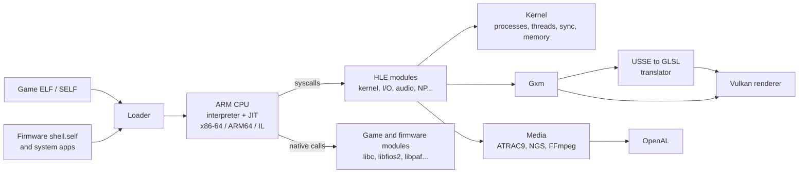

| Project | Role |
| --- | --- |
| [`src/VitaSharp.Core`](src/VitaSharp.Core) | Emulator core: CPU (`Cpu/`, interpreter and JIT backends), memory, kernel and processes, loader and SELF crypto, firmware and registry, Gxm and shader translation, HLE modules (`Hle/`), media |
| [`src/VitaSharp.Renderer.Vulkan`](src/VitaSharp.Renderer.Vulkan) | Vulkan 1.3 backend: draws, textures and formats, swapchain, writeback of render targets, mobile GPU quirks |
| [`src/VitaSharp.Desktop`](src/VitaSharp.Desktop) | Executable: Avalonia game library, window and input, OpenAL audio, command line and test runner |
| [`src/VitaSharp.Android`](src/VitaSharp.Android) | Skeleton of the planned Android port |
| [`tests/VitaSharp.Tests`](tests/VitaSharp.Tests) | Unit tests, including CPU fuzzing against Unicorn |
| [`tests/scenarios`](tests/scenarios) | Automated game scenarios |
| [`docs/hle`](docs/hle/README.md) | Function-by-function specs of the system functions still to implement |
| [`docs/notes`](docs/notes) | Design notes: [native JIT](docs/notes/native-jit.md), [system apps](docs/notes/system-apps.md), [diagnostics](docs/notes/debug-mode.md), [GPU dumps](docs/notes/gpu-dump.md), [mobile GPUs](docs/notes/mobile-gpu.md), [online features](docs/notes/online-features.md), [controllers](docs/notes/controller-config.md) |
| [`docs/android`](docs/android/README.md) | Mockups of the planned Android interface |
| [`docs/roadmap.md`](docs/roadmap.md) | Future work and open bugs |

## Testing

Unit tests:

```sh
dotnet test tests/VitaSharp.Tests
```

The CPU fuzz tests compare the interpreter and the JIT backends with [Unicorn](https://www.unicorn-engine.org/); they
take several minutes, and are skipped where Unicorn's native library is not available (macOS on Apple Silicon) or when
`VITASHARP_SKIP_UNICORN=1` is set. CI ([`.github/workflows/ci.yml`](.github/workflows/ci.yml)) builds and tests on
Windows, Ubuntu and macOS and publishes every platform.

Game scenarios boot a title headless, feed scripted input and write frames, a contact sheet, metrics and a report
to the data folder:

```text
title=PCSE00002
args=--frames=8600 --dump-every=50 --input=start@f3400,cross@f3600
```

```sh
dotnet run --project src/VitaSharp.Desktop -c Release -- test tests/scenarios/f1_drive.txt
```

A scenario's `data=` line is ignored when `--data=<folder>` is given or when that folder does not exist on the
machine, so the same scenarios run on Linux against a copy of the data:
`VitaSharp.Desktop test tests/scenarios/dd_boot.txt --data=$HOME/vitadata`. Headless runs need no display; on a
machine without a GPU, Mesa's lavapipe (`mesa-vulkan-drivers`) renders in software.

## Contributing

Contributions are welcome, from bug reports to new system functions.

1. Pick a function from [`docs/hle`](docs/hle/README.md). Each one has its prototype, expected behaviour, error
   codes and where it goes in the code.
2. Implement it as an `[Hle]` method in `src/VitaSharp.Core/Hle/Modules`. Registration is automatic.
3. Check it with `imports <TITLEID>` and the scenarios of the affected game.
4. Open a pull request describing what changed and which games it affects.

When reporting a bug, attach `logs/last.log` (and an F10 capture if the problem is visible) and say which game (title
ID and version) and which hardware you used.

## Acknowledgements

VitaSharp stands on the work of the PS Vita homebrew and emulation community:

- [Vita3K](https://github.com/Vita3K/Vita3K): the reference for system behaviour, the NID database and the USSE register model
- [VitaSDK](https://vitasdk.org/) and [vita-headers](https://github.com/vitasdk/vita-headers): prototypes and NIDs of the system libraries
- [PS Vita Developer wiki](https://wiki.henkaku.xyz/): hardware and firmware documentation
- [VGAudio](https://github.com/Thealexbarney/VGAudio): the ATRAC9 decoder (MIT)
- [RPCN](https://github.com/RipleyTom/rpcn): the open PSN replacement used for online Score and TUS
- [Silk.NET](https://github.com/dotnet/Silk.NET), [Avalonia](https://avaloniaui.net/) and [FFmpeg](https://ffmpeg.org/)

## License

VitaSharp is free software: you can redistribute it and/or modify it under the terms of the
**GNU General Public License version 3**, as published by the Free Software Foundation. See [LICENSE](LICENSE).

Third-party components keep their own licenses:

| Component | License |
| --- | --- |
| ATRAC9 decoder, from VGAudio (`src/VitaSharp.Core/Hle/Audio/Atrac9`) | MIT |
| FFmpeg (downloaded at build time, see `third_party/ffmpeg`) | LGPL 2.1 or later |
| Silk.NET, Avalonia, FFmpeg.AutoGen (NuGet) | MIT / LGPL, see each package |

PlayStation and PS Vita are trademarks of Sony Interactive Entertainment. VitaSharp is not affiliated with or
endorsed by Sony. Game screenshots and the system software shown belong to their respective owners and are shown
only to document emulation progress.
