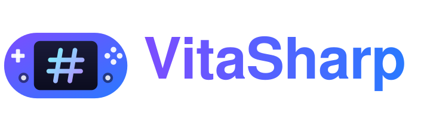
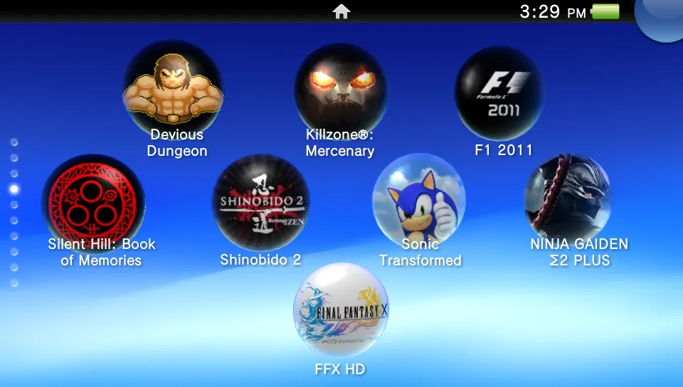
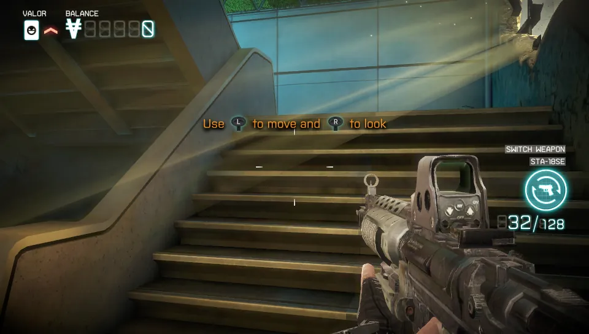
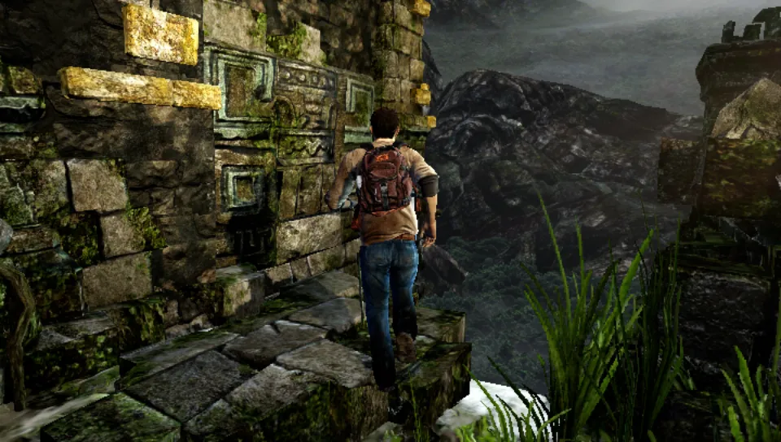
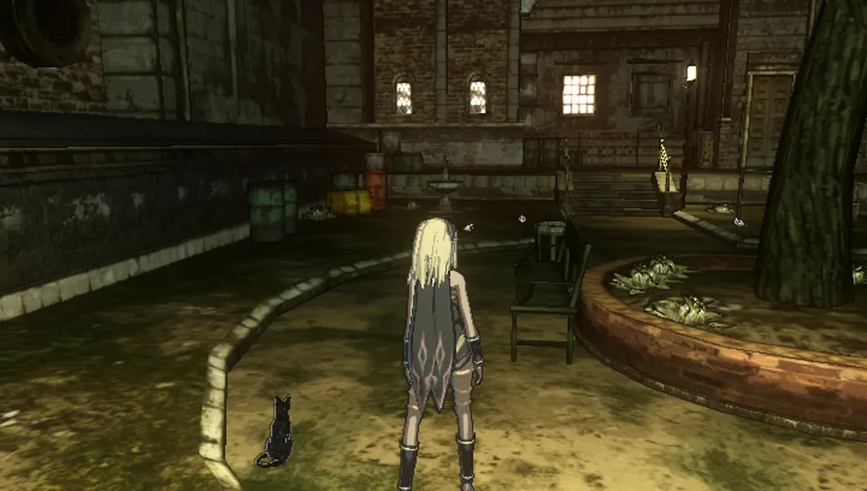
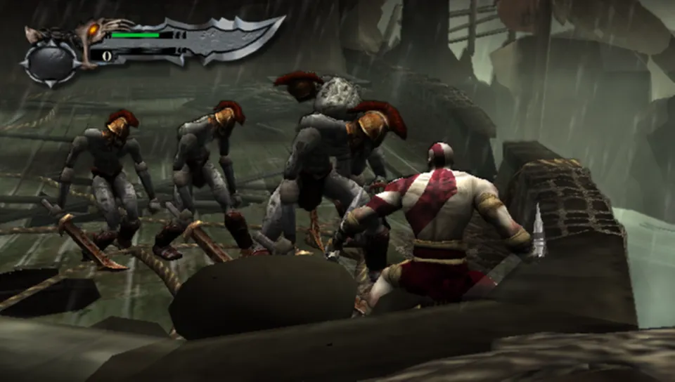
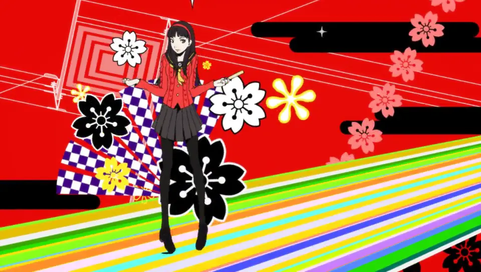
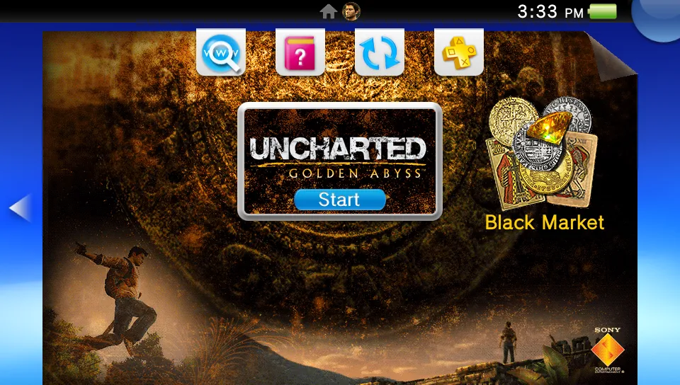
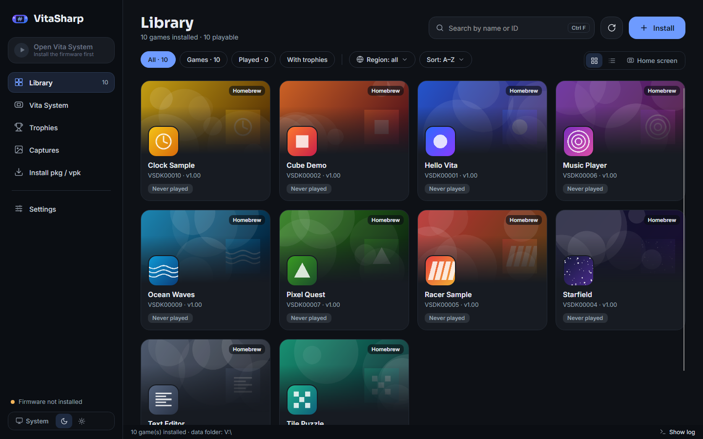
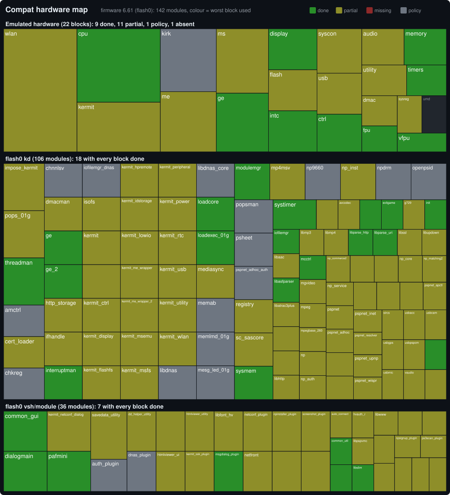

<!-- pair: README.pt-BR.md sha256=0196caa76645f0bc7747307c3bbfb26e3b46af30e4d91a6e78272beec33250bb -->
<div align="center">

**English** | [Português](README.pt-BR.md)



### A PlayStation Vita emulator written in C#

Runs commercial Vita games and the console's own system software, with no native core: an ARMv7 JIT, a Vulkan
renderer and more than 1,100 system functions reimplemented, all in .NET 10.

[](LICENSE)
[](https://dotnet.microsoft.com/)
[](https://www.vulkan.org/)
[](docs/compatibility.md)

<br>



<sub><i>The real PS Vita home screen (the firmware's <code>shell.self</code>) running in VitaSharp.</i></sub>

</div>

---

**Contents:** [Quick start](#quick-start) · [What it is](#what-it-is) · [Current state](#current-state) · [Progress](#progress) ·
[Requirements](#requirements) · [Install](#install) · [Firmware and system fonts](#firmware-and-system-fonts) ·
[Your first game](#your-first-game) · [Controls](#controls) · [Main options](#main-options) ·
[Report a bug](#report-a-bug) · [Where your data lives](#where-your-data-lives) · [Development](#development) ·
[License and credits](#license-and-credits)

## Quick start

1. Download VitaSharp for your system from the **Releases** page ([Install](#install)).
2. Open it: the launcher (your game library) shows up.
3. Click **Install pkg / vpk** and pick a game you dumped from your own console ([Your first game](#your-first-game)).
4. Select the game and press **Play**.
5. Optional: install the official firmware and its font package to get the real Vita home screen
   ([Firmware and system fonts](#firmware-and-system-fonts)).

> [!IMPORTANT]
> VitaSharp includes no games, firmware or Sony code. Use games and licenses dumped from your own console and
> download the system update (`PSVUPDAT.PUP`) from the PlayStation website. Piracy is not supported.

## What it is

VitaSharp emulates the PS Vita on a PC (Windows, Linux, macOS) and on Android phones. It runs the console's ARM code,
translates the Vita GPU's work to Vulkan and reimplements the system libraries games call. With the official firmware
installed it also runs the Vita's own software: the lock screen, the home screen, LiveArea and the games started from
them.

It is a research project in active development. Many games already reach gameplay, but none is guaranteed to run
from start to end, and some do not start yet.

<table>
<tr>
<td width="33%"><br><sub><b>Killzone: Mercenary</b>, campaign</sub></td>
<td width="33%"><br><sub><b>Uncharted: Golden Abyss</b>, first chapter</sub></td>
<td width="33%"><br><sub><b>Gravity Rush</b>, opening</sub></td>
</tr>
<tr>
<td><br><sub><b>God of War Collection</b>, combat</sub></td>
<td><br><sub><b>Persona 4 Golden</b>, opening</sub></td>
<td><br><sub><b>Vita System</b>, a game's LiveArea</sub></td>
</tr>
</table>

<div align="center">
<picture>
  <source media="(prefers-color-scheme: light)" srcset="docs/assets/launcher-light.png">
  
</picture>

<sub><i>The desktop launcher's game library (sample homebrew entries; the light theme follows your GitHub theme).</i></sub>
</div>

<p><b>On Android</b> (Redmi Note 14, Mali-G57):</p>

<table>
<tr>
<td rowspan="3" width="40%" valign="top"><br><sub><b>Library</b>, the app's game list</sub></td>
<td width="60%"><br><sub><b>Killzone: Mercenary</b>, campaign, on-screen controls</sub></td>
</tr>
<tr>
<td width="60%"><br><sub><b>Pause menu</b>, save states and Record everything</sub></td>
</tr>
<tr>
<td width="60%"><br><sub><b>Uncharted: Golden Abyss</b>, the Prologue, 30 fps</sub></td>
</tr>
</table>

## Current state

| Area | State |
| --- | --- |
| **PS Vita games** | 37 tested: 24 reach gameplay (Killzone: Mercenary, Uncharted: Golden Abyss, Gravity Rush, God of War Collection, FIFA 13, Persona 4 Golden, LittleBigPlanet, Tearaway, WRC 4, Skullgirls, Devious Dungeon...), 12 reach the menus, 1 not confirmed. Full list: [compatibility](docs/compatibility.md) |
| **Vita System** (the real home screen) | Works with the firmware installed: initial setup, lock screen, home screen, LiveArea, starting and resuming games ([details](docs/notes/system-apps.md)) |
| **Windows** (x64) | The most tested platform: launcher, game window, Vita System, every diagnostic tool |
| **Linux** (x64) | Builds and runs; tested on Debian 12 |
| **macOS** (Apple silicon) | Builds and packages; not tested on a Mac yet |
| **Android** (arm64) | Its own app; tested on a Redmi Note 14 (Mali-G57). Performance is the main work in progress ([Android](docs/user-guide.md#android)) |
| **PSP and PSone games** | In progress: the PSP CPU core is written and the Vita's own PSP emulator is being brought up, but PSP and PSone games do not run yet; Adrenaline does not get past its start yet ([PSP notes](docs/notes/psp-compat.md)) |
| **PlayStation Mobile (PSM)** | Games and the PSM runtime install; running them is in progress |
| **Local multiplayer (ad hoc)** | First part: PSP ad hoc groups between VitaSharp instances on the same network |

Known issues and future work are in the [roadmap](docs/roadmap.md).

## Progress

How much of the console's system software VitaSharp reimplements, generated by `build/hle-status` from the firmware
and the test games ([progress per library](docs/hle/progress.md)).

[](docs/hle/progress.md)
[](docs/hle/progress.md)
[](docs/hle/progress.md)
[](docs/hle/progress.md)
[](docs/hle/progress.md)
[](docs/compat/progress.md)

<table>
<tr>
<td width="50%" valign="top" align="center">
<a href="docs/hle/progress.md">
<picture>
  <source media="(prefers-color-scheme: light)" srcset="docs/assets/status/progress-map-light.svg">
  
</picture>
</a>
<br><sub><b>PS Vita:</b> one cell per firmware library (user and kernel), sized by its functions and coloured by how
many are implemented.</sub>
</td>
<td width="50%" valign="top" align="center">
<a href="docs/compat/progress.md">
<picture>
  <source media="(prefers-color-scheme: light)" srcset="docs/assets/status/progress-map-compat-light.svg">
  
</picture>
</a>
<br><sub><b>Compat</b> (the Allegrex compatibility core, SceCompat): VitaSharp runs its real firmware 6.61, so this map
measures the emulated hardware that firmware uses:
one cell per block and per firmware module, each with its percentage of contract items implemented.</sub>
</td>
</tr>
</table>

<details>
<summary>What the percentages mean</summary>

<sub>Percentages of the functions that firmware 3.74 exports to user code (its user modules and the syscall
libraries of its kernel modules) with an HLE implementation, not of every PS Vita system function. "Games imports":
the exported functions the installed test games import; "system imports": those only the system software imports;
VitaSDK: the user functions of the VitaSDK NID list. "Default": implemented functions that need hardware or a
service the emulator does not have and return the firmware's own result for that case (counted in the percentage, shown
apart). "LLE": functions of libraries the emulator provides by loading and running the real module the program brings
(a game's own libsmart/libface, the libshacccg.suprx the user extracts from their console, the firmware module of a
library the emulator loads for every importer; also counted, shown apart;
list in [`docs/hle/progress.md`](docs/hle/progress.md)). "Kernel exports": the functions the kernel modules export to
other kernel code (what a kernel plugin can import), from the census in
[`docs/hle/kernel-exports.md`](docs/hle/kernel-exports.md). Compat: the contract items (registers, instruction
groups, kermit request paths) the firmware 6.61 drives on each emulated block, counted as implemented only while
their probe is in the block's code; a module's percentage is over the items of the blocks it uses
([`docs/compat/progress.md`](docs/compat/progress.md)). Refreshed with `build/hle-status.ps1`.</sub>

</details>

## Requirements

| | Windows | Linux | macOS | Android |
| --- | --- | --- | --- | --- |
| System | Windows 10 or 11, x64 | x64 distribution (tested: Debian 12) | Apple silicon (arm64) | Android 8.0 or newer, arm64 |
| GPU | Vulkan 1.3 driver (recent NVIDIA, AMD or Intel) | Vulkan 1.3 driver (Mesa or the vendor's) and the Vulkan loader | MoltenVK 1.3 or newer | Vulkan 1.1 or newer |
| Extra software | none | `libvulkan1` (`sudo apt install libvulkan1 mesa-vulkan-drivers`) | `brew install molten-vk vulkan-loader ffmpeg` (or the LunarG Vulkan SDK + `brew install ffmpeg`) | none |
| CPU | several cores | several cores | several cores | several cores |

The firmware is optional for most games ([below](#firmware-and-system-fonts)). Building from source has its own
requirements ([Development](#development)).

## Install

Every package is on the **Releases** page: numbered versions, and automatic `build-<commit>` prereleases of every
`main` build whose checks passed. The packages are not signed and never include firmware.

### Windows

1. Download `VitaSharp-<version>-win-x64-setup.exe` (installer) or `VitaSharp-<version>-win-x64.zip`.
2. Run the installer, or unpack the zip anywhere.
3. Start **VitaSharp** (`VitaSharp.Desktop.exe`). SmartScreen warns because the package is not signed: **More info >
   Run anyway**.

### Linux

1. Install the Vulkan loader and a driver: `sudo apt install libvulkan1 mesa-vulkan-drivers` (Fedora:
   `vulkan-loader mesa-vulkan-drivers`).
2. Download `VitaSharp-<version>-linux-x64.AppImage` (or the `.tar.gz`).
3. AppImage: `chmod +x VitaSharp-*.AppImage` and run it. Tarball: unpack it and run `VitaSharp/VitaSharp.Desktop`.

### macOS

1. Install Vulkan and FFmpeg: `brew install molten-vk vulkan-loader ffmpeg`.
2. Download `VitaSharp-<version>-osx-arm64.dmg` (or the `.app.zip`) and drag VitaSharp to Applications.
3. The app is not signed: the first time, right-click it and choose **Open**.

### Android

1. Download `VitaSharp-<version>-android-arm64.apk` from the Releases page.
2. Open it on the phone (allow installing from that source) or run `adb install -r <apk>`.
3. On the first start the app asks for **"All files access"**: allow it, so your games and saves live in the visible
   folder `.vitasharp` at the root of the phone's storage and stay there if the app is uninstalled.

The release APKs are signed with the project's fixed key, so a newer APK installs over the old one and keeps your
data. An APK you build yourself, or from a fork, is signed with another key: Android then asks to uninstall the old
app first. Details on the app, its screens and building it: [Android guide](docs/user-guide.md#android) and
[`docs/android/README.md`](docs/android/README.md).

### Updates

The desktop packages look for a new version when they open (**Settings > General > Updates**: on/off, channel,
**Check now**) and can update themselves; your data folder is never touched
([details](docs/user-guide.md#updates)).

## Firmware and system fonts

**What it is.** The firmware is the PS Vita's own system software. Sony publishes it as a system update file,
`PSVUPDAT.PUP`, on the PlayStation website. VitaSharp never ships it.

**Do you need it?** Most games run without it. Install it to get:

- the **Vita System** (the real lock screen, home screen and LiveArea);
- the system libraries VitaSharp does not reimplement (`libSceXml`, `libSceSqlite`, `libSceJson`...), which some games
  need;
- the system fonts (from the font package, below), without which the Vita System and many games show no text.

**How to install.**

1. Download `PSVUPDAT.PUP` (the system update, version 3.74 is the one tested) from the PlayStation website.
2. In the launcher open the **Vita System** page and click **Install firmware (.PUP)...** (Android: **Settings >
   Firmware > Install firmware (.PUP)**).
3. Install the **font package** too: **Install font package (.PUP)...** with Sony's firmware font package, a separate
   `.PUP` that carries the system fonts (the same file Vita3K's quick-start guide links to). The system update has no
   fonts: on a real Vita they come from the factory.
4. Click **Open Vita System** (or press `Ctrl+H`).

Already have Vita3K? **Use Vita3K's firmware** copies its firmware, fonts included, with one click. From the command
line: `VitaSharp.Desktop install-firmware <file.PUP>`. More (uninstalling, the PSP boot code, what each part does):
[user guide](docs/user-guide.md#firmware).

## Your first game

1. Dump the game from your own console: a `.vpk`, a `.pkg` with its license, or an already decrypted game folder.
2. In the launcher click **Install pkg / vpk**, or drag the files onto any screen (Android: **Library > Install
   game**).
3. Pick what you have:

   | You have | Give the launcher |
   | --- | --- |
   | VPK or zip | the file |
   | PKG | the `.pkg` and its license: a `work.bin` / `.rif` file or the zRIF text pasted |
   | Decrypted folder | the game's folder |

4. Select the game and press **Play**. The first start of a game is slower: its shaders and code are prepared and kept
   for the next time.

Updates and DLC install the same way and go where the console keeps them. PlayStation Mobile games, where every file
goes and what happens on a reinstall: [user guide](docs/user-guide.md#games-and-where-they-go).

## Controls

USB and Bluetooth controllers (through SDL2) work on their own, with the buttons by position (the
bottom button is always Cross) and the gyroscope. Everything can be remapped in **Settings > Controls**, per controller
([details](docs/notes/controller-config.md)). On Android there are on-screen controls; see the
[Android guide](docs/user-guide.md#android).

| Key | Function |
| --- | --- |
| Arrows, `W` `A` `S` `D`, `I` `J` `K` `L` | D-pad, left stick, right stick |
| `X` or `Space` / `C` / `Z` / `V` | Cross / Circle / Square / Triangle |
| `Q` / `E`, `Enter` / `Backspace` | L / R, Start / Select |
| `Home` | PS button |
| `End` | POWER button: a press puts the system in standby (the picture stays, with a notice; the next press wakes it and the game gets the power callbacks of a resume), held 2 s opens the system's power menu (with the Vita OS running), held 4 s turns the system off (the session ends) |
| Left / right mouse button | Touch on the front screen / the rear touchpad |
| `F1` / `Shift+F1` | Next / previous internal resolution while the game runs (1x, 2x, 3x, 4x; this session only, with an on-screen notice) |
| `F2` / `Shift+F2` | Next / previous frame rate while the game runs (native, locked to 30, locked to 60, unlimited) |
| `F3` / `Shift+F3` | Next / previous MSAA mode while the game runs (native, 2x supersampling, off; this session only, with an on-screen notice) |
| `F4` | Mouse mode: gyroscope (middle button), right stick, left stick or off, saved per game (`Esc` releases the cursor) |
| `F5` / `F7` | Save / load the quick state; `Shift+F5` / `Shift+F7` save / load in the chosen slot |
| `F6` | Save state picker over the paused game: the quick slot and slots 1-9 with their picture, date, play time and version; save (overwriting asks, showing the old and the current picture), load (with the picture large), delete (`Del` / Triangle) |
| `F8` | Starts / stops **Record everything** (see [Report a bug](#report-a-bug)) |
| `Shift+F8` | While recording: marks the problem (a mark and a save state of that moment go into the recording) |
| `F11` | Full screen |
| `P` | Pauses / resumes the emulation |

## Main options

The launcher's **Settings** apply to every game; a game's own page overrides them for that game. The Android app has
the same options with the same names.

| Option | Where | What it does |
| --- | --- | --- |
| Internal resolution | Settings > Graphics; the game's page; `F1` | Renders at 1x-4x the Vita's resolution (Android also 50% and 75%) |
| Frame rate, MSAA | the game's page; `F2`, `F3` | Native pacing or locked to 30/60/unlimited; MSAA native, 2x supersampling or off |
| Load the shader cache before playing | Settings > Graphics; the game's page | Builds the shaders recorded in earlier sessions before the game starts, to avoid stutter |
| Precompile ARM code | Settings > Graphics; the game's page | Translates the game's code on every free core before it starts |
| Language / System language | Settings > General; the game's page | The launcher's language (English or Brazilian Portuguese) / the language a game sees |
| Model | Settings > Emulation | PS Vita handheld (default) or PlayStation TV |
| Bluetooth keyboard and mouse | Settings > Emulation | Gives the PC keyboard and mouse to games and apps that read them (browser, chat) |
| Ad hoc over the local network | Settings > Emulation | Local multiplayer with other VitaSharp instances on the same network |
| Microphone, Location | Settings > Audio | What the Vita's microphone hears; a fixed position for apps that ask where the Vita is |
| Pre-recording | Settings > Advanced | Keeps the last seconds, so **Record everything** includes what happened before `F8` |
| Enable Kernel Plugins | Settings > Advanced | Off by default (pure firmware); on, loads the plugins of your `config.txt` |

Every option, with its command-line switch and the details: [user guide](docs/user-guide.md).

## Report a bug

**Record everything** makes one `.zip` with everything needed to see and reproduce the problem without the game.

1. Optional, for problems that are over quickly: turn on **Pre-recording** (Settings > Advanced; Android: pause menu
   > **Ajustes**), so the recording also has the seconds before you press the key.
2. While playing press **F8** (the title bar shows *"● REC | Recording everything (F8 to stop)"*). Android: pause menu
   > **Record everything**.
3. Play until the problem shows. At that moment press **Shift+F8** (Android: pause menu > **Mark the problem**): the
   recording gets a mark and a save state of that instant.
4. Press **F8** again (Android: **Stop recording**). The `.zip` is in the `captures/` folder of your
   [data folder](#where-your-data-lives).
5. Open an issue on GitHub with the `.zip`, the game's name and title ID, and what happened. A screenshot of the
   problem (just the picture) and `logs/last.log` help too.

**Record everything** is the only debugging tool you need: there is no debug mode, diagnostic key or separate GPU dump
to turn on. The recording carries a save state, the controls, every picture with its timing, the GPU dump, the audio
and the detailed log (on by itself while it records and during the pre-recording). It carries nothing personal: paths,
user, computer and account names become placeholders, and no game file, license or key is copied. Whoever fixes the
problem can analyse it, re-run it and check a fix without the game or your plugins (for developers:
[`docs/captures.md`](docs/captures.md)).

## Where your data lives

| System | Data folder |
| --- | --- |
| Windows | `%APPDATA%\VitaSharp` |
| Linux | `~/.local/share/VitaSharp` |
| macOS | `~/Library/Application Support/VitaSharp` |
| Android | `/sdcard/.vitasharp` (with "All files access"; otherwise `Android/data/io.github.vitasharp/files`) |

Inside it: `fs/` is the Vita's storage (games in `fs/ux0/app`, saves in `fs/ux0/user/00/savedata`, firmware in
`fs/os0`, `fs/vs0`...), plus `logs/`, `savestates/`, `captures/` (Record everything) and `shadercache/`. `--data=<folder>` or the `VITASHARP_DATA` variable use another folder. Updating VitaSharp never
changes this folder. Before uninstalling the Android app without "All files access", copy `fs/ux0/user/00/savedata`
out.

## Development

### Build and test

Needs the [.NET 10 SDK](https://dotnet.microsoft.com/download/dotnet/10.0). The first build downloads FFmpeg (videos
and MP3/AAC); the other native libraries come from NuGet.

```sh
dotnet build -c Release
dotnet run --project src/VitaSharp.Desktop -c Release          # opens the launcher
dotnet run --project src/VitaSharp.Desktop -c Release -- run <TITLEID>   # opens a game directly
dotnet test tests/VitaSharp.Tests -c Release --filter "Category!=Slow"  # quick tests (without the CPU fuzz)
```

Before a push run `build/prepush-check.ps1` (Windows) / `build/prepush-check.sh` (Linux, macOS, Git Bash): on exactly
what is committed it runs script parity, the scripts' `--help`, ShellCheck, the code style, a 0-warning build and the
`Category!=Slow` suite; push only after "prepush-check: ok".

Everything else for contributors is in [`docs/development.md`](docs/development.md): the command line, packages, the
test requirements per system, the code style, the developer options and the release process. Also:
[developer tools](docs/notes/developer-tools.md), the [Android app build](docs/android/README.md#building), the system
function specifications in [`docs/hle`](docs/hle/README.md) and the [roadmap](docs/roadmap.md). To see the phone's
slow paths on the PC, `build/phone-profile.ps1` / `.sh` runs the Native AOT build with the phone profile
([cpu-phases.md](docs/notes/cpu-phases.md#reproducing-the-phones-timing-on-the-pc-the-phone-profile)).

## License and credits

License **GPL v3** ([LICENSE](LICENSE)); third-party components keep their own. PlayStation and PS Vita are trademarks
of Sony Interactive Entertainment; VitaSharp is not affiliated with Sony.

VitaSharp builds on the Vita community's work: [Vita3K](https://github.com/Vita3K/Vita3K) (behaviour reference,
NIDs, USSE register model), [VitaSDK](https://vitasdk.org/) and vita-headers, the
[PS Vita development wiki](https://wiki.henkaku.xyz/), [PPSSPP](https://www.ppsspp.org/) (behaviour reference for the
PSP CPU; its VFPU interpolator tables and the GE's reciprocal table, GPL-2.0-or-later,
[third_party/ppsspp](third_party/ppsspp/README.md)), [pspautotests](https://github.com/hrydgard/pspautotests) (PSP
hardware results used by the tests) and [RPCN](https://github.com/RipleyTom/rpcn).

Third-party components:

| Component | Used for | License |
| --- | --- | --- |
| [Silk.NET](https://github.com/dotnet/Silk.NET) | Vulkan, OpenAL, SDL2, windowing and shaderc bindings | MIT |
| [OpenAL Soft](https://openal-soft.org/), [SDL2](https://www.libsdl.org/), [shaderc](https://github.com/google/shaderc) | sound and microphone, controllers, shader compiler (native libraries) | LGPL-2.0-or-later, zlib, Apache-2.0 |
| [Avalonia](https://avaloniaui.net/) | the desktop launcher | MIT |
| [.NET MAUI](https://github.com/dotnet/maui), [MauiReactor](https://github.com/adospace/reactorui-maui) | the Android app | MIT |
| [FFmpeg](https://ffmpeg.org/) through FFmpeg.AutoGen | video and MP3/AAC decoding (downloaded at build time) | LGPL |
| [VGAudio](https://github.com/Thealexbarney/VGAudio) | ATRAC9 decoder | MIT |
| [SQLite](https://sqlite.org/) through [SQLitePCLRaw](https://github.com/ericsink/SQLitePCL.raw) | the system databases | public domain, Apache-2.0 |
| [Iced](https://github.com/icedland/iced) | x86-64 code generation of the JIT | MIT |
| [libadrenotools](https://github.com/bylaws/libadrenotools) | custom GPU drivers on Android | BSD-2-Clause |
| [FlashCap](https://github.com/kekyo/FlashCap), [StbTrueTypeSharp](https://github.com/StbSharp/StbTrueTypeSharp) | the PC's cameras, the system font rasterizer | see each project |
| [Unicorn](https://www.unicorn-engine.org/) | reference ARM CPU for the tests and the lockstep comparison | GPL-2.0 |
| [Inter](https://rsms.me/inter/), [Sora](https://fonts.google.com/specimen/Sora) | the Android app's fonts | SIL OFL 1.1 |
