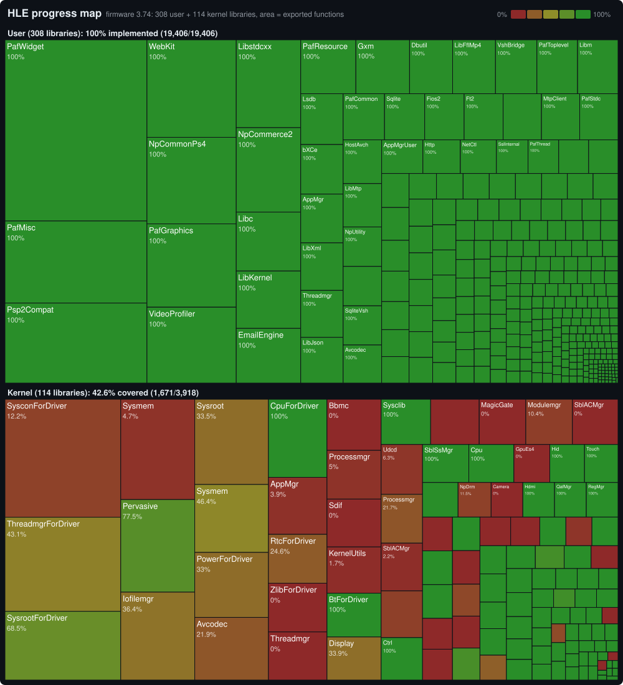

<!-- pair: README.pt-BR.md sha256=cad1bd7a81699ab64fcd50a6200fffc2960981f0aee45e35c1483dc7a5ff4bd6 -->
<div align="center">

**English** | [Português](README.pt-BR.md)


### A PlayStation Vita emulator written in C#

Runs commercial Vita games and the console's own system software, with no native core: an ARMv7 JIT, a Vulkan
renderer and more than 1,100 system functions reimplemented, all in .NET 10.

[](LICENSE)
[](https://dotnet.microsoft.com/)
[](https://www.vulkan.org/)
[](docs/compatibility.md)

<br>


<sub><i>The real PS Vita home screen (the firmware's <code>shell.self</code>) running in VitaSharp.</i></sub>

<br><br>

<picture>
  <source media="(prefers-color-scheme: light)" srcset="docs/assets/launcher-light.png">
  
</picture>

<sub><i>The desktop launcher's game library (sample homebrew entries; the light theme follows your GitHub theme).</i></sub>

</div>

---

## What it is

VitaSharp emulates the PS Vita. It runs the console's ARMv7 code (an interpreter and native JITs for x86-64 and
ARM64), translates the Vita GPU's shaders to Vulkan and reimplements the system libraries games call (HLE). With the
official firmware installed it also runs the Vita's own software: lock screen, home screen, LiveArea and the games
started from them. It is a research project under active development, all in C#.

> [!IMPORTANT]
> VitaSharp includes no games, firmware or Sony code. Use games and licenses dumped from your own console and
> download the system update (`PSVUPDAT.PUP`) from the PlayStation website. Piracy is not supported.

<table>
<tr>
<td width="33%"><br><sub><b>Killzone: Mercenary</b>, campaign</sub></td>
<td width="33%"><br><sub><b>Uncharted: Golden Abyss</b>, first chapter</sub></td>
<td width="33%"><br><sub><b>Gravity Rush</b>, opening</sub></td>
</tr>
<tr>
<td><br><sub><b>God of War Collection</b>, combat</sub></td>
<td><br><sub><b>Persona 4 Golden</b>, opening</sub></td>
<td><br><sub><b>Vita System</b>, a game's LiveArea</sub></td>
</tr>
</table>

<p><b>On Android</b> (Redmi Note 14, Mali-G57; see <a href="#android">Android</a>):</p>

<table>
<tr>
<td rowspan="3" width="40%" valign="top"><br><sub><b>Library</b>, the app's game list</sub></td>
<td width="60%"><br><sub><b>Killzone: Mercenary</b>, campaign, on-screen controls</sub></td>
</tr>
<tr>
<td width="60%"><br><sub><b>Pause menu</b>, save states and Record everything</sub></td>
</tr>
<tr>
<td width="60%"><br><sub><b>Uncharted: Golden Abyss</b>, the Prologue, 30 fps</sub></td>
</tr>
</table>

## Status

[](docs/hle/progress.md)
[](docs/hle/progress.md)
[](docs/hle/progress.md)
[](docs/hle/progress.md)
[](docs/hle/progress.md)

<a href="docs/hle/progress.md">
<picture>
  <source media="(prefers-color-scheme: light)" srcset="docs/assets/status/progress-map-light.svg">
  
</picture>
</a>

[Progress per library](docs/hle/progress.md)

<sub>* Percentages of the functions that firmware 3.74 exports to user code (its user modules and the syscall
libraries of its kernel modules) with an HLE implementation, not of every PS Vita system function. "Games imports":
the exported functions the installed test games import; "system imports": those only the system software imports;
VitaSDK: the user functions of the VitaSDK NID list. "Default": implemented functions that need hardware or a
service the emulator does not have and return the firmware's own result for that case (counted in the percentage, shown
apart). "LLE": functions of libraries the emulator provides by loading and running the real module the program brings
(a game's own libsmart/libface, the libshacccg.suprx the user extracts from their console, the firmware module of a
library the emulator loads for every importer; also counted, shown apart;
list in [`docs/hle/progress.md`](docs/hle/progress.md)). "Kernel exports": the functions the kernel modules export to
other kernel code (what a kernel plugin can import), from the census in
[`docs/hle/kernel-exports.md`](docs/hle/kernel-exports.md). Refreshed with `build/hle-status.ps1`.</sub>

## Games

38 games tested so far ([`docs/compatibility.md`](docs/compatibility.md), with each one's state and test scenario):
25 reach gameplay (among them Killzone: Mercenary, Uncharted: Golden Abyss, Gravity Rush, God of War Collection,
FIFA 13, Persona 4 Golden, LittleBigPlanet, Tearaway, WRC 4, Skullgirls and Devious Dungeon) and the
rest reach the menus. Known issues and future work are in the [roadmap](docs/roadmap.md).

## Platforms

| Platform | State |
| --- | --- |
| **Windows** (x64) | The most tested: launcher, game window, Vita System, every diagnostic tool |
| **Android** (arm64) | Its own .NET MAUI app (Native AOT, ARM64 JIT, Vulkan 1.1+; library, settings, on-screen controls, pause menu); tested on a Redmi Note 14 (Mali-G57). APK from the CI artifact or built locally ([Android](#android)) |
| Linux, macOS | Build and make packages; Linux x64 tested on Debian 12, macOS not yet tested on a Mac |

PC requirements: a Vulkan 1.3 driver (recent NVIDIA, AMD or Intel) and a multi-core processor.

## Install and play

1. Download the package from the **Releases** page (zip or installer for Windows; see [Releases](#releases)) or build
   it (see [Build and test](#build-and-test)).
2. Open VitaSharp: the launcher (game library) shows up.
3. On **Install pkg / vpk** (or dragging the files onto any screen):
   - **VPK or zip**;
   - **PKG with license**: the package with its license, a `work.bin`/`.rif` file or the pasted zRIF text;
   - **Decrypted folder**: a game folder that is already decrypted.
4. Pick the game and press **Play**.

**PlayStation Mobile (PSM).** A PSM game `.pkg` installs like a PS Vita one, with the license of your own account: the
1024-byte PSM `.rif` (or its zRIF) that your console has for that game; a PS Vita license or another game's is refused.
It goes where the console puts it, `ux0:psm/<TITLEID>` (`RO` with the game and `RO/License`, `RW/Documents` for the
saves, which a reinstall keeps); the game stays protected as sold and is opened by the PSM runtime with your license.
It also needs the **PSM Runtime Package** (`PCSI00011`, a normal PS Vita `.pkg` with its license). The library lists
an installed PSM game with the name and icon from the game itself, and the **Vita System** home screen shows its bubble
once the system has rebuilt its database (at its next start after the install, as on the console). Running PSM games
is still in progress (see `docs/roadmap.md`); a PSM game installed with an earlier version must be installed again.

**Where things go.** Everything is kept where the console keeps it (games in `ux0:app`, updates in `ux0:patch`, DLC in
`ux0:addcont`, PSP/PSone games in `ux0:pspemu/PSP/GAME`, PSM games in `ux0:psm`, saves in `ux0:user/00/savedata`,
licenses in `ux0:license/app/<TITLEID>`). Licenses that earlier versions kept in `ux0:license/<TITLEID>` move to
`ux0:license/app/<TITLEID>` by themselves at the next start (a license whose new place already holds a different one
stays where it was). An installed update counts the way the console counts it: the game sees the update's files
over its own (`ux0:patch/<TITLEID>`, or `grw0:patch/<TITLEID>` for a game card), its version is the update's (the
library shows it too), and the firmware's own apps take none. A Unity PSM game keeps its own runtime in
`ux0:psm/<TITLEID>/runtime` with that runtime's license in `ux0:license/app/<TITLEID>`; one that an earlier version
left in `RO/runtime` moves there by itself at the next start.

**Firmware (optional).** Games run without firmware. Install it for the system fonts and libraries (`libSceXml`,
`libSceSqlite`...) and the **Vita System**: on the **Vita System** page, **Install firmware (.PUP)...**, or **Use
Vita3K's firmware** (copies `os0`/`vs0`/`sa0`/`pd0` from a Vita3K installation). From the command line:
`install-firmware <PSVUPDAT.PUP>`. **Uninstall firmware** (same page; `uninstall-firmware [--yes]`) removes only what the
install created (`os0`/`vs0`/`sa0`/`pd0` and the index files `firmware.json`, `firmware-libraries.txt`): games, saves and
`ux0`/`ur0` stay, and a partition linked to another folder loses only the link.

**Vita System.** With the firmware installed, the launcher's **Open Vita System** button (Ctrl+H, or `boot-shell`)
runs the firmware's `shell.self`: initial setup the first time, lock screen, home screen with the installed games and
LiveArea. A game opened from the LiveArea runs as a second process; the PS button (Home key) goes back to the system
and **Continue** resumes the game. Details and what is missing in [`docs/notes/system-apps.md`](docs/notes/system-apps.md).

**Android.** See [Android](#android).

**Language.** The launcher and the game window follow the system's language (English or Brazilian Portuguese);
**Settings > General > Appearance > Language** picks one (on Android: **Settings > Appearance > Language**). Logs stay in English.
The language a game sees is the Vita's system language; for a game without yours (e.g. an Asian release with only
Japanese and English, which falls back to Japanese), its **System language** setting (the game's page in the launcher,
the game's details on Android; `--system-language=<0-19>` on the command line) makes only that game see another one.

Data lives in `%APPDATA%\VitaSharp` on Windows (`~/.local/share/VitaSharp` on Linux,
`~/Library/Application Support/VitaSharp` on macOS; `--data=<folder>` or `VITASHARP_DATA` change the folder): games in
`fs/ux0/app`, firmware in `fs/os0`... , `logs/`, `savestates/`, `captures/` (Record everything), `gpudumps/`,
`diagnostics/`, `shadercache/`.

### Kernel plugins

An emulator option, **Enable Kernel Plugins**, like pausing or recording the screen (the Vita has no such setting).
**Off by default: the pure firmware runs and no plugin loads.** On, VitaSharp loads the plugins the configuration lists
and offers them the plugin framework libraries they import (module information, export and import lookups, data
injections, function hooks), as a console with the homebrew environment set up.

- **Turn it on:** launcher **Settings > Advanced**; Android **Settings > Debugging**; command line
  `--kernel-plugins=on|off`; environment `VITASHARP_KERNEL_PLUGINS=1` (the switches win over the variable).
- **Folder:** `ur0:kernel_plugins/` (on the host `fs/ur0/kernel_plugins/`, same on Windows, Linux, macOS and Android),
  next to `ur0:tai`, holds `config.txt`. Its lines are Vita paths, as on the Vita (`ur0:tai/kubridge.skprx`): the
  plugins themselves stay in `fs/ur0/tai` (or `fs/ux0/tai`), where homebrew checks their files. A line without a device
  (`my.skprx`) names a file you put in `ur0:kernel_plugins/`. Sections as on the Vita: `*KERNEL` for kernel plugins,
  `*ALL` / `*TITLEID` for user plugins, `*main` is the home screen.
- **Fallback:** without `ur0:kernel_plugins/config.txt`, the Vita's `fs/ux0/tai/config.txt` (else
  `fs/ur0/tai/config.txt`) is read, as copied from a Vita.
- **Automatic move:** the first time the option is on, the Vita's `config.txt` moves into `ur0:kernel_plugins/`
  unchanged (a copy kept as `ur0:kernel_plugins/config.txt.bak`); the plugins, the framework's own file and the plugins'
  data files stay in `ur0:tai`. The framework's own file is never loaded: the emulator provides its libraries. The
  folder of earlier versions (`kernel_plugins/` next to `fs/` in the data folder) moves into `ur0:kernel_plugins/` the
  same way, and the empty old folder is deleted.
- **Log:** one line per plugin, `kernel plugin <path>: loaded and started (<name>) (at system boot)`, `... not started:
  no module provides ...` or `... not loaded (...)`. The `*KERNEL` plugins load at the system's boot, before the title's
  launch, even when that launch then fails.

Details in [`docs/notes/plugins.md`](docs/notes/plugins.md).

## Keys

| Key | Function |
| --- | --- |
| Arrows, `W` `A` `S` `D`, `I` `J` `K` `L` | D-pad, left stick, right stick |
| `X` or `Space` / `C` / `Z` / `V` | Cross / Circle / Square / Triangle |
| `Q` / `E`, `Enter` / `Backspace` | L / R, Start / Select |
| `Home` | PS button |
| `End` | POWER button: a press puts the system in standby (the picture stays, with a notice; the next press wakes it and the game gets the power callbacks of a resume), held 2 s opens the system's power menu (with the Vita OS running), held 4 s turns the system off (the session ends) |
| Left / right mouse button | Touch on the front screen / the rear touchpad |
| `F1` / `Shift+F1` | Next / previous internal resolution while the game runs (1x, 2x, 3x, 4x; this session only, with an on-screen notice) |
| `F2` / `Shift+F2` | Next / previous frame rate while the game runs (native, locked to 30, locked to 60, unlimited) |
| `F3` / `Shift+F3` | Next / previous MSAA mode while the game runs (native, 2x supersampling, off; this session only, with an on-screen notice) |
| `F4` | Mouse mode: gyroscope (middle button), right stick, left stick or off, saved per game (`Esc` releases the cursor) |
| `F5` / `F7` | Save / load the quick state; `Shift+F5` / `Shift+F7` save / load in the chosen slot |
| `F6` | Save state picker over the paused game: the quick slot and slots 1-9 with their picture, date, play time and version; save (overwriting asks, showing the old and the current picture), load (with the picture large), delete (`Del` / Triangle) |
| `F8` | Starts / stops **Record everything** (see [Report a bug](#report-a-bug)) |
| `Ctrl+F8` | Starts / stops a GPU dump (`gpudumps/*.vsgd`; `replay-gpu` redraws it draw by draw, without the game) |
| `F9` | Turns debug mode on / off (detailed logs, 10 s pre-recording, automatic captures) |
| `F10` | Diagnostic capture: the next frame with its draws, textures, targets, screenshot and log (`diagnostics/`) |
| `F11` | Full screen |
| `P` | Pauses / resumes the emulation |

Controllers (SDL2) are detected on their own, with a positional layout (the bottom button is always Cross) and
gyroscope. Everything can be remapped in **Settings > Controls**, per controller ([`docs/notes/controller-config.md`](docs/notes/controller-config.md)).

## Android

The Android app (`src/VitaSharp.Android`) is a .NET MAUI app that runs the same emulator core as the desktop on arm64
phones: the Release APK is compiled with Native AOT by default, the Vita's ARMv7 code runs on the native ARM64 JIT and
the picture is drawn with Vulkan. It has its own screens: game library, game details (CPU backend, clock, GPU profile,
internal resolution, MSAA, frame rate, VSync and the FPS counter per game, saves), trophies, controls, settings, firmware, GPU driver, PSN
account and network, and a performance page. The app follows the language setting (**Ajustes > Aparência > Idioma**;
the menu names below are the Portuguese ones). Screens and design:
[`docs/android/README.md`](docs/android/README.md#screens).

**Requirements.** An arm64 phone with Android 8.0 or newer (API 26) and a Vulkan 1.1 or newer driver.

**State (measured on a Redmi Note 14, Helio G99, Mali-G57).** The mobile version has reached a certain stability;
performance is still the main work in progress. Measured today:

| Game | Where it was measured | fps (native) |
| --- | --- | --- |
| Killzone: Mercenary | campaign | about 22-25 (30) |
| Uncharted: Golden Abyss | the Prologue | 30 (30) |
| F1 2011 | the race | 30 (30) |

Lighter games reach their native 30 or 60 fps; other games have not been measured on the phone yet. Adreno phones are
barely tested.

**Install the APK.** Download `VitaSharp-<version>-android-arm64.apk` from the **Releases** page (every version and
every automatic `build-<commit>` prerelease carries it). Every CI run also builds one for arm64 phones: on the run's
page in **Actions**, the artifact **VitaSharp-android-arm64-packages** holds
`VitaSharp-ci-<run>-android-arm64.apk`. The APK is the Release build (Native AOT, with the device shader compiler
and libadrenotools; signed with a throwaway debug key, so a later APK from another run or PC installs only after uninstalling the old one,
which deletes the app's data). Install it with `adb install` or by opening it on the phone. Copy the saves out first (see below). To build it on a PC: the
.NET 10 SDK with the MAUI Android workload (`dotnet workload install maui-android`), a JDK 17, the Android SDK
(platform 36) and the NDK (r30: `sdkmanager "ndk;30.0.16248370"`), then `build/build-android-apk.ps1` / `.sh`, the
CI's own script (it builds the native libraries the first time, then the APK into `artifacts/android/packages`, and
checks it). Steps and options: [`docs/android/README.md`](docs/android/README.md#building).

```sh
build/build-android-apk.sh          # Windows: build/build-android-apk.ps1
adb install -r artifacts/android/packages/VitaSharp-dev-android-arm64.apk
```

**Games, licenses, firmware and saves.** The app asks for no storage permission and no folder: each file comes in
through Android's file picker (Storage Access Framework) and is read in place. In **Biblioteca**, **Instalar jogo** takes
a `.vpk` (or `.zip`) or a `.pkg` with its license (`work.bin`, `.rif` or the pasted zRIF). The firmware is optional, as
on the PC: **Ajustes > Firmware > Instalar firmware (.PUP)** with `PSVUPDAT.PUP`; then **Sistema do Vita** in the
library boots the real home screen. Custom GPU drivers (Adreno, through libadrenotools) are installed in **Ajustes >
Driver da GPU**. Everything lives in one data folder with the desktop's layout (games in `fs/ux0/app`, licenses in
`fs/ux0/license/app`, saves in `fs/ux0/user/00/savedata`, `config/env.txt`...): without root it is **`.vitasharp`** at
the root of the phone's storage (`/sdcard/.vitasharp`), visible and editable in any file manager and kept when the app
is uninstalled; the app asks for **"All files access"** on its first start for that and moves the old
`Android/data/io.github.vitasharp/files` there (checked file by file, resumed if interrupted). Until the permission is
given, and on a rooted phone, the data stays in `Android/data/io.github.vitasharp/files`
([details](docs/android/README.md#storage)).

**Controls.** Translucent on-screen controls over the sides of the picture (D-pad, sticks, face buttons, L/R,
SELECT/PS/START, a TRÁS toggle for the rear touchpad); touches on the picture are the front touch screen. Bluetooth or
USB controllers are detected on their own with the desktop's positional layout (the on-screen controls hide while one
is connected), and a hardware keyboard uses the desktop's keys. **Controles** remaps each controller's buttons (tap a
control, then press the button on the controller; **Restore defaults** goes back), and sets the O/X swap, deadzone, opacity,
vibration (on every press, also with the other thumb on the stick; weak, medium or strong) and auto-hide. The phone's gyroscope and accelerometer feed the Vita's motion sensor.
**Ajustes > Sistema > Ao abrir o emulador** can boot the Vita system (the firmware's shell) as the app opens, as on
the desktop. **Ajustes > Câmeras** chooses what each Vita camera shows, as the desktop's camera options: the phone's camera of
that side (the default), a PNG/JPEG picture or none (grey frames).

**Pause menu, save states and Record everything.** The PS button (on screen or on the controller) pauses a game
started on its own: **Continuar**, **Salvar estado** / **Carregar estado** (6 slots with a picture), **Ajustes** (rear
touch, on-screen controls, MSAA, frame rate, pre-recording), **Recentralizar** (motion), **Gravar tudo** and **Sair do jogo**. **Gravar
tudo** records the same bug report as the desktop's F8 (save state, input, GPU dump, frames, audio and log) into
`captures/` until **Parar gravação**; send the `.zip` as in [Report a bug](#report-a-bug).

**States and recordings on the game page.** The game's details show the 6 slots with their picture and date; tapping a
slot opens the game already loading that state (as the desktop's `--load-state`; with the game open, it loads into
it). Below them are the game's **Gravar tudo** recordings with their date and size; tapping one shares the `.zip`.
From adb: `am start ... --es titleId <ID> --ei loadSlot <1-6>`.

**Per-game settings.** In the game's details: internal resolution (50%, 75%, native, 2x, 3x or 4x, as the desktop's), MSAA, frame rate (**Nativo**, the
game's own pacing, by default; **Fixo em 30**, **Fixo em 60** or **Sem limite**, as the desktop's `--frame-rate`; also in
the pause menu, applied right away, and shown next to the FPS counter), VSync, the FPS counter, CPU backend, clock and
GPU profile and the system language the game sees (**Idioma do sistema**), saved per game (**Voltar ao padrão de Ajustes**
goes back to the global settings).

**Known limitations.**

- Killzone: Mercenary's movies can play slowly for a while before they catch up.
- Minecraft loses performance as the session goes on (under investigation).
- Adreno GPUs (and custom drivers) are barely tested; the measurements above are from a Mali-G57.

Open items are in the [roadmap](docs/roadmap.md) (Android section).

## Report a bug

Use **Record everything**: press **F8** while playing (the title bar shows *"● REC | Recording everything (F8 to
stop)"*), play until the problem shows up and press **F8** again. A `.zip` comes out in `captures/` with a save
state, the controls, every picture with its timing, the GPU dump, the audio (the mix and every voice) and the log: the
problem can be reproduced without playing again. On Android: pause menu > **Record everything**. For quick defects,
turn on **Pre-recording** (Settings > General, or debug mode with F9): the file then includes the seconds before the key.

Send the `.zip` with the game's name (title ID) and what happened. Every session also writes `logs/last.log`.
The capture carries nothing personal (paths, user, computer and account names become placeholders) and can be
analysed and re-run without the game or the plugins: see [`docs/captures.md`](docs/captures.md). Details in
[`docs/notes/session-capture.md`](docs/notes/session-capture.md); whoever analyses it uses
`vitasharp-perf capture <zip>` and `VitaSharp.Desktop rerun <folder>`.

## Build and test

Needs the [.NET 10 SDK](https://dotnet.microsoft.com/download/dotnet/10.0). The first build downloads FFmpeg (videos
and MP3/AAC); the other native libraries come from NuGet.

```sh
dotnet build -c Release
dotnet run --project src/VitaSharp.Desktop -c Release          # opens the launcher
dotnet run --project src/VitaSharp.Desktop -c Release -- run <TITLEID>   # opens a game directly
dotnet test tests/VitaSharp.Tests -c Release --filter "Category!=Slow"  # quick tests (without the CPU fuzz)
build/coverage.ps1                                              # test coverage report (HTML + summary; also .sh)
```

The command line also has `install`, `boot-shell`, `test <scenario>` (automatic scenarios in
[`tests/scenarios`](tests/scenarios)), `replay-gpu`, `rerun`, `imports`, `update` and more: `VitaSharp.Desktop --help`.
The Android app: [`docs/android/README.md`](docs/android/README.md). Ready packages (zip, installer, tar.gz, AppImage,
.app, .dmg; ReadyToRun or Native AOT): `build/publish.ps1` / `build/publish.sh`.

Every script comes as a `.ps1` + `.sh` pair, and the CI checks it. Interface texts live in
`src/VitaSharp.Core/Localization` (`Texts.resx` in English, `Texts.pt-BR.resx`); the external docs come in both
languages too (`README.md` + `README.pt-BR.md`, checked by `ExternalDocPairsTests`). To contribute system functions,
see the specifications in [`docs/hle`](docs/hle/README.md). `build/hle-abi-check.ps1` / `build/hle-abi-check.sh` lists the HLE functions whose argument registers differ from the [vita-headers](https://github.com/vitasdk/vita-headers) prototypes (needs `git` and network for the clone, or a local checkout).

### Code style

The C# style is the Ryujinx/Ryubing one, and [`.editorconfig`](.editorconfig) is the rule (what is enforced, what is
off and why). `build/format-check.ps1` (Windows) / `build/format-check.sh` (Linux, macOS) runs
`dotnet format whitespace` and `dotnet format style --severity warn` with `--verify-no-changes` over the tracked `.cs`
files only (`git ls-files`: never untracked or git-ignored files), as the CI job
"Code style" does (that job is commented out in `.github/workflows/ci.yml` for now: run it locally), with the same exit code (2 when something differs); `-Fix` / `--fix` rewrites the files instead
(also running `build/NamingTool`, which renames the symbols that break the naming rules with all their references,
since `dotnet format` reports IDE1006 but cannot fix it, and `build/FormatTool`, which splits the blocks written on
one line and keeps `{ get; set; }` on one line; the fix needs the NuGet packages of `build/NamingTool`, restored on
its first run). Folders not converted yet are listed in [`build/format-pending.txt`](build/format-pending.txt) and
skipped. The file list goes to `dotnet format` as a response file, and the scripts run the `dotnet-format.dll` of the
active SDK (`<sdk>/DotnetTools/dotnet-format/`) directly so that it reads that file itself: `dotnet format` would put
every path on one command line, longer than Windows allows once the whole tree is listed (other SDK layouts fall back
to `dotnet format`). `OneLineBlockTests` (in the test suite) rejects blocks written on one line (`if (x) { a; }`): every body
goes on its own lines.

**Options on both apps:** every new user option (settings, per-game settings, pause menu, controls) goes into the
desktop launcher and the Android app in the same change, with the same name, default and meaning (the texts come from
the shared `Texts.resx`); a test checks that both map it to the same emulator setting (`AndroidOptionParityTests`).

Shell scripts follow the Google Shell Style Guide and must pass ShellCheck (CI job "ShellCheck"; the job
"Scripts on macOS" also runs `build/check-scripts-help.sh` under the system bash 3.2). Install ShellCheck with
`winget install koalaman.shellcheck` (Windows), `sudo apt install shellcheck` / `sudo dnf install ShellCheck`
(Linux) or `brew install shellcheck` (macOS), then `shellcheck --severity=style build/*.sh build/package/*.sh`.

### Developer tools

- IL backend dump: `VITASHARP_IL_DUMP=<folder>` writes the compiled guest blocks as assemblies to read with ILSpy
  (`dotnet tool install -g ilspycmd`, then `ilspycmd -il <file>.dll`); `DOTNET_JitDisasm=<method>` prints the
  machine code RyuJIT generates. See [`docs/notes/il-jit.md`](docs/notes/il-jit.md).
- Vulkan validation: `--validation` (`run`, `test`, `replay-gpu`) or `VITASHARP_VK_VALIDATION=1` (`=sync` adds
  synchronization validation) needs the Khronos layer: the [Vulkan SDK](https://vulkan.lunarg.com/sdk/home)
  (Windows, Linux, macOS), or on Linux the distribution package (`vulkan-validationlayers` / `vulkan-validation-layers`);
  on macOS the SDK also brings MoltenVK. Frame captures: [RenderDoc](https://renderdoc.org) (Windows, Linux) and
  GPU dumps (`replay-gpu`, [`docs/notes/gpu-dump.md`](docs/notes/gpu-dump.md)) on every OS.
- Graphics pipeline libraries (off by default, measured slower with cold caches): `VITASHARP_PIPELINE_LIBRARY=1`
  links first-use pipelines from shader libraries and optimises them in the background where the driver has
  `VK_EXT_graphics_pipeline_library` with fast linking (desktop NVIDIA/AMD/Intel, Mesa); without it (MoltenVK,
  Dozen, phone drivers) pipelines are compiled whole either way. The
  `[shadercache] session` log line counts what the GPU thread compiled; see
  [`docs/notes/pipeline-skip.md`](docs/notes/pipeline-skip.md).
- Loading window: a click on a game opens its window at once (960x544 times `--scale`), before the game process does
  any of its start-up, with the game's start-up picture (`sce_sys/pic0.png`), its icon and name, the current step
  (firmware, controls, audio, GPU, the game, the shader cache, the ARM code) with a bar and, during the shader cache
  and the ARM code waits, "Cancelar". The game's own window waits hidden at the same place
  (`--loading-screen=launcher --window-pos=X,Y`) and appears when the game is ready; the steps are the game process's
  `[boot-step] <step>` log lines and `[boot-log] <path>` its log file. A second click on the game brings the same
  window back; its X stops the game. A start that fails (a title that cannot be loaded, a missing license, an error
  exit) leaves the reason and the log's place on the window, with "Fechar". Android shows the same screen over the
  game. Nothing extra to install, every OS.
- "Carregar o cache de shaders antes de jogar" / "Load the shader cache before playing" (launcher: Configurações, next
  to "Compilar shaders em segundo plano", and each game's page; `--load-shader-cache=on|off`, default on; the earlier
  name `--precompile-shaders` is still accepted with a warning): before a game starts, its shader cache (the shaders
  and pipelines recorded in its earlier sessions, `shadercache/titles/<ID>/`) is built behind a progress bar in the
  launcher's status bar; "Cancelar" (the line `cancel-shader-cache-load` on the game process's standard input) starts
  the game at once and the rest builds in the background. It is a cache load, not a precompilation: a game's first
  session has nothing recorded. Nothing extra to install, same on Windows, Linux and macOS.
- Compile shaders at program load ("compilar shaders ao carregar o programa"; `--compile-on-program-load=on|off`,
  default on; `VITASHARP_COMPILE_ON_PROGRAM_LOAD=0|1` overrides it, also on Android): when a game creates a vertex or
  fragment program (sceGxmShaderPatcherCreate*, usually behind its loading screen), the shader workers translate and
  compile its shaders with the hints predicted from the program, and build the pipeline of the vertex program it is
  made for, so a first session's first draw finds them ready. A draw whose texture or surface format differs from the
  prediction but translates to the same shader uses the same module. The colour surfaces the game initialises and the
  scenes it begins are remembered, and the programs that depend on the surface (programmable blending, native-colour
  or integer outputs) are also built for each of them, with their fetch-pass and integer-view pipelines. The session's `[shadercache] session` line ends
  with what was queued and used ("at program load: ..."); `replay-gpu --compile-on-program-load=on` announces the
  dump's programs before its first command. Nothing extra to install, every OS.
- "Precompilar código ARM" / "Precompile ARM code" (launcher: Configurações, after the shader cache option, and each
  game's page; `--precompile-code=on|off`, default on): before a game starts, the native JIT translates its ARM code
  on every free core, behind its own progress bar in the launcher's status bar ("Cancelar" = the line
  `cancel-code-precompile` on the game process's standard input; log lines `[code-precompile] progress ...`): the
  blocks its earlier sessions ran, in the order they first ran (the code cache: `codecache/<module image hash>.vsjc` in
  the data folder, `--code-cache=<folder>|off`; one file per module image, valid at any load address, rejected after a
  translator change), or in a first session the code the static analysis reaches from the modules' entry points
  (module start, exports, direct branches and call returns). The game starts as soon as those are ready; then a few
  low-priority threads translate the code near what the game runs (a few blocks past every block it reaches, and the
  rest of its function, found through the `.ARM.exidx` function index), at most 64 MB of the code arena. Precompiled
  code is published when the game first reaches it. The log lines `ARM code precompilation: boot step ...` and, at the
  end, `... % of the run blocks were precompiled` give the time and the coverage. Android waits for the same step behind
  its loading screen (the option is in the app's settings and each game's settings). Nothing extra to
  install, every OS.
- Profiling: `dotnet-trace` / `dotnet-counters` (`dotnet tool install -g dotnet-trace`, every OS); on Windows also
  PerfView and WPR/WPA (Windows Performance Toolkit).

### Test requirements

What `dotnet test tests/VitaSharp.Tests` needs per system; a test whose requirement is missing is skipped and says why.

| | Windows | Linux | macOS |
|---|---|---|---|
| SDK | .NET 10 SDK | .NET 10 SDK | .NET 10 SDK |
| Vulkan device (renderer, GPU dump and game-run tests) | Mesa lavapipe (Vulkan 1.4, the Linux CI's driver): unpack the `x64` folder of a [mesa-dist-win](https://github.com/pal1000/mesa-dist-win/releases) release (`vulkan_lvp.dll` + `lvp_icd.x86_64.json`) into `%LOCALAPPDATA%\VitaSharpTools\mesa\<version>\x64`; without it, or when the system loader `vulkan-1.dll` cannot take it, SwiftShader as Microsoft Edge or Google Chrome ship it (both found by themselves) | Mesa lavapipe: `sudo apt install mesa-vulkan-drivers libvulkan1` (Fedora: `mesa-vulkan-drivers vulkan-loader`) | MoltenVK: the LunarG Vulkan SDK, or `brew install molten-vk vulkan-loader` |
| shaderc (renderer and shader-compile tests; the renderer needs it too) | from the Silk.NET.Shaderc.Native package | from the package (found under `runtimes/linux-x64` also where Silk.NET's search misses it, as on Ubuntu); when that copy does not load: `sudo apt install libshaderc-dev` (Fedora, Arch: `shaderc`; loaded as `libshaderc.so.1`) | from the package, else Homebrew's `brew install shaderc` |
| A desktop window (game overlay tests) | always | an X11 or Wayland display; headless: `xvfb-run dotnet test tests/VitaSharp.Tests` (`sudo apt install xvfb`) | skipped: AppKit creates windows only on the main thread, and the tests run on worker threads |
| FFmpeg (video and audio decode tests) | downloaded by the first build | downloaded by the first build | the system's: `brew install ffmpeg` |

- Any system: `VK_DRIVER_FILES` (or `VK_ICD_FILENAMES`) set to the ICD manifest of a downloaded SwiftShader or Mesa
  build is used instead.
- `RendererPipelineLibraryTests` checks the linked pipelines where the software device has the extension with fast
  linking (SwiftShader, Mesa lavapipe) and the whole-pipeline fallback everywhere else.
- Firmware: without it the tests of the real firmware modules (`libSceJson`, `libSceXml`, `libpaf`, the update file
  install) are skipped. `VITASHARP_FIRMWARE_PUP` names a `PSVUPDAT.PUP`, `VITASHARP_FIRMWARE_DIR` a `vs0` or Vita3K
  data folder; the Piglet compiler tests need `libshacccg.suprx` in `ur0:data`.
- The tests never use your data folder: each one makes a scratch folder (`VITASHARP_DATA` for the child processes);
  the game-run tests boot a small executable the tests write themselves.
- Optional: the LunarG Vulkan SDK's validation layers run the renderer workloads under validation with
  `dotnet test tests/VitaSharp.Tests --filter Category=Slow` (`RendererValidationTests`; skipped without the layer).
- The window test runs a hidden window (`VITASHARP_HIDDEN_WINDOW=1`): on Linux it needs a display (`DISPLAY`), on
  Windows the system Vulkan loader (`vulkan-1.dll`, installed with any GPU driver), which gets the software driver
  from `VK_DRIVER_FILES`. An elevated process (Administrator) makes the loader ignore that variable: run the tests
  unelevated, or register the driver's `*_icd.json` as a DWORD value `0` under
  `HKLM\SOFTWARE\Khronos\Vulkan\Drivers` (the CI does this for Edge's SwiftShader); otherwise the test is skipped. It
  is skipped on macOS. An elevated process also takes SwiftShader instead of an unregistered lavapipe.
- Windows' lavapipe has no `VK_EXT_headless_surface`: the test of a window-less renderer
  (`RendererDeviceHandoffTests`) is skipped with it and runs with SwiftShader (the Windows CI) and on Linux.
- Media parity (`MediaParityTests`): the desktop side (FFmpeg) always runs; the Android side needs the developer APK
  (`-p:VitaSharpDeveloper=true`) on a phone or the Android Emulator (any system with the Android SDK: an x86_64
  Google APIs image and the `android-x64` build). `build/android-media-parity.sh` (or `.ps1`) records the trace on the
  device; `VITASHARP_ANDROID_MEDIA_TRACE=<trace> dotnet test tests/VitaSharp.Tests --filter MediaParityTests` compares
  it with the desktop's (skipped without the variable). `SYNC=0` (`-Sync 0`) records the old MediaCodec timing.
- .NET 11 (optional, for comparisons; the default and the CI stay on .NET 10): `-p:VitaSharpDotnet=net11.0` builds
  every project against .NET 11 on any system. It needs the .NET 11 SDK (and, for Android, its `maui-android` workload
  and the Android API 37 platform; .NET 11 has no Mono, so only `VitaSharpAndroidRuntime=coreclr` or `nativeaot`
  build). An SDK installed outside the default location runs the desktop app with `DOTNET_ROOT` set to it.

## Releases

- **Versions**: a `v*` tag (or **Actions > Release > Run workflow**) publishes a release with the Native AOT packages
  for Windows, Linux and macOS, the Android APK (`VitaSharp-<version>-android-arm64.apk`) and the `SHA256SUMS.txt`.
- **Automatic builds**: every push to `main` whose CI passed becomes a `build-<commit>` prerelease with that CI run's
  packages (the 10 newest stay).
- **Automatic update**: the packages check for a new version when they open (Settings > General > Updates: on/off,
  channel automatic builds or versions only, **Check now**). The dialog shows the version in use, the new one, its
  date and what's new, with **Skip this version**, **Remind me later** and **Update now**: the platform's package is
  downloaded, checked against `SHA256SUMS.txt` and swapped in (the installer, on Windows installed by the setup), and
  VitaSharp reopens. Only the emulator's files change; the data folder never does. A build compiled from source is
  updated with git (from the command line: `update [--channel=releases] [--apply]`).
- The packages are not signed (Windows SmartScreen warns) and never include firmware.

## Credits and license

VitaSharp builds on the Vita community's work: [Vita3K](https://github.com/Vita3K/Vita3K) (behaviour reference,
NIDs, USSE register model), [VitaSDK](https://vitasdk.org/) and vita-headers, the
[PS Vita development wiki](https://wiki.henkaku.xyz/), [VGAudio](https://github.com/Thealexbarney/VGAudio)
(ATRAC9 decoder, MIT), [RPCN](https://github.com/RipleyTom/rpcn), [Silk.NET](https://github.com/dotnet/Silk.NET),
[Avalonia](https://avaloniaui.net/), [FFmpeg](https://ffmpeg.org/) (LGPL, downloaded at build time) and
[SQLite](https://sqlite.org/) (public domain) through [SQLitePCLRaw](https://github.com/ericsink/SQLitePCL.raw) (Apache-2.0).

License **GPL v3** ([LICENSE](LICENSE)); third-party components keep their own. PlayStation and PS Vita are trademarks
of Sony Interactive Entertainment; VitaSharp is not affiliated with Sony.
