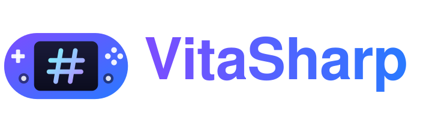
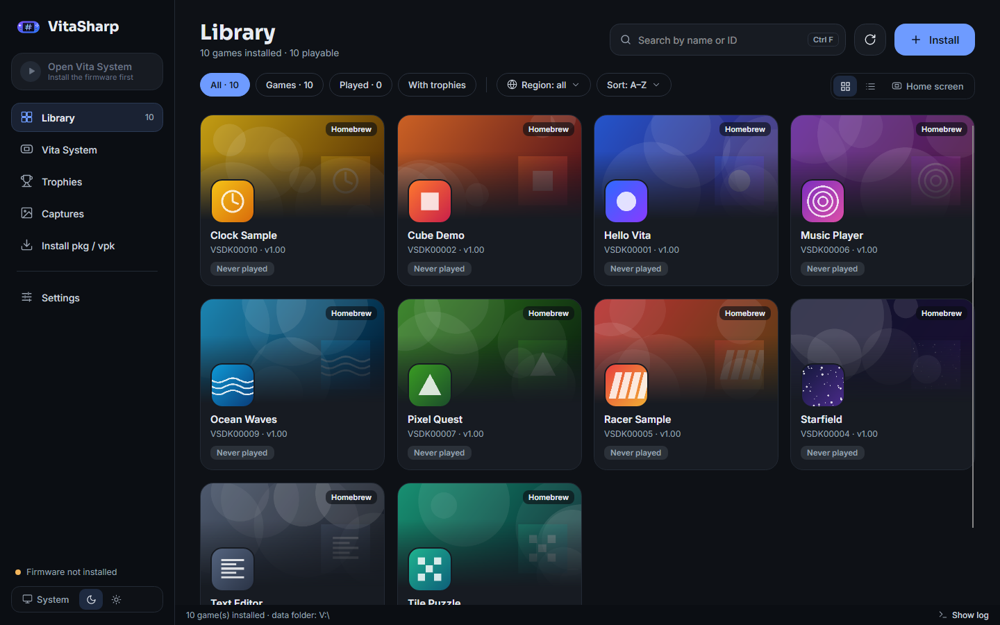
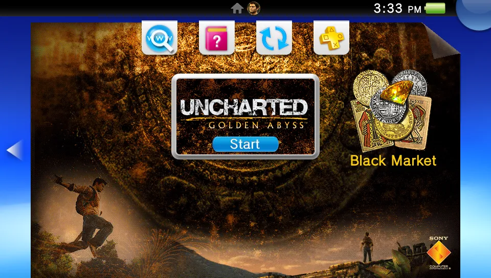

<!-- pair: README.md sha256=8184b2a2b26dcc29f4d0d585ef3a8314b3b721b7cddd22bb1e4d434fefb66c80 -->
<div align="center">

[English](README.md) | **Português**



### Um emulador de PlayStation Vita escrito em C#

Roda jogos comerciais do Vita e o próprio sistema do console, sem núcleo nativo: um JIT ARMv7, um renderizador
Vulkan e mais de 1.100 funções do sistema reimplementadas, tudo em .NET 10.

[](LICENSE)
[](https://dotnet.microsoft.com/)
[](https://www.vulkan.org/)
[](docs/compatibility.md)

<br>


<sub><i>A tela inicial de verdade do PS Vita (o <code>shell.self</code> do firmware) rodando no VitaSharp.</i></sub>

<br><br>

<picture>
  <source media="(prefers-color-scheme: light)" srcset="docs/assets/launcher-light.png">
  
</picture>

<sub><i>A biblioteca de jogos do launcher do desktop (entradas homebrew de exemplo; o tema claro segue o tema do seu GitHub).</i></sub>

</div>

---

## O que é

O VitaSharp emula o PS Vita. Ele executa o código ARMv7 do console (interpretador e JITs nativos para x86-64 e
ARM64), traduz os shaders da GPU do Vita para Vulkan e reimplementa as bibliotecas do sistema que os jogos chamam
(HLE). Com o firmware oficial instalado, ele também roda o software do próprio Vita: tela de bloqueio, tela inicial,
LiveArea e jogos abertos por elas. É um projeto de pesquisa em desenvolvimento ativo, todo em C#.

> [!IMPORTANT]
> O VitaSharp não inclui jogos, firmware nem código da Sony. Use jogos e licenças tirados do seu próprio console e
> baixe a atualização do sistema (`PSVUPDAT.PUP`) no site da PlayStation. Pirataria não é suportada.

<table>
<tr>
<td width="33%"><br><sub><b>Killzone: Mercenary</b>, campanha</sub></td>
<td width="33%"><br><sub><b>Uncharted: Golden Abyss</b>, primeira fase</sub></td>
<td width="33%"><br><sub><b>Gravity Rush</b>, abertura</sub></td>
</tr>
<tr>
<td><br><sub><b>God of War Collection</b>, combate</sub></td>
<td><br><sub><b>Persona 4 Golden</b>, abertura</sub></td>
<td><br><sub><b>Sistema do Vita</b>, LiveArea de um jogo</sub></td>
</tr>
</table>

<p><b>No Android</b> (Redmi Note 14, Mali-G57; veja <a href="#android">Android</a>):</p>

<table>
<tr>
<td rowspan="3" width="40%" valign="top"><br><sub><b>Biblioteca</b>, a lista de jogos do app</sub></td>
<td width="60%"><br><sub><b>Killzone: Mercenary</b>, campanha, controles na tela</sub></td>
</tr>
<tr>
<td width="60%"><br><sub><b>Menu de pausa</b>, save states e Gravar tudo</sub></td>
</tr>
<tr>
<td width="60%"><br><sub><b>Uncharted: Golden Abyss</b>, o Prólogo, 30 fps</sub></td>
</tr>
</table>

## Status

[](docs/hle/progress.md)
[](docs/hle/progress.md)
[](docs/hle/progress.md)
[](docs/hle/progress.md)
[](docs/hle/progress.md)

<a href="docs/hle/progress.md">
<picture>
  <source media="(prefers-color-scheme: light)" srcset="docs/assets/status/progress-map-light.svg">
  
</picture>
</a>

[Progresso por biblioteca](docs/hle/progress.md)

<sub>* Porcentagens das funções que o firmware 3.74 exporta para o código de usuário (seus módulos de usuário e as
bibliotecas de syscall dos módulos do kernel) com implementação HLE, não de todas as funções do sistema do PS Vita.
"Games imports": as funções exportadas que os jogos de teste instalados importam; "system imports": as que só o
software do sistema importa; VitaSDK: as funções de usuário da lista de NIDs do VitaSDK. "Default": funções
implementadas que precisam de hardware ou serviço que o emulador não tem e devolvem o resultado do próprio firmware
para esse caso (contam na porcentagem, mostradas à parte). "LLE": funções de bibliotecas que o emulador fornece
carregando e rodando o módulo de verdade que o programa traz (a libsmart/libface do próprio jogo, a libshacccg.suprx que
o usuário extrai do console, o módulo do firmware de uma biblioteca que o emulador carrega para todo importador; também contam, mostradas à parte; lista em [`docs/hle/progress.md`](docs/hle/progress.md)).
"Kernel exports": as funções que os módulos do kernel exportam para outro código de kernel (o que um plugin de kernel
pode importar), do censo em [`docs/hle/kernel-exports.md`](docs/hle/kernel-exports.md). Atualizado com
`build/hle-status.ps1`.</sub>

## Jogos

38 jogos testados até agora ([`docs/compatibility.md`](docs/compatibility.md), com o estado e o cenário de teste de
cada um): 25 chegam ao gameplay (entre eles Killzone: Mercenary, Uncharted: Golden Abyss, Gravity Rush, God of War
Collection, FIFA 13, Persona 4 Golden, LittleBigPlanet, Tearaway, WRC 4, Skullgirls e Devious Dungeon, vários que
não abrem no Vita3K) e o resto chega aos menus. Os defeitos conhecidos e o trabalho futuro estão no
[roadmap](docs/roadmap.md).

## Plataformas

| Plataforma | Estado |
| --- | --- |
| **Windows** (x64) | A mais testada: launcher, janela do jogo, Sistema do Vita, todas as ferramentas de diagnóstico |
| **Android** (arm64) | App .NET MAUI próprio (Native AOT, JIT ARM64, Vulkan 1.1+; biblioteca, ajustes, controles na tela, menu de pausa); testado num Redmi Note 14 (Mali-G57). APK pelo artefato do CI ou compilado localmente ([Android](#android)) |
| Linux, macOS | Compilam e geram pacotes; Linux x64 testado no Debian 12, macOS ainda sem teste num Mac |

Requisitos no PC: um driver Vulkan 1.3 (NVIDIA, AMD ou Intel recentes) e um processador com vários núcleos.

## Instalar e jogar

1. Baixe o pacote da página de **Releases** (zip ou instalador para Windows; veja [Releases](#releases)) ou compile
   (veja [Compilar e testar](#compilar-e-testar)).
2. Abra o VitaSharp: o launcher (biblioteca de jogos) aparece.
3. Em **Instalar pkg / vpk** (ou arrastando os arquivos para qualquer tela):
   - **VPK ou zip**;
   - **PKG com licença**: o pacote junto com a licença, um `work.bin`/`.rif` ou o texto zRIF colado;
   - **Pasta descriptografada**: uma pasta de jogo já descriptografada.
4. Escolha o jogo e aperte **Jogar**.

**PlayStation Mobile (PSM).** Um `.pkg` de jogo de PSM se instala como um do PS Vita, com a licença da sua própria
conta: o `.rif` de PSM de 1024 bytes (ou o zRIF dele) que o seu console tem para o jogo; licença de PS Vita ou de
outro jogo é recusada. Ele vai para onde o console põe, `ux0:psm/<TITLEID>` (`RO` com o jogo e `RO/License`,
`RW/Documents` com os saves, que uma reinstalação mantém); o jogo continua protegido como foi vendido e quem o abre é
o runtime do PSM, com a sua licença. Também precisa do **PSM Runtime Package** (`PCSI00011`, um `.pkg` normal de PS
Vita com a licença dele). A Biblioteca mostra um jogo de PSM instalado com o nome e o ícone do próprio jogo, e a tela
inicial do **Sistema do Vita** mostra a bolha dele depois que o sistema reconstrói a sua base (na inicialização seguinte
à instalação, como no console). Rodar jogos de PSM ainda está em andamento (veja `docs/roadmap.md`); um jogo de PSM
instalado por uma versão anterior precisa ser instalado de novo.

**Onde fica cada coisa.** Tudo fica onde o console guarda (jogos em `ux0:app`, atualizações em `ux0:patch`, DLC em
`ux0:addcont`, jogos de PSP/PSone em `ux0:pspemu/PSP/GAME`, jogos de PSM em `ux0:psm`, saves em
`ux0:user/00/savedata`, licenças em `ux0:license/app/<TITLEID>`). As licenças que as versões anteriores guardavam em
`ux0:license/<TITLEID>` vão sozinhas para `ux0:license/app/<TITLEID>` na inicialização seguinte (uma licença cujo novo
lugar já tem outra diferente fica onde estava). Uma atualização instalada vale como no console: o jogo vê os
arquivos dela por cima dos seus (`ux0:patch/<TITLEID>`, ou `grw0:patch/<TITLEID>` para um cartão), a versão dele passa
a ser a da atualização (a Biblioteca também mostra) e os apps do próprio firmware não recebem nenhuma. Um jogo de PSM
feito em Unity guarda o próprio runtime em `ux0:psm/<TITLEID>/runtime`, com a licença desse runtime em
`ux0:license/app/<TITLEID>`; um que uma versão anterior deixou em `RO/runtime` vai sozinho para lá na inicialização
seguinte.

**Firmware (opcional).** Os jogos rodam sem firmware. Instale-o para ter as fontes e bibliotecas do sistema
(`libSceXml`, `libSceSqlite`...) e o **Sistema do Vita**: na página **Sistema do Vita**, **Instalar firmware
(.PUP)…**, ou **Usar firmware do Vita3K** (copia o `os0`/`vs0`/`sa0`/`pd0` de uma instalação do Vita3K). Pela linha
de comando: `install-firmware <PSVUPDAT.PUP>`. **Desinstalar firmware** (na mesma página; `uninstall-firmware [--yes]`)
remove só o que a instalação criou (`os0`/`vs0`/`sa0`/`pd0` e os arquivos de índice `firmware.json`,
`firmware-libraries.txt`): os jogos, os saves e o `ux0`/`ur0` ficam, e uma partição ligada a outra pasta perde só o link.

**Sistema do Vita.** Com o firmware instalado, o botão **Abrir Sistema do Vita** do launcher (Ctrl+H, ou `boot-shell`) roda o
`shell.self` do firmware: configuração inicial na primeira vez, tela de bloqueio, tela inicial com os jogos
instalados e LiveArea. Um jogo aberto pela LiveArea roda como um segundo processo; o botão PS (tecla Home) volta ao
sistema e **Continuar** retoma o jogo. Detalhes e o que falta em [`docs/notes/system-apps.md`](docs/notes/system-apps.md).

**Android.** Veja [Android](#android).

**Idioma.** O launcher e a janela do jogo seguem o idioma do sistema (inglês ou português do Brasil);
**Configurações > Geral > Aparência > Idioma** escolhe um (no Android: **Ajustes > Aparência > Idioma**). Os logs continuam em inglês.
O idioma que um jogo vê é o idioma do sistema do Vita; para um jogo sem o seu (ex.: um lançamento asiático só com
japonês e inglês, que cai no japonês), o ajuste **Idioma do sistema** dele (na página do jogo no launcher, nos detalhes
do jogo no Android; `--system-language=<0-19>` na linha de comando) faz só esse jogo ver outro.

Os dados ficam em `%APPDATA%\VitaSharp` no Windows (`~/.local/share/VitaSharp` no Linux,
`~/Library/Application Support/VitaSharp` no macOS; `--data=<pasta>` ou `VITASHARP_DATA` trocam a pasta): jogos em
`fs/ux0/app`, firmware em `fs/os0`... , `logs/`, `savestates/`, `captures/` (Gravar tudo), `gpudumps/`,
`diagnostics/`, `shadercache/`.

### Plugins do kernel

Uma opção do emulador, **Ativar Plugins do Kernel**, como pausar ou gravar a tela (o Vita não tem essa configuração).
**Desligada por padrão: roda o firmware puro e nenhum plugin carrega.** Ligada, o VitaSharp carrega os plugins que a
configuração lista e oferece a eles as bibliotecas do framework de plugins que eles importam (informação de módulo,
busca de exports e imports, injeção de dados, hooks de função), como um console com o ambiente homebrew instalado.

- **Como ligar:** launcher **Configurações > Avançado**; Android **Configurações > Depuração**; linha de comando
  `--kernel-plugins=on|off`; ambiente `VITASHARP_KERNEL_PLUGINS=1` (as chaves valem sobre a variável).
- **Pasta:** `ur0:kernel_plugins/` (no computador `fs/ur0/kernel_plugins/`, igual no Windows, Linux, macOS e Android),
  ao lado de `ur0:tai`, guarda o `config.txt`. As linhas dele são caminhos do Vita, como no Vita
  (`ur0:tai/kubridge.skprx`): os plugins ficam em `fs/ur0/tai` (ou `fs/ux0/tai`), onde os homebrews conferem os
  arquivos. Uma linha sem dispositivo (`meu.skprx`) é um arquivo que você coloca em `ur0:kernel_plugins/`. Seções como
  no Vita: `*KERNEL` para os plugins de kernel, `*ALL` / `*TITLEID` para os de usuário, `*main` é a tela inicial.
- **Alternativa:** sem `ur0:kernel_plugins/config.txt`, é lido o `fs/ux0/tai/config.txt` do Vita (senão
  `fs/ur0/tai/config.txt`), como copiado de um Vita.
- **Mudança automática:** na primeira vez com a opção ligada, o `config.txt` do Vita vai para `ur0:kernel_plugins/`
  sem mudanças (uma cópia fica como `ur0:kernel_plugins/config.txt.bak`); os plugins, o arquivo do próprio framework e
  os arquivos de dados dos plugins ficam em `ur0:tai`. O arquivo do próprio framework nunca é carregado: o emulador
  oferece as bibliotecas dele. A pasta das versões anteriores (`kernel_plugins/` ao lado de `fs/` na pasta de dados)
  vai do mesmo jeito para `ur0:kernel_plugins/`, e a pasta antiga vazia é apagada.
- **Log:** uma linha por plugin, `kernel plugin <caminho>: loaded and started (<nome>)`, `... not started: no module
  provides ...` ou `... not loaded (...)`.

Detalhes em [`docs/notes/plugins.pt-BR.md`](docs/notes/plugins.pt-BR.md).

## Teclas

| Tecla | Função |
| --- | --- |
| Setas, `W` `A` `S` `D`, `I` `J` `K` `L` | Direcional, analógico esquerdo, analógico direito |
| `X` ou `Espaço` / `C` / `Z` / `V` | Cruz / Círculo / Quadrado / Triângulo |
| `Q` / `E`, `Enter` / `Backspace` | L / R, Start / Select |
| `Home` | Botão PS |
| `End` | Botão POWER: um toque põe o sistema em modo de espera (a imagem fica, com um aviso; o toque seguinte volta e o jogo recebe os callbacks de energia de uma retomada), segurar 2 s abre o menu de energia do sistema (com o Sistema do Vita rodando), segurar 4 s desliga (a sessão termina) |
| Botão esquerdo / direito do mouse | Toque na tela frontal / no touchpad traseiro |
| `F1` / `Shift+F1` | Resolução interna seguinte / anterior com o jogo rodando (1x, 2x, 3x, 4x; só nesta sessão, com aviso na tela) |
| `F2` / `Shift+F2` | Taxa de quadros seguinte / anterior com o jogo rodando (nativa, fixa em 30, fixa em 60, sem limite) |
| `F3` / `Shift+F3` | MSAA seguinte / anterior com o jogo rodando (nativo, superamostragem 2x, desligado; só nesta sessão, com aviso na tela) |
| `F4` | Modo do mouse: giroscópio (botão do meio), analógico direito, analógico esquerdo ou desligado, salvo por jogo (`Esc` solta o cursor) |
| `F5` / `F7` | Salvar / carregar o estado rápido; `Shift+F5` / `Shift+F7` salvam / carregam no slot escolhido |
| `F6` | Tela de estados por cima do jogo pausado: o slot rápido e os slots 1-9 com o print, a data, o tempo de jogo e a versão; salvar (substituir pergunta antes, mostrando o print antigo e o atual), carregar (com o print grande), apagar (`Del` / Triângulo) |
| `F8` | Inicia / para o **Gravar tudo** (ver [Relatar um bug](#relatar-um-bug)) |
| `Ctrl+F8` | Inicia / para um dump da GPU (`gpudumps/*.vsgd`; `replay-gpu` refaz desenho por desenho, sem o jogo) |
| `F9` | Liga / desliga o modo de depuração (logs detalhados, pré-gravação de 10 s, capturas automáticas) |
| `F10` | Captura de diagnóstico: o próximo quadro com seus desenhos, texturas, alvos, print e log (`diagnostics/`) |
| `F11` | Tela cheia |
| `P` | Pausa / retoma a emulação |

Controles (SDL2) são detectados sozinhos, com layout posicional (o botão de baixo é sempre Cruz) e giroscópio. Tudo
pode ser remapeado em **Configurações > Controles**, por controle ([`docs/notes/controller-config.md`](docs/notes/controller-config.md)).

## Android

O app Android (`src/VitaSharp.Android`) é um app .NET MAUI que roda o mesmo núcleo do emulador do desktop em celulares
arm64: o APK Release é compilado com Native AOT por padrão, o código ARMv7 do Vita roda no JIT nativo ARM64 e a imagem é
desenhada com Vulkan. Tem telas próprias: biblioteca de jogos, detalhes do jogo (backend de CPU, clock, perfil de GPU,
resolução interna, MSAA, taxa de quadros, VSync e contador de FPS por jogo, saves), troféus, controles, ajustes, firmware, driver da GPU,
conta PSN e rede, e uma página de desempenho. O app segue o idioma escolhido (**Ajustes > Aparência > Idioma**; os
nomes de menu abaixo são os em português). Telas e design:
[`docs/android/README.md`](docs/android/README.md#screens).

**Requisitos.** Um celular arm64 com Android 8.0 ou mais novo (API 26) e driver Vulkan 1.1 ou mais novo.

**Estado (medido num Redmi Note 14, Helio G99, Mali-G57).** A versão mobile chegou a uma certa estabilidade; o
desempenho ainda é o principal trabalho em andamento. Medido hoje:

| Jogo | Onde foi medido | fps (nativo) |
| --- | --- | --- |
| Killzone: Mercenary | campanha | cerca de 22-25 (30) |
| Uncharted: Golden Abyss | o Prólogo | 30 (30) |
| F1 2011 | a corrida | 30 (30) |

Jogos mais leves chegam aos seus 30 ou 60 fps nativos; os outros jogos ainda não foram medidos no celular. Celulares
Adreno foram pouco testados.

**Instalar o APK.** Baixe o `VitaSharp-<versão>-android-arm64.apk` da página de **Releases** (toda versão e toda
prerelease automática `build-<commit>` o traz). Toda execução do CI também gera um para celulares arm64: na página da
execução em **Actions**, o artefato **VitaSharp-android-arm64-packages** traz o
`VitaSharp-ci-<execução>-android-arm64.apk`. O APK é o build Release (Native AOT, com o compilador de shaders do
aparelho e o libadrenotools; assinado com uma chave de debug descartável, então um APK de outra execução ou de outro PC só instala
depois de desinstalar o anterior, o que apaga os dados do app). Instale com `adb install` ou abrindo-o no celular. Copie os saves antes (veja abaixo).
Para compilar num PC: o SDK do .NET 10 com o workload MAUI Android (`dotnet workload install maui-android`), um JDK
17, o Android SDK (plataforma 36) e o NDK (r30: `sdkmanager "ndk;30.0.16248370"`), e então
`build/build-android-apk.ps1` / `.sh`, o mesmo script do CI (compila as bibliotecas nativas na primeira vez, depois o
APK em `artifacts/android/packages`, e o confere). Passos e opções:
[`docs/android/README.md`](docs/android/README.md#building).

```sh
build/build-android-apk.sh          # Windows: build/build-android-apk.ps1
adb install -r artifacts/android/packages/VitaSharp-dev-android-arm64.apk
```

**Jogos, licenças, firmware e saves.** O app não pede permissão de armazenamento nem pasta: cada arquivo entra pelo
seletor de arquivos do Android (Storage Access Framework) e é lido no lugar. Em **Biblioteca**, **Instalar jogo** aceita
um `.vpk` (ou `.zip`) ou um `.pkg` com a licença (`work.bin`, `.rif` ou o zRIF colado). O firmware é opcional, como no
PC: **Ajustes > Firmware > Instalar firmware (.PUP)** com o `PSVUPDAT.PUP`; depois **Sistema do Vita** na biblioteca
inicia a tela inicial de verdade. Drivers de GPU próprios (Adreno, pela libadrenotools) são instalados em **Ajustes >
Driver da GPU**. Tudo fica numa pasta de dados com a organização do desktop (jogos em `fs/ux0/app`, licenças em
`fs/ux0/license/app`, saves em `fs/ux0/user/00/savedata`, `config/env.txt`...): sem root ela é a **`.vitasharp`** na raiz
do armazenamento do celular (`/sdcard/.vitasharp`), visível e editável em qualquer gerenciador de arquivos e mantida se o
app for desinstalado; para isso o app pede **"Acesso a todos os arquivos"** na primeira abertura e move a antiga
`Android/data/io.github.vitasharp/files` para lá (conferida arquivo por arquivo, retomada se for interrompida). Enquanto a
permissão não é dada, e num celular com root, os dados ficam em `Android/data/io.github.vitasharp/files`
([detalhes](docs/android/README.md#storage)).

**Controles.** Controles translúcidos na tela, sobre as laterais da imagem (direcional, analógicos, botões de ação,
L/R, SELECT/PS/START, um botão TRÁS para o touchpad traseiro); toques na imagem são a tela de toque frontal. Controles
Bluetooth ou USB são detectados sozinhos com o layout posicional do desktop (os controles na tela somem enquanto um está
conectado), e um teclado físico usa as teclas do desktop. **Controles** remapeia os botões de cada controle (toque
no controle da lista e aperte o botão no controle; **Restaurar padrão** volta ao padrão) e ajusta a troca O/X, zona morta, opacidade,
vibração (a cada toque, também com o outro dedo no analógico; fraca, média ou forte) e esconder sozinho. O giroscópio e o acelerômetro do celular alimentam o sensor de movimento do Vita.
**Ajustes > Sistema > Ao abrir o emulador** pode dar boot no Sistema do Vita (o shell do firmware) ao abrir o app,
como no desktop. **Ajustes > Câmeras** escolhe o que cada câmera do Vita mostra, como as opções de câmera do desktop: a câmera do
celular daquele lado (o padrão), uma imagem PNG/JPEG ou nenhuma (quadros cinza).

**Menu de pausa, save states e Gravar tudo.** O botão PS (na tela ou no controle) pausa um jogo iniciado sozinho:
**Continuar**, **Salvar estado** / **Carregar estado** (6 slots com imagem), **Ajustes** (toque traseiro, controles na
tela, MSAA, taxa de quadros, pré-gravação), **Recentralizar** (movimento), **Gravar tudo** e **Sair do jogo**. **Gravar tudo** grava o mesmo
relatório de bug do F8 do desktop (save state, entrada, GPU dump, quadros, áudio e log) em `captures/` até **Parar
gravação**; envie o `.zip` como em [Relatar um bug](#relatar-um-bug).

**Estados e gravações na página do jogo.** Os detalhes do jogo mostram os 6 slots com a imagem e a data; tocar num
slot abre o jogo já carregando aquele estado (como o `--load-state` do desktop; com o jogo aberto, carrega nele). Logo
abaixo ficam as gravações do **Gravar tudo** do jogo, com data e tamanho; tocar numa compartilha o `.zip`. Pelo adb:
`am start ... --es titleId <ID> --ei loadSlot <1-6>`.

**Ajustes por jogo.** Nos detalhes do jogo: resolução interna (50%, 75%, nativa, 2x, 3x ou 4x, como no desktop), MSAA, taxa de quadros
(**Nativo**, o ritmo do próprio jogo, por padrão; **Fixo em 30**, **Fixo em 60** ou **Sem limite**, como o `--frame-rate`
do desktop; também no menu de pausa, vale na hora, e aparece ao lado do contador de FPS), VSync, o contador de FPS,
backend de CPU, clock, perfil de GPU e o idioma do sistema que o jogo vê (**Idioma do sistema**), salvos por jogo (**Voltar ao padrão de Ajustes** volta aos ajustes gerais).

**Limitações conhecidas.**

- Os vídeos do Killzone: Mercenary podem ficar lentos por um tempo até se recuperarem.
- O Minecraft perde desempenho com o tempo de sessão (em investigação).
- GPUs Adreno (e drivers próprios) foram pouco testadas; as medidas acima são de uma Mali-G57.

Os itens abertos estão no [roadmap](docs/roadmap.md) (seção Android).

## Relatar um bug

Use o **Gravar tudo**: aperte **F8** durante o jogo (a barra de título mostra *"● REC | Gravando tudo (F8 para
parar)"*), jogue até o problema aparecer e aperte **F8** de novo. Sai um `.zip` em `captures/` com um estado salvo,
os controles, todas as imagens com seus tempos, o dump da GPU, o áudio (mix e cada voz) e o log: dá para reproduzir o
problema sem jogar de novo. No Android: menu de pausa > **Gravar tudo**. Para defeitos rápidos, ligue a
**Pré-gravação** (Configurações > Geral, ou o modo de depuração com F9): o arquivo inclui os segundos antes da tecla.

Envie o `.zip` com o nome do jogo (title ID) e o que aconteceu. Toda sessão também grava `logs/last.log`. Detalhes
em [`docs/notes/session-capture.md`](docs/notes/session-capture.md); quem analisa usa `vitasharp-perf capture <zip>` e
`VitaSharp.Desktop rerun <pasta>`.

## Compilar e testar

Precisa do [.NET 10 SDK](https://dotnet.microsoft.com/download/dotnet/10.0). O primeiro build baixa o FFmpeg
(vídeos e MP3/AAC); as outras bibliotecas nativas vêm do NuGet.

```sh
dotnet build -c Release
dotnet run --project src/VitaSharp.Desktop -c Release          # abre o launcher
dotnet run --project src/VitaSharp.Desktop -c Release -- run <TITLEID>   # abre um jogo direto
dotnet test tests/VitaSharp.Tests -c Release --filter "Category!=Slow"  # testes rápidos (sem o fuzz da CPU)
build/coverage.ps1                                              # relatório de cobertura dos testes (HTML + resumo; também .sh)
```

A linha de comando tem também `install`, `boot-shell`, `test <cenário>` (cenários automáticos em
[`tests/scenarios`](tests/scenarios)), `replay-gpu`, `rerun`, `imports`, `update` e outras: `VitaSharp.Desktop --help`. O app
Android: [`docs/android/README.md`](docs/android/README.md). Pacotes prontos (zip, instalador, tar.gz, AppImage, .app,
.dmg; ReadyToRun ou Native AOT): `build/publish.ps1` / `build/publish.sh`.

Todo script vem em par `.ps1` + `.sh`, e o CI confere isso. Os textos da interface ficam em
`src/VitaSharp.Core/Localization` (`Texts.resx` em inglês, `Texts.pt-BR.resx`); a documentação externa também vem nos
dois idiomas (`README.md` + `README.pt-BR.md`, conferidos pelo `ExternalDocPairsTests`). Para contribuir com funções do
sistema, veja as especificações em [`docs/hle`](docs/hle/README.md). `build/hle-abi-check.ps1` / `build/hle-abi-check.sh` lista as funções HLE cujos registradores de argumento diferem dos protótipos do [vita-headers](https://github.com/vitasdk/vita-headers) (precisa de `git` e rede para o clone, ou de um clone local).

### Estilo de código

O estilo do C# é o do Ryujinx/Ryubing, e o [`.editorconfig`](.editorconfig) é a regra (o que é cobrado, o que está
desligado e por quê). `build/format-check.ps1` (Windows) / `build/format-check.sh` (Linux, macOS) roda
`dotnet format whitespace` e `dotnet format style --severity warn` com `--verify-no-changes` só nos arquivos `.cs`
versionados (`git ls-files`: nunca arquivos fora do git nem ignorados por ele), como o job
"Code style" do CI (esse job está comentado no `.github/workflows/ci.yml` por enquanto: rode localmente), com o mesmo código de saída (2 quando algo difere); `-Fix` / `--fix` reescreve os arquivos em
vez de conferir (rodando também o `build/NamingTool`, que renomeia os símbolos fora das regras de nomes junto com
todas as referências, já que o `dotnet format` aponta o IDE1006 mas não sabe corrigi-lo, e o `build/FormatTool`, que
quebra os blocos escritos numa linha e mantém `{ get; set; }` numa linha; a correção precisa dos pacotes NuGet do
`build/NamingTool`, baixados na primeira vez). As pastas ainda não convertidas ficam em
[`build/format-pending.txt`](build/format-pending.txt) e são puladas. A lista de arquivos vai para o `dotnet format` num arquivo de resposta, e os scripts rodam direto o
`dotnet-format.dll` do SDK ativo (`<sdk>/DotnetTools/dotnet-format/`) para que ele mesmo leia esse arquivo: o
`dotnet format` poria todos os caminhos numa linha de comando, maior do que o Windows aceita quando a árvore inteira é
listada (outros layouts de SDK voltam para o `dotnet format`). O `OneLineBlockTests` (na suíte de testes)
recusa blocos escritos numa linha só (`if (x) { a; }`): todo corpo vai em linhas próprias.

**Opções nos dois apps:** toda opção nova do usuário (ajustes, ajustes por jogo, menu de pausa, controles) entra no
launcher do desktop e no app Android na mesma mudança, com o mesmo nome, padrão e significado (os textos vêm do
`Texts.resx` compartilhado); um teste confere que os dois levam a opção ao mesmo ajuste do emulador
(`AndroidOptionParityTests`).

Os scripts shell seguem o Google Shell Style Guide e precisam passar no ShellCheck (job "ShellCheck" do CI; o job
"Scripts on macOS" também roda o `build/check-scripts-help.sh` no bash 3.2 do sistema). Instale o ShellCheck com
`winget install koalaman.shellcheck` (Windows), `sudo apt install shellcheck` / `sudo dnf install ShellCheck`
(Linux) ou `brew install shellcheck` (macOS) e rode `shellcheck --severity=style build/*.sh build/package/*.sh`.

### Ferramentas de desenvolvimento

- Dump do backend IL: `VITASHARP_IL_DUMP=<pasta>` grava os blocos do jogo compilados como assemblies para ler no ILSpy
  (`dotnet tool install -g ilspycmd`, depois `ilspycmd -il <arquivo>.dll`); `DOTNET_JitDisasm=<método>` mostra o
  código de máquina que o RyuJIT gera. Veja [`docs/notes/il-jit.md`](docs/notes/il-jit.md).
- Validação do Vulkan: `--validation` (`run`, `test`, `replay-gpu`) ou `VITASHARP_VK_VALIDATION=1` (`=sync` inclui a
  validação de sincronização) precisa da camada da Khronos: o [Vulkan SDK](https://vulkan.lunarg.com/sdk/home)
  (Windows, Linux, macOS) ou, no Linux, o pacote da distribuição (`vulkan-validationlayers` /
  `vulkan-validation-layers`); no macOS o SDK também traz o MoltenVK. Captura de quadros:
  [RenderDoc](https://renderdoc.org) (Windows, Linux) e os dumps da GPU (`replay-gpu`,
  [`docs/notes/gpu-dump.md`](docs/notes/gpu-dump.md)) em todos os sistemas.
- Bibliotecas de pipeline gráfico (desligadas por padrão, mais lentas nas medições com caches frios):
  `VITASHARP_PIPELINE_LIBRARY=1` liga pipelines de primeiro uso ligados a partir de bibliotecas de shader e otimizados
  em segundo plano, onde o driver tem `VK_EXT_graphics_pipeline_library` com ligação rápida (NVIDIA/AMD/Intel de
  desktop, Mesa); sem ela (MoltenVK, Dozen, drivers de celular) os pipelines são compilados inteiros de qualquer jeito.
  A linha `[shadercache] session` do log conta o que a thread da GPU compilou; ver
  [`docs/notes/pipeline-skip.md`](docs/notes/pipeline-skip.md).
- "Carregar o cache de shaders antes de jogar" / "Load the shader cache before playing" (launcher: Configurações, ao
  lado de "Compilar shaders em segundo plano", e a página de cada jogo; `--load-shader-cache=on|off`, ligado por padrão;
  o nome antigo `--precompile-shaders` ainda é aceito, com um aviso): antes de o jogo começar, o cache de shaders dele
  (os shaders e pipelines gravados nas sessões anteriores, `shadercache/titles/<ID>/`) é montado atrás de uma barra de
  progresso na barra de status do launcher; "Cancelar" (a linha `cancel-shader-cache-load` na entrada padrão do
  processo do jogo) começa o jogo na hora e o resto é montado em segundo plano. É um carregamento de cache, não uma
  pré-compilação: a primeira sessão de um jogo não tem nada gravado. Nada a mais para instalar, igual no Windows, Linux
  e macOS.
- Compilar shaders ao carregar o programa ("compile shaders at program load"; `--compile-on-program-load=on|off`, ligado
  por padrão; `VITASHARP_COMPILE_ON_PROGRAM_LOAD=0|1` tem prioridade, também no Android): quando o jogo cria um programa de
  vértice ou de fragmento (sceGxmShaderPatcherCreate*, normalmente atrás da tela de carregamento), os workers de shader
  traduzem e compilam os shaders com os hints previstos pelo programa e montam o pipeline do programa de vértice para
  o qual ele foi feito, então o primeiro desenho da primeira sessão já os encontra prontos. Um desenho cujo formato de
  textura ou de superfície difere do previsto mas traduz para o mesmo shader usa o mesmo módulo. As superfícies de cor
  que o jogo inicializa e as cenas que ele começa são lembradas, e os programas que dependem da superfície (blending
  programável, saída de cor nativa ou inteira) também são montados para cada uma delas, com os pipelines de fetch pass
  e de integer view. A linha `[shadercache] session` da sessão termina com o que foi enfileirado e usado ("at program
  load: ..."); `replay-gpu --compile-on-program-load=on` anuncia os programas do dump antes do primeiro comando. Nada a
  mais para instalar, em todos os sistemas.
- "Precompilar código ARM" / "Precompile ARM code" (launcher: Configurações, depois da opção do cache de shaders, e a
  página de cada jogo; `--precompile-code=on|off`, ligado por padrão): antes de o jogo começar, o JIT nativo traduz o
  código ARM dele em todos os núcleos livres, atrás de uma barra de progresso própria na barra de status do launcher
  ("Cancelar" = a linha `cancel-code-precompile` na entrada padrão do processo do jogo; linhas de log
  `[code-precompile] progress ...`): os blocos que as sessões anteriores executaram, na ordem em que rodaram pela
  primeira vez (o cache de código: `codecache/<hash da imagem do módulo>.vsjc` na pasta de dados,
  `--code-cache=<pasta>|off`; um arquivo por imagem de módulo, vale em qualquer endereço de carga, rejeitado depois de
  uma mudança no tradutor), ou, na primeira sessão, o código que a análise estática alcança a partir das entradas dos
  módulos (início do módulo, exportações, branches diretos e retornos de chamada). O jogo começa assim que esses ficam
  prontos; depois, algumas threads de prioridade baixa traduzem o código perto do que o jogo executa (alguns blocos
  além de cada bloco que ele alcança, e o resto da função dele, achada pelo índice de funções `.ARM.exidx`), no máximo
  64 MB da arena de código. O código pré-compilado é publicado quando o jogo chega nele pela primeira vez. As linhas de
  log `ARM code precompilation: boot step ...` e, no fim, `... % of the run blocks were precompiled` dão o tempo e a
  cobertura. O Android faz a mesma tradução em segundo plano, sem esperar (a opção fica nos ajustes do app e nos de
  cada jogo). Nada a mais para instalar, em todos os sistemas.
- Perfil: `dotnet-trace` / `dotnet-counters` (`dotnet tool install -g dotnet-trace`, todos os sistemas); no Windows
  também o PerfView e o WPR/WPA (Windows Performance Toolkit).

### Requisitos dos testes

O que o `dotnet test tests/VitaSharp.Tests` precisa em cada sistema; um teste sem o seu requisito é pulado e diz o porquê.

| | Windows | Linux | macOS |
|---|---|---|---|
| SDK | .NET 10 SDK | .NET 10 SDK | .NET 10 SDK |
| Dispositivo Vulkan (testes do renderizador, dos dumps da GPU e dos jogos rodando) | o lavapipe do Mesa (Vulkan 1.4, o mesmo do CI do Linux): descompacte a pasta `x64` de uma versão do [mesa-dist-win](https://github.com/pal1000/mesa-dist-win/releases) (`vulkan_lvp.dll` + `lvp_icd.x86_64.json`) em `%LOCALAPPDATA%\VitaSharpTools\mesa\<versão>\x64`; sem ele, ou quando o carregador do sistema `vulkan-1.dll` não pode usá-lo, o SwiftShader que vem com o Microsoft Edge ou o Google Chrome (os dois achados sozinhos) | o lavapipe do Mesa: `sudo apt install mesa-vulkan-drivers libvulkan1` (Fedora: `mesa-vulkan-drivers vulkan-loader`) | o MoltenVK: o Vulkan SDK da LunarG, ou `brew install molten-vk vulkan-loader` |
| shaderc (testes do renderizador e de compilação de shaders; o renderizador também precisa dele) | vem do pacote Silk.NET.Shaderc.Native | vem do pacote; quando essa cópia não carrega: `sudo apt install libshaderc-dev` (Fedora, Arch: `shaderc`) | vem do pacote |
| Uma janela do desktop (testes do overlay do jogo) | sempre | uma tela X11 ou Wayland; sem tela: `xvfb-run dotnet test tests/VitaSharp.Tests` (`sudo apt install xvfb`) | pulados: o AppKit só cria janelas na thread principal, e os testes rodam em threads de trabalho |
| FFmpeg (testes de decodificação de vídeo e áudio) | baixado pelo primeiro build | baixado pelo primeiro build | o do sistema: `brew install ffmpeg` |

- Qualquer sistema: `VK_DRIVER_FILES` (ou `VK_ICD_FILENAMES`) com o manifesto ICD de um SwiftShader ou Mesa baixado é
  usado no lugar.
- O `RendererPipelineLibraryTests` confere os pipelines ligados onde o dispositivo por software tem a extensão com
  ligação rápida (SwiftShader, Mesa lavapipe) e a compilação inteira em todos os outros.
- Firmware: sem ele os testes dos módulos reais do firmware (`libSceJson`, `libSceXml`, `libpaf`, a instalação do
  arquivo de atualização) são pulados. `VITASHARP_FIRMWARE_PUP` aponta um `PSVUPDAT.PUP`, `VITASHARP_FIRMWARE_DIR` uma
  pasta `vs0` ou de dados do Vita3K; os testes do compilador do Piglet precisam do `libshacccg.suprx` em `ur0:data`.
- Os testes nunca usam a sua pasta de dados: cada um cria uma pasta temporária (`VITASHARP_DATA` nos processos filhos);
  os testes de jogo rodando iniciam um executável pequeno que os próprios testes escrevem.
- Opcional: as camadas de validação do Vulkan SDK da LunarG rodam as cargas do renderizador sob validação com
  `dotnet test tests/VitaSharp.Tests --filter Category=Slow` (`RendererValidationTests`; pulado sem a camada).
- O teste de janela abre uma janela oculta (`VITASHARP_HIDDEN_WINDOW=1`): no Linux precisa de um display (`DISPLAY`), no
  Windows do carregador Vulkan do sistema (`vulkan-1.dll`, instalado com qualquer driver de GPU), que recebe o driver
  por software em `VK_DRIVER_FILES`. Num processo elevado (Administrador) o carregador ignora essa variável: rode os
  testes sem elevação, ou registre o `*_icd.json` do driver como um valor DWORD `0` em
  `HKLM\SOFTWARE\Khronos\Vulkan\Drivers` (o CI faz isso com o SwiftShader do Edge); senão o teste é pulado. No macOS
  ele é pulado. Um processo elevado também usa o SwiftShader no lugar de um lavapipe não registrado.
- O lavapipe do Windows não tem `VK_EXT_headless_surface`: o teste do renderizador sem janela
  (`RendererDeviceHandoffTests`) é pulado com ele e roda com o SwiftShader (o CI do Windows) e no Linux.
- Paridade de mídia (`MediaParityTests`): o lado do desktop (FFmpeg) roda sempre; o lado do Android precisa do APK de
  desenvolvedor (`-p:VitaSharpDeveloper=true`) num celular ou no Android Emulator (qualquer sistema com o Android SDK:
  uma imagem x86_64 Google APIs e o build `android-x64`). `build/android-media-parity.sh` (ou `.ps1`) grava o traço no
  aparelho; `VITASHARP_ANDROID_MEDIA_TRACE=<traço> dotnet test tests/VitaSharp.Tests --filter MediaParityTests` compara
  com o do desktop (pulado sem a variável). `SYNC=0` (`-Sync 0`) grava com o tempo antigo do MediaCodec.
- .NET 11 (opcional, para comparações; o padrão e o CI continuam no .NET 10): `-p:VitaSharpDotnet=net11.0` compila
  todos os projetos para o .NET 11 em qualquer sistema. Precisa do SDK do .NET 11 (e, no Android, do workload
  `maui-android` dele e da plataforma Android API 37; o .NET 11 não tem Mono, então só `VitaSharpAndroidRuntime=coreclr`
  ou `nativeaot` compilam). Com o SDK instalado fora do local padrão, o app do desktop roda com `DOTNET_ROOT`
  apontando para ele.

## Releases

- **Versões**: uma tag `v*` (ou **Actions > Release > Run workflow**) publica uma release com os pacotes Native AOT de
  Windows, Linux e macOS, o APK do Android (`VitaSharp-<versão>-android-arm64.apk`) e o `SHA256SUMS.txt`.
- **Builds automáticos**: todo push na `main` cujo CI passou vira uma prerelease `build-<commit>` com os pacotes
  daquele CI (as 10 mais novas ficam).
- **Atualização automática**: os pacotes procuram uma versão nova ao abrir (Configurações > Geral > Atualizações:
  liga/desliga, canal builds automáticos ou só versões, **Procurar agora**). O diálogo mostra a versão em uso, a nova,
  a data e as novidades, com **Pular esta versão**, **Lembrar depois** e **Atualizar agora**: o pacote da plataforma
  é baixado, conferido pelo `SHA256SUMS.txt` e trocado (o instalador, no Windows instalado pelo setup), e o VitaSharp
  reabre. Só os arquivos do emulador mudam; a pasta de dados nunca. Um build compilado do código se atualiza pelo git
  (pela linha de comando: `update [--channel=releases] [--apply]`).
- Os pacotes não são assinados (o Windows SmartScreen avisa) e nunca incluem firmware.

## Créditos e licença

O VitaSharp se apoia no trabalho da comunidade do Vita: [Vita3K](https://github.com/Vita3K/Vita3K) (referência de
comportamento, NIDs, modelo de registradores USSE), [VitaSDK](https://vitasdk.org/) e vita-headers, a
[wiki de desenvolvimento do PS Vita](https://wiki.henkaku.xyz/), [VGAudio](https://github.com/Thealexbarney/VGAudio)
(decodificador ATRAC9, MIT), [RPCN](https://github.com/RipleyTom/rpcn), [Silk.NET](https://github.com/dotnet/Silk.NET),
[Avalonia](https://avaloniaui.net/), [FFmpeg](https://ffmpeg.org/) (LGPL, baixado no build) e
[SQLite](https://sqlite.org/) (domínio público) pelo [SQLitePCLRaw](https://github.com/ericsink/SQLitePCL.raw) (Apache-2.0).

Licença **GPL v3** ([LICENSE](LICENSE)); componentes de terceiros mantêm as suas. PlayStation e PS Vita são marcas da
Sony Interactive Entertainment; o VitaSharp não tem ligação com a Sony.
