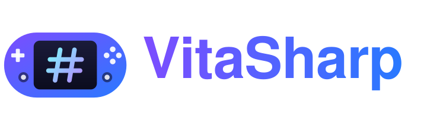
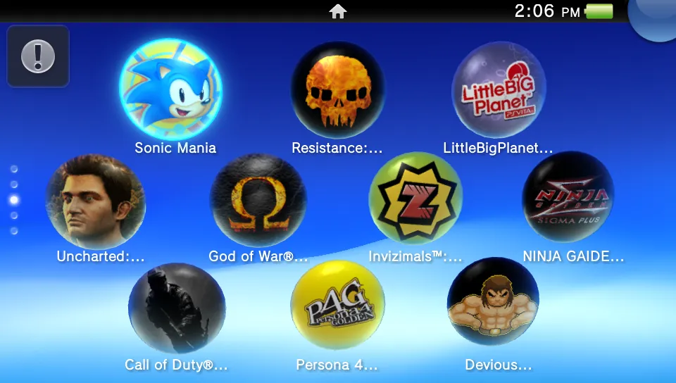
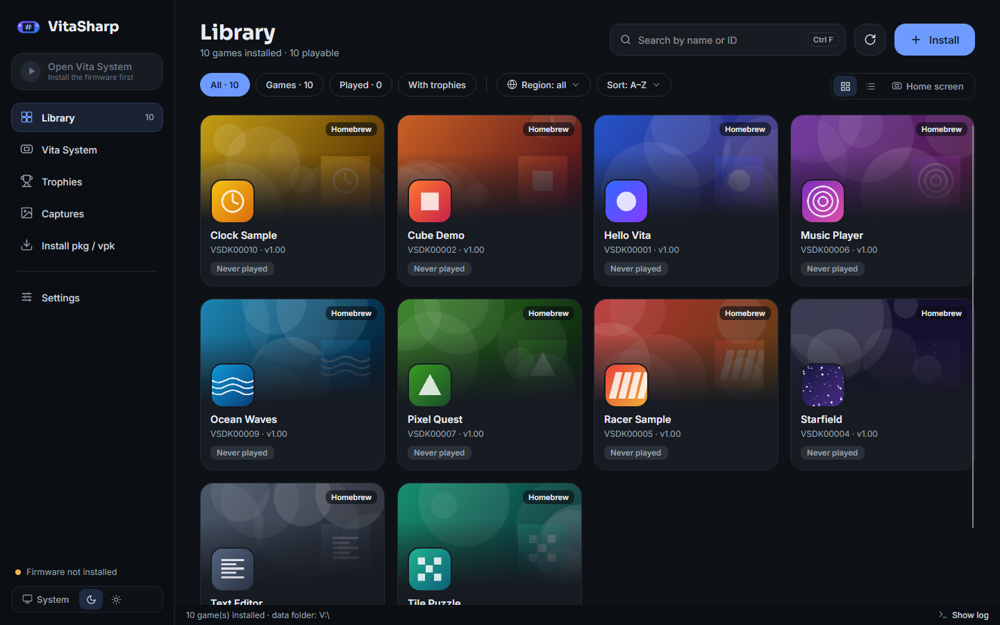
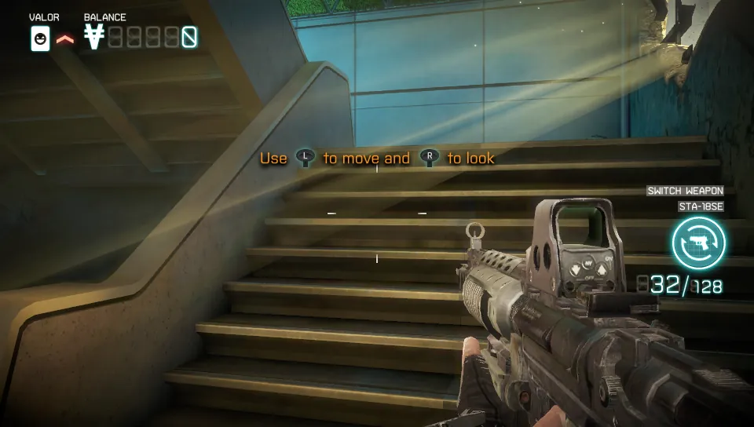
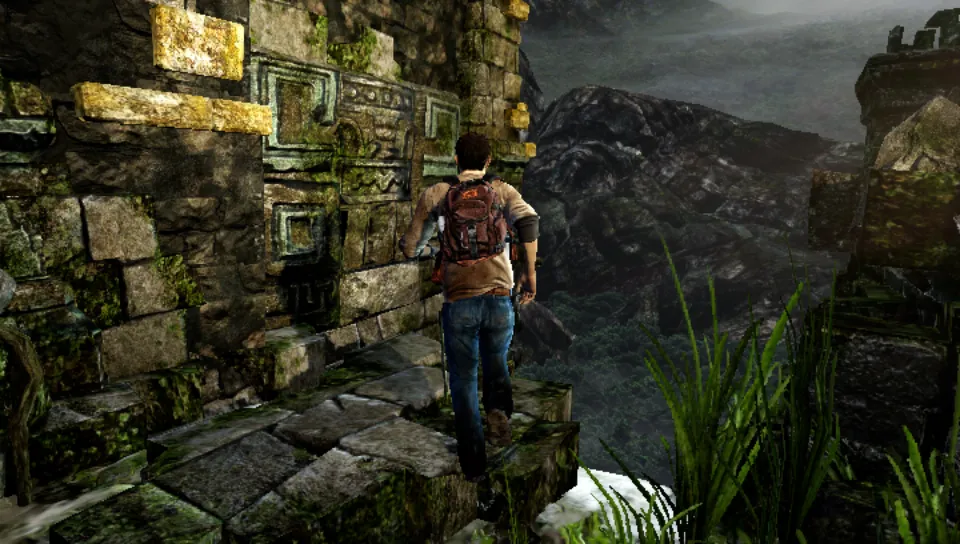
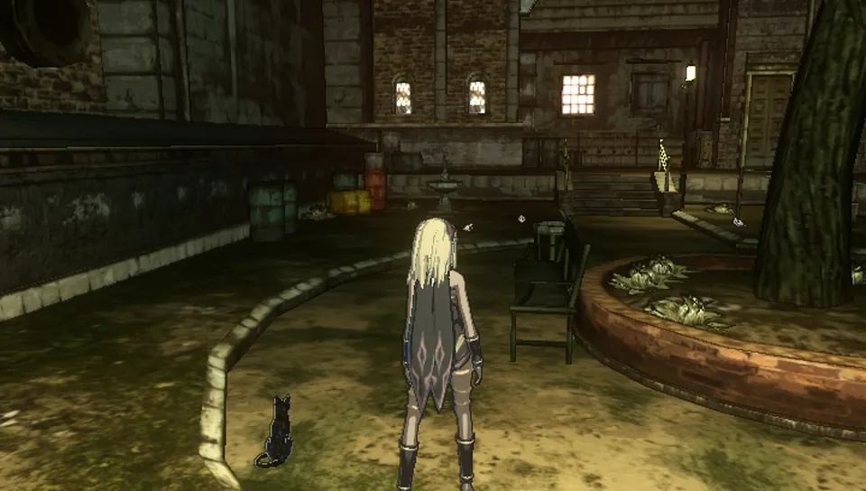
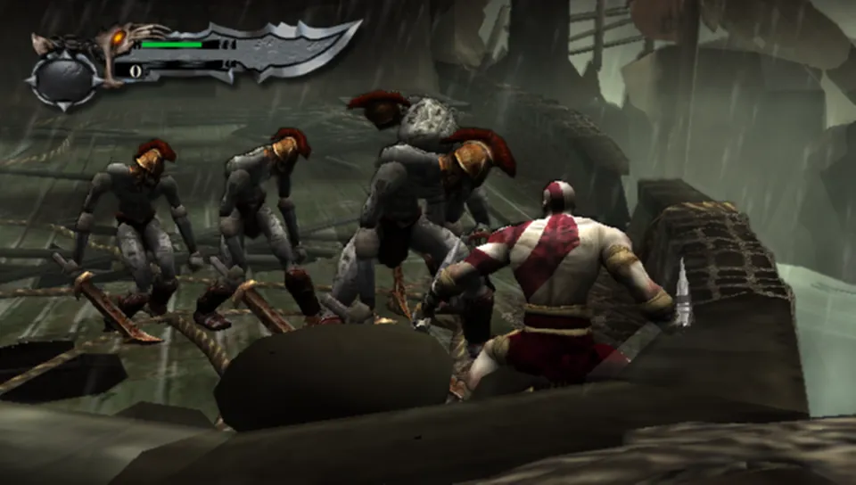
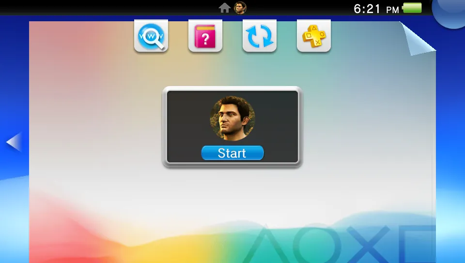
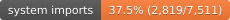
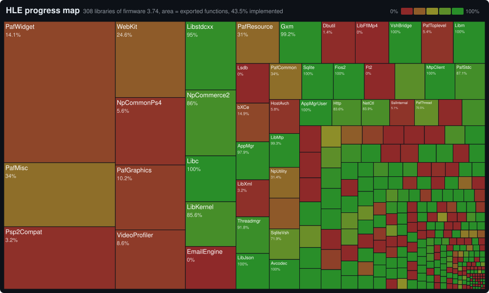

<!-- pair: README.md sha256=1449efee64681f65932f60bd74ee4b34b5d9ab1cc4d2d946fb1c25047c02db0a -->
<div align="center">

[English](README.md) | **Português**



### Um emulador de PlayStation Vita escrito em C#

Roda jogos comerciais do Vita e o próprio sistema do console, sem núcleo nativo: um JIT ARMv7, um renderizador
Vulkan e mais de 1.100 funções do sistema reimplementadas, tudo em .NET 10.

[](LICENSE)
[](https://dotnet.microsoft.com/)
[](https://www.vulkan.org/)
[](docs/compatibility.md)

<br>



<sub><i>A tela inicial de verdade do PS Vita (o <code>shell.self</code> do firmware) rodando no VitaSharp.</i></sub>

<br><br>

<picture>
  <source media="(prefers-color-scheme: light)" srcset="docs/assets/launcher-light.png">
  
</picture>

<sub><i>A biblioteca de jogos do launcher do desktop (entradas homebrew de exemplo; o tema claro segue o tema do seu GitHub).</i></sub>

</div>

---

## O que é

O VitaSharp emula o PS Vita. Ele executa o código ARMv7 do console (interpretador e JITs nativos para x86-64 e
ARM64), traduz os shaders da GPU do Vita para Vulkan e reimplementa as bibliotecas do sistema que os jogos chamam
(HLE). Com o firmware oficial instalado, ele também roda o software do próprio Vita: tela de bloqueio, tela inicial,
LiveArea e jogos abertos por elas. É um projeto de pesquisa em desenvolvimento ativo, todo em C#.

> [!IMPORTANT]
> O VitaSharp não inclui jogos, firmware nem código da Sony. Use jogos e licenças tirados do seu próprio console e
> baixe a atualização do sistema (`PSVUPDAT.PUP`) no site da PlayStation. Pirataria não é suportada.

<table>
<tr>
<td width="33%"><br><sub><b>Killzone: Mercenary</b>, campanha</sub></td>
<td width="33%"><br><sub><b>Uncharted: Golden Abyss</b>, primeira fase</sub></td>
<td width="33%"><br><sub><b>Gravity Rush</b>, abertura</sub></td>
</tr>
<tr>
<td><br><sub><b>God of War Collection</b>, combate</sub></td>
<td><br><sub><b>Persona 4 Golden</b>, abertura</sub></td>
<td><br><sub><b>Sistema do Vita</b>, LiveArea de um jogo</sub></td>
</tr>
</table>

## Status

[](docs/hle/progress.md)
[](docs/hle/progress.md)
[](docs/hle/progress.md)
[](docs/hle/progress.md)

<a href="docs/hle/progress.md">
<picture>
  <source media="(prefers-color-scheme: light)" srcset="docs/assets/status/progress-map-light.svg">
  
</picture>
</a>

[Progresso por biblioteca](docs/hle/progress.md)

<sub>* Porcentagens das funções que o firmware 3.74 exporta para o código de usuário (seus módulos de usuário e as
bibliotecas de syscall dos módulos do kernel) com implementação HLE, não de todas as funções do sistema do PS Vita.
"Games imports": as funções exportadas que os jogos de teste instalados importam; "system imports": as que só o
software do sistema importa; VitaSDK: as funções de usuário da lista de NIDs do VitaSDK. "Default": funções
implementadas que precisam de hardware ou serviço que o emulador não tem e devolvem o resultado do próprio firmware
para esse caso (contam na porcentagem, mostradas à parte). "LLE": funções de bibliotecas que o emulador fornece
carregando e rodando o módulo de verdade que o programa traz (a libsmart/libface do próprio jogo, a libshacccg.suprx que
o usuário extrai do console, o módulo do firmware de uma biblioteca que o emulador carrega para todo importador; também contam, mostradas à parte; lista em [`docs/hle/progress.md`](docs/hle/progress.md)).
Atualizado com `build/hle-status.ps1`.</sub>

## Jogos

38 jogos testados até agora ([`docs/compatibility.md`](docs/compatibility.md), com o estado e o cenário de teste de
cada um): 25 chegam ao gameplay (entre eles Killzone: Mercenary, Uncharted: Golden Abyss, Gravity Rush, God of War
Collection, FIFA 13, Persona 4 Golden, LittleBigPlanet, Tearaway, WRC 4, Skullgirls e Devious Dungeon, vários que
não abrem no Vita3K) e o resto chega aos menus. Os defeitos conhecidos e o trabalho futuro estão no
[roadmap](docs/roadmap.md).

## Plataformas

| Plataforma | Estado |
| --- | --- |
| **Windows** (x64) | A mais testada: launcher, janela do jogo, Sistema do Vita, todas as ferramentas de diagnóstico |
| **Android** (arm64) | App próprio (biblioteca, ajustes, controles na tela, menu de pausa); testado num Redmi Note 14 (Mali-G57) e no emulador x86_64. Por enquanto o APK é compilado localmente ([`docs/android/README.md`](docs/android/README.md)) |
| Linux, macOS | Compilam e geram pacotes; Linux x64 testado no Debian 12, macOS ainda sem teste num Mac |

Requisitos no PC: um driver Vulkan 1.3 (NVIDIA, AMD ou Intel recentes) e um processador com vários núcleos.

## Instalar e jogar

1. Baixe o pacote da página de **Releases** (zip ou instalador para Windows; veja [Releases](#releases)) ou compile
   (veja [Compilar e testar](#compilar-e-testar)).
2. Abra o VitaSharp: o launcher (biblioteca de jogos) aparece.
3. Em **Instalar pkg / vpk** (ou arrastando os arquivos para qualquer tela):
   - **VPK ou zip**;
   - **PKG com licença**: o pacote junto com a licença, um `work.bin`/`.rif` ou o texto zRIF colado;
   - **Pasta descriptografada**: uma pasta de jogo já descriptografada.
4. Escolha o jogo e aperte **Jogar**.

**Firmware (opcional).** Os jogos rodam sem firmware. Instale-o para ter as fontes e bibliotecas do sistema
(`libSceXml`, `libSceSqlite`...) e o **Sistema do Vita**: na página **Sistema do Vita**, **Instalar firmware
(.PUP)…**, ou **Usar firmware do Vita3K** (copia o `os0`/`vs0`/`sa0`/`pd0` de uma instalação do Vita3K). Pela linha
de comando: `install-firmware <PSVUPDAT.PUP>`.

**Sistema do Vita.** Com o firmware instalado, o botão **Abrir Sistema do Vita** do launcher (Ctrl+H, ou `boot-shell`) roda o
`shell.self` do firmware: configuração inicial na primeira vez, tela de bloqueio, tela inicial com os jogos
instalados e LiveArea. Um jogo aberto pela LiveArea roda como um segundo processo; o botão PS (tecla Home) volta ao
sistema e **Continuar** retoma o jogo. Detalhes e o que falta em [`docs/notes/system-apps.md`](docs/notes/system-apps.md).

**Plugins.** O VitaSharp carrega os plugins do `fs/ur0/tai/config.txt` (copiados do seu Vita para `fs/ur0/tai`,
listados como no Vita: `*KERNEL` para os plugins de kernel `.skprx`, `*ALL` / `*TITLEID` para os de usuário `.suprx`) e
roda o código deles. O taiHEN (`taihen.skprx`) também carrega, mas não consegue iniciar: o início dele precisa de
patches nas checagens de assinatura e de DRM do firmware, que o VitaSharp não faz funcionar. Por isso nada que precise
do taiHEN roda, como num Vita sem ele: os plugins feitos sobre ele (kubridge, fd_fix) e os homebrews que o chamam ou
precisam de um desses plugins, entre eles o **Dead Space** (pelo kubridge) e o **Sonic Mania**. Detalhes em
[`docs/notes/plugins.pt-BR.md`](docs/notes/plugins.pt-BR.md).

**Android.** Veja [Android](#android).

**Idioma.** O launcher e a janela do jogo seguem o idioma do sistema (inglês ou português do Brasil);
**Configurações > Geral > Aparência > Idioma** escolhe um (no Android: **Ajustes > Aparência > Idioma**). Os logs continuam em inglês.

Os dados ficam em `%APPDATA%\VitaSharp` no Windows (`~/.local/share/VitaSharp` no Linux,
`~/Library/Application Support/VitaSharp` no macOS; `--data=<pasta>` ou `VITASHARP_DATA` trocam a pasta): jogos em
`fs/ux0/app`, firmware em `fs/os0`... , `logs/`, `savestates/`, `captures/` (Gravar tudo), `gpudumps/`,
`diagnostics/`, `shadercache/`.

## Teclas

| Tecla | Função |
| --- | --- |
| Setas, `W` `A` `S` `D`, `I` `J` `K` `L` | Direcional, analógico esquerdo, analógico direito |
| `X` ou `Espaço` / `C` / `Z` / `V` | Cruz / Círculo / Quadrado / Triângulo |
| `Q` / `E`, `Enter` / `Backspace` | L / R, Start / Select |
| `Home` | Botão PS |
| Botão esquerdo / direito do mouse | Toque na tela frontal / no touchpad traseiro |
| `F1` / `Shift+F1` | Resolução interna seguinte / anterior com o jogo rodando (1x, 2x, 3x, 4x; só nesta sessão, com aviso na tela) |
| `F2` / `Shift+F2` | Taxa de quadros seguinte / anterior com o jogo rodando (nativa, fixa em 30, fixa em 60, sem limite) |
| `F3` / `Shift+F3` | MSAA seguinte / anterior com o jogo rodando (nativo, superamostragem 2x, desligado; só nesta sessão, com aviso na tela) |
| `F4` | Modo do mouse: giroscópio (botão do meio), analógico direito, analógico esquerdo ou desligado, salvo por jogo (`Esc` solta o cursor) |
| `F5` / `F7` | Salvar / carregar o estado rápido; `Shift+F5` / `Shift+F7` salvam / carregam no slot escolhido |
| `F6` | Tela de estados por cima do jogo pausado: o slot rápido e os slots 1-9 com o print, a data, o tempo de jogo e a versão; salvar (substituir pergunta antes, mostrando o print antigo e o atual), carregar (com o print grande), apagar (`Del` / Triângulo) |
| `F8` | Inicia / para o **Gravar tudo** (ver [Relatar um bug](#relatar-um-bug)) |
| `Ctrl+F8` | Inicia / para um dump da GPU (`gpudumps/*.vsgd`; `replay-gpu` refaz desenho por desenho, sem o jogo) |
| `F9` | Liga / desliga o modo de depuração (logs detalhados, pré-gravação de 10 s, capturas automáticas) |
| `F10` | Captura de diagnóstico: o próximo quadro com seus desenhos, texturas, alvos, print e log (`diagnostics/`) |
| `F11` | Tela cheia |
| `P` | Pausa / retoma a emulação |

Controles (SDL2) são detectados sozinhos, com layout posicional (o botão de baixo é sempre Cruz) e giroscópio. Tudo
pode ser remapeado em **Configurações > Controles**, por controle ([`docs/notes/controller-config.md`](docs/notes/controller-config.md)).

## Android

O app Android (`src/VitaSharp.Android`) roda o mesmo núcleo do emulador do desktop em celulares arm64 (Android 8.0 ou
mais novo, Vulkan), com telas próprias: biblioteca de jogos, detalhes do jogo (backend de CPU, clock, perfil de GPU,
VSync e FPS por jogo, saves), troféus, controles, ajustes, firmware, driver da GPU, conta PSN e rede, e uma página de
desempenho. Os textos do app estão em português por enquanto. Telas e design:
[`docs/android/README.md`](docs/android/README.md#screens).

**Instalar o APK.** Ainda não há APK na página de Releases: compile num PC (o workload .NET MAUI Android, o Android
SDK e um JDK 17; o compilador de shaders do aparelho uma vez com `build/build-android-shaderc.ps1` / `.sh`) e instale
o `io.github.vitasharp-Signed.apk` com `adb install` ou abrindo-o no celular. Passos e opções:
[`docs/android/README.md`](docs/android/README.md#building).

```sh
dotnet build src/VitaSharp.Android -c Release -m:2
adb install -r src/VitaSharp.Android/bin/Release/net10.0-android/io.github.vitasharp-Signed.apk
```

**Jogos e firmware.** O app não pede permissão de armazenamento: os arquivos entram pelo seletor de arquivos do
Android. Na **Biblioteca**, **Instalar jogo** aceita um `.vpk` (ou `.zip`) ou um `.pkg` com a licença (`work.bin`,
`.rif` ou o zRIF colado). O firmware é opcional, como no PC: **Ajustes > Firmware > Instalar firmware (.PUP)** com o
`PSVUPDAT.PUP`; depois o **Sistema do Vita** na biblioteca abre a tela inicial de verdade. Drivers de GPU próprios
(Adreno, pela libadrenotools) se instalam em **Ajustes > Driver da GPU**. Os dados ficam na pasta do próprio app
(`Android/data/io.github.vitasharp/files`, a mesma organização do desktop); desinstalar o app apaga essa pasta.

**Controles.** Controles translúcidos na tela, nas laterais da imagem (direcional, analógicos, botões de ação, L/R,
SELECT/PS/START, o botão TRÁS para o touchpad traseiro); toques na imagem são a tela de toque da frente. Controles
Bluetooth ou USB são detectados sozinhos com o layout posicional do desktop (os controles na tela somem enquanto um
está conectado), e um teclado físico usa as teclas do desktop. **Controles** ajusta a troca O/X, zona morta,
opacidade, vibração e ocultar sozinho. O giroscópio e o acelerômetro do celular alimentam o sensor de movimento do
Vita (ainda não verificado num aparelho).

**Menu de pausa.** O botão PS (na tela ou no controle) pausa um jogo aberto sozinho: **Continuar**, **Salvar estado** /
**Carregar estado** (6 slots com imagem), **Ajustes** (toque traseiro, controles na tela, pré-gravação),
**Recentralizar** (movimento), **Gravar tudo** e **Sair do jogo**. O **Gravar tudo** grava o mesmo relatório de bug do
F8 do desktop (estado salvo, entrada, dump da GPU, quadros, áudio e log) em `captures/` até **Parar gravação**; envie
o `.zip` como em [Relatar um bug](#relatar-um-bug).

**Estado e limites.** Testado num Redmi Note 14 (Mali-G57) e no emulador Android x86_64; celulares Adreno e controles
físicos ainda não foram verificados. O desempenho é o trabalho em andamento: jogos mais leves chegam aos 30 ou 60 fps
nativos, os 3D pesados ainda não (Killzone: Mercenary, o teste de referência, roda a uns 12-15 fps contra os 30
dele). Os itens em aberto estão no [roadmap](docs/roadmap.md) (seção Android).

## Relatar um bug

Use o **Gravar tudo**: aperte **F8** durante o jogo (a barra de título mostra *"● REC | Gravando tudo (F8 para
parar)"*), jogue até o problema aparecer e aperte **F8** de novo. Sai um `.zip` em `captures/` com um estado salvo,
os controles, todas as imagens com seus tempos, o dump da GPU, o áudio (mix e cada voz) e o log: dá para reproduzir o
problema sem jogar de novo. No Android: menu de pausa > **Gravar tudo**. Para defeitos rápidos, ligue a
**Pré-gravação** (Configurações > Geral, ou o modo de depuração com F9): o arquivo inclui os segundos antes da tecla.

Envie o `.zip` com o nome do jogo (title ID) e o que aconteceu. Toda sessão também grava `logs/last.log`. Detalhes
em [`docs/notes/session-capture.md`](docs/notes/session-capture.md); quem analisa usa `vitasharp-perf capture <zip>` e
`VitaSharp.Desktop rerun <pasta>`.

## Compilar e testar

Precisa do [.NET 10 SDK](https://dotnet.microsoft.com/download/dotnet/10.0). O primeiro build baixa o FFmpeg
(vídeos e MP3/AAC); as outras bibliotecas nativas vêm do NuGet.

```sh
dotnet build -c Release
dotnet run --project src/VitaSharp.Desktop -c Release          # abre o launcher
dotnet run --project src/VitaSharp.Desktop -c Release -- run <TITLEID>   # abre um jogo direto
dotnet test tests/VitaSharp.Tests -c Release --filter "Category!=Slow"  # testes rápidos (sem o fuzz da CPU)
build/coverage.ps1                                              # relatório de cobertura dos testes (HTML + resumo; também .sh)
```

A linha de comando tem também `install`, `boot-shell`, `test <cenário>` (cenários automáticos em
[`tests/scenarios`](tests/scenarios)), `replay-gpu`, `rerun`, `imports`, `update` e outras: `VitaSharp.Desktop --help`. O app
Android: [`docs/android/README.md`](docs/android/README.md). Pacotes prontos (zip, instalador, tar.gz, AppImage, .app,
.dmg; ReadyToRun ou Native AOT): `build/publish.ps1` / `build/publish.sh`.

Todo script vem em par `.ps1` + `.sh`, e o CI confere isso. Os textos da interface ficam em
`src/VitaSharp.Core/Localization` (`Texts.resx` em inglês, `Texts.pt-BR.resx`); a documentação externa também vem nos
dois idiomas (`README.md` + `README.pt-BR.md`, conferidos pelo `ExternalDocPairsTests`). Para contribuir com funções do
sistema, veja as especificações em [`docs/hle`](docs/hle/README.md).

### Estilo de código

O estilo do C# é o do Ryujinx/Ryubing, e o [`.editorconfig`](.editorconfig) é a regra (o que é cobrado, o que está
desligado e por quê). `build/format-check.ps1` (Windows) / `build/format-check.sh` (Linux, macOS) roda
`dotnet format whitespace` e `dotnet format style --severity warn` com `--verify-no-changes` só nos arquivos `.cs`
versionados (`git ls-files`: nunca a `.claude/` com as worktrees dos agentes, nem arquivos fora do git), como o job
"Code style" do CI, com o mesmo código de saída (2 quando algo difere); `-Fix` / `--fix` reescreve os arquivos em
vez de conferir (rodando também o `build/NamingTool`, que renomeia os símbolos fora das regras de nomes junto com
todas as referências, já que o `dotnet format` aponta o IDE1006 mas não sabe corrigi-lo, e o `build/FormatTool`, que
quebra os blocos escritos numa linha e mantém `{ get; set; }` numa linha; a correção precisa dos pacotes NuGet do
`build/NamingTool`, baixados na primeira vez). As pastas ainda não convertidas ficam em
[`build/format-pending.txt`](build/format-pending.txt) e são puladas. O `OneLineBlockTests` (na suíte de testes)
recusa blocos escritos numa linha só (`if (x) { a; }`): todo corpo vai em linhas próprias.

Os scripts shell seguem o Google Shell Style Guide e precisam passar no ShellCheck (job "ShellCheck" do CI; o job
"Scripts on macOS" também roda o `build/check-scripts-help.sh` no bash 3.2 do sistema). Instale o ShellCheck com
`winget install koalaman.shellcheck` (Windows), `sudo apt install shellcheck` / `sudo dnf install ShellCheck`
(Linux) ou `brew install shellcheck` (macOS) e rode `shellcheck --severity=style build/*.sh build/package/*.sh`.

### Ferramentas de desenvolvimento

- Dump do backend IL: `VITASHARP_IL_DUMP=<pasta>` grava os blocos do jogo compilados como assemblies para ler no ILSpy
  (`dotnet tool install -g ilspycmd`, depois `ilspycmd -il <arquivo>.dll`); `DOTNET_JitDisasm=<método>` mostra o
  código de máquina que o RyuJIT gera. Veja [`docs/notes/il-jit.md`](docs/notes/il-jit.md).
- Validação do Vulkan: `--validation` (`run`, `test`, `replay-gpu`) ou `VITASHARP_VK_VALIDATION=1` (`=sync` inclui a
  validação de sincronização) precisa da camada da Khronos: o [Vulkan SDK](https://vulkan.lunarg.com/sdk/home)
  (Windows, Linux, macOS) ou, no Linux, o pacote da distribuição (`vulkan-validationlayers` /
  `vulkan-validation-layers`); no macOS o SDK também traz o MoltenVK. Captura de quadros:
  [RenderDoc](https://renderdoc.org) (Windows, Linux) e os dumps da GPU (`replay-gpu`,
  [`docs/notes/gpu-dump.md`](docs/notes/gpu-dump.md)) em todos os sistemas.
- Perfil: `dotnet-trace` / `dotnet-counters` (`dotnet tool install -g dotnet-trace`, todos os sistemas); no Windows
  também o PerfView e o WPR/WPA (Windows Performance Toolkit).

### Requisitos dos testes

O que o `dotnet test tests/VitaSharp.Tests` precisa em cada sistema; um teste sem o seu requisito é pulado e diz o porquê.

| | Windows | Linux | macOS |
|---|---|---|---|
| SDK | .NET 10 SDK | .NET 10 SDK | .NET 10 SDK |
| Dispositivo Vulkan (testes do renderizador, dos dumps da GPU e dos jogos rodando) | o SwiftShader que vem com o Microsoft Edge ou o Google Chrome (achado sozinho) | o lavapipe do Mesa: `sudo apt install mesa-vulkan-drivers libvulkan1` (Fedora: `mesa-vulkan-drivers vulkan-loader`) | o MoltenVK: o Vulkan SDK da LunarG, ou `brew install molten-vk vulkan-loader` |
| shaderc (testes do renderizador e de compilação de shaders; o renderizador também precisa dele) | vem do pacote Silk.NET.Shaderc.Native | vem do pacote; quando essa cópia não carrega: `sudo apt install libshaderc-dev` (Fedora, Arch: `shaderc`) | vem do pacote |
| Uma janela do desktop (testes do overlay do jogo) | sempre | uma tela X11 ou Wayland; sem tela: `xvfb-run dotnet test tests/VitaSharp.Tests` (`sudo apt install xvfb`) | pulados: o AppKit só cria janelas na thread principal, e os testes rodam em threads de trabalho |
| FFmpeg (testes de decodificação de vídeo e áudio) | baixado pelo primeiro build | baixado pelo primeiro build | o do sistema: `brew install ffmpeg` |

- Qualquer sistema: `VK_DRIVER_FILES` (ou `VK_ICD_FILENAMES`) com o manifesto ICD de um SwiftShader ou Mesa baixado é
  usado no lugar.
- Firmware: sem ele os testes dos módulos reais do firmware (`libSceJson`, `libSceXml`, `libpaf`, a instalação do
  arquivo de atualização) são pulados. `VITASHARP_FIRMWARE_PUP` aponta um `PSVUPDAT.PUP`, `VITASHARP_FIRMWARE_DIR` uma
  pasta `vs0` ou de dados do Vita3K; os testes do compilador do Piglet precisam do `libshacccg.suprx` em `ur0:data`.
- Os testes nunca usam a sua pasta de dados: cada um cria uma pasta temporária (`VITASHARP_DATA` nos processos filhos);
  os testes de jogo rodando iniciam um executável pequeno que os próprios testes escrevem.
- Opcional: as camadas de validação do Vulkan SDK da LunarG rodam as cargas do renderizador sob validação com
  `dotnet test tests/VitaSharp.Tests --filter Category=Slow` (`RendererValidationTests`; pulado sem a camada).
- O teste de janela abre uma janela oculta (`VITASHARP_HIDDEN_WINDOW=1`): no Linux precisa de um display (`DISPLAY`), no
  Windows do carregador Vulkan do sistema (`vulkan-1.dll`, instalado com qualquer driver de GPU).

## Releases

- **Versões**: uma tag `v*` (ou **Actions > Release > Run workflow**) publica uma release com os pacotes Native AOT de
  Windows, Linux e macOS e o `SHA256SUMS.txt`.
- **Builds automáticos**: todo push na `main` cujo CI passou vira uma prerelease `build-<commit>` com os pacotes
  daquele CI (as 10 mais novas ficam).
- **Atualização automática**: os pacotes procuram uma versão nova ao abrir (Configurações > Geral > Atualizações:
  liga/desliga, canal builds automáticos ou só versões, **Procurar agora**). O diálogo mostra a versão em uso, a nova,
  a data e as novidades, com **Pular esta versão**, **Lembrar depois** e **Atualizar agora**: o pacote da plataforma
  é baixado, conferido pelo `SHA256SUMS.txt` e trocado (o instalador, no Windows instalado pelo setup), e o VitaSharp
  reabre. Só os arquivos do emulador mudam; a pasta de dados nunca. Um build compilado do código se atualiza pelo git
  (pela linha de comando: `update [--channel=releases] [--apply]`).
- Os pacotes não são assinados (o Windows SmartScreen avisa) e nunca incluem firmware.

## Créditos e licença

O VitaSharp se apoia no trabalho da comunidade do Vita: [Vita3K](https://github.com/Vita3K/Vita3K) (referência de
comportamento, NIDs, modelo de registradores USSE), [VitaSDK](https://vitasdk.org/) e vita-headers, a
[wiki de desenvolvimento do PS Vita](https://wiki.henkaku.xyz/), [VGAudio](https://github.com/Thealexbarney/VGAudio)
(decodificador ATRAC9, MIT), [RPCN](https://github.com/RipleyTom/rpcn), [Silk.NET](https://github.com/dotnet/Silk.NET),
[Avalonia](https://avaloniaui.net/), [FFmpeg](https://ffmpeg.org/) (LGPL, baixado no build) e
[SQLite](https://sqlite.org/) (domínio público) pelo [SQLitePCLRaw](https://github.com/ericsink/SQLitePCL.raw) (Apache-2.0).

Licença **GPL v3** ([LICENSE](LICENSE)); componentes de terceiros mantêm as suas. PlayStation e PS Vita são marcas da
Sony Interactive Entertainment; o VitaSharp não tem ligação com a Sony.
