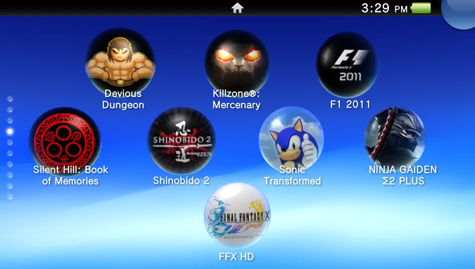
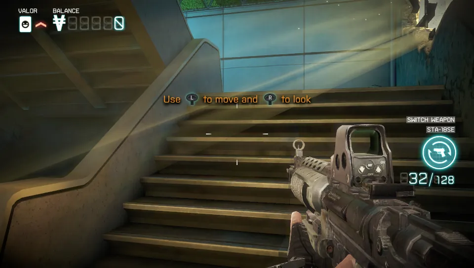
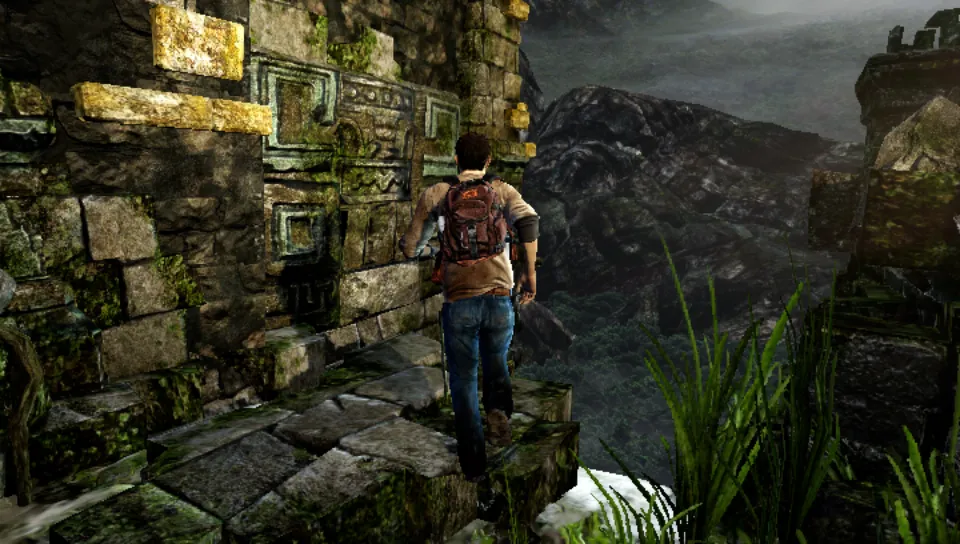
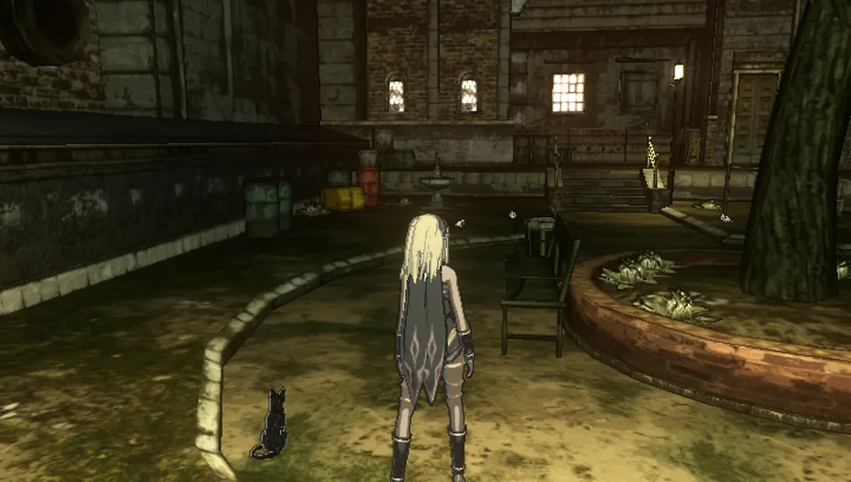
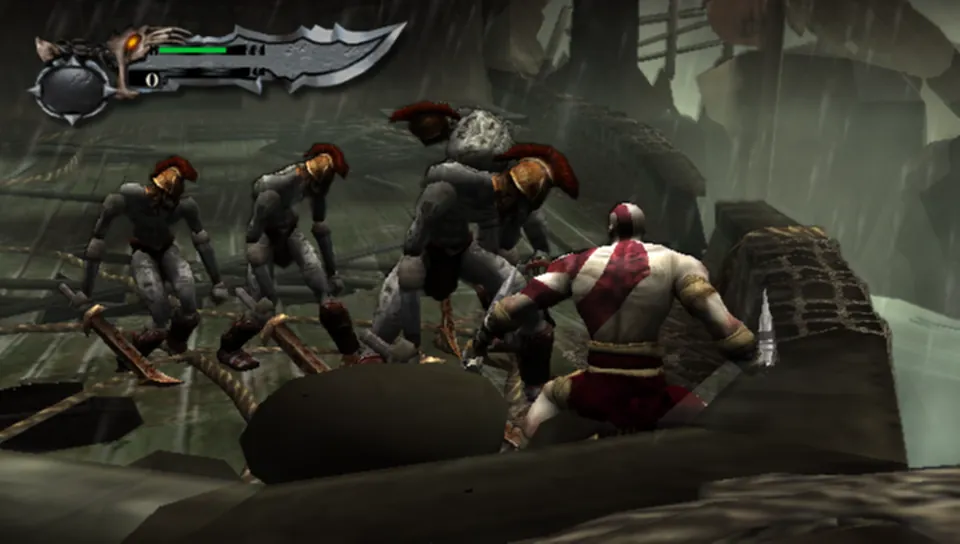
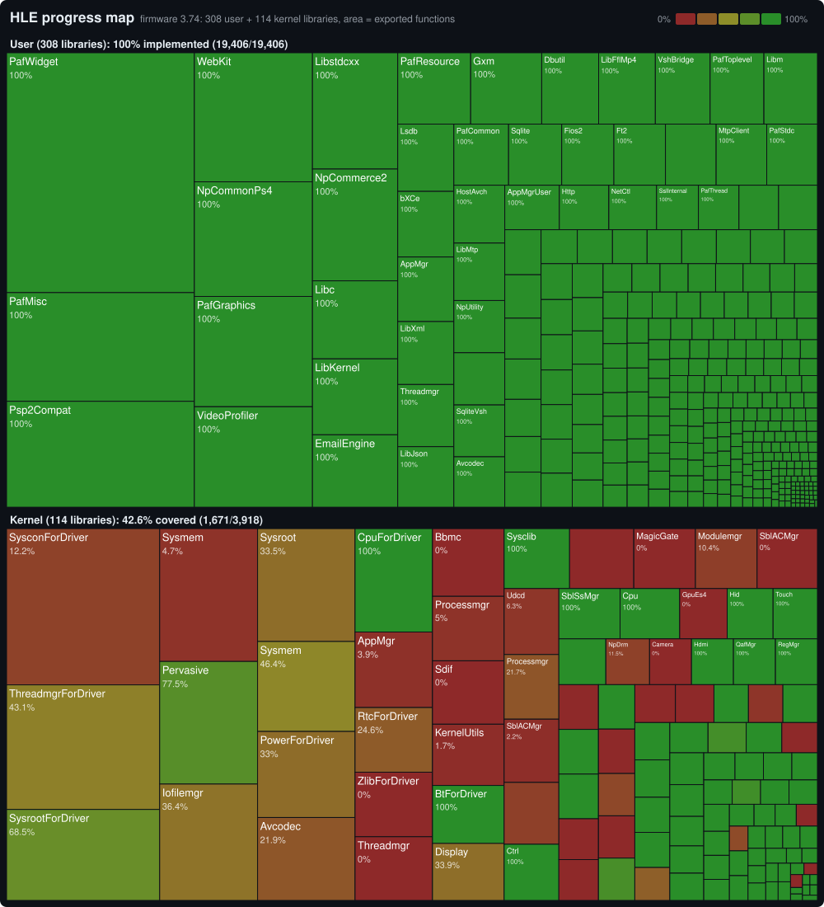
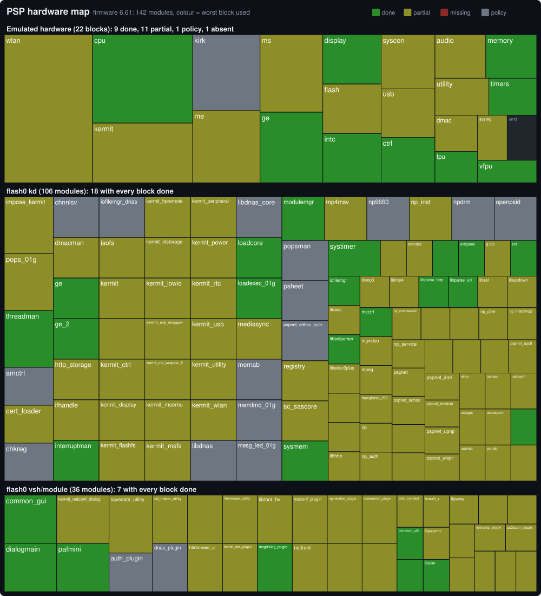

<!-- pair: README.md sha256=7b564a20222cbcc66bb3d292446e4fa1f35a534a928a1dd5767dfc73c1868f72 -->
<div align="center">

[English](README.md) | **Português**


### Um emulador de PlayStation Vita escrito em C#

Roda jogos comerciais do Vita e o próprio software de sistema do console, sem núcleo nativo: um JIT ARMv7, um
renderizador Vulkan e mais de 1.100 funções do sistema reimplementadas, tudo em .NET 10.

[](LICENSE)
[](https://dotnet.microsoft.com/)
[](https://www.vulkan.org/)
[](docs/compatibility.pt-BR.md)

<br>



<sub><i>A tela inicial real do PS Vita (o <code>shell.self</code> do firmware) rodando no VitaSharp.</i></sub>

</div>

---

**Conteúdo:** [Começo rápido](#começo-rápido) · [O que é](#o-que-é) · [Estado atual](#estado-atual) · [Progresso](#progresso) ·
[Requisitos](#requisitos) · [Instalação](#instalação) · [Firmware e fontes do sistema](#firmware-e-fontes-do-sistema) ·
[Seu primeiro jogo](#seu-primeiro-jogo) · [Controles](#controles) · [Opções principais](#opções-principais) ·
[Relatar um bug](#relatar-um-bug) · [Onde ficam os seus dados](#onde-ficam-os-seus-dados) · [Desenvolvimento](#desenvolvimento) ·
[Licença e créditos](#licença-e-créditos)

## Começo rápido

1. Baixe o VitaSharp do seu sistema na página de **Releases** ([Instalação](#instalação)).
2. Abra: o launcher (a sua biblioteca de jogos) aparece.
3. Clique em **Instalar pkg / vpk** e escolha um jogo tirado do seu próprio console ([Seu primeiro jogo](#seu-primeiro-jogo)).
4. Selecione o jogo e aperte **Jogar**.
5. Opcional: instale o firmware oficial e o pacote de fontes dele para ter a tela inicial real do Vita
   ([Firmware e fontes do sistema](#firmware-e-fontes-do-sistema)).

> [!IMPORTANT]
> O VitaSharp não inclui jogos, firmware nem código da Sony. Use jogos e licenças tirados do seu próprio console e
> baixe a atualização do sistema (`PSVUPDAT.PUP`) no site da PlayStation. Pirataria não é suportada.

## O que é

O VitaSharp emula o PS Vita num PC (Windows, Linux, macOS) e em celulares Android. Ele roda o código ARM do console,
traduz o trabalho da GPU do Vita para Vulkan e reimplementa as bibliotecas do sistema que os jogos chamam. Com o
firmware oficial instalado ele também roda o software do próprio Vita: a tela de bloqueio, a tela inicial, a LiveArea
e os jogos abertos por elas.

É um projeto de pesquisa em desenvolvimento ativo. Muitos jogos já chegam ao gameplay, mas nenhum tem garantia de
rodar do começo ao fim, e alguns ainda não abrem.

<table>
<tr>
<td width="33%"><br><sub><b>Killzone: Mercenary</b>, campanha</sub></td>
<td width="33%"><br><sub><b>Uncharted: Golden Abyss</b>, primeiro capítulo</sub></td>
<td width="33%"><br><sub><b>Gravity Rush</b>, abertura</sub></td>
</tr>
<tr>
<td><br><sub><b>God of War Collection</b>, combate</sub></td>
<td><br><sub><b>Persona 4 Golden</b>, abertura</sub></td>
<td><br><sub><b>Sistema do Vita</b>, a LiveArea de um jogo</sub></td>
</tr>
</table>

<div align="center">
<picture>
  <source media="(prefers-color-scheme: light)" srcset="docs/assets/launcher-light.png">
  
</picture>

<sub><i>A biblioteca de jogos do launcher do desktop (entradas de homebrew de exemplo; o tema claro segue o tema do seu GitHub).</i></sub>
</div>

<p><b>No Android</b> (Redmi Note 14, Mali-G57):</p>

<table>
<tr>
<td rowspan="3" width="40%" valign="top"><br><sub><b>Biblioteca</b>, a lista de jogos do app</sub></td>
<td width="60%"><br><sub><b>Killzone: Mercenary</b>, campanha, controles na tela</sub></td>
</tr>
<tr>
<td width="60%"><br><sub><b>Menu de pausa</b>, save states e Gravar tudo</sub></td>
</tr>
<tr>
<td width="60%"><br><sub><b>Uncharted: Golden Abyss</b>, o Prólogo, 30 fps</sub></td>
</tr>
</table>

## Estado atual

| Área | Estado |
| --- | --- |
| **Jogos de PS Vita** | 37 testados: 24 chegam ao gameplay (Killzone: Mercenary, Uncharted: Golden Abyss, Gravity Rush, God of War Collection, FIFA 13, Persona 4 Golden, LittleBigPlanet, Tearaway, WRC 4, Skullgirls, Devious Dungeon...), 12 chegam aos menus, 1 sem confirmação. Lista completa: [compatibilidade](docs/compatibility.pt-BR.md) |
| **Sistema do Vita** (a tela inicial real) | Funciona com o firmware instalado: configuração inicial, tela de bloqueio, tela inicial, LiveArea, abrir e retomar jogos ([detalhes](docs/notes/system-apps.md)) |
| **Windows** (x64) | A plataforma mais testada: launcher, janela do jogo, Sistema do Vita, todas as ferramentas de diagnóstico |
| **Linux** (x64) | Compila e roda; testado no Debian 12 |
| **macOS** (Apple silicon) | Compila e gera pacotes; ainda sem teste num Mac |
| **Android** (arm64) | App próprio; testado num Redmi Note 14 (Mali-G57). O desempenho é o principal trabalho em andamento ([Android](docs/user-guide.pt-BR.md#android)) |
| **Jogos de PSP e PSone** | Em andamento: o núcleo da CPU do PSP está escrito e o emulador de PSP do próprio Vita está sendo colocado de pé, mas jogos de PSP e PSone ainda não rodam; o Adrenaline ainda não passa do início ([notas do PSP](docs/notes/psp-compat.pt-BR.md)) |
| **PlayStation Mobile (PSM)** | Os jogos e o runtime do PSM se instalam; rodá-los está em andamento |
| **Multijogador local (ad hoc)** | Primeira parte: grupos ad hoc do PSP entre instâncias do VitaSharp na mesma rede |

Os defeitos conhecidos e o trabalho futuro estão no [roadmap](docs/roadmap.md).

## Progresso

Quanto do software de sistema do console o VitaSharp reimplementa, gerado pelo `build/hle-status` a partir do firmware
e dos jogos de teste ([progresso por biblioteca](docs/hle/progress.md)).

[](docs/hle/progress.md)
[](docs/hle/progress.md)
[](docs/hle/progress.md)
[](docs/hle/progress.md)
[](docs/hle/progress.md)
[](docs/psp/progress.pt-BR.md)

<table>
<tr>
<td width="50%" valign="top" align="center">
<a href="docs/hle/progress.md">
<picture>
  <source media="(prefers-color-scheme: light)" srcset="docs/assets/status/progress-map-light.svg">
  
</picture>
</a>
<br><sub><b>PS Vita:</b> uma célula por biblioteca do firmware (usuário e kernel), do tamanho das suas funções e com a
cor de quantas estão implementadas.</sub>
</td>
<td width="50%" valign="top" align="center">
<a href="docs/psp/progress.pt-BR.md">
<picture>
  <source media="(prefers-color-scheme: light)" srcset="docs/assets/status/progress-map-psp-light.svg">
  
</picture>
</a>
<br><sub><b>PSP:</b> o VitaSharp roda o firmware 6.61 real do PSP, então este mapa mede o hardware emulado que ele usa:
uma célula por bloco e por módulo do firmware, com a cor do pior bloco de que o módulo precisa.</sub>
</td>
</tr>
</table>

<details>
<summary>O que as porcentagens significam</summary>

<sub>Porcentagens das funções que o firmware 3.74 exporta para código de usuário (os módulos de usuário dele e as
bibliotecas de syscall dos módulos de kernel) com implementação HLE, não de todas as funções do sistema do PS Vita.
"Imports dos jogos": as funções exportadas que os jogos de teste instalados importam; "imports do sistema": as que só o
software do sistema importa; VitaSDK: as funções de usuário da lista de NIDs do VitaSDK. "Default": funções
implementadas que precisam de um hardware ou serviço que o emulador não tem e devolvem o próprio resultado do firmware
para esse caso (contadas na porcentagem, mostradas à parte). "LLE": funções de bibliotecas que o emulador oferece
carregando e rodando o módulo real que o programa traz (a libsmart/libface do próprio jogo, o libshacccg.suprx que o
usuário extrai do console, o módulo do firmware de uma biblioteca que o emulador carrega para todo importador; também
contadas, mostradas à parte; lista em [`docs/hle/progress.md`](docs/hle/progress.md)). "Exports de kernel": as funções
que os módulos de kernel exportam para outro código de kernel (o que um plugin de kernel pode importar), do censo em
[`docs/hle/kernel-exports.md`](docs/hle/kernel-exports.md). Atualizado com `build/hle-status.ps1`.</sub>

</details>

## Requisitos

| | Windows | Linux | macOS | Android |
| --- | --- | --- | --- | --- |
| Sistema | Windows 10 ou 11, x64 | distribuição x64 (testada: Debian 12) | Apple silicon (arm64) | Android 8.0 ou mais novo, arm64 |
| GPU | driver Vulkan 1.3 (NVIDIA, AMD ou Intel recentes) | driver Vulkan 1.3 (Mesa ou o do fabricante) e o carregador Vulkan | MoltenVK 1.3 ou mais novo | Vulkan 1.1 ou mais novo |
| Programas extras | nenhum | `libvulkan1` (`sudo apt install libvulkan1 mesa-vulkan-drivers`) | `brew install molten-vk vulkan-loader ffmpeg` (ou o Vulkan SDK da LunarG + `brew install ffmpeg`) | nenhum |
| CPU | vários núcleos | vários núcleos | vários núcleos | vários núcleos |

O firmware é opcional para a maioria dos jogos ([abaixo](#firmware-e-fontes-do-sistema)). Compilar pelo código tem os
seus próprios requisitos ([Desenvolvimento](#desenvolvimento)).

## Instalação

Todos os pacotes estão na página de **Releases**: versões numeradas e prereleases automáticas `build-<commit>` de todo
build da `main` cujas checagens passaram. Os pacotes não são assinados e nunca incluem firmware.

### Windows

1. Baixe o `VitaSharp-<versão>-win-x64-setup.exe` (instalador) ou o `VitaSharp-<versão>-win-x64.zip`.
2. Rode o instalador, ou descompacte o zip em qualquer pasta.
3. Abra o **VitaSharp** (`VitaSharp.Desktop.exe`). O SmartScreen avisa porque o pacote não é assinado: **Mais
   informações > Executar assim mesmo**.

### Linux

1. Instale o carregador Vulkan e um driver: `sudo apt install libvulkan1 mesa-vulkan-drivers` (Fedora:
   `vulkan-loader mesa-vulkan-drivers`).
2. Baixe o `VitaSharp-<versão>-linux-x64.AppImage` (ou o `.tar.gz`).
3. AppImage: `chmod +x VitaSharp-*.AppImage` e rode. Tarball: descompacte e rode `VitaSharp/VitaSharp.Desktop`.

### macOS

1. Instale o Vulkan e o FFmpeg: `brew install molten-vk vulkan-loader ffmpeg`.
2. Baixe o `VitaSharp-<versão>-osx-arm64.dmg` (ou o `.app.zip`) e arraste o VitaSharp para Aplicativos.
3. O app não é assinado: na primeira vez, clique nele com o botão direito e escolha **Abrir**.

### Android

1. Baixe o `VitaSharp-<versão>-android-arm64.apk` da página de Releases.
2. Abra no celular (permitindo instalar dessa origem) ou rode `adb install -r <apk>`.
3. Na primeira abertura o app pede **"Acesso a todos os arquivos"**: permita, para os seus jogos e saves ficarem na
   pasta visível `.vitasharp` na raiz do armazenamento do celular e continuarem lá se o app for desinstalado.

Os APKs das releases são assinados com a chave fixa do projeto, então um APK mais novo instala por cima do antigo e
mantém os seus dados. Um APK que você mesmo compila, ou de um fork, é assinado com outra chave: aí o Android pede para
desinstalar o app antigo antes. Detalhes do app, das telas e de como compilá-lo: [guia do Android](docs/user-guide.pt-BR.md#android)
e [`docs/android/README.md`](docs/android/README.md).

### Atualizações

Os pacotes do desktop procuram uma versão nova ao abrir (**Configurações > Geral > Atualizações**: liga/desliga, canal,
**Procurar agora**) e podem se atualizar sozinhos; a sua pasta de dados nunca é mexida
([detalhes](docs/user-guide.pt-BR.md#atualizações)).

## Firmware e fontes do sistema

**O que é.** O firmware é o software de sistema do próprio PS Vita. A Sony publica ele como um arquivo de atualização
do sistema, o `PSVUPDAT.PUP`, no site da PlayStation. O VitaSharp nunca o distribui.

**Precisa dele?** A maioria dos jogos roda sem. Instale para ter:

- o **Sistema do Vita** (a tela de bloqueio, a tela inicial e a LiveArea de verdade);
- as bibliotecas do sistema que o VitaSharp não reimplementa (`libSceXml`, `libSceSqlite`, `libSceJson`...), que
  alguns jogos usam;
- as fontes do sistema (do pacote de fontes, abaixo), sem as quais o Sistema do Vita e vários jogos ficam sem texto.

**Como instalar.**

1. Baixe o `PSVUPDAT.PUP` (a atualização do sistema; a versão 3.74 é a testada) no site da PlayStation.
2. No launcher, abra a página **Sistema do Vita** e clique em **Instalar firmware (.PUP)…** (Android: **Ajustes >
   Firmware > Instalar firmware (.PUP)**).
3. Instale também o **pacote de fontes**: **Instalar pacote de fontes (.PUP)...** com o pacote de fontes do firmware da
   Sony, um `.PUP` separado que traz as fontes do sistema (o mesmo arquivo para o qual o guia de início rápido do Vita3K
   aponta). A atualização do sistema não tem fontes: num Vita de verdade elas vêm de fábrica.
4. Clique em **Abrir Sistema do Vita** (ou aperte `Ctrl+H`).

Já tem o Vita3K? **Usar firmware do Vita3K** copia o firmware dele, fontes incluídas, com um clique. Pela linha de
comando: `VitaSharp.Desktop install-firmware <arquivo.PUP>`. Mais (desinstalar, o código de boot do PSP, o que cada
parte faz): [guia do usuário](docs/user-guide.pt-BR.md#firmware).

## Seu primeiro jogo

1. Tire o jogo do seu próprio console: um `.vpk`, um `.pkg` com a licença, ou uma pasta de jogo já descriptografada.
2. No launcher clique em **Instalar pkg / vpk**, ou arraste os arquivos para qualquer tela (Android: **Biblioteca >
   Instalar jogo**).
3. Escolha o que você tem:

   | Você tem | Dê ao launcher |
   | --- | --- |
   | VPK ou zip | o arquivo |
   | PKG | o `.pkg` e a licença: um arquivo `work.bin` / `.rif` ou o texto zRIF colado |
   | Pasta descriptografada | a pasta do jogo |

4. Selecione o jogo e aperte **Jogar**. A primeira abertura de um jogo é mais lenta: os shaders e o código dele são
   preparados e guardados para a próxima vez.

Atualizações e DLC se instalam do mesmo jeito e vão para onde o console guarda. Jogos de PlayStation Mobile, onde fica
cada arquivo e o que acontece numa reinstalação: [guia do usuário](docs/user-guide.pt-BR.md#jogos-e-onde-ficam).

## Controles

Controles USB e Bluetooth (pelo SDL2) funcionam sozinhos, com os botões por posição (o botão de baixo é sempre Cruz) e
giroscópio. Tudo pode ser remapeado em **Configurações > Controles**, por controle
([detalhes](docs/notes/controller-config.md)). No Android há controles na tela; veja o
[guia do Android](docs/user-guide.pt-BR.md#android).

| Tecla | Função |
| --- | --- |
| Setas, `W` `A` `S` `D`, `I` `J` `K` `L` | Direcional, analógico esquerdo, analógico direito |
| `X` ou `Espaço` / `C` / `Z` / `V` | Cruz / Círculo / Quadrado / Triângulo |
| `Q` / `E`, `Enter` / `Backspace` | L / R, Start / Select |
| `Home` | Botão PS |
| `End` | Botão POWER: um toque põe o sistema em modo de espera (a imagem fica, com um aviso; o toque seguinte volta e o jogo recebe os callbacks de energia de uma retomada), segurar 2 s abre o menu de energia do sistema (com o Sistema do Vita rodando), segurar 4 s desliga (a sessão termina) |
| Botão esquerdo / direito do mouse | Toque na tela frontal / no touchpad traseiro |
| `F1` / `Shift+F1` | Resolução interna seguinte / anterior com o jogo rodando (1x, 2x, 3x, 4x; só nesta sessão, com aviso na tela) |
| `F2` / `Shift+F2` | Taxa de quadros seguinte / anterior com o jogo rodando (nativa, fixa em 30, fixa em 60, sem limite) |
| `F3` / `Shift+F3` | MSAA seguinte / anterior com o jogo rodando (nativo, superamostragem 2x, desligado; só nesta sessão, com aviso na tela) |
| `F4` | Modo do mouse: giroscópio (botão do meio), analógico direito, analógico esquerdo ou desligado, salvo por jogo (`Esc` solta o cursor) |
| `F5` / `F7` | Salvar / carregar o estado rápido; `Shift+F5` / `Shift+F7` salvam / carregam no slot escolhido |
| `F6` | Tela de estados por cima do jogo pausado: o slot rápido e os slots 1-9 com o print, a data, o tempo de jogo e a versão; salvar (substituir pergunta antes, mostrando o print antigo e o atual), carregar (com o print grande), apagar (`Del` / Triângulo) |
| `F8` | Inicia / para o **Gravar tudo** (ver [Relatar um bug](#relatar-um-bug)) |
| `Shift+F8` | Durante a gravação: marca o problema (uma marca e um estado salvo daquele momento vão na gravação; `rerun --from=mark1` começa dali) |
| `Ctrl+F8` | Inicia / para um dump da GPU (`gpudumps/*.vsgd`; `replay-gpu` refaz desenho por desenho, sem o jogo) |
| `F9` | Liga / desliga o modo de depuração (logs detalhados, pré-gravação de 10 s, capturas automáticas) |
| `F10` | Captura de diagnóstico: o próximo quadro com seus desenhos, texturas, alvos, print e log (`diagnostics/`) |
| `F11` | Tela cheia |
| `P` | Pausa / retoma a emulação |

## Opções principais

As **Configurações** do launcher valem para todos os jogos; a página de um jogo as substitui para aquele jogo. O app
Android tem as mesmas opções, com os mesmos nomes.

| Opção | Onde | O que faz |
| --- | --- | --- |
| Resolução interna | Configurações > Gráficos; a página do jogo; `F1` | Desenha a 1x-4x a resolução do Vita (o Android também 50% e 75%) |
| Taxa de quadros, MSAA | a página do jogo; `F2`, `F3` | Ritmo nativo ou fixo em 30/60/sem limite; MSAA nativo, superamostragem 2x ou desligado |
| Carregar o cache de shaders antes de jogar | Configurações > Gráficos; a página do jogo | Monta os shaders gravados nas sessões anteriores antes de o jogo começar, para evitar engasgos |
| Pré-compilar código ARM | Configurações > Gráficos; a página do jogo | Traduz o código do jogo em todos os núcleos livres antes de ele começar |
| Idioma / Idioma do sistema | Configurações > Geral; a página do jogo | O idioma do launcher (inglês ou português do Brasil) / o idioma que um jogo vê |
| Modelo | Configurações > Emulação | PS Vita portátil (padrão) ou PlayStation TV |
| Teclado e mouse Bluetooth | Configurações > Emulação | Dá o teclado e o mouse do PC aos jogos e apps que os leem (navegador, chat) |
| Ad hoc pela rede local | Configurações > Emulação | Multijogador local com outras instâncias do VitaSharp na mesma rede |
| Microfone, Localização | Configurações > Áudio | O que o microfone do Vita ouve; uma posição fixa para apps que perguntam onde o Vita está |
| Pré-gravação | Configurações > Avançado | Guarda os últimos segundos, para o **Gravar tudo** incluir o que aconteceu antes do `F8` |
| Ativar Plugins do Kernel | Configurações > Avançado | Desligada por padrão (firmware puro); ligada, carrega os plugins do seu `config.txt` |

Todas as opções, com a chave de linha de comando e os detalhes: [guia do usuário](docs/user-guide.pt-BR.md).

## Relatar um bug

O **Gravar tudo** gera um `.zip` com tudo o que é preciso para ver e reproduzir o problema sem o jogo.

1. Opcional, para problemas que passam rápido: ligue a **Pré-gravação** (Configurações > Avançado, ou o modo de
   depuração com `F9`), para a gravação ter também os segundos antes de você apertar a tecla.
2. Durante o jogo aperte **F8** (a barra de título mostra *"● REC | Gravando tudo (F8 para parar)"*). Android: menu
   de pausa > **Gravar tudo**.
3. Jogue até o problema aparecer. Nesse momento aperte **Shift+F8** (Android: menu de pausa > **Marcar o problema**):
   a gravação ganha uma marca e um estado salvo daquele instante.
4. Aperte **F8** de novo (Android: **Parar gravação**). O `.zip` fica na pasta `captures/` da sua
   [pasta de dados](#onde-ficam-os-seus-dados).
5. Abra uma issue no GitHub com o `.zip`, o nome e o title ID do jogo e o que aconteceu. O `logs/last.log` também ajuda.

A gravação leva um estado salvo, os controles, todas as imagens com seus tempos, o dump da GPU, o áudio e o log. Ela
não leva nada pessoal: caminhos e nomes de usuário, computador e conta viram marcadores, e nenhum arquivo do jogo,
licença ou chave é copiado. Quem corrige o problema consegue analisar, reexecutar e conferir uma correção
(`VitaSharp.Desktop verify <zip>`) sem o jogo e sem os seus plugins: veja [`docs/captures.pt-BR.md`](docs/captures.pt-BR.md) e
[`docs/notes/session-capture.md`](docs/notes/session-capture.md).

## Onde ficam os seus dados

| Sistema | Pasta de dados |
| --- | --- |
| Windows | `%APPDATA%\VitaSharp` |
| Linux | `~/.local/share/VitaSharp` |
| macOS | `~/Library/Application Support/VitaSharp` |
| Android | `/sdcard/.vitasharp` (com "Acesso a todos os arquivos"; senão `Android/data/io.github.vitasharp/files`) |

Dentro dela: `fs/` é o armazenamento do Vita (jogos em `fs/ux0/app`, saves em `fs/ux0/user/00/savedata`, firmware em
`fs/os0`, `fs/vs0`...), mais `logs/`, `savestates/`, `captures/` (Gravar tudo), `gpudumps/`, `diagnostics/` e
`shadercache/`. `--data=<pasta>` ou a variável `VITASHARP_DATA` usam outra pasta. Atualizar o VitaSharp nunca muda
essa pasta. Antes de desinstalar o app Android sem "Acesso a todos os arquivos", copie o `fs/ux0/user/00/savedata`
para fora.

## Desenvolvimento

### Compilar e testar

Precisa do [.NET 10 SDK](https://dotnet.microsoft.com/download/dotnet/10.0). O primeiro build baixa o FFmpeg (vídeos
e MP3/AAC); as outras bibliotecas nativas vêm do NuGet.

```sh
dotnet build -c Release
dotnet run --project src/VitaSharp.Desktop -c Release          # abre o launcher
dotnet run --project src/VitaSharp.Desktop -c Release -- run <TITLEID>   # abre um jogo direto
dotnet test tests/VitaSharp.Tests -c Release --filter "Category!=Slow"  # testes rápidos (sem o fuzz da CPU)
```

Antes de um push rode `build/prepush-check.ps1` (Windows) / `build/prepush-check.sh` (Linux, macOS, Git Bash): sobre
exatamente o que está commitado ele roda a paridade dos scripts, o `--help` dos scripts, o ShellCheck, o estilo do
código, um build com 0 avisos e a suíte `Category!=Slow`; só suba depois de "prepush-check: ok".

O resto para quem contribui está em [`docs/development.pt-BR.md`](docs/development.pt-BR.md): a linha de comando, os
pacotes, os requisitos dos testes por sistema, o estilo de código, as opções de desenvolvedor e o processo de release.
Também: [ferramentas de desenvolvimento](docs/notes/developer-tools.md), o [build do app Android](docs/android/README.md#building),
as especificações das funções do sistema em [`docs/hle`](docs/hle/README.md) e o [roadmap](docs/roadmap.md).

## Licença e créditos

Licença **GPL v3** ([LICENSE](LICENSE)); componentes de terceiros mantêm as suas. PlayStation e PS Vita são marcas da
Sony Interactive Entertainment; o VitaSharp não tem ligação com a Sony.

O VitaSharp se apoia no trabalho da comunidade do Vita: [Vita3K](https://github.com/Vita3K/Vita3K) (referência de
comportamento, NIDs, modelo de registradores USSE), [VitaSDK](https://vitasdk.org/) e vita-headers, a
[wiki de desenvolvimento do PS Vita](https://wiki.henkaku.xyz/), [PPSSPP](https://www.ppsspp.org/) (referência de
comportamento da CPU do PSP; as tabelas do interpolador da VFPU e a do recíproco do GE, GPL-2.0-or-later,
[third_party/ppsspp](third_party/ppsspp/README.md)), [pspautotests](https://github.com/hrydgard/pspautotests)
(resultados do hardware do PSP usados pelos testes) e [RPCN](https://github.com/RipleyTom/rpcn).

Componentes de terceiros:

| Componente | Usado para | Licença |
| --- | --- | --- |
| [Silk.NET](https://github.com/dotnet/Silk.NET) | bindings de Vulkan, OpenAL, SDL2, janelas e shaderc | MIT |
| [OpenAL Soft](https://openal-soft.org/), [SDL2](https://www.libsdl.org/), [shaderc](https://github.com/google/shaderc) | som e microfone, controles, compilador de shaders (bibliotecas nativas) | LGPL-2.0-or-later, zlib, Apache-2.0 |
| [Avalonia](https://avaloniaui.net/) | o launcher do desktop | MIT |
| [.NET MAUI](https://github.com/dotnet/maui), [MauiReactor](https://github.com/adospace/reactorui-maui) | o app Android | MIT |
| [FFmpeg](https://ffmpeg.org/) pelo FFmpeg.AutoGen | decodificação de vídeo e MP3/AAC (baixado no build) | LGPL |
| [VGAudio](https://github.com/Thealexbarney/VGAudio) | decodificador ATRAC9 | MIT |
| [SQLite](https://sqlite.org/) pelo [SQLitePCLRaw](https://github.com/ericsink/SQLitePCL.raw) | as bases de dados do sistema | domínio público, Apache-2.0 |
| [Iced](https://github.com/icedland/iced) | geração de código x86-64 do JIT | MIT |
| [libadrenotools](https://github.com/bylaws/libadrenotools) | drivers de GPU próprios no Android | BSD-2-Clause |
| [FlashCap](https://github.com/kekyo/FlashCap), [StbTrueTypeSharp](https://github.com/StbSharp/StbTrueTypeSharp) | as câmeras do PC, o rasterizador das fontes do sistema | veja cada projeto |
| [Unicorn](https://www.unicorn-engine.org/) | CPU ARM de referência para os testes e a comparação lockstep | GPL-2.0 |
| [Inter](https://rsms.me/inter/), [Sora](https://fonts.google.com/specimen/Sora) | as fontes do app Android | SIL OFL 1.1 |
