# Android app

`src/VitaSharp.Android` is a .NET MAUI Android app (MauiReactor screens, a native game activity with a Vulkan
SurfaceView) that builds into an installable APK. It has run on the **x86_64 Android emulator** (30/10/2026, results in
[Emulator run](#emulator-run-30102026)): every screen, two games to their menus on the native x64 JIT, the surface,
pause/resume, AAudio and the on-screen controls. It has also run on a **phone** (Redmi Note 14, Mali-G57, 30/10/2026:
[Phone run](#phone-run-redmi-note-14-mali-g57-30102026)): the native ARM64 JIT, the Mali driver, AAudio, MediaCodec
movies and six games. Adreno (and libadrenotools) and real controllers are still unverified (the checklist at the end).
On-screen text is in Portuguese, like the desktop launcher.

## Building

Needs the .NET MAUI Android workload (`dotnet workload install maui-android`), the Android SDK (platform 36,
build-tools) and a JDK 17. The desktop build does not: the app is outside `VitaSharp.sln`, which only gained the
platform-neutral `VitaSharp.Android.Common` (plain `net10.0`).

```
dotnet build src/VitaSharp.Android -c Release -m:2
# or the whole Android side: dotnet build VitaSharp.Android.sln -c Release -m:2
# without ANDROID_HOME in the environment: add -p:AndroidSdkDirectory=<sdk>
#   (Windows %LOCALAPPDATA%\Android\Sdk, Linux ~/Android/Sdk, macOS ~/Library/Android/sdk)
```

The renderer needs shaderc on the device, and `Silk.NET.Shaderc.Native` has no Android build: once per checkout,
`build/build-android-shaderc.ps1` (or `.sh`) compiles `libshaderc_shared.so` for arm64-v8a and x86_64 from the shaderc sources
the NDK ships (`sources/third_party/shaderc`, ndk-build, libc++ static, 16 KiB-page aligned) into
`third_party/android-shaderc/libs/<abi>/` (not committed); the app packages them when they exist. It needs the NDK
(`sdkmanager "ndk;30.0.16248370"`, r30 was used) and takes long (glslang + SPIRV-Tools, about 460 files per ABI;
`-Jobs 2` by default).

Custom GPU drivers need libadrenotools: `build/build-android-adrenotools.ps1` (or `.sh`) fetches its sources at a
pinned commit (git, once) into `third_party/android-adrenotools/src` and builds `libadrenotools.so` and its four hook
libraries for arm64-v8a with ndk-build (no CMake needed, 2 jobs, under a minute) into
`third_party/android-adrenotools/libs/arm64-v8a/` (not committed); the app packages them when they exist, else the
system Vulkan driver is always used. Details: [mobile GPU notes](../notes/mobile-gpu.md#custom-drivers-android).

Output: `src/VitaSharp.Android/bin/Release/net10.0-android/io.github.vitasharp-Signed.apk` (debug-keystore signed,
arm64-v8a + x86_64). Size on 30/10/2026: 43,713,556 bytes (41.7 MiB) with libshaderc (38,974,327 without); with the
MediaCodec/AAudio backends, libadrenotools and `extractNativeLibs` (native libraries stored compressed), without
libshaderc: 39,253,246 (+278,919; libadrenotools and hooks are about 142 KB of it compressed); with both libshaderc
builds and libadrenotools: 44,136,042. A Release rebuild of both ABIs takes about 3 minutes with `-m:2`. Since the
full AOT default (30/10/2026, [Runtime and AOT choice](#runtime-and-aot-choice-vitasharpandroidruntime)): 66,860,650
bytes and about 5 minutes; since the LLVM default (31/10/2026): about 17 minutes for `-r android-arm64` (82 MB APK);
`-p:VitaSharpAndroidRuntime=mono-aot` builds in 5, `mono-jit` gives the old build.
`-r android-arm64` (phones) or `-r android-x64` (the emulator) builds one ABI, into `bin/Release/net10.0-android/<rid>/`
(about 2 minutes, for iterating).

| Project | Target | In `VitaSharp.sln` | What |
|---|---|---|---|
| `src/VitaSharp.Android.Common` | `net10.0` | yes | models behind the screens, on-screen pad, gamepad mapping, logcat formatting (unit-tested: `AndroidAppTests`) |
| `src/VitaSharp.Android` | `net10.0-android` (minSdk 26) | no (`VitaSharp.Android.sln`) | the MAUI app, game activity, Android backends |

## Code

- `Pages/` (MauiReactor components, no XAML) and `Ui/` (theme, the shared building blocks of the mockups:
  header, cards, rows, chips, progress bars, pickers). Fonts: Sora and Inter (SIL OFL 1.1, `Resources/Fonts`).
- `Platforms/Android/Game/`: `GameActivity` (the in-game screen), `EmulationSession` (the Android counterpart of the
  desktop `Runner`), `AndroidVulkanSurface` (`IPresentationSurface`), `OnScreenControlsView`, `GamePerformance`
  (thread placement, ADPF, display rate: [below](#cpu-cores-and-adpf)).
- `Platforms/Android/Services/`: `LogcatSink`, `Saf` (Storage Access Framework picker); `Services/AppServices.cs`:
  data folder, settings, controller profiles, Keystore.
- `Audio/AndroidAudioBackend.cs` (AAudio, AudioTrack), `Media/MediaCodecVideoDecoder.cs`,
  `Media/AndroidMediaPlayer.cs`, `Gpu/AdrenoToolsDriverLoader.cs`: the audio, video and GPU driver backends
  ([below](#audio-video-and-gpu-drivers); compiled into the app, not run yet). Their platform-neutral halves are in
  `VitaSharp.Android.Common` (`Audio/BufferedPcmStream.cs`, `Media/MediaCodecSupport.cs`,
  `Storage/GameProcessMarker.cs`; unit-tested: `AndroidMediaDriverTests`).
- `src/VitaSharp.Android.Common`: `Library/` (game scan, trophy progress and list), `Settings/` (global and per-game
  settings, CPU/clock/GPU choices, PSN/network, `RuntimeReport`, `EnvironmentFile`), `Firmware/FirmwareSetup.cs`,
  `Gpu/GpuDriverScreen.cs` (Driver/Informações da GPU models), `Input/` (`OnScreenPad`, `AndroidGamepads`,
  `AndroidKeyboard`, `AndroidInput`), `Logging/` (`LogcatFormat`, `SessionLog`), `Performance/` (`CpuTopology`, `ThreadPlacementPlanner`,
  `FrameRateEstimator`, `FrameWorkMeter`; unit-tested: `AndroidPerformanceTests`), `Storage/DataLayout.cs`.
- Icon: the adaptive launcher icon (`Platforms/Android/Resources/mipmap-*`) generated from `docs/assets/logo.svg` by
  `build/make-icons.ps1`.

## Runtime and CPU backends

- **.NET for Android 10 runs on Mono** (the MAUI default). The APK carries `libmonosgen-2.0.so` with its JIT and,
  in Release, AOT images of **every method of every assembly** (`libaot-*.so`, `VitaSharpAndroidRuntime=mono-aot`,
  [below](#runtime-and-aot-choice-vitasharpandroidruntime)). The AOT mode is Mono's `Normal` one: the JIT stays and
  compiles what the AOT images do not cover (the `[UnsafeAccessor]` stubs of the HLE bindings, some generic
  instantiations, every DynamicMethod). So `RuntimeFeature.IsDynamicCodeSupported` and `IsDynamicCodeCompiled` stay
  true: the **IL backend** (DynamicMethod/Reflection.Emit) is available, as on the desktop. `UseInterpreter` is off;
  the app does not use Mono's AOT-only modes or Native AOT, which remove the JIT: `AndroidAotMode=Full` and Native AOT
  have no Reflection.Emit at all (no IL backend, and Full cannot run the UnsafeAccessor stubs either), `Hybrid` runs
  DynamicMethods in Mono's interpreter (the IL backend would work, interpreted); the native backend and the guest
  interpreter work under all of them.
- **Native ARM64 JIT**: it does not depend on Reflection.Emit (generated code is called through
  `delegate* unmanaged`, callouts are `[UnmanagedCallersOnly]`), so it works under Mono as under CoreCLR or Native
  AOT. Its code arena is the Android dual mapping of `ExecutableMemory` (memfd on API 30+, ASharedMemory on 26-29;
  RWX only as the last resort). On the x86_64 Android emulator the **native x64 backend** is the default instead.
- Default chain on a phone: native > il > interpreter (`Jit.All`); `RuntimeReport` writes runtime, dynamic-code
  flags, each backend's availability and the selected chain to the log at startup; Desempenho shows the same.
- Trimming: `TrimMode=partial` with `VitaSharp.Core` and `VitaSharp.Renderer.Vulkan` rooted (the HLE tables and
  Silk.NET are not trim-annotated). JSON uses source-generated contexts.

## CPU cores and ADPF

The game process places its hot threads itself (`Platforms/Android/Game/GamePerformance.cs`; the decisions are in
`VitaSharp.Android.Common/Performance`, unit-tested: `AndroidPerformanceTests`). Measured on the Redmi Note 14 ([Phone run 2](#phone-run-2-performance-31102026)): the main guest thread and the GPU worker run on cores 6-7, the rest on 0-5.

- **Clusters** (`CpuTopology`): read at start from `/sys/devices/system/cpu/cpuN/cpu_capacity` and
  `cpufreq/cpuinfo_max_freq`, cores grouped by (capacity, maximum frequency) and ordered slowest to fastest; capacity
  ranks first when every core has one (it separates an A55 from an A76 even at the same clock). No core number is
  assumed: the Helio G99 is 0-5 (A55) + 6-7 (A76), other SoCs are 4+4, 1+3+4, 2+3+3. One kind of core: nothing is
  pinned.
- **Placement** (`ThreadPlacementPlanner`, about once a second, `sched_setaffinity` on each thread's tid): the
  emulator's threads register their tid and role in the core (`NativeThread.Register(name, role)`: guest threads, the
  GPU worker, the JIT workers; the renderer's shader workers by name). Their CPU time over the last second (thread CPU
  clocks) decides:
  - fastest cluster: the **main guest thread** (the busiest guest thread; the first one until there are loads; it only
    changes when another is 1.5x + 0.1 core busier, so the pinning does not flap), the **GPU worker**, then other guest
    threads using at least 30% of a core while a fast core is left (4+4 phones);
  - a **single fast core** (1+3+4): the main guest thread has it, the GPU worker goes to the mid cluster (to the slow
    cores when there is none);
  - every other core: the other guest threads (audio, file, job threads; moved at the next step if one becomes the
    busiest) and the **JIT workers** (background compiles: the guest keeps running the interpreter/IL code meanwhile);
  - **shader workers**: the other cores while the hot threads use more than (fast cores - 0.25) of the fast cluster,
    every core once they leave half a fast core idle (hysteresis): when the GPU thread waits for a shader, or during a
    load, the compile it waits for runs on a fast core; a background compile during gameplay does not take time from
    the game;
  - anything else (UI thread, runtime, driver threads) is left to the system.
- **Timer slack**: guest threads and the GPU worker set a 1 µs timer slack (`PR_SET_TIMERSLACK`; Linux's default is
  50 µs), so their short sleeps end on time: nothing spins on a phone (`HostTuning.AvoidBusyWaits`, below).
- **ADPF** (API 31+, `PerformanceHintManager` through the Java API): one hint session for the hot threads (main guest
  thread, GPU worker, any extra hot guest thread; `setThreads` on API 34+, a new session below). Each frame the
  foreground guest process presents (`Display.Presented`) reports the CPU time of the busiest hot thread since the
  previous frame (`FrameWorkMeter`: time blocked on vblank, pacing sleeps or the GPU is not work; never more than the
  frame's wall time). The target is the game's frame time, 16.68 ms at 60 fps or 33.37 ms at 30 (`FrameRateEstimator`:
  the smallest frame interval, in whole vblanks, of the last 60 frames that were either one vblank long or contained
  a display wait longer than one vblank period, `VBlank.LongWaits`, which only `sceDisplayWaitVblankStartMulti` /
  `sceDisplayWaitSetFrameBufMulti` with 2+ vblanks produce; a 60 fps game that takes 20 ms and then waits for the next
  vblank also presents every 2 vblanks, but never waits that long, so it keeps the 16.7 ms target). Below API 31 or
  without a session (`createHintSession` returns null on some devices) nothing is reported.
- **Sustained performance mode** (`Window.setSustainedPerformanceMode`) is **off** by default: it holds the clocks at a
  level the phone can keep for hours, which is below its peak, while ADPF already asks for what each frame needs.
  `VITASHARP_ANDROID_SUSTAINED=1` turns it on where `PowerManager.isSustainedPerformanceModeSupported` (for long
  sessions on a phone that throttles hard; the log says whether it is supported).
- **Off switch**: `VITASHARP_ANDROID_AFFINITY=off` in `config/env.txt` disables both the placement and ADPF (timer slack,
  no spinning and the display rate stay), to compare.
- **Log** (also in logcat during gameplay), once the main thread is known, e.g.
  `CPU clusters: 0-5 @2.0GHz, 6-7 @2.2GHz; pinned guest main 'main' to 6-7 + gpu to 6-7; other guest threads and JIT
  workers to 0-5; shader workers to 0-5 (all cores while the fast ones are idle); ADPF session on (target 16.68 ms)`;
  in the file: `ADPF: hint session for threads ...` (with the device's preferred update rate), `ADPF/placement: hot
  threads ...` at each change of the hot set, `Game frame rate: 30 fps`.

## Frame pacing

- **Swapchain**: FIFO with VSync on (the default, Ajustes/Detalhes), 3 images on Android (`max(minImageCount, 3)`; the
  desktop keeps `minImageCount + 1`, at least 3). The `Swapchain ... (N images)` log line shows what the driver gave.
- **Display refresh rate** (API 30+): the game's frame rate (`FrameRateEstimator`: 60, or 30 for a 30 fps game) goes to
  `Surface.setFrameRate` (compatibility DEFAULT), so a 90/120 Hz panel runs at a rate the frames divide evenly instead
  of juddering; the first rate of a surface may change the display mode even when not seamless (API 31+
  `CHANGE_FRAME_RATE_ALWAYS`), later changes only when seamless. Log: `Surface frame rate: 60 Hz (display at N Hz now)`.
- **No busy waits** (`HostTuning.AvoidBusyWaits`, set by the game process): `PreciseSleep.Until` sleeps the whole wait
  instead of spinning its last 0.5 ms (vblank waits, timed guest waits, the 30 µs syscall wake-up latency of blocking
  waits), and the vblank callback notifier sleeps to the next vblank instead of waking every millisecond. The CPU pacing
  (`CpuCore.Throttle`) already never spun and never sleeps while the guest is behind: it sleeps only when a thread is
  more than 1 ms ahead of real time, and restarts its ledger when it falls more than 10 ms behind.
- **Not used**: Swappy (AGDK frame pacing) is a native library to build and bundle, and `VK_GOOGLE_display_timing` would
  need present-time bookkeeping in the renderer; FIFO with 3 images plus the matching display rate covers the judder
  case. Both are options if the phone measurements show uneven frame times.

**Measuring on/off** (Knightin'+, Devious Dungeon, F1 2011; same scene, phone cool, charger state the same): run each
game twice, once with an empty `config/env.txt` and once with `VITASHARP_ANDROID_AFFINITY=off`, ~3 minutes each, and
compare the average FPS Detalhes records for the session (`Session of ... ends after ..., N frames`), the FPS chip, and
`adb logcat -s VitaSharp` for the `CPU clusters:` line (absent when off). Where the threads run:
`adb shell ps -T -o TID,PSR,PCY,CMD -p $(adb shell pidof io.github.vitasharp:game)` (PSR = the core; the main guest
thread and `GPU worker` should show 6 or 7 on the G99) and `adb shell cat /proc/<pid>/task/<tid>/status | grep
Cpus_allowed_list`. Clocks during the run: `adb shell cat /sys/devices/system/cpu/cpufreq/policy6/scaling_cur_freq`
(the policy number is the first core of the fast cluster); ADPF effects in `adb shell dumpsys power | grep -i hint`
and Perfetto (`power.hint` / cpufreq tracks).

### Runtime and AOT choice (`VitaSharpAndroidRuntime`)

The roadmap's "Custo do Mono" item: everything managed (HLE modules, renderer, GXM/shader translation, audio, the
JIT compilers themselves) ran on Mono's JIT, whose code is much weaker than CoreCLR's RyuJIT, and the .NET for
Android Release default only AOT-compiles the methods of the MAUI startup profiles plus the app assembly
(`profile-only`): `VitaSharp.Core.dll` (4.3 MB of IL) got a 384 KB AOT image, the renderer 19 KB. The csproj now
selects the runtime with one property; **Release defaults to `mono-aot-llvm`** (since 31/10/2026, measured below), Debug to
`mono-jit`:

```
dotnet build src/VitaSharp.Android -c Release -m:2                                   # mono-aot-llvm
dotnet build src/VitaSharp.Android -c Release -m:2 -p:VitaSharpAndroidRuntime=mono-aot   # 5-minute build
dotnet build src/VitaSharp.Android -c Release -m:2 -p:VitaSharpAndroidRuntime=mono-jit   # the old Release
#   mono-jit | mono-aot | mono-aot-llvm | coreclr; anything else stops the build
```

| Value | What it sets | Runtime |
|---|---|---|
| `mono-jit` | nothing (SDK defaults: profiled AOT in Release, no AOT in Debug) | Mono JIT for everything outside the startup profiles |
| `mono-aot` | `RunAOTCompilation=true`, `AndroidEnableProfiledAot=false`, `AndroidAotMode=Normal` | every method AOT-compiled by Mono's own backend, the JIT kept |
| `mono-aot-llvm` | the same plus `EnableLLVM=true` | AOT through LLVM (`opt`/`llc` of the AOT cross pack), the JIT kept |
| `coreclr` | `UseMonoRuntime=false` | CoreCLR, RyuJIT with tiering, partial ReadyToRun; warning XA1040 (experimental) |

Mono's AOT task starts one compiler per logical CPU (plus `opt`/`llc` each with LLVM), which pinned the PC's 8 cores
above 90%; the csproj sets `_DisableParallelAot=true` (one assembly at a time per ABI, two ABIs in parallel with
`-m:2`) unless `-p:VitaSharpParallelAot=true`. The variant is in the app assembly's metadata and the startup log
says which one ran: `Runtime: .NET 10.0.x (Mono), Arm64, android-arm64, build mono-aot`.

Measured on 30/10/2026 (both ABIs, `-m:2`, only the app's `obj/Release` cleaned; the referenced projects already
built; with libshaderc and libadrenotools):

| Variant | Builds | App build | Signed APK | arm64 AOT images | `VitaSharp.Core` image | `Renderer.Vulkan` image |
|---|---|---|---|---|---|---|
| `mono-jit` | yes | 2 min 24 s | 44,156,522 | 13.6 MB, profile-only | 384,080 | 18,736 |
| `mono-aot` (default until 31/10) | yes | 4 min 46 s (3 min 41 s parallel) | 66,860,650 | 55.4 MB, all methods | 12,356,512 | 1,436,320 |
| `mono-aot-llvm` (default) | yes | 19 min 4 s | 68,417,130 | 51.1 MB, all methods | 9,407,576 | 1,139,272 |
| `coreclr` | yes (XA1040) | 2 min 55 s | 77,141,717 | partial R2R inside the DLLs | (R2R: 4.36 MB vs 4.30 MB IL) | |
| Native AOT (`-p:PublishAot=true`, publish) | **no** | 6 min 27 s to the link error | | | | |

- **`mono-aot`**: `VitaSharp.Core` compiles 21,303 of 24,155 methods; the other 2,852 are the `[UnsafeAccessor]`
  externs the HLE binder generates ("Method has zero rva"), tiny stubs the JIT builds on first call. The renderer:
  1,208/1,208. Size: +22.7 MB APK (the AOT images of the framework, MAUI and Iced are most of it; the hot managed code
  of the emulator also lives in CoreLib: collections, spans, `Math`, so the whole set is compiled, not only
  VitaSharp's assemblies).
- **`mono-aot-llvm`**: builds (NDK r30 present; the toolchain is the AOT cross pack's LLVM), 4x the build time,
  +1.5 MB over `mono-aot`, smaller code for VitaSharp.Core (9.4 vs 12.4 MB). LLVM usually generates much better
  loops and register use than Mono's own backend, but it is the riskier code generator: a candidate for the phone
  A/B, not the default.
- **`coreclr`**: builds and packs `libcoreclr.so` + `libclrjit.so` (the MAUI app included); RyuJIT is the best
  managed code generator of the four once the hot methods reach tier 1, but .NET 10 marks the runtime experimental
  (XA1040, "not intended for production"), the R2R of the release build is partial (VitaSharp.Core gains 54 KB of
  precompiled code, so startup and the first minutes are JIT time) and the APK is the largest (debugger libraries
  `libmscordaccore.so`/`libmscordbi.so` included). It is .NET 11's default, so it is the path forward: second
  candidate for the phone A/B.
- **Native AOT**: ILC compiles the whole app (MAUI, MauiReactor; only Silk.NET's loader IL3000/IL3002 warnings), but
  the link fails with NDK r30: `ld.lld: duplicate symbol: __unw_init_local` (the runtime pack's libunwind against the
  NDK's). Even fixed, it would be a dead end here: .NET 10 MAUI supports Native AOT only on iOS/Mac Catalyst
  (Android is experimental even in .NET 11), `TrimMode` must be full (Silk.NET and the HLE tables are not
  trim-annotated) and there is no Reflection.Emit, so the IL backend goes. Not offered by the switch.
- **What each keeps of the CPU backends**: the native ARM64 JIT maps its arena with mmap/memfd and calls into it
  through `delegate* unmanaged`, with `[UnmanagedCallersOnly]` callouts: no Reflection.Emit, so it works under all of
  them (Mono's AOT compiles the native-to-managed wrappers of the callouts; under `Normal` the JIT can still build
  any missing one). Mono `Normal` AOT keeps `mono_aot_only` off, so dynamic code is supported and compiled: the startup
  line should stay `Dynamic code: supported True, compiled True` and `CPU backend selected: native (chain: native > il
  > interp)`, as with `mono-jit`; CoreCLR reports the same. The desktop build is untouched (only the Android csproj
  and `RuntimeReport`'s first line changed).

**Speed on the phone (31/10/2026, [Phone run 2](#phone-run-2-performance-31102026)): `mono-aot-llvm` is the Release
default now.** Same code (branch perf/android-phone), same scenes, VSync on, `mono-aot` against `mono-aot-llvm`:

| Game, scene | `mono-aot` | `mono-aot-llvm` |
|---|---|---|
| F1 2011, race start (GPU worker and NGS bound) | 10-12 fps; NGS thread 8.7 ms/frame | 15.4-15.8 fps (+35%); NGS 3.8 ms/frame |
| Devious Dungeon, town (JIT bound) | 49-50 fps; 13.8 fps in the first 30 s | 52 fps; 20.8 fps in the first 30 s |

LLVM's code is much better for the managed hot loops (renderer, HLE, NGS, copies) that Mono's own AOT backend compiles
poorly; the guest code is the native JIT's in both. The cost is the build: about 17 minutes for one ABI instead of 5
(single-threaded `opt`/`llc`, so it stays well under the CPU cap). One native crash happened in an LLVM run of F1 2011
(GPU worker, null pointer in `libGLES_mali.so` under `vkEndCommandBuffer`); the same crash (same driver pc) also
happened with `mono-aot` and in the earlier phone runs, so it is a driver issue, not the runtime (open, see below).
`coreclr` was not measured. `-p:VitaSharpAndroidRuntime=mono-aot` gives the faster-building variant.

#### Phone measurement plan (Redmi Note 14, one agent, serially)

1. Build the four APKs for the phone only, each into its own folder (the debug keystore is the same, so `adb install
   -r` keeps the data folder, firmware and games):
   `dotnet build src/VitaSharp.Android -c Release -r android-arm64 -m:2 -p:VitaSharpAndroidRuntime=<v> -o <dir>\<v>`
   for `mono-jit`, `mono-aot`, `mono-aot-llvm`, `coreclr`, deleting `src/VitaSharp.Android/obj/Release` before each
   (the SDK's property cache does not track `EnableLLVM`; the variant attribute changes the app assembly, which
   re-runs the AOT step, but a clean intermediate folder rules out stale images).
2. Settings for every run: CPU automatic, default clock, GPU profile native, **VSync off** (Ajustes), no
   `config/env.txt`, debug mode off; phone on the charger, screen brightness fixed, `adb shell dumpsys thermalservice`
   at status 0 before each run (wait otherwise), the app killed between runs (`adb shell am force-stop
   io.github.vitasharp`).
3. Games and scenes, in this order: **Knightin'+** (title screen, then the first level, 3 minutes), **Devious
   Dungeon** (title, 3 minutes), **F1 2011** (intro movie skipped, menus, 3 minutes; the heaviest HLE/GXM load).
   Two runs per variant and game, alternating the variants (A B C D A B C D) so heat does not favour one.
4. Capture: `adb logcat -c`, then `adb logcat -v monotonic -s VitaSharp VitaSharp-Guest > <v>_<game>_<n>.txt` during
   the run; after it `adb pull /sdcard/Android/data/io.github.vitasharp/files/logs/last.log`. While it runs, every 30 s:
   `adb shell cat /proc/$(adb shell pidof io.github.vitasharp:game)/stat` (fields 14-15, utime and stime in ticks).
5. Lines to read:
   - `Runtime: ... build <v>` (proves which APK ran), `Dynamic code: supported True, compiled True`,
     `CPU backend native (NativeArm64Compiler): available` and `CPU backend selected: native (chain: native > il >
     interp)`: must be identical for all four (else the run is invalid);
   - `Game <TITLEID> ...` and `Renderer: ...` (their monotonic timestamps: start-up time of the game process);
   - `Session of <TITLEID> ends after hh:mm:ss, N frames`: **average fps = N / seconds** (also Desempenho's "FPS
     médio");
   - the process CPU time from `/proc/<pid>/stat` divided by N: **CPU ms per frame** (the main A/B number: with VSync
     off it shows the managed-code gain even where a game already reaches its frame rate).
6. Compare with `mono-jit` as the baseline: fps and CPU ms/frame per game (mean of the two runs), plus game start-up
   time and the installed size (`adb shell pm path` + `du`). Keep `mono-aot` as the default unless `mono-aot-llvm` or
   `coreclr` is at least 10% better in CPU ms/frame on two of the three games with no crash or new log errors; then
   switch the default in the csproj and record the numbers here.

## Process model and the game screen

- The screens run in the app's main process; **each game runs in its own process** (`GameActivity`,
  `android:process=":game"`), started fresh and ended when the game is left, like the desktop launcher's `run`: no
  emulator state carries over between games, and a GPU driver change applies to the next game. The two processes
  share only files (settings, statistics, logs); the UI reloads them when it comes back to the front.
- **Surface**: a `SurfaceView`; `surfaceCreated` wraps its `Surface` in an `ANativeWindow` and the renderer creates
  a `VkSurfaceKHR` through `VK_KHR_android_surface` (with the renderer's own `Vk`, so a libadrenotools driver
  creates it too). The first surface boots the game on a `boot` thread (renderer, `LoadTitle`, `Start`);
  `surfaceDestroyed` calls `VulkanRenderer.DetachSurface` (waits for the GPU, destroys swapchain and surface; frames
  are still rendered but not presented) and the next `surfaceCreated` calls `AttachSurface`. The swapchain asks for
  the IDENTITY transform when the display reports a rotation (the compositor rotates).
- **Lifecycle**: `onPause` suspends the guest process (`Emulator.Suspend`) and pauses the AAudio streams; `onResume`
  resumes both. The guest clock keeps running meanwhile (as the Vita's RTC across a suspend). Leaving the game
  (pause menu > Sair) records the play time and average FPS in the game's statistics.
- **Input** (`AndroidInput`, the core's `IInputBackend`): the on-screen pad (`OnScreenPad`, drawn by
  `OnScreenControlsView`) combined with every physical controller (`AndroidGamepads`): `InputDevice` hot-plug,
  `KeyEvent` buttons and `MotionEvent` axes become a standard-layout `PadSnapshot` mapped through the same controller
  profiles as the desktop (`<data>/config/input.json`; positional A = Cross, triggers also L/R, Mode/Home = PS, the
  right stick on AXIS_Z/RZ or RX/RY by what the device reports). TRÁS toggles rear touch (touches on the image go to
  the rear pad). The on-screen controls hide while a controller is connected (setting). In a game on its own the
  PS button (on-screen or the controller's) opens the pause menu; in Sistema do Vita it goes to the shell.
- **Hardware keyboard** (`AndroidKeyboard`, USB or Bluetooth): `GameActivity.OnKeyDown`/`OnKeyUp` hand the key codes
  of keyboard events that are not a connected controller's to the keyboard profile of `input.json`, the desktop's
  (key codes become the Silk.NET key names the desktop stores, `AndroidKeyNames`), so the default mapping is the
  desktop's: arrows = D-pad, X/Space = Cross, C = Circle, Z = Square, V = Triangle, Q/E = L/R, Enter = Start,
  Backspace/right Shift = Select, Home = PS, WASD/IJKL = sticks. P (the pause hotkey) opens the pause menu and never
  reaches the game; Home in a game on its own opens it too, like PS. The tilt keys (numeric keypad 8/2/4/6 tilt,
  7/9 twist, 5 re-centres; or T/G/F/H, R/Y, B) drive SceMotion through the core's `VirtualMotion` from their first
  use (`AndroidKeyboard` is the session's `IMotionSource`; the profile's motion source Off/Controller turns them off).
  Keys outside the profile (volume, Back, Escape, which Android turns into Back) keep their system meaning; held keys
  are released when a dialog takes the focus (pause menu, text entry) or the activity pauses. Text entry: the IME
  dialog (`AndroidImeDialog`) is an `EditText`, so a hardware keyboard types into it (Enter confirms, Escape/Back
  cancel) and Android leaves the soft keyboard down while one is attached. Letters follow the keyboard layout set in
  Android (the desktop names US physical positions).
- **Sistema do Vita** boots `vs0:vsh/shell/shell.self` from the installed firmware in the same activity with the
  PS-only layout.

## Storage

The data root is the **app-specific external storage** (`Context.GetExternalFilesDir(null)`,
`/sdcard/Android/data/io.github.vitasharp/files`), or the internal files folder when it is not mounted; the layout is
the desktop's (`fs/ux0/app` games, `fs/ux0/user/00/savedata` saves, `fs/vs0`... firmware, `logs`, `shadercache`,
`np`, `config/app.json`, `config/games/TITLEID.json`, `config/input.json`, `gpu_driver.json`; `DataLayout`).
GPU driver packages (`gpu_drivers/`, `gpu_driver_files/`) and the running game's marker (`run/game.json`) are in the
**internal** files folder (`Context.FilesDir`) instead: the linker loads no library from shared storage. Why not a folder chosen with the Storage Access Framework: SAF gives `content://` URIs, not paths, and
the emulator opens, maps and seeks guest files directly (and keeps the shader cache and saves next to them); the only
way to a real path in a user folder is `MANAGE_EXTERNAL_STORAGE`, which needs a Play policy exception. So no storage
permission is requested, and files come in through SAF: **Instalar VPK**, the firmware `.PUP` and GPU driver
packages are picked with `ACTION_OPEN_DOCUMENT` and read in place through `ContentResolver.OpenFileDescriptor`
(a provider that only streams, such as a cloud drive, is copied into the cache first). Uninstalling the app deletes
the data folder (Android's rule for app-specific storage); a USB/MTP connection or the Files app can reach it on most
phones.

## Audio, video and GPU drivers

- **Audio** (`AndroidAudioBackend`): one device stream per guest port, NDK **AAudio** on Android 8.1+ (low-latency
  performance mode, exclusive/MMAP sharing when granted, usage GAME, 16-bit) and the Java **AudioTrack** in
  low-latency mode on 8.0 (Oboe's rule: 8.0's AAudio is buggy) or when AAudio does not open. The stream runs at the
  rate the device reports (`AudioManager` `PROPERTY_OUTPUT_SAMPLE_RATE`), so AAudio adds no resampler of its own;
  the guest's 48 kHz is converted (linear) only when the device differs. `BufferedPcmStream` (Android.Common) holds
  the policy of the desktop OpenAL backend: up to `max(4, 2 × period grains + 2)` grains queued (the device buffer is
  sized to that), playback starting after one period plus a grain (primed before `requestStart`), Submit blocking
  while full (the guest's pacing). A dry spell (the device's xrun counter moved) counts once in `IAudioStream.Underruns`,
  so it shows in the `AUDIO summary` line and the debug-mode AUDIO lines; when the buffer was completely empty the next
  grain is preceded by silence up to the start threshold, as OpenAL re-buffers. The AAudio error callback (headphones,
  Bluetooth, USB) and `AudioDeviceCallback` (an output added or removed) make the stream reopen on its next grain, on
  the guest thread, at the new device's rate; with no device at all the guest is paced by the clock. The device line
  of the AUDIO summary (`AudioDiagnostics.DeviceInfo`) has the backend, mode, rate, burst, queue depth, latency and
  underruns.
- **Video** (`MediaCodecVideoBackend`, the default `VideoDecoders.Backend` in the game process): H.264 through the
  `android.media.MediaCodec` bindings without a surface. Hardware decoders first, then Android's own software decoder
  (`c2.android.avc.decoder` / `OMX.google.h264.decoder`, on every device); a decoder that fails while running hands
  over to the next one from the last IDR picture (`DecoderReplay`, the FFmpeg hwaccel fallback's scheme). Output is
  `COLOR_FormatYUV420Flexible` read with `getOutputImage` (plane row/pixel strides, crop rectangle; vendor layouts
  work), the raw buffer in the two standard layouts otherwise; `KEY_LOW_LATENCY` (API 30) where supported; colour
  range/standard from the output format. The pictures are the planar `DecodedPicture` the existing upload path takes
  (SceAvcdec, SceVideodec).
- **Movies** (`AndroidMediaPlayer`, installed as `MediaPlayers.Backend`): SceAvPlayer on the desktop demuxes and
  decodes AAC with FFmpeg, which the app does not carry. On Android `MediaExtractor` demuxes the MP4, H.264 goes
  through the same `IVideoDecoder` (csd-0/csd-1 in front of key frames) and AAC through a MediaCodec audio decoder, into
  the same NV21/16-bit queues as the desktop player (`MediaPlayerBase` in the core).
- **SceAudiodec MP3/AAC and SceMp4** (the games' own movie players: Persona 4 Golden's AvPlayer on sceMp4 +
  sceVideodec + sceAudiodec raw AAC in 0x200-byte ES slots, F1 2011's on sceMp4; verified on the Redmi Note 14): the
  core's `IMp4Demuxer` / `Mp4Demuxers.Backend` and `IAudioFrameDecoder` / `AudioFrameDecoders` have FFmpeg on the
  desktop and, in the game process, `MediaExtractorDemuxer` and `MediaCodecAacDecoder` (`AacBackend`). MediaCodec
  cannot say how long a raw AAC frame is, so SceMp4 records the length of every AAC unit it hands out
  (`RawAudioFrameLengths`) and the decoder takes exactly that many bytes; each call returns one frame of PCM (the
  decoder's frame size, silence only while it primes). MP3 (`Mp3Backend`, no game known to use it, not run on a
  device) drives the same class with "audio/mpeg", the frame size taken from the first frame's header (1152/576
  samples, FFmpeg's count) because Android's MP3 decoder drops its first 529 samples. `AudioFrameDecoderTests` checks
  FFmpeg's per-frame counts through the interface (1152/576 MP3, 1024 AAC) and the SceMp4 hook.
- **GPU drivers** (`AdrenoToolsDriverLoader`, see the [mobile GPU notes](../notes/mobile-gpu.md#custom-drivers-android)):
  a Turnip or Qualcomm package (zip with `meta.json`, the Skyline/yuzu format) installed from "Driver da GPU" goes to
  internal storage; the game process opens it through libadrenotools with the file-redirect, BCeNabler and turbo
  options. Each game process records the configuration it loaded (`run/game.json`); after a change the screen offers
  to restart the running game (kills the `:game` process and starts the game again).

## Motion sensors and cameras

Compiled into the app, not run on a device yet (item 11 of the list at the end). `GameSensors` (game process) owns both
and follows the activity: listeners and cameras only between `onResume` and `onPause`.

- **Motion** (`AndroidMotionSensors`, the core's `IMotionSource` through `AndroidMotion`): `TYPE_ACCELEROMETER` and
  `TYPE_GYROSCOPE` at `SENSOR_DELAY_GAME` on a `sensors` HandlerThread, each gyroscope event paired with the latest
  acceleration into a `MotionSample` with the event's timestamp (`SensorMotionSource`). The phone's axes are those of
  its natural orientation; `AndroidMotionAxes.DeviceToScreen` turns them into the screen's for `Display.getRotation()`
  (the game is `sensorLandscape`, so turning the phone over flips ROTATION_90/270 without a configuration change:
  a `DisplayManager` listener keeps the rotation current), which in landscape are the Vita's (x right, y top, z out
  of the screen); then `MotionAxes.FromDevice` (m/s² to G with the Vita's sign, flat = (0, 0, -1); rad/s unchanged).
  The orientation the game reads comes from the core's `MotionFusion`, as on the desktop, so
  `TYPE_GAME_ROTATION_VECTOR` is not used. "Movimento" (Controles screen, `AppPreferences.Motion`): **Sensores do
  celular** (the default when the phone has both sensors), **Giroscópio do controle** (a controller's sensors through
  `InputDevice.getSensorManager`, Android 12+, mapped like the desktop's SDL pads with `MotionOrientation.Natural`;
  the default when the phone has none) or **Desligado** (the Vita at rest). While the chosen device has not delivered,
  the session's earlier motion source (a hardware keyboard's tilt keys) drives the Vita, like the desktop where a
  controller's gyroscope wins over the keys. **Recentralizar movimento** (pause menu, while a sensor device is in use)
  makes the pose the phone is held in the Vita lying flat, screen up (the at-rest pose of the tilt keys); doing it with
  the phone lying flat clears it.
- **Camera** (`AndroidCamera`, the core's `ICameraSource`): Camera2 with an `ImageReader` in `YUV_420_888`; Vita
  camera 0 (front) opens the phone's front camera, 1 (back) the back one (an external camera, then any, when one is
  missing). The capture size is the smallest covering the game's request with the closest aspect ratio, the AE
  frame-rate range the steadiest one reaching the game's rate (`CameraSupport`). Each frame is converted (full-range
  BT.601) and turned upright for the sensor orientation and the current display rotation into RGBA, which the core
  crops/scales to the game's resolution and converts to its format (YUV422/YUV420 planar, packed, ARGB/ABGR:
  `CameraImage`), mirroring only when the game asks (SCE_CAMERA_REVERSE). One capture serves both Vita cameras and
  lingers 2 s after a stop (`SharedCapture`, as the desktop webcam). The `CAMERA` permission (manifest, not required
  hardware) is asked the first time a game starts a camera; denied, the game sees the grey "no camera" frames of a
  desktop without a webcam, for the rest of the process. In the background the camera is closed and reopened on resume;
  a disconnect (another app took it) or error is retried with a growing delay.

## Logging

`LogcatSink` routes every line of VitaSharp's `Log` to logcat through `__android_log_write` (liblog): tag
**VitaSharp**, priorities Trace = VERBOSE, Debug = DEBUG, Info = INFO, Warn = WARN, Error = ERROR; guest output
(`sceClibPrintf`, TTY writes, `sceKernelPrintf`: the `[guest...]` lines) goes to **VitaSharp-Guest**. Lines are split
at line breaks and at 4,000 bytes (liblog truncates near 4 KB). The console copy is off (stdout would duplicate every
line). The file logs stay: `logs/app.log` (UI process, truncated at each start) and `logs/last.log` (the current or
last game; the previous ones kept as `<time>_<TITLEID>.log`, 10 at most). "Modo de depuração" turns on debug level.

**During gameplay** (from the game's first frame) only warnings and errors go to logcat: every entry is a system call
into logd and a slot in a buffer the whole system shares, and info lines (guest `printf` output, thread creation,
shader and pipeline reports) fire per event. The session's log file keeps every line at the usual level. Boot lines
(runtime, renderer, swapchain, `env.txt`) still reach logcat, and a few one-off reports (the CPU placement line)
always do. `VITASHARP_ANDROID_LOGCAT=info` (or `debug`) in `env.txt` keeps forwarding them during gameplay.

**Session statistics** (`SessionReport` in the core, the same lines the desktop's `Runner` writes when a run stops):
when the game ends, `SessionStatistics` (from `EmulationSession`) writes the whole end-of-run report (JIT and `CPU backend report`, busiest HLE
functions, threads, `PERF cycles`, the renderer's report with `PERF gpu` and `PERF mobile`, `AUDIO summary`,
`PERF cpu`/`PERF thread`/`PERF allocated`). Android kills the game process more often than it lets it stop, so the
performance part (`SessionReport.PeriodicLines`, headed `PERF periodic summary: frame N`) also goes to the log file
every 30 s while the game runs and whenever it pauses (pause menu, home), through `Log.InfoFileOnly`: the file only,
not logcat. `VITASHARP_SESSION_REPORT_SECONDS` (in `config/env.txt`) changes the period, 0 turns it off. This is
what phone performance is measured from: `logs/last.log` (or the kept `<time>_<TITLEID>.log`). The short `[perf]`
lines `GameActivity` logs every 30 s (fps, JIT, audio) stay as they are; this report is the detailed one.

```
adb logcat -s VitaSharp VitaSharp-Guest
```

**Environment switches** (`config/env.txt`, `EnvironmentFile`): an Android process cannot be started with
environment variables, so each process reads `<data>/config/env.txt` at startup (before any emulator type reads its
switches) and sets the `VITASHARP_*` variables in it, one `NAME=value` per line (`#` comments; other names are
ignored). It applies to the next game started; the log shows each one (`env.txt: NAME=value`). For example:

```
# VITASHARP_GPU_QUIRKS=-TextureCompressionBC  (ASTC transcoding on a GPU with BC)
# VITASHARP_GPU_PROFILE=adreno-vk11           (render passes + static state)
VITASHARP_NATIVE_VERIFY=1
```
```
adb push env.txt /sdcard/Android/data/io.github.vitasharp/files/config/env.txt
adb shell rm /sdcard/Android/data/io.github.vitasharp/files/config/env.txt
```

## Screens

| Biblioteca | Detalhes do jogo | Troféus | Controles |
| --- | --- | --- | --- |
| 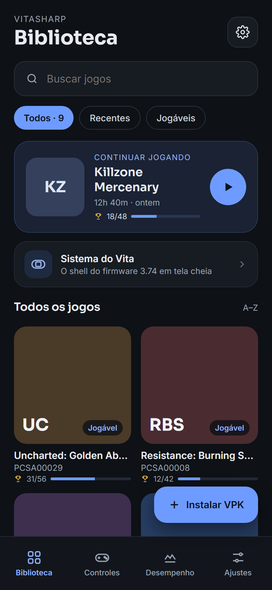 | 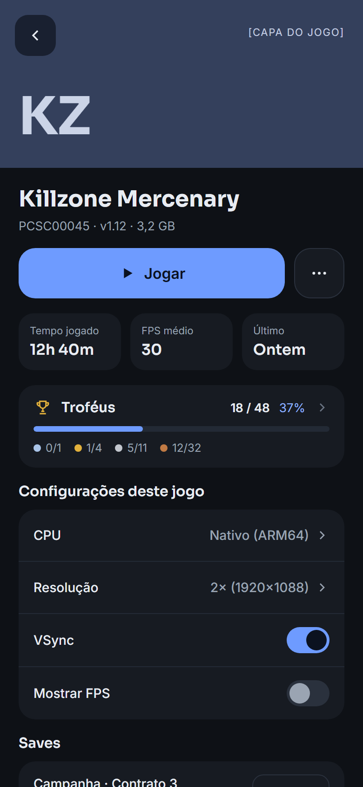 | 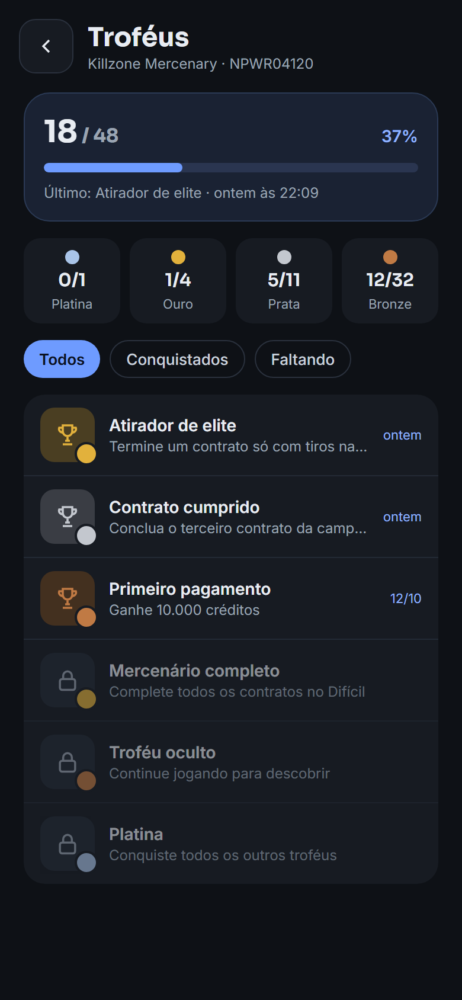 | 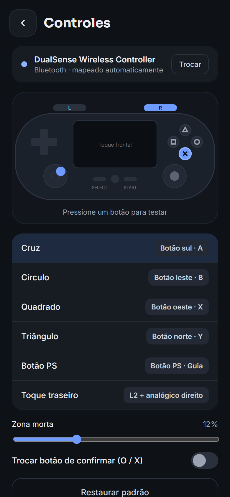 |

| Menu de pausa | Ajustes | Firmware | Conta PSN e rede |
| --- | --- | --- | --- |
| 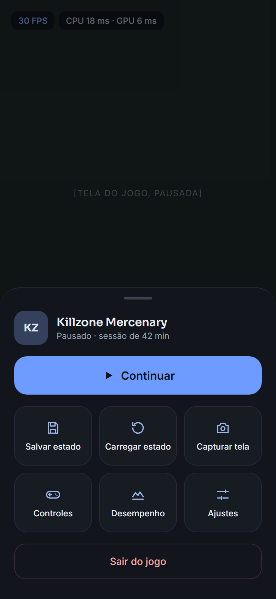 | 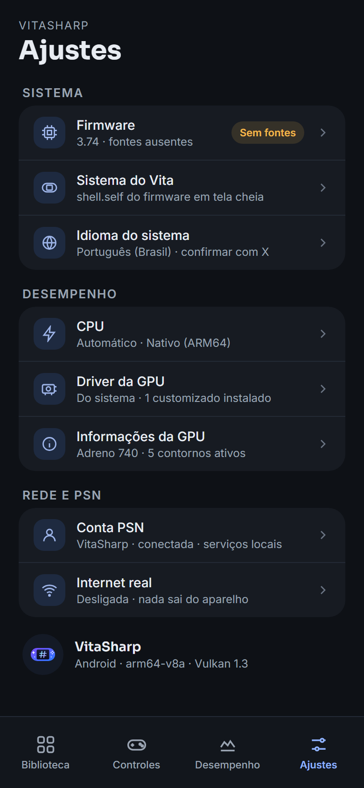 | 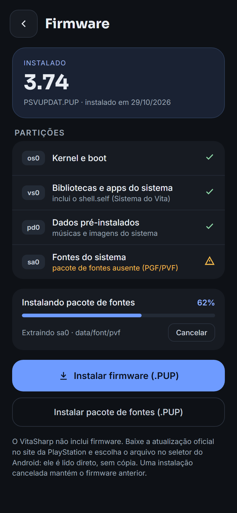 | 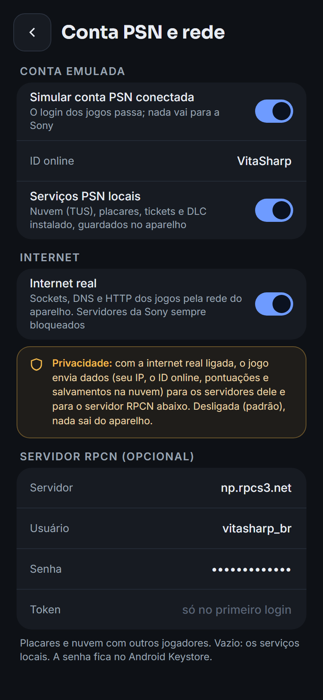 |

| Driver da GPU | Informações da GPU |
| --- | --- |
| 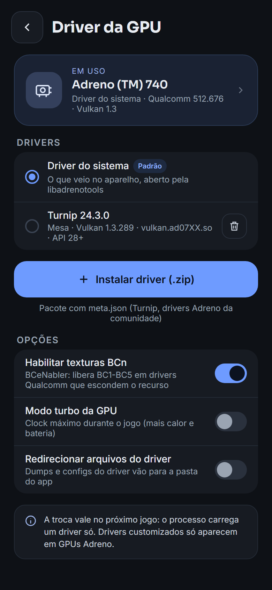 | 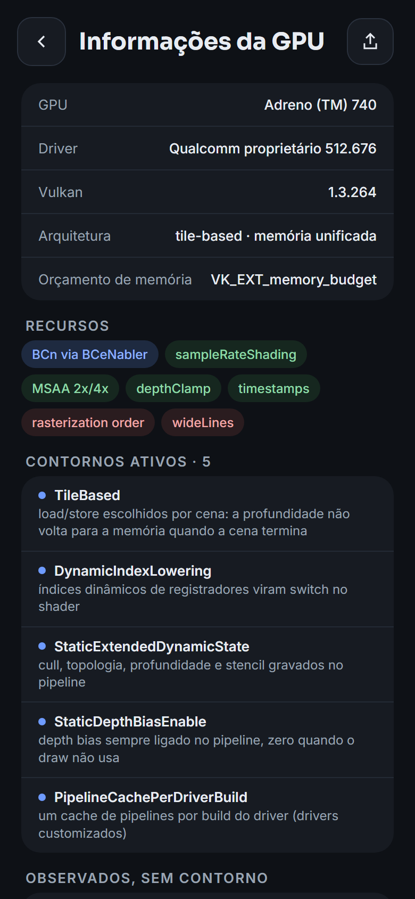 |

The mockups (`mockups/*.html`, rendered to `screens/*.png` by `build/render-android-mockups.ps1` or `.sh`) are the visual
reference; the app follows them with these differences:

- **Biblioteca**: as the mockup, plus a fourth tab "Desempenho" (runtime/CPU backends, GPU pages, play statistics).
  Covers are the game's `icon0.png`, or coloured initials. The badge says "Jogável" for applications (no
  compatibility database yet).
- **Detalhes do jogo**: CPU backend, clock (333/444 MHz), GPU profile (`--gpu-profile`), VSync and FPS per game,
  each "Padrão" following Ajustes; no resolution row (the renderer has no internal-resolution scaling). Saves: size,
  date, delete. The "⋯" menu uninstalls.
- **Menu de pausa**: an Android dialog (continue, rear touch, on-screen controls, leave); no save states or
  screenshot (the emulator has no save states yet).
- **Controles**: connected controllers, the mapping of the selected one, O/X swap, deadzone, the on-screen controls'
  opacity, vibration and auto-hide; no live layout lighting up (the screens' process does not receive the
  controller's events) and no remapping editor yet.
- **Ajustes**: no system-language row (`EmulatorOptions.Language` is not used by the core); adds data-folder and
  debugging sections.
- **Driver da GPU / Informações da GPU**: the information comes from a surface-less `VkCore` probe in the screens'
  process (the system driver); the driver list, install (SAF picker, then "Usar este driver agora?"), select, remove
  and the three libadrenotools switches work on files and apply to the next start of a game; a game running with
  another configuration is offered a restart.

## Emulator run (30/10/2026)

**AVD `VitaSharp_Test`** (kept on the dev PC; `avdmanager create avd -n VitaSharp_Test -k
"system-images;android-36;google_apis;x86_64" -d pixel_8`, then in its `config.ini`): Android 16 (API 36) Google APIs
x86_64 image (its `abilist64` is `x86_64,arm64-v8a`: the image carries Google's ARM translation, so arm64-only apps
install too; the APK's x86_64 libraries are used, so the native backend is x64), Pixel 8 profile (1080x2400, 420 dpi),
`hw.ramSize=6144`, `hw.cpu.ncore=4`, `vm.heapSize=512M`, `disk.dataPartition.size=16G`, `hw.keyboard=yes`,
`hw.gpu.enabled=yes`, `hw.gpu.mode=host`. Started with

```
emulator -avd VitaSharp_Test -gpu host -cores 4 -feature Vulkan,GLDirectMem -no-snapshot-save -no-boot-anim
```

WHPX acceleration (`emulator -accel-check`); the `Vulkan` feature is off in the emulator's default
`advancedFeatures.ini`, `-feature Vulkan` turns it on: the guest sees the GTX 1650 through gfxstream as Vulkan 1.3
(`NvidiaProprietary 546.17`, BC, ASTC LDR emulated by gfxstream, ETC2, dynamic rendering, extended dynamic state, no
`VK_EXT_memory_budget`). Games were copied into the app's own folder (`adb push <game> /sdcard/Android/data/io.github
.vitasharp/files/fs/ux0/app/`, the `.rif` into `ux0/license/<TITLEID>/`); no firmware was installed (the games run on
HLE).

**Clock source caveat.** Under WHPX the guest kernel has no kvm-clock; it uses the TSC when it trusts it and HPET
otherwise (`/sys/devices/system/clocksource/clocksource0/current_clocksource`, needs `adb root`). The first boot, made
while the PC was building shaderc, fell back to HPET: every `clock_gettime` then traps to the hypervisor (~13 µs, all
of a guest thread's time in `read_hpet` in `simpleperf`), and Knightin'+ took minutes in its loading screen. Later
boots on an idle PC chose the TSC. Forcing `clocksource=tsc tsc=reliable` with `kernel.parameters` froze the display
(vsync stopped): do not. If games crawl, check the clock source (`adb root`, then
`echo tsc > .../current_clocksource` if `tsc` is listed). A phone reads the clock in the vDSO.

| Checklist item | Result |
|---|---|
| 1. shaderc | **pass**: `libshaderc_shared.so` for both ABIs in the APK, loaded by Silk.NET; Devious Dungeon compiled its 6 shaders (`shaderc (Zero): 6 compiled in 220 ms`), the pipeline cache and shader recipes are reused on the next start |
| 2. screens, SAF | **pass**: Biblioteca (empty and with games, "Continuar jogando"), Detalhes, Troféus, Controles, Desempenho (Mono, dynamic code, Nativo (x64)), Informações da GPU, Driver da GPU, Ajustes, Firmware; the PUP picker (`ACTION_OPEN_DOCUMENT`) opens and returns on cancel. **Untested**: picking a real VPK/PUP/driver zip end to end (nothing may be put in public storage here), Keystore (no RPCN password set) |
| 3. game process, surface | **pass**: surface → renderer → `LoadTitle` → frames; landscape 2400x1080 swapchain, IDENTITY on a `ROTATE_90` surface; home → back (`Presentation surface detached`/`attached`, `suspended`/`resumed`); PS and Back open the pause menu; "Sair do jogo" ends the `:game` process and Detalhes shows the play time (after the fix below). **Inconclusive**: 180° rotation (the emulator's rotation commands did not flip the sensor-landscape activity) |
| 4. CPU | **pass**: `Runtime: .NET 10.0.11 (Mono), X64, android-x64`, `Dynamic code: supported True, compiled True`, chain `native > il > interp`; the native x64 JIT executes from the memfd dual mapping (SELinux allowed it on API 36); Detalhes > CPU switches native / IL / interpreter per game |
| 5. input | **pass**: on-screen D-pad and Cross drive the menus, PS opens the pause menu. **Untested**: a real controller (`adb shell input gamepad` comes from a virtual device, which `AndroidGamepads` ignores by design); a hardware keyboard was not mapped to the pad yet (`AndroidKeyboard` since, not run) |
| 6. logcat | **pass**: `VitaSharp` (I/W/E) and `VitaSharp-Guest` lines; `logs/last.log` per game. Mono prints harmless `Shared library 'libc'/'libaaudio.so' not loaded, p/invoke ... may fail` warnings for P/Invokes that then resolve |
| 7. audio | **pass (emulator)**: AAudio opened (`AAudio normal shared, capacity 8192 frames 48000 Hz, burst 4096 frames`): the emulator grants neither low latency nor exclusive mode; pause/resume on home. **Untested**: pitch/pace by ear, headphones/Bluetooth reopening, a 44.1 kHz device |
| 8. video | **untested**: neither game uses SceAvcdec/SceAvPlayer |
| 9. GPU drivers | libadrenotools and the four hooks are in `lib/arm64-v8a`; on the emulator "Driver da GPU" shows the system driver (no `/dev/kgsl-3d0`). **Device only** |
| 10. renderer paths | **pass on gfxstream**: native profile = dynamic rendering, no quirks; `VITASHARP_GPU_QUIRKS=-TextureCompressionBC` (env.txt) transcodes BC to ASTC 4x4 through gfxstream's ASTC emulation (disk cache written, frames as with BC); `VITASHARP_GPU_PROFILE=adreno-vk11` (render passes, static state, ASTC) renders Devious Dungeon's menus the same. Real Vulkan 1.1 / Adreno / Mali drivers: **device only** |

**Fixed during the run:**

- `GameActivity` crashed at start on API 30+: `EnterImmersive` ran before `SetContentView`, and
  `Window.InsetsController` needs the decor view (NullPointerException in `PhoneWindow.getInsetsController`).
- The swapchain was recreated every frame: Android returns `VK_SUBOPTIMAL_KHR` from every acquire/present while
  `preTransform` (IDENTITY, by design) differs from `currentTransform`, and the renderer recreated the swapchain on
  SUBOPTIMAL (with a `vkDeviceWaitIdle`; 13 fps on Knightin'+'s logo, 30 after). SUBOPTIMAL is now ignored when the
  transform mismatch was chosen; OUT_OF_DATE and resizes still recreate it.
- **Mono miscompiled `Arm.SignExtend`**: `(int)(v << n) >> n` folded to a logical shift when `v` is a constant, which it
  is once the IL backend inlines a handler with the instruction word as a constant: every backward Thumb `B` jumped
  4 KB forward. The IL backend crashed the game in 1.6 s (`__stack_chk_fail`), and the native backend after ~95 s
  (blocks it hands to the IL backend). Found with `VITASHARP_NATIVE_VERIFY=1`, which now also checks store-free IL
  blocks against the interpreter; `SignExtend` is written with unsigned xor/subtract. After the fix Knightin'+ reaches
  its title menu on the native backend and runs on the IL backend.
- A game process that ends by itself (guest exit, stack-protector failure) left a frozen image: the game screen now
  shows "O jogo terminou." with the log path.
- Play time was not shown after leaving a game: the screens resume (and re-read the statistics) before the game
  activity's `onDestroy`, which wrote them; they are written when the player leaves now.
- Dark status/navigation bar icons on the dark screens (MAUI's light window flags); the pause chip took the keyboard
  focus (arrow keys drew Android's focus highlight over the game); the ASTC log line claimed transcoding on GPUs with
  BC; "Driver do sistema" said "aberto pela libadrenotools" on GPUs where libadrenotools is not used.

Screenshots of the run are not committed (they show game content).

**Still device-only:** the ARM64 native JIT under a phone's SELinux policy (memfd/ashmem RX views), Adreno/Mali
proprietary driver behaviour and every quirk of the table, libadrenotools (custom drivers, BCeNabler, file redirect,
turbo), `VK_EXT_rasterization_order_attachment_access`, tile memory savings, AAudio low-latency/exclusive streams and
output changes, hardware MediaCodec decoders, Bluetooth/USB controllers, 180° rotation, thermal behaviour and speed.
(The phone run below covered the JIT, the Mali driver, MediaCodec, AAudio shared streams, thermals and speed.)

## Phone run: Redmi Note 14, Mali-G57 (30/10/2026)

**Device:** Xiaomi Redmi Note 14 (24117RN76L, "tanzanite"), MediaTek MT6789 (Helio G99: 2x Cortex-A76 2.2 GHz + 6x
A55 2.0 GHz), Mali-G57 MC2 (Vulkan 1.3, driver r54 `ArmProprietary 54.1.0`), 8 GB, Android 16 (HyperOS), arm64-v8a,
2400x1080. Games and `.rif` licences in the app's own folder (`ux0/app`, `ux0/license`), no firmware (HLE).

**First failure:** "Mali-G57 MC2 lacks shaderClipDistance (needed for the GXM far plane)": the renderer required clip
distances, which Mali does not have. Fixed with a fragment-shader far-plane clip (`GpuQuirk.FarPlaneDiscard`); the
device's full capability list and its quirks are in the [mobile GPU notes](../notes/mobile-gpu.md#real-device-mali-g57-mc2-30102026).

**Driving the phone from the PC.** HyperOS refuses `adb shell input` (INJECT_EVENTS) unless "USB debugging (Security
settings)" is on, a system setting this run did not change. Instead:

- the launcher intent takes a title: `adb shell am start -n io.github.vitasharp/crc64ca1c02f6e48bb1c7.MainActivity
  --es titleId PCSB01240` (`adb shell cmd package resolve-activity --brief io.github.vitasharp` prints the activity);
- `VITASHARP_ANDROID_INPUT` in `config/env.txt` scripts the pad: `cross@20,start@31:0.5,lstick@40:1:0:2,tap@50:0.5:0.6`
  (ScriptedPad, seconds since the game first read the pad; buttons, sticks, front/rear taps);
- `VITASHARP_AUDIO_DUMP=<folder>` writes the guest's audio as WAVs (as the desktop's `--audio-dump`);
- every 30 s the game log gets `[perf]` lines: fps, the CPU backends' statistics, the audio streams;
- `build/android-device-test.ps1` (or `.sh`) does a whole run: pushes the game if it is not on the phone, runs it
  with a pad script, collects `last.log`, screenshots, the audio WAVs and a summary, and removes the game again
  (`-Keep` / `KEEP=1` keeps it). Only the app's files folder is touched.

| Game | Result on the phone |
|---|---|
| Devious Dungeon (PCSB01240, Unity) | title, story, menus correct; 6-11 fps in the first 30 s (loading, JIT warm-up: the Unity main thread at 93 % of an A76), 46 fps the next 30 s, then 55-60 fps |
| Knightin'+ (PCSE01444, Construct 2) | logos, title, story scroll correct; 27-30 fps (the game's 30) |
| F1 2011 (PCSE00002) | was black (SceMp4 needed FFmpeg); now the intro movies play through MediaExtractor + MediaCodec (`c2.mtk.avc.decoder` hardware, `c2.android.aac.decoder`) with sound; about 20 fps in the menus. Movies show black frames: the game's movie player skips its picture draw when its decoder thread is late (CPU-bound; reproduced on the desktop with `--cpu-mhz=120`, see the GPU notes) |
| Persona 4 Golden (PCSB00245) | CRIWARE logo, PSN prompt, opening movie (AvPlayer-style player on SceMp4/SceAvcdec/AAC), title and main menu; 26-30 fps (the game's 30) |
| Killzone Mercenary (PCSC00045) | intro, main menu, into gameplay with correct 3D (BC/PVRTC-II transcoded to ASTC, 4X MSAA); menus 22-29 fps, the first gameplay seconds 1-3 fps (shader/pipeline compiles and transcodes on a first run) |
| Uncharted: Golden Abyss (PCSA00029) | intro movie, title and main menu at 21-27 fps. Two bugs found and fixed: the title's background stayed black (its R32G32_SFLOAT surface fell back to RGBA8 because the Mali cannot blend 32-bit float formats; the renderer now keeps any renderable format and draws blended draws into it unblended), and the game screen said "O jogo terminou" during the game's LoadExec (launcher to `uncharted.self`). Open: a single dark, stale movie picture about every 5 s on the title background (not the decoder's "no picture" case; cause not found yet) |

- **CPU:** `CPU backend selected: native` (NativeArm64Compiler), and it executes: Devious Dungeon 28k blocks (164k
  guest instructions, about 160 µs per block to compile), Killzone 32k blocks, no rejections; HyperOS's SELinux allows
  the dual-mapped code. The phone is CPU-bound everywhere: slow first minutes (compiling) and F1's 20 fps.
- **Audio:** AAudio at 48 kHz, but only as a *normal shared* stream: the track lands on the speaker's primary mixer
  thread, which has no FastMixer on this phone (`dumpsys media.audio_flinger`: flags 0x0, HAL period 1024 frames), so
  the reported burst is 4096 frames and the latency about 180-230 ms; no underruns on the device side in any run.
  Garbled sound in Devious Dungeon's first 90 s was the guest's own: its WAV repeats whole 512-frame grains (428
  discontinuities, none on the desktop) only while the game ran at 6-46 fps, i.e. its mixer thread missed deadlines;
  at 60 fps the sound is clean. F1's movie sound has the game's own silence grains for the same reason.
- **Video:** SceAvcdec through the hardware decoder. MediaCodec is asynchronous (pictures come out one or more calls
  late): Videodec repeats the previous picture rather than returning none, and drops older pictures when several
  arrive at once; blocking for every picture made the movies slower than real time.
- **On-screen controls:** drawn over the image and used by hand on the phone (the scripted pad drove the runs).
- **Thermals:** no throttling: thermal status 0 after an hour of runs, skin 36.5 °C, battery 30 -> 34 °C (charging
  over USB).

**Fixed during the run:** `shaderClipDistance` required; colour surfaces whose format renders but cannot blend on the GPU (R32G32_SFLOAT on Mali) fell back to RGBA8 (Uncharted's black title background); "O jogo terminou" shown during a LoadExec (`Emulator.Execing`); SceMp4 and SceAudiodec AAC without FFmpeg (MediaExtractor,
MediaCodec); `MediaFormat` csd buffers are heap buffers (`GetDirectBufferAddress` 0: a crash in the demuxer, latent in
`AndroidMediaPlayer`); the asynchronous decoder behaviour above; the Vulkan error hint mentioned `vulkan-1.dll`.

## Phone run 2: performance (31/10/2026)

Same Redmi Note 14, branch perf/android-phone (from main 4603a03), one agent. Scenes driven by
`VITASHARP_ANDROID_INPUT` (Cross every 4 s; F1: Start at 40 s, then Cross every 5 s into the first race; Uncharted:
Start), the phone on USB power, thermal status 0 throughout (A76 at 2.0-2.2 GHz). The game settings on the phone were
left as found (F1 2011 and Knightin'+ at 444 MHz, F1 2011 with the `desktop` GPU profile, VSync on). Desktop
reference: the same games and saves on the PC (GTX 1650, `VITASHARP_DATA` without firmware like the phone).

| Game, scene | Desktop | Phone before (main, `mono-aot`) | Phone after (`mono-aot-llvm`) | What limits it now |
|---|---|---|---|---|
| Knightin'+, first dungeon room (30 fps game) | 30.0 | 28-30 (main 10.5 + GPU worker 8.6 ms/frame) | **30.0** steady after the first minute (main 11.7, GPU worker 5.6 ms) | nothing (the game's rate) |
| Devious Dungeon, town (60 fps game) | 60 | 27-30; first 30 s 6.5 | **50-52**; first 30 s 20 | the Unity main thread: 18.9 ms/frame on an A76, 75% of it generated code |
| F1 2011, menus | 60 | 60 | 60 | - |
| F1 2011, intro movies (25 fps) | 25 | 25, black one-frame flashes, half the pictures shown twice | 25, no flashes in 30 s recordings, 5/150 pictures repeated | - |
| F1 2011, race start | 53 | 3-6 | **16.3-16.5** | the GPU worker (one A76, ~1,000 draws per frame) and the HLE main thread (~15,000 calls per frame) |
| Uncharted, title (movie background) | 60 | 21-30 | 25 | the Mali GPU: 33.7 ms of GPU time per frame (4.2 on the desktop) |

**Bottlenecks found (simpleperf `--app` on a `<profileable>` build, `-p:_AndroidAotStripLibraries=false` for symbols;
`VITASHARP_NATIVE_MAP` for the JIT arena) and what was done:**
- HLE round trip (Unity's lwmutex/TLS: 5,100 calls per frame): SVCs handled inside `CpuCore.Run`, then called from the
  native code itself (`VITASHARP_NATIVE_HLE_CALLOUT`), resume through the dispatch table, two clock reads per native entry
  sampled 1 in 16. Mono's GC transition on every native entry (7.7% of the Unity thread): skipped
  (`SuppressGCTransition`, Mono only, `VITASHARP_NATIVE_GC_TRANSITION=on` restores it).
- JIT code: linked exits patched into direct branches, dispatch table 4x larger, evicted targets republished
  ([native JIT notes](../notes/native-jit.md#on-the-device-branch-perfandroid-phone-31102026-redmi-note-14)).
- Mono's managed block copy (~250 MB/s on an A76): F1 copies 8 MB of uniforms and uploads 13 MB per race frame;
  `FastCopy` sends large copies to libc's `memmove` on Mono. Vertex streams are uploaded from the lowest index used.
- Render-target writebacks read through uncached memory (20 ms per frame in F1): cached readback buffers (5 ms, then
  0.8 ms with `FastCopy`).
- NGS (F1's audio thread, 14.6 ms per frame on an A55): HEVAG decode, resampler and mixer without per-sample calls (7.7 ms;
  3.8 with LLVM).
- Per-draw descriptor writes on Mali: repeated texture sets reused.
- Managed code quality: `mono-aot-llvm` made the Release default ([Runtime and AOT choice](#runtime-and-aot-choice-vitasharpandroidruntime)).

**Movies.** F1's "broken" movies were the MediaTek decoder's bursts: the newest picture of a burst was shown and repeated
on the next call (73 of 150 pictures repeated), and repeated pictures carried an old pts, after which the game's player
skipped its picture draw now and then (black flashes, seen in `adb shell screenrecord` + ffmpeg `signalstats`). Pictures
now queue and go out one per call with the pts of that call's unit (repeats 73/150 -> 0-6, no black flash in 30 s
recordings); until its first picture a new or flushed decoder answers with the last picture it (or the previous
decoder) produced: Uncharted's looping title movie flashed an older, darker frame at every loop (4 flashes in a 40 s
recording -> 1). Hardware decoding (`c2.mtk.avc.decoder`) was already used. **Movie sound is still wrong:** F1's
movie port gets a 1024-sample block of silence every 4096 samples (one AAC frame in four; 304 silent grains in a 5 s
movie, none on the desktop with FFmpeg), so the movie sound runs 40% longer with gaps. All 235 AAC frames are decoded
(2 answered with silence), so it is the rate at which the game's player gets them through SceMp4 (MediaExtractor) and
SceAudiodec (MediaCodec); a one-frame decode cushion instead of waiting for each frame did not change it. Open.

**Audio.** AAudio still opens as a normal shared stream (the speaker path has no fast mixer on this phone; the backend
already asks for low latency and exclusive mode). Guest-side WAV dumps against the desktop (`VITASHARP_AUDIO_DUMP`,
`--audio-dump`): Knightin'+ clean (no repeated grains, no gaps, no clicks); Devious Dungeon has no repeated grains any
more (428 in the first run, when the game ran at 6-30 fps) but still 288 clicks (sample jumps above 12,000) in 165 s,
most of them in its slow first 45 s and then one every few seconds at 52 fps (none on the desktop at 60): the FMOD
mixer missing deadlines while the game runs below its rate, so it goes with the speed work. Uncharted's title
music has no clicks.

**Rendering parity** (phone screenshots against desktop frames of the same scenes, `scratchpad/phone_shots` of the run):
Knightin'+ room, Devious Dungeon town, F1 2011 race start (chase camera), Uncharted title match apart from the on-screen controls drawn over
the phone's picture.

**Open:** F1 2011 races (16 fps of the desktop's 53) need the GPU worker split over two threads and fewer per-draw
Vulkan calls; Devious Dungeon's last 15% is generated-code quality (cross-block registers); Uncharted is GPU bound on
the Mali-G57; F1's movie sound (a silent AAC frame in four, above); Devious Dungeon's clicks below 60 fps; one stale frame per
~40 s left in Uncharted's title loop; an intermittent Mali driver crash (null pointer in `libGLES_mali.so` under `vkEndCommandBuffer`, GPU
worker) between F1's menu and race, also seen with the previous builds (2 of about 12 F1 runs today, 6 the day before).

**Next steps, in order** (status at the end of 31/10/2026; the final `mono-aot-llvm` build of the branch is installed
on the phone):
1. F1 2011 races: profile the GPU worker per draw (simpleperf, `GPU worker` thread) and split it into a preparing
   thread (texture resolve, uniform packing, pipeline key) and a recording thread; then cut per-draw Vulkan calls
   (push constants only when changed, uniform sets with dynamic offsets). Main thread: the ~15,000 HLE calls per frame
   (GXM state setters, `sceClibMemset`, `sceKernelGetProcessTimeWide`) through the SVC callouts are next to make cheaper.
2. F1 movie sound: log per `sceAudiodecDecode` and `sceMp4` call when the game's player asks for the next AAC frame
   and when it gets it (MediaExtractor read time), to find which side is late; compare with the desktop FFmpeg path.
3. The Mali `vkEndCommandBuffer` crash: catch it with `VITASHARP_GPU_DUMP_AT` around F1's menu-to-race load and replay
   the dump with `--gpu-profile=mali`, or package the Khronos validation layer in a debug APK.
4. Devious Dungeon's last 15%: generated code (cross-block guest registers, smaller exit stubs, flag materialisation
   only when live).
5. Uncharted's remaining stale frame per loop: log the decoder calls around a loop (`sceAvcdecDecodeStop`/`Flush`).

## Phone run 3: correctness tooling, God of War, flicker (31/10/2026)

Same Redmi Note 14, branch perf/android-phone-2 (from main ca6f938). The phone captures; the investigation runs on
the PC wherever the bug survives a GPU dump.

**The PC loop.** `VITASHARP_GPU_DUMP_AT=F1:F2[:file]` in `env.txt` now records a GPU dump on the phone too
(`<data>/gpudumps`; presents count from 1 again after a LoadExec). `build/android-gpu-dump.ps1`/`.sh` starts a game with
it, pulls the dump and replays it with `replay-gpu --validation` and synchronization validation (needs the Khronos
layer on the PC: not installed on this one). Replay aids: `VITASHARP_GPU_POISON=1` (new render targets magenta,
depth/stencil discarded at a scene's end cleared to 0/0xFF, so tiler-only dependencies on undefined contents show on a
desktop GPU; with `--gpu-profile=mali` for the tile-based paths), `vitasharp-perf flicker <dir>` (frames that differ
from both neighbours while the neighbours match; tools/VitaSharp.PerfTools), and work
counters in the `PERF sync` line (draws, pipeline binds, descriptor sets and writes, uploads per frame: deterministic
for a replay). The startup log also lists the GXM vertex formats the device cannot fetch (none on the Mali-G57).

**God of War: Kratos' patches** ([notes](../notes/gow-textures.md)). Yellow, purple and blue patches on Kratos and the
enemies, only on the phone. Ruled out on the phone: ASTC (`VITASHARP_ASTC=0`), descriptor-set reuse, the vertex rebase,
zero-initialised registers, an integer register file (NaN canonicalisation), the `desktop` profile, the JIT
(`VITASHARP_NATIVE_VERIFY=1`); the phone's dump replayed correctly on the PC. The draw trace showed the cause: 19-byte
vertex strides with F16 attributes at offsets 3 and 11; Vulkan requires component-size alignment, NVIDIA tolerates
the misalignment, Mali reads garbage. Misaligned attributes are now fetched as R8 bytes and rebuilt in the vertex
shader (no copy; aligned attributes keep their shaders; the phone dump replays pixel-identical on the PC, 15/15
frames). Fixed on the phone (`phone2_shots/gow_bytefetch`).

**Flicker.** Phone dumps of all five games (120 consecutive frames each: Knightin'+ room, Devious Dungeon town,
Uncharted title, God of War gameplay, F1 2011) replayed on the PC, plain and with `--gpu-profile=mali` +
`VITASHARP_GPU_POISON=1`: 0 flagged frames. Screen recordings on the phone (`adb exec-out screenrecord`, streamed to
the PC, frames through `flicker` and ffmpeg `signalstats`): Knightin'+ 241, Devious Dungeon 380, God of War 124, F1 45
and Uncharted 259 frames, 0 flagged and no luma outliers with the default settings.

**Mali GPU cost, Uncharted's title.** 28 ms of GPU per frame on the phone; the `PERF gpu` line showed 5.4 renderings
per scene: every small programmable-blending draw (about 18 a frame: particles) renders in a render pass of its own
reading the surface as an input attachment, each a store and load of the whole surface and depth. Keeping that pass
open across consecutive such draws (the GPU orders the reads with `VK_ARM_rasterization_order_attachment_access`):
1.6 renderings per scene, 25 -> 36 fps, 24 ms of GPU. But one frame in seven came out 15% darker on the phone (luma 74
-> 63 in the recording; a dump of such a run replays without them on the PC, so it is the Mali side), so it is off by
default (`VITASHARP_FETCH_PASS_MERGE=1`), cause open. Work per frame (replays of the phone dumps): Uncharted title 233
draws, 366 descriptor sets, 2,520 descriptor writes, 4.2 MB uploaded; God of War 394 / 451 / 2,478 / 3.0 MB;
Knightin'+ 69 / 125 / 1,175 / 2.2 MB; Devious Dungeon 32 / 49 / 400 / 0.5 MB.

**F1 2011's GPU worker.** The race replay (phone dump, PC) showed 1,626 draws, 2,164 descriptor sets and 15,110
descriptor writes per frame: texture sets wrote all 16 units per stage and the uniform set all four buffers, dummies
included. Only the units and buffers the shaders declare are written now: 3,877 writes per frame, all five phone dumps
pixel-identical on the PC. Still 18.7 MB of vertex, index and uniform uploads per race frame (next: cache static vertex
streams with the dirty-page tracker). The Mali crash in `libGLES_mali.so` between F1's menu and race happened once in
three runs of this build, as often as before.

**Numbers on the phone** (`mono-aot-llvm` build of the branch, VSync on, same scenes as Phone run 2; CPU ms per frame
of the busiest threads and GPU ms from the session's `PERF` lines):

| Game, scene | Desktop | Phone run 2 | Phone run 3 | Busiest threads (ms/frame) | GPU ms | What limits it |
|---|---|---|---|---|---|---|
| Knightin'+, first room (30) | 30 | 30 | **30.0** | main 6.7, GPU worker 4.7 | 10.6 | nothing (the game's rate) |
| Devious Dungeon, town (60) | 60 | 52-53 | 48.7 at 150 s (still warming up; 52-53 later in run 2) | Unity main 21.9 | 7.8 | the Unity main thread (generated code) |
| F1 2011, race start | 53 | 16.5 | **17.3**; 17.8-20.7 with fewer descriptor writes (the user drove in that run: at the back of the field, fewer cars in view) | GPU worker 25.7 -> 23.4, main 23.8 -> 21.0 | 13.0 -> 12.3 | CPU: the GPU worker and the HLE main thread |
| Uncharted, title | 60 | 25 | **25.4** (36 with `VITASHARP_FETCH_PASS_MERGE=1`, dark frames) | GPU worker 13.6, game 11.4 | 32.2 | the Mali GPU (fetch passes) |
| God of War I, first fight (30) | 30 | patches on the characters | **23-29.5, correct picture** | Render 10.3, GPU worker 8.8 | 10.8 | CPU (the game's render thread) |

**Audio.** `vitasharp-perf audio-check` reads the guest audio dumps (`VITASHARP_AUDIO_DUMP` on the phone,
`--audio-dump` on the desktop): silent gaps inside the sound, repeated grains, clicks (jumps above 12,000).

| Game | Phone (guest dump) | Desktop (same scene) | Notes |
|---|---|---|---|
| Knightin'+ | 72 s of sound, 1 gap (85 ms, a load), 0 repeats, 0 clicks | - | clean |
| Devious Dungeon | 90 s, 0 repeats, 204-270 clicks | - | the FMOD mixer late below 60 fps (guest side; goes with the speed work) |
| F1 2011 movies | first movie 6.53 s of sound for 5 s of audio, 75 gaps -> **5.85 s, 45 gaps** | 4.95 s, 1 gap | movie players paced by picture timestamps: Android's own H.264 decoder now (below) |
| F1 2011 menus and race | 250 s, 2 gaps, 245 clicks | - | to compare with a desktop dump of the same scene |
| Uncharted title | music 85 s, 0 gaps, 0 clicks; movie port 63 -> **40 gaps** | movie port 2 gaps | as F1 |
| God of War | 129 s + 36 s, 30 + 127 clicks | - | to compare with a desktop dump |

- **Movies.** The decoders are not slow (phone: AAC 5 ms per call, H.264 12.8 ms after faster picture copies,
  MediaExtractor 0.3-0.4 ms per unit), but the MediaTek H.264 decoder holds pictures in flight and the players pace
  themselves by the pictures' timestamps: F1's first movie took 6.25 s instead of 5 (one AAC frame in four became a
  silent grain). Android's own decoder (`c2.android.avc.decoder`) answers in the same call, as the Vita does: 5.6 s, 45
  gaps; no black frame in a recording. Still slower than the desktop's 4.8 s (open: the guest player threads).
- **Latency.** The AAudio stream no longer requests 8192 frames: AAudio's own capacity (4104 frames, a 2052-frame
  burst) halves the latency, 181 -> 96 ms, no underrun in Devious Dungeon (86 s) or Knightin'+. Still "normal shared":
  `aaudio.mmap_policy` is 2 (auto) but the speaker's output thread has no fast or MMAP path on this phone.

**Desktop revalidation** of the 34 installed games (Croixleur Sigma excluded; scratch data root with copied saves,
sheets and the review in `scratchpad/phone2_shots/pc`): no crash; Sonic & All-Stars Racing still hangs at frame 29
(known). New: The Deer God unpaced (214-348 fps), Shinobido 2 green line under the intro movie and
`sceKernelGetCpuId` unimplemented (31,410 calls), Call of Duty's title in Russian, slow screens confirmed on an idle PC: Silent
Hill's Zone Select (15-22 fps) and Crazy Market's terms of service (16 fps); the Soul Sacrifice and Skullgirls dips
were loads or CPU contention (60 and 30 fps at the end of the reruns); Tearaway's static-menu stall not rerun, Zero Time Dilemma's title at
47-57 fps (was 60). The scenarios that start a new game need a data root without saves (they took Continue).

## Before the first run: what the emulator/device step must verify

1. **Shader compiler**: `libshaderc_shared.so` (built from the NDK r30 sources, 42 `shaderc_*` exports, 16 KiB
   aligned, needs only libc/libm/libdl) is in the APK when `build/build-android-shaderc.ps1` (or `.sh`) ran; check that
   Silk.NET.Shaderc loads it by that name and that the first shaders compile (a missing library shows as a
   DllNotFoundException in the session dialog and the log).
2. Install, launch, navigate every screen (portrait), fonts and colours; SAF pickers return (VPK, PUP, driver zip);
   VPK install and firmware install end to end; the Keystore stores the RPCN password.
3. Game process: `surfaceCreated` → renderer → `LoadTitle` → frames on screen; landscape orientation and the
   swapchain extent/transform (the IDENTITY choice); home → back (detach/attach, `Suspend`/`Resume`, audio pause);
   rotation by 180°; leaving the game kills the `:game` process and the library shows the new play time.
4. CPU: the log's `RuntimeReport` lines (Mono, `build mono-aot`, dynamic code supported and compiled true; the
   full-AOT images load, no AOT-related crash at startup); the native backend selected (x64 on the x86_64
   emulator, ARM64 on a phone) and that SELinux lets the memfd/ashmem RX view execute; `--cpu`-equivalent choices from
   Detalhes.
5. Input: on-screen buttons and sticks, front touch on the image, TRÁS rear touch, PS opens the pause menu; a
   Bluetooth/USB controller (hot-plug, right stick axes, analog and digital triggers, Home = PS). A USB/Bluetooth
   keyboard (or `adb shell input keyevent`, the virtual keyboard): arrows/X/C/Z/V/WASD drive the game, P and Home
   open the pause menu, no key stays held after the menu or the IME dialog, numpad 8/2/4/6 (or T/G/F/H) tilt a
   motion game (the log's `Input: keyboard tilt keys drive the Vita's motion sensors` line), volume keys still change
   the volume, typing into a game's IME dialog with the keyboard (Enter confirms) while the soft keyboard stays down,
   a controller and a keyboard together (a gamepad's D-pad auto-repeat must not leave a key held).
6. Logcat tags and priorities (`adb logcat -s VitaSharp VitaSharp-Guest`), the file logs. Session statistics:
   `PERF periodic summary` blocks in `logs/last.log` every 30 s and at each pause but never in logcat; after leaving a
   game through the menu, the full end-of-run report (`Stopping.`, `CPU backend report`, `PERF gpu`, `PERF mobile`,
   `AUDIO summary`, `PERF cpu`) after `Session of ... ends`; a process killed from the recents screen keeps the last
   periodic block; `PERF thread` lines list named threads with non-zero CPU times under Mono (if they are missing,
   Mono does not report per-thread times there).
7. **Audio**: the log's `Audio:` lines (AAudio on 8.1+, low-latency and exclusive or shared, the device rate and burst;
   AudioTrack on the x86_64 emulator image if it is API 26); sound plays at the right pitch and pace (a 44.1 kHz
   device exercises the resampler), the `AUDIO summary` device line and underruns after a session (debug mode for
   the periodic AUDIO lines); home → back (pause/resume, no burst of stale grains); plugging/unplugging headphones and
   connecting a Bluetooth headset during a game ("reopening the output", sound continues on the new device, at its
   rate); writes before `requestStart` (priming) are accepted by AAudio.
8. **Video**: SceAvcdec/SceVideodec games and SceAvPlayer movies (an intro movie, F1 2011's): the log's
   `MediaCodec: H.264 with <decoder>` and output-format lines; frames correct (no green/garbled chroma: the
   `getOutputImage` plane strides and the crop), the fallback to `c2.android.avc.decoder` when a hardware decoder fails
   (`MediaCodec: ... failed`), movie sound (AAC through MediaCodec) in sync; on the x86_64 emulator only the software
   decoder exists. **SceAudiodec MP3** (no game known yet): if one turns up, the log's `sceAudiodec: MP3 through
   MediaCodec <decoder>` line, every `sceAudiodecDecode` returning a full 1152/576-sample frame and clean sound.
9. **GPU drivers** on an Adreno phone: the APK has `lib/arm64-v8a/libadrenotools.so` and the four hooks (when
   `build/build-android-adrenotools.ps1` or `.sh` ran) and they are extracted to the native library directory
   (`extractNativeLibs`); install a Turnip package (K11MCH1/AdrenoToolsDrivers or Mesa Turnip releases) from "Driver da
   GPU", select it, start a game: the log's `Vulkan driver: ... via libadrenotools` line, the capability block shows
   Turnip (`TurnipDriver` quirk, none of the blob quirks); BCeNabler on a stock driver without BCn (`BCeNabler:` line);
   file redirect and turbo; change the driver while a game runs and accept the restart (the `:game` process is killed,
   the game starts again with the new driver); a Mali phone uses the system loader. The quirk table on Adreno/Mali
   ([mobile GPU notes](../notes/mobile-gpu.md)).
10. **Renderer paths** ([mobile renderer notes](../notes/mobile-renderer.md)): the capability block's `RenderPasses`
    line (proprietary Adreno/Mali/PowerVR drivers and every device without Vulkan 1.3 dynamic rendering render with
    render passes; `VITASHARP_GPU_QUIRKS=-RenderPasses` tries dynamic rendering on a 1.3 driver); an Adreno 6xx on an
    old driver (Vulkan 1.1) boots instead of "No Vulkan 1.1 capable device", with `StaticExtendedDynamicState` and
    `StaticDepthBiasEnable`; the `[texcache] BC/PVRTC textures are transcoded to ASTC 4x4` line and the ASTC part of
    `PERF mobile` (levels encoded, M texels/s, memory/disk hits) after a session, BC games look as on desktop (no
    blocky or discoloured textures, BC4/BC5 normal maps lit correctly), a second start of the same game hits the disk
    cache (`<data>/shadercache/titles/<TITLEID>/astc`, at most 512 MB, `VITASHARP_ASTC_CACHE_MB`); `PERF gpu`'s
    renderings per scene and hoisted breaks, and the tile load/store counters in the device's profiler (Snapdragon
    Profiler / Arm Performance Studio: fewer GMEM loads and stores per frame than with `VITASHARP_SCENE_BREAKS=strict`).
11. **Motion sensors and cameras** ([above](#motion-sensors-and-cameras)): the log's `Motion:` lines at start
    (`Sensores do celular`, `phone sensors registered (<accelerometer>, <gyroscope>, rotation 90)`), then
    `phone sensors drive the Vita's motion sensors` once the game samples. Axes, in a SceMotion game (Tearaway,
    Invizimals; also Devious Dungeon, God of War, Killzone import SceMotion): phone flat on the table = the game's at-rest
    view; raising the screen's top edge, lowering its right edge and turning the phone flat on the table each move the
    game the way a Vita would (not mirrored or swapped), the same after turning the phone over (ROTATION_270; the
    `Display rotation 270 degrees` line); no drift while still. Pause menu > Recentralizar movimento (`Motion: re-centred`
    line) makes the held pose the flat one; Controles > Movimento > Desligado keeps the game at rest; Giroscópio do
    controle with a DualShock 4/DualSense on Android 12+ (`controller '<name>' registered`; check its axes the same
    way, the mapping is the desktop's SDL one, unverified on Android's kernel drivers); the listeners stop in the
    background (no `sensors` thread CPU in a profiler while paused) and resume. Camera, in Tearaway or Invizimals' AR
    mode: the permission dialog appears on the first camera start, not at app start; allowed: `Camera: ... -> front
    camera <id> 640x480 YUV_420_888, fps 30-30` and `Camera: first frame` lines, the image upright (not rotated or
    upside down, both landscape directions), the front camera for the Vita's front camera and the back one for the back,
    colours right (not green/pink: the chroma planes and their pixel stride), the frame rate the game asked for; a
    sensor switch in Tearaway reuses or reopens the capture without errors; home and back to the game reopens the
    camera; denied (and on a second start): grey frames, no crash, no new dialog.

## Stack

- **.NET MAUI** for the app shell, reusing `VitaSharp.Core` and the Vulkan renderer; the game view is a native
  activity with a SurfaceView hosting the Vulkan swapchain.
- **Declarative C#, no XAML**: [MauiReactor](https://github.com/adospace/reactorui-maui) 4 (MVU components written
  in C#). Existing/community libraries only; no custom UI framework.
- **Own visual style, not Material**: dark surfaces, one blue accent (#6E9BFF), rounded cards, Sora for headings and
  Inter for text.
- **Input**: the platform-neutral model in `src/VitaSharp.Core/Input` (profiles, mapping, deadzone, touch layers)
  is shared with the desktop controller screen ([notes](../notes/controller-config.md)).
- **CPU**: the native ARM64 JIT, picked automatically on ARM64 ([notes](../notes/native-jit.md)).

### In game (landscape)

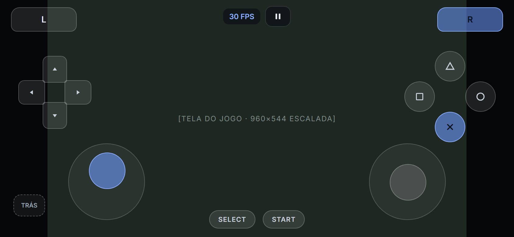

The 960×544 image is scaled to the screen height and centred. Translucent controls sit over the side margins: L/R in
the corners, D-pad and left stick on the left, face buttons and right stick on the right, SELECT/PS/START at the
bottom, a rear-touch toggle (TRÁS) and a small FPS + pause bar at the top. Pressed controls switch to the accent
colour. A trophy unlock shows a toast ("Troféu desbloqueado", name and grade) at the top right. In a game started on
its own (no shell running) the PS button opens the pause menu.

### Sistema do Vita (landscape)

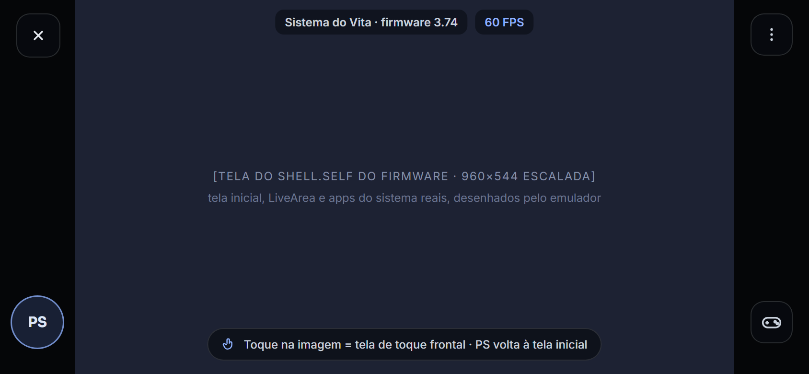

"Sistema do Vita" boots the installed firmware's own `vs0:vsh/shell/shell.self` full screen
([system apps notes](../notes/system-apps.md)). The home screen, LiveArea and system apps are the firmware's, drawn
by the emulator; the app never redraws or imitates them. Only the app's chrome sits around it: the PS button (it
reaches the shell like the console's: a running game goes to its LiveArea), the FPS/pause bar and the back gesture
for the menu. Touches on the image are the front touch screen.

## Files

- [`mockups/`](mockups): standalone HTML for each screen (open in a browser).
- [`screens/`](screens): PNG renders of the mockups (2× scale), made with `build/render-android-mockups.ps1` (Windows) or `build/render-android-mockups.sh` (Linux/macOS)
  (headless Edge, the centred phone frame cropped out).
