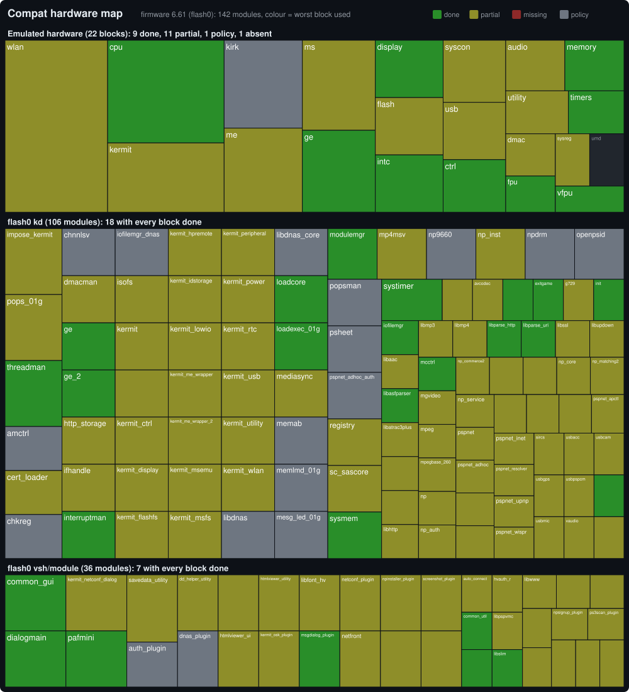

<!-- pair: progress.pt-BR.md sha256=59658eff27581b11ec5be350743100493303ea43f8f7350618cee3db2dba9a68 -->
# Compat hardware coverage

*Português: [progress.pt-BR.md](progress.pt-BR.md).*

<!-- Generated by build/hle-status (VitaSharp.Desktop compat-coverage --status) from docs/compat/coverage.json; do not edit by hand. -->

What the Compat firmware (the Vita's compatibility core: the Allegrex inside the SoC, which the firmware calls SceCompat) needs from the emulated hardware. VitaSharp does not reimplement the modules that run on it (no HLE on this side): like a Vita, it runs the firmware 6.61 that comes in `pcff` (the kermit flash0 that ships in the PSP emulator system app) on that core ([psp-compat.md](../notes/psp-compat.md)). So this page measures the hardware: **89.7%** of the contract items implemented (122/136).

## How the percentage is measured

- Every block lists its **contract items**: the interface the firmware drives on it (the registers of an MMIO block, the instruction groups of a CPU unit, the request path and the Vita service of a kermit channel), taken from the sources the block's code cites (uOFW, Jpcsp, the IPL SDK, Adrenaline, [psp-compat.md](../notes/psp-compat.md)).
- An item is **implemented** when it has a *probe*: a text (the register's `case` label, the handler's or the HLE function's name) that must be in one of the block's code files. `compat-coverage` and `CompatCoverageReportTests` refuse a probe the code does not have, so the percentage follows the code, not an opinion. An item the code does not do has a *gap* that says why.
- **Block:** implemented items ÷ items; its state follows (all: done, none: missing, else partial). Only KIRK (not emulated by policy) and the UMD drive (absent on the Vita) are declared.
- **flash0 module:** implemented items ÷ the items of the blocks it uses (the mean of those blocks' percentages weighted by their item count). **Region and badge:** the same sum; the global one is over every block (the absent one left out).
- The kermit channels (Memory Stick, flash, audio, Media Engine, Wi-Fi, USB, syscon, utilities) reach the real ScePspemu as requests; the item they all miss is running them end to end with it.
- Every flash0 module is encrypted (`~PSP`) and loaded through `memlmd`, which needs KIRK: not emulated by policy, counted on the modules that call it (memlmd and the DRM ones). The boot code (`pcbc`) is still encrypted for the secure processor: the core boots the real firmware only with a `pcbc.bin` dumped by the user (psp-compat.md).
- Module names come from the file table of `pcff`; roles from uOFW, the kermit channels and psdevwiki's PSP module lists ("to confirm" where no source gives the role).

<picture>
  <source media="(prefers-color-scheme: light)" srcset="../assets/status/progress-map-compat-light.svg">
  
</picture>

| State | Blocks | Items | Modules (worst block) |
|---|---:|---:|---:|
| done | 9 | 69/69 | 25 |
| partial | 11 | 53/66 | 100 |
| missing | 0 | 0/0 | 0 |
| not emulated by policy | 1 | 0/1 | 17 |
| absent on the Vita | 1 | - | - |
| Total | 22 | 122/136 (89.7%) | 142 |

## Hardware blocks (22)

| Block | Id | % | Items | State | Used by | Code | Notes |
|---|---|---:|---:|---|---:|---|---|
| Allegrex CPU | `cpu` | 100% | 11/11 | done | 34 | [AllegrexCore.cs](../../src/VitaSharp.Core/Compat/Allegrex/AllegrexCore.cs), [AllegrexCore.Blocks.cs](../../src/VitaSharp.Core/Compat/Allegrex/AllegrexCore.Blocks.cs), [AllegrexCore.Il.cs](../../src/VitaSharp.Core/Compat/Allegrex/AllegrexCore.Il.cs), [AllegrexCore.Alu.cs](../../src/VitaSharp.Core/Compat/Allegrex/AllegrexCore.Alu.cs), [AllegrexCore.Branch.cs](../../src/VitaSharp.Core/Compat/Allegrex/AllegrexCore.Branch.cs), [AllegrexCore.Memory.cs](../../src/VitaSharp.Core/Compat/Allegrex/AllegrexCore.Memory.cs), [AllegrexCore.MultiplyDivide.cs](../../src/VitaSharp.Core/Compat/Allegrex/AllegrexCore.MultiplyDivide.cs), [AllegrexCore.Extensions.cs](../../src/VitaSharp.Core/Compat/Allegrex/AllegrexCore.Extensions.cs), [AllegrexCore.System.cs](../../src/VitaSharp.Core/Compat/Allegrex/AllegrexCore.System.cs) | the integer ISA with the Allegrex additions, COP0, exceptions, interrupts, cache instructions; block cache and IL tier |
| FPU (COP1) | `fpu` | 100% | 5/5 | done | 0 | [AllegrexCore.Fpu.cs](../../src/VitaSharp.Core/Compat/Allegrex/AllegrexCore.Fpu.cs) | exact results in software for the four rounding modes, IEEE causes, flags and enables, the Allegrex's NaN and flush-to-zero |
| VFPU (COP2) | `vfpu` | 100% | 8/8 | done | 0 | [AllegrexCore.Vfpu.cs](../../src/VitaSharp.Core/Compat/Allegrex/AllegrexCore.Vfpu.cs), [AllegrexVfpuMath.cs](../../src/VitaSharp.Core/Compat/Allegrex/AllegrexVfpuMath.cs), [AllegrexCore.VfpuVector.cs](../../src/VitaSharp.Core/Compat/Allegrex/AllegrexCore.VfpuVector.cs), [AllegrexCore.VfpuMatrix.cs](../../src/VitaSharp.Core/Compat/Allegrex/AllegrexCore.VfpuMatrix.cs) | every opcode, prefixes, register views; the transcendental functions match pspautotests bit for bit |
| Memory (RAM, VRAM, scratchpad) | `memory` | 100% | 5/5 | done | 4 | [PspBus.cs](../../src/VitaSharp.Core/Compat/PspBus.cs) | the four 16 MB banks of the SceCompat window, the hole, VRAM and scratchpad at the top of bank 3, the shared SRAM |
| Interrupt controller | `intc` | 100% | 5/5 | done | 7 | [PspInterruptController.cs](../../src/VitaSharp.Core/Compat/Psp/PspInterruptController.cs) | 0xBC300000: 64 lines, masked/raw pending and enable, output on IP2 |
| Timers and system time | `timers` | 100% | 8/8 | done | 2 | [PspHardwareTimers.cs](../../src/VitaSharp.Core/Compat/Psp/PspHardwareTimers.cs), [PspSystemTime.cs](../../src/VitaSharp.Core/Compat/Psp/PspSystemTime.cs) | the four timers at 0xBC500000 (interrupts 15-18), the 1 MHz count and alarm at 0xBC600000 (interrupt 19), on the core's own time |
| DMA controllers | `dmac` | 90.9% | 10/11 | partial | 1 | [PspDmac.cs](../../src/VitaSharp.Core/Compat/Psp/PspDmac.cs) | 0xBC900000/0xBCA00000 (PL080): memory-to-memory items and lists; channels that wait for a peripheral (flow control) are not emulated |
| GE (graphics engine) | `ge` | 100% | 16/16 | done | 14 | [GeEngine.cs](../../src/VitaSharp.Core/Compat/Ge/GeEngine.cs), [GeEngine.Draw.cs](../../src/VitaSharp.Core/Compat/Ge/GeEngine.Draw.cs), [GeVulkanRasterizer.cs](../../src/VitaSharp.Renderer.Vulkan/GeVulkanRasterizer.cs), [GeEngine.Patches.cs](../../src/VitaSharp.Core/Compat/Ge/GeEngine.Patches.cs), [GeTextureDecoder.cs](../../src/VitaSharp.Core/Compat/Ge/GeTextureDecoder.cs), [GeVertexTransformer.cs](../../src/VitaSharp.Core/Compat/Ge/GeVertexTransformer.cs), [GeCommand.cs](../../src/VitaSharp.Core/Compat/Ge/GeCommand.cs) | 0xBD400000/0xBD500000: display lists, command state, vertex decode, textures and CLUT, patches, rasterized on Vulkan |
| Display and LCD DMA | `display` | 100% | 9/9 | done | 7 | [PspDisplayController.cs](../../src/VitaSharp.Core/Compat/Psp/PspDisplayController.cs), [PspLcdc.cs](../../src/VitaSharp.Core/Compat/Psp/PspLcdc.cs), [CompatLcdDma.cs](../../src/VitaSharp.Core/Compat/CompatLcdDma.cs) | scan timing and vblank (interrupt 30) at 0xBE740000, the scan-out channel at 0xBC800100, the LCD DMA into ScePspemu's framebuffer (its source is inferred) |
| System control and clocks | `sysreg` | 75% | 6/8 | partial | 0 | [PspSystemControl.cs](../../src/VitaSharp.Core/Compat/Psp/PspSystemControl.cs) | 0xBC100000/0xBC200000: reset, clock and IO enables, PLL, bus ratios; the compat core's chip version and fuse id are unknown (read 0) |
| Kermit (mailbox, shared SRAM) | `kermit` | 75% | 6/8 | partial | 21 | [CompatMailbox.cs](../../src/VitaSharp.Core/Compat/CompatMailbox.cs), [CompatSharedSram.cs](../../src/VitaSharp.Core/Compat/CompatSharedSram.cs), [PspDdrController.cs](../../src/VitaSharp.Core/Compat/Psp/PspDdrController.cs), [Compat.cs](../../src/VitaSharp.Core/Hle/Modules/Compat.cs) | requests, answers, virtual interrupts and the DDR flush as SceCompat 3.74 moves them; the doorbells' interrupt number on the core and pending/acknowledge registers are inferred until the boot trace |
| Controller (shared SRAM) | `ctrl` | 100% | 2/2 | done | 5 | [Compat.cs](../../src/VitaSharp.Core/Hle/Modules/Compat.cs) | sceCompatWriteSharedCtrl writes the three pad words the compat core reads |
| Media Engine (channel 6) | `me` | 80% | 4/5 | partial | 16 | [Compat.cs](../../src/VitaSharp.Core/Hle/Modules/Compat.cs), [Audiodec.cs](../../src/VitaSharp.Core/Hle/Modules/Audiodec.cs) | no ME on the compat core: kermit_me_wrapper sends the codec work to the real ScePspemu (LLE) and its Vita codecs; not run end to end yet |
| Memory Stick (channel 3) | `ms` | 75% | 3/4 | partial | 16 | [Compat.cs](../../src/VitaSharp.Core/Hle/Modules/Compat.cs), [IoFileMgr.cs](../../src/VitaSharp.Core/Hle/Modules/IoFileMgr.cs) | kermit_msfs requests served by the real ScePspemu over the Vita file system (ux0:pspemu); not run end to end yet |
| flash0/NAND and ID storage (channel 4) | `flash` | 80% | 4/5 | partial | 7 | [Compat.cs](../../src/VitaSharp.Core/Hle/Modules/Compat.cs), [IoFileMgr.cs](../../src/VitaSharp.Core/Hle/Modules/IoFileMgr.cs) | kermit_flashfs served by the real ScePspemu; sceCompatIdStorageLookup answers the ID storage leaves; not run end to end yet |
| Audio (channels 5 and 11) | `audio` | 80% | 4/5 | partial | 4 | [Compat.cs](../../src/VitaSharp.Core/Hle/Modules/Compat.cs), [Audio.cs](../../src/VitaSharp.Core/Hle/Modules/Audio.cs) | kermit_audio posts PCM that the real ScePspemu plays with sceAudioOut (virtual interrupts 1-3); not run end to end yet |
| Syscon: power, RTC, low IO (channels 7 and 9) | `syscon` | 80% | 4/5 | partial | 7 | [Compat.cs](../../src/VitaSharp.Core/Hle/Modules/Compat.cs), [SystemMisc.cs](../../src/VitaSharp.Core/Hle/Modules/SystemMisc.cs) | no syscon on the compat core: power, clock, LEDs, remote and peripherals go to the real ScePspemu as kermit requests (power: virtual interrupt 10); not run end to end yet |
| Wi-Fi (channel 10) | `wlan` | 83.3% | 5/6 | partial | 53 | [Compat.cs](../../src/VitaSharp.Core/Hle/Modules/Compat.cs), [KernelTwins.cs](../../src/VitaSharp.Core/Hle/Modules/KernelTwins.cs), [Online.cs](../../src/VitaSharp.Core/Hle/Modules/Online.cs) | kermit_wlan served by the real ScePspemu over the Vita network HLE (virtual interrupts 7-8); not run end to end yet |
| USB (channels 8 and 12) | `usb` | 75% | 3/4 | partial | 6 | [Compat.cs](../../src/VitaSharp.Core/Hle/Modules/Compat.cs), [MtpIf.cs](../../src/VitaSharp.Core/Hle/Modules/MtpIf.cs) | kermit_usb served by the real ScePspemu; on the Vita side the cable is always disconnected (the firmware's answer with no host) |
| Utility: OSK and dialogs (channel 13) | `utility` | 80% | 4/5 | partial | 3 | [Compat.cs](../../src/VitaSharp.Core/Hle/Modules/Compat.cs), [CommonDialog.cs](../../src/VitaSharp.Core/Hle/Modules/CommonDialog.cs) | kermit_utility requests (on-screen keyboard, network dialog) shown by the real ScePspemu with the Vita's dialogs; not run end to end yet |
| UMD drive / ATA | `umd` | - | - | absent on the Vita | 0 | - | the Vita has no UMD drive and this flash0 has no UMD or ATA driver: ISO titles are read by np9660/isofs through the Memory Stick channel |
| KIRK crypto engine | `kirk` | 0% | 0/1 | not emulated by policy | 17 | - | decrypts every ~PSP module (memlmd) and the DRM; not emulated by policy (its keys are a lead decision) |

## Missing items

| Block | Item | Why |
|---|---|---|
| `dmac` | peripheral flow control | channels that wait for a peripheral are logged and not run |
| `sysreg` | fuse id and fuse configuration (0x090..0x098) | the compat core's values are unknown: read 0 |
| `sysreg` | chip version (0x040 high bits) | the compat core's chip version is unknown: read 0 |
| `kermit` | the doorbells' interrupt line on the core | its PSP interrupt number is not known: the mailbox holds IP2 directly until the boot trace finds it |
| `kermit` | run end to end with the real ScePspemu | no test or boot trace runs this channel's requests through the real ScePspemu yet |
| `me` | run end to end with the real ScePspemu | no test or boot trace runs this channel's requests through the real ScePspemu yet |
| `ms` | run end to end with the real ScePspemu | no test or boot trace runs this channel's requests through the real ScePspemu yet |
| `flash` | run end to end with the real ScePspemu | no test or boot trace runs this channel's requests through the real ScePspemu yet |
| `audio` | run end to end with the real ScePspemu | no test or boot trace runs this channel's requests through the real ScePspemu yet |
| `syscon` | run end to end with the real ScePspemu | no test or boot trace runs this channel's requests through the real ScePspemu yet |
| `wlan` | run end to end with the real ScePspemu | no test or boot trace runs this channel's requests through the real ScePspemu yet |
| `usb` | run end to end with the real ScePspemu | no test or boot trace runs this channel's requests through the real ScePspemu yet |
| `utility` | run end to end with the real ScePspemu | no test or boot trace runs this channel's requests through the real ScePspemu yet |
| `kirk` | decryption of ~PSP modules and DRM | not emulated by policy (its keys are a lead decision) |

## Implemented items (probes)

| Block | Item | Probe in the code |
|---|---|---|
| `cpu` | integer ALU with the overflow exception | `Overflow` |
| `cpu` | shifts and rotates (rotr/rotrv) | `rotr` |
| `cpu` | branches and jumps, branch-likely annul | `BranchLikelyIf(` |
| `cpu` | loads and stores, unaligned lwl/lwr/swl/swr | `lwl/lwr/swl/swr` |
| `cpu` | multiply/divide and madd/msub | `madd` |
| `cpu` | Allegrex additions (ext/ins, seb/seh, wsbh/wsbw, bitrev, clz/clo, min/max) | `bitrev` |
| `cpu` | COP0 moves and eret | `eret` |
| `cpu` | exceptions (syscall, break, address errors) | `syscall` |
| `cpu` | interrupt line IP2 | `IP2` |
| `cpu` | halt and $ic (mfic/mtic) | `mfic` |
| `cpu` | decoded-block cache and IL tier | `MaxRegionBlocks` |
| `fpu` | arithmetic and sqrt, exact in every rounding mode | `sqrt` |
| `fpu` | conversions (cvt, round/trunc/ceil/floor) | `cvt.w.s` |
| `fpu` | FCR31 flags, enables and causes (cfc1/ctc1) | `Fcr31WriteMask` |
| `fpu` | compare and the condition bit | `Fcr31Condition` |
| `fpu` | flush-to-zero | `Fcr31FlushToZero` |
| `vfpu` | register views and COP2 moves (mfv/mtv/mfvc/mtvc) | `mfvc` |
| `vfpu` | S/T/D prefixes | `vpfxs` |
| `vfpu` | loads and stores (lv/sv .s/.q, unaligned) | `lv.q` |
| `vfpu` | vector arithmetic and the VFPU4 table | `vsin` |
| `vfpu` | matrix instructions | `vmmul` |
| `vfpu` | transcendental functions bit-exact | `vrnds` |
| `vfpu` | conversions and colour packing | `vt4444` |
| `vfpu` | vsync/vflush/vnop | `vsync` |
| `memory` | main RAM: four 16 MB banks | `BankSize` |
| `memory` | VRAM 2 MB with its mirrors | `VramMirrorsEnd` |
| `memory` | scratchpad 16 KB | `ScratchpadSize` |
| `memory` | shared SRAM window | `CompatSharedSram` |
| `memory` | unknown MMIO logged for the boot trace | `UnknownLogLimit` |
| `intc` | low group 0x00/0x04/0x08 (lines 0..31) | `case 0x08:` |
| `intc` | high group 0x10/0x14/0x18 (lines 32..63) | `case 0x18:` |
| `intc` | compact group 0x20/0x24/0x28 (38, 39, 46, 47) | `case 0x28:` |
| `intc` | latched sources acknowledged on 0x00 (vblank, ME) | `_latched &= ~(ulong)value` |
| `intc` | output on Cause.IP2 | `OutputChanged` |
| `timers` | timer status and acknowledge (+0x00) | `ResetOverflow` |
| `timers` | timer count (+0x04) | `case 0x4:` |
| `timers` | prescaler numerator/denominator (+0x08/+0x0C) | `case 0x8:` |
| `timers` | status without acknowledge (+0x100) | `ReadOnlyStatus` |
| `timers` | timer interrupts 15-18 | `InterruptEnable` |
| `timers` | system time count in microseconds (+0x00) | `case 0x00:` |
| `timers` | system time alarm, interrupt 19 (+0x04) | `case 0x04:` |
| `timers` | boot registers +0x08..+0x10 | `case 0x10:` |
| `dmac` | interrupt status (0x000) | `case 0x000:` |
| `dmac` | terminal count status/clear (0x004/0x008) | `case 0x008:` |
| `dmac` | error status/clear (0x00C/0x010) | `case 0x010:` |
| `dmac` | raw status (0x014/0x018) | `case 0x018:` |
| `dmac` | enabled channels (0x01C) | `case 0x01C:` |
| `dmac` | software requests (0x020..0x02C) | `case 0x02C:` |
| `dmac` | configuration and sync (0x030/0x034) | `case 0x034:` |
| `dmac` | channel registers (source, destination, LLI, control, configuration) | `ChannelStride` |
| `dmac` | memory-to-memory items and linked lists | `ControlSourceIncrement` |
| `dmac` | terminal count interrupts 22/23 | `ControlTerminalCountInterrupt` |
| `ge` | list registers (EXEC, LIST, STALL, CALL return levels) | `RegisterStall` |
| `ge` | SIGNAL/END/FINISH interrupt status, mask and acknowledge | `RegisterInterruptAcknowledge` |
| `ge` | command words at +0x800 and matrices at +0xC00 | `RegisterMatricesEnd` |
| `ge` | EDRAM controller | `EdramPhysicalBase` |
| `ge` | vertex decode and index buffers | `IndexAddress` |
| `ge` | primitives (points, lines, strips, fans, rectangles) | `PrimitiveTriangleFan` |
| `ge` | bezier and spline patches | `Spline` |
| `ge` | bounding box test | `BoundingBoxJump` |
| `ge` | textures, swizzle and CLUT | `ClutAddress` |
| `ge` | DXT textures | `FormatDxt5` |
| `ge` | lighting and materials | `MaterialSpecular` |
| `ge` | skinning and morphing | `MorphWeight0` |
| `ge` | fog, blending, alpha/colour/stencil/depth tests, logic op | `LogicOpEnable` |
| `ge` | clear mode | `ClearMode` |
| `ge` | block transfer | `TransferStart` |
| `ge` | rasterized on Vulkan | `GeVulkanRasterizer` |
| `display` | scan line (+0x04) | `case 0x04:` |
| `display` | vertical blanks count (+0x08) | `case 0x08:` |
| `display` | busy status (+0x20) | `case 0x20:` |
| `display` | vblank interrupt 30 | `PspInterrupt` |
| `display` | scan-out channel address and pixel format | `case 0x00:` |
| `display` | scan-out width and stride | `case 0x0C:` |
| `display` | scan-out enable | `ScanOutEnabled` |
| `display` | LCD DMA into ScePspemu's framebuffer | `OnVblank` |
| `display` | pixel format conversion to A8B8G8R8 | `ConvertLine(` |
| `sysreg` | RAM size (0x040) | `case RamSizeRegister:` |
| `sysreg` | Media Engine interrupt (0x044) | `case MeInterruptRegister:` |
| `sysreg` | reset bits (0x04C) | `case ResetRegister:` |
| `sysreg` | PLL (0x068) | `case PllRegister:` |
| `sysreg` | USB and Memory Stick state (0x080) | `case UsbMemoryStickRegister:` |
| `sysreg` | CPU/bus clock ratios (0xBC200000) | `PspClockFrequency` |
| `kermit` | ARM-side doorbells (0xE5070000) | `ArmPhysicalBase` |
| `kermit` | core-side pending/acknowledge registers | `PspAcknowledgeRegister` |
| `kermit` | command entries in the shared SRAM (16 channels) | `CommandEntries` |
| `kermit` | requests and answers (sceCompatWaitAndGetRequest, sceCompatReturnValueEx) | `int sceCompatReturnValueEx(` |
| `kermit` | virtual interrupts (sceCompatInterrupt) | `int sceCompatInterrupt(` |
| `kermit` | DDR flush before the doorbell | `FlushRegister` |
| `ctrl` | the three pad words in the shared SRAM (sceCompatWriteSharedCtrl) | `int sceCompatWriteSharedCtrl(` |
| `ctrl` | controller area of the shared SRAM | `ControllerWords` |
| `me` | requests reach the ARM side (ring, sceCompatWaitAndGetRequest) | `int sceCompatWaitAndGetRequest(` |
| `me` | answers return to the core (sceCompatReturnValueEx) | `int sceCompatReturnValueEx(` |
| `me` | ME DMA virtual interrupts 4-6 | `int sceCompatInterrupt(` |
| `me` | Vita audio codecs the real ScePspemu calls | `int sceAudiodecDecode(` |
| `ms` | requests reach the ARM side (ring, sceCompatWaitAndGetRequest) | `int sceCompatWaitAndGetRequest(` |
| `ms` | answers return to the core (sceCompatReturnValueEx) | `int sceCompatReturnValueEx(` |
| `ms` | files on the Vita file system (sceIo) | `int sceIoOpen(` |
| `flash` | requests reach the ARM side (ring, sceCompatWaitAndGetRequest) | `int sceCompatWaitAndGetRequest(` |
| `flash` | answers return to the core (sceCompatReturnValueEx) | `int sceCompatReturnValueEx(` |
| `flash` | ID storage leaves (sceCompatIdStorageLookup) | `int sceCompatIdStorageLookup(` |
| `flash` | files on the Vita file system (sceIo) | `int sceIoOpen(` |
| `audio` | requests reach the ARM side (ring, sceCompatWaitAndGetRequest) | `int sceCompatWaitAndGetRequest(` |
| `audio` | answers return to the core (sceCompatReturnValueEx) | `int sceCompatReturnValueEx(` |
| `audio` | audio virtual interrupts 1-3 | `int sceCompatInterrupt(` |
| `audio` | PCM played with sceAudioOut | `int sceAudioOutOutput(` |
| `syscon` | requests reach the ARM side (ring, sceCompatWaitAndGetRequest) | `int sceCompatWaitAndGetRequest(` |
| `syscon` | answers return to the core (sceCompatReturnValueEx) | `int sceCompatReturnValueEx(` |
| `syscon` | power virtual interrupt 10 | `int sceCompatInterrupt(` |
| `syscon` | battery and power state (scePower) | `int scePowerGetBatteryLifePercent(` |
| `wlan` | requests reach the ARM side (ring, sceCompatWaitAndGetRequest) | `int sceCompatWaitAndGetRequest(` |
| `wlan` | answers return to the core (sceCompatReturnValueEx) | `int sceCompatReturnValueEx(` |
| `wlan` | WLAN virtual interrupts 7-8 | `int sceCompatInterrupt(` |
| `wlan` | sockets (sceNet) | `sceNetSocket(` |
| `wlan` | connection state (sceNetCtl) | `int sceNetCtlInetGetState(` |
| `usb` | requests reach the ARM side (ring, sceCompatWaitAndGetRequest) | `int sceCompatWaitAndGetRequest(` |
| `usb` | answers return to the core (sceCompatReturnValueEx) | `int sceCompatReturnValueEx(` |
| `usb` | cable state, always disconnected (sceUdcd) | `sceUdcdGetDeviceState` |
| `utility` | requests reach the ARM side (ring, sceCompatWaitAndGetRequest) | `int sceCompatWaitAndGetRequest(` |
| `utility` | answers return to the core (sceCompatReturnValueEx) | `int sceCompatReturnValueEx(` |
| `utility` | on-screen keyboard (sceImeDialog) | `int sceImeDialogInit(` |
| `utility` | network dialog (sceNetCheckDialog) | `int sceNetCheckDialogInit(` |

## Modules of firmware 6.61 (142)

| Module | Role | Blocks | % | Worst |
|---|---|---|---:|---|
| `kd/sysmem.prx` | memory manager | `cpu`, `memory` | 100% | done |
| `kd/loadcore.prx` | module loader and linker | `cpu`, `memory` | 100% | done |
| `kd/exceptionman.prx` | exception handlers | `cpu` | 100% | done |
| `kd/interruptman.prx` | interrupt manager | `cpu`, `intc` | 100% | done |
| `kd/threadman.prx` | threads, synchronisation, alarms | `cpu`, `intc`, `timers` | 100% | done |
| `kd/systimer.prx` | hardware timer driver | `timers`, `intc` | 100% | done |
| `kd/dmacman.prx` | DMA controller manager | `dmac`, `intc` | 93.7% | partial |
| `kd/iofilemgr.prx` | I/O file manager | `cpu` | 100% | done |
| `kd/iofilemgr_dnas.prx` | I/O manager for DNAS-protected files | `cpu`, `kirk` | 91.6% | not emulated by policy |
| `kd/modulemgr.prx` | module manager | `cpu`, `memory` | 100% | done |
| `kd/init.prx` | boot-time module loader | `cpu` | 100% | done |
| `kd/loadexec_01g.prx` | executable loader and reboot | `cpu`, `memory` | 100% | done |
| `kd/memlmd_01g.prx` | decrypts ~PSP modules before loading | `cpu`, `kirk` | 91.6% | not emulated by policy |
| `kd/mesg_led_01g.prx` | module decryption (game and updater modules) | `cpu`, `kirk` | 91.6% | not emulated by policy |
| `kd/registry.prx` | system registry (flash1) | `cpu`, `flash` | 93.7% | partial |
| `kd/chkreg.prx` | region check from the ID storage | `flash`, `kirk` | 66.6% | not emulated by policy |
| `kd/ifhandle.prx` | network interface handles | `cpu`, `wlan` | 94.1% | partial |
| `kd/usersystemlib.prx` | user-mode kernel library | `cpu` | 100% | done |
| `kd/memab.prx` | authentication crypto for ad hoc | `cpu`, `kirk` | 91.6% | not emulated by policy |
| `kd/openpsid.prx` | console ID (OpenPSID) | `flash`, `kirk` | 66.6% | not emulated by policy |
| `kd/npdrm.prx` | PSP NPDRM (licences, EDAT) | `cpu`, `kirk` | 91.6% | not emulated by policy |
| `kd/amctrl.prx` | DRM decryption of PSN content | `cpu`, `kirk` | 91.6% | not emulated by policy |
| `kd/chnnlsv.prx` | save data encryption | `cpu`, `kirk` | 91.6% | not emulated by policy |
| `kd/cert_loader.prx` | loads the SSL certificates from flash0 | `cpu`, `flash` | 93.7% | partial |
| `kd/exitgame.prx` | exit game callback | `cpu` | 100% | done |
| `kd/mediasync.prx` | waits for the game media | `cpu`, `ms` | 93.3% | partial |
| `kd/isofs.prx` | ISO 9660 file system of the disc image | `cpu`, `ms` | 93.3% | partial |
| `kd/np9660.prx` | PSN disc image (NPUMDIMG) as a UMD | `ms`, `kirk` | 60% | not emulated by policy |
| `kd/impose_kermit.prx` | HOME overlay settings (volume, brightness) | `kermit`, `syscon`, `display` | 86.3% | partial |
| `kd/kermit.prx` | kermit request transport to the ARM | `kermit`, `intc` | 84.6% | partial |
| `kd/kermit_audio.prx` | audio out driver | `kermit`, `audio` | 76.9% | partial |
| `kd/kermit_ctrl.prx` | controller driver | `kermit`, `ctrl` | 80% | partial |
| `kd/kermit_display.prx` | display driver | `kermit`, `display` | 88.2% | partial |
| `kd/kermit_flashfs.prx` | flash0/flash1 file system | `kermit`, `flash` | 76.9% | partial |
| `kd/kermit_hpremote.prx` | headphone remote | `kermit`, `syscon` | 76.9% | partial |
| `kd/kermit_idstorage.prx` | ID storage | `kermit`, `flash` | 76.9% | partial |
| `kd/kermit_lowio.prx` | low-level I/O (power, LEDs) | `kermit`, `syscon` | 76.9% | partial |
| `kd/kermit_me_wrapper.prx` | Media Engine calls to the ARM | `kermit`, `me` | 76.9% | partial |
| `kd/kermit_me_wrapper_2.prx` | Media Engine calls to the ARM (second variant) | `kermit`, `me` | 76.9% | partial |
| `kd/kermit_msemu.prx` | Memory Stick device | `kermit`, `ms` | 75% | partial |
| `kd/kermit_msfs.prx` | Memory Stick file system | `kermit`, `ms` | 75% | partial |
| `kd/kermit_peripheral.prx` | peripheral state | `kermit`, `syscon` | 76.9% | partial |
| `kd/kermit_power.prx` | power, battery, suspend | `kermit`, `syscon` | 76.9% | partial |
| `kd/kermit_rtc.prx` | real-time clock | `kermit`, `syscon` | 76.9% | partial |
| `kd/kermit_usb.prx` | USB driver | `kermit`, `usb` | 75% | partial |
| `kd/kermit_utility.prx` | utility requests (OSK, dialogs) | `kermit`, `utility` | 76.9% | partial |
| `kd/kermit_wlan.prx` | Wi-Fi driver | `kermit`, `wlan` | 78.5% | partial |
| `kd/ge.prx` | GE driver (display lists) | `ge`, `intc` | 100% | done |
| `kd/ge_2.prx` | GE driver (second variant) | `ge`, `intc` | 100% | done |
| `kd/audiocodec_260.prx` | audio codec interface | `me` | 80% | partial |
| `kd/avcodec.prx` | audio/video codec core | `me` | 80% | partial |
| `kd/videocodec_260.prx` | video codec interface | `me` | 80% | partial |
| `kd/mpegbase_260.prx` | MPEG base (video decode) | `me` | 80% | partial |
| `kd/mpeg.prx` | PSMF movie player library | `me` | 80% | partial |
| `kd/libatrac3plus.prx` | ATRAC3/ATRAC3plus decoder | `me` | 80% | partial |
| `kd/libmp3.prx` | MP3 decoder | `me` | 80% | partial |
| `kd/libaac.prx` | AAC decoder | `me` | 80% | partial |
| `kd/libaudiocodec2.prx` | audio codec library (second interface) | `me` | 80% | partial |
| `kd/g729.prx` | G.729 voice codec | `me` | 80% | partial |
| `kd/sc_sascore.prx` | SAS sound synthesiser | `me`, `audio` | 80% | partial |
| `kd/vaudio.prx` | video audio output | `audio` | 80% | partial |
| `kd/libmp4.prx` | MP4 playback | `me` | 80% | partial |
| `kd/mp4msv.prx` | MP4 video from the Memory Stick | `me`, `ms` | 77.7% | partial |
| `kd/libasfparser.prx` | ASF (WMA) container parser | `cpu` | 100% | done |
| `kd/mgvideo.prx` | video playback (role to confirm) | `me` | 80% | partial |
| `kd/mcctrl.prx` | role to confirm | `cpu` | 100% | done |
| `kd/pops_01g.prx` | PSone emulator | `cpu`, `display`, `audio` | 96% | partial |
| `kd/popsman.prx` | PSone image manager (decryption) | `ms`, `kirk` | 60% | not emulated by policy |
| `kd/psheet.prx` | DRM sheet of PSN content | `cpu`, `kirk` | 91.6% | not emulated by policy |
| `kd/sircs.prx` | infrared remote (SIRCS) | `syscon` | 80% | partial |
| `kd/http_storage.prx` | HTTP download to storage | `wlan`, `ms` | 80% | partial |
| `kd/libhttp.prx` | HTTP client | `wlan` | 83.3% | partial |
| `kd/libparse_http.prx` | HTTP header parser | `cpu` | 100% | done |
| `kd/libparse_uri.prx` | URI parser | `cpu` | 100% | done |
| `kd/libssl.prx` | SSL/TLS | `wlan` | 83.3% | partial |
| `kd/libupdown.prx` | upload/download library | `wlan` | 83.3% | partial |
| `kd/libgameupdate.prx` | game update check | `wlan` | 83.3% | partial |
| `kd/libdnas.prx` | DNAS authentication | `wlan`, `kirk` | 71.4% | not emulated by policy |
| `kd/libdnas_core.prx` | DNAS core | `wlan`, `kirk` | 71.4% | not emulated by policy |
| `kd/pspnet.prx` | network core | `wlan` | 83.3% | partial |
| `kd/pspnet_inet.prx` | TCP/IP sockets | `wlan` | 83.3% | partial |
| `kd/pspnet_apctl.prx` | access point connection | `wlan` | 83.3% | partial |
| `kd/pspnet_resolver.prx` | DNS resolver | `wlan` | 83.3% | partial |
| `kd/pspnet_upnp.prx` | UPnP | `wlan` | 83.3% | partial |
| `kd/pspnet_wispr.prx` | WISPr hotspot login | `wlan` | 83.3% | partial |
| `kd/pspnet_adhoc.prx` | ad hoc PDP/PTP | `wlan` | 83.3% | partial |
| `kd/pspnet_adhocctl.prx` | ad hoc group control | `wlan` | 83.3% | partial |
| `kd/pspnet_adhoc_auth.prx` | ad hoc authentication | `wlan`, `kirk` | 71.4% | not emulated by policy |
| `kd/pspnet_adhoc_discover.prx` | ad hoc discovery | `wlan` | 83.3% | partial |
| `kd/pspnet_adhoc_download.prx` | ad hoc game sharing download | `wlan` | 83.3% | partial |
| `kd/pspnet_adhoc_matching.prx` | ad hoc matching | `wlan` | 83.3% | partial |
| `kd/pspnet_adhoc_transfer_int.prx` | ad hoc transfer | `wlan` | 83.3% | partial |
| `kd/np.prx` | PSN library | `wlan` | 83.3% | partial |
| `kd/np_core.prx` | PSN core | `wlan` | 83.3% | partial |
| `kd/np_auth.prx` | PSN authentication | `wlan` | 83.3% | partial |
| `kd/np_service.prx` | PSN services | `wlan` | 83.3% | partial |
| `kd/np_commerce2.prx` | PSN store | `wlan` | 83.3% | partial |
| `kd/np_commerce2_regcam.prx` | PSN store (campaign codes) | `wlan` | 83.3% | partial |
| `kd/np_commerce2_store.prx` | PSN store browser | `wlan` | 83.3% | partial |
| `kd/np_matching2.prx` | PSN matching | `wlan` | 83.3% | partial |
| `kd/np_inst.prx` | PSN content install | `wlan`, `ms` | 80% | partial |
| `kd/usbacc.prx` | USB accessories | `usb` | 75% | partial |
| `kd/usbcam.prx` | USB camera | `usb` | 75% | partial |
| `kd/usbgps.prx` | USB GPS | `usb` | 75% | partial |
| `kd/usbmic.prx` | USB microphone | `usb` | 75% | partial |
| `kd/usbpspcm.prx` | USB PSP communication (PSP-PS3) | `usb` | 75% | partial |
| `vsh/module/pafmini.prx` | UI toolkit of the utilities | `cpu`, `ge`, `display` | 100% | done |
| `vsh/module/common_gui.prx` | common UI | `ge`, `display`, `ctrl` | 100% | done |
| `vsh/module/common_util.prx` | common utilities | `cpu` | 100% | done |
| `vsh/module/dialogmain.prx` | utility dialogs host | `ge`, `display`, `ctrl` | 100% | done |
| `vsh/module/msgdialog_plugin.prx` | message dialog | `ge`, `ctrl` | 100% | done |
| `vsh/module/savedata_utility.prx` | save data utility | `ms`, `ge`, `ctrl` | 95.4% | partial |
| `vsh/module/savedata_auto_dialog.prx` | automatic save dialog | `ms`, `ge` | 95% | partial |
| `vsh/module/kermit_osk_plugin.prx` | on-screen keyboard (shown by the Vita) | `kermit`, `utility` | 76.9% | partial |
| `vsh/module/kermit_netconf_dialog.prx` | network dialog (shown by the Vita) | `kermit`, `utility`, `wlan` | 78.9% | partial |
| `vsh/module/netconf_plugin.prx` | network configuration dialog | `wlan`, `ge` | 95.4% | partial |
| `vsh/module/auto_connect.prx` | automatic network connection | `wlan` | 83.3% | partial |
| `vsh/module/screenshot_plugin.prx` | screenshots | `display`, `ms` | 92.3% | partial |
| `vsh/module/game_install_plugin.prx` | game data install | `ms`, `ge` | 95% | partial |
| `vsh/module/libfont_hv.prx` | font library | `cpu`, `flash` | 93.7% | partial |
| `vsh/module/libpspvmc.prx` | PSone virtual memory card | `ms` | 75% | partial |
| `vsh/module/file_parser_base.prx` | file parser base | `cpu` | 100% | done |
| `vsh/module/libslim.prx` | role to confirm | `cpu` | 100% | done |
| `vsh/module/dd_helper_utility.prx` | download helper | `wlan`, `ms` | 80% | partial |
| `vsh/module/htmlviewer_ui.prx` | HTML viewer UI | `wlan`, `ge` | 95.4% | partial |
| `vsh/module/htmlviewer_utility.prx` | HTML viewer utility | `wlan`, `ge` | 95.4% | partial |
| `vsh/module/hvauth_r.prx` | HTML viewer authentication | `wlan` | 83.3% | partial |
| `vsh/module/netfront.prx` | browser engine | `wlan`, `ge` | 95.4% | partial |
| `vsh/module/libwww.prx` | web library | `wlan` | 83.3% | partial |
| `vsh/module/auth_plugin.prx` | authentication dialog | `wlan`, `kirk` | 71.4% | not emulated by policy |
| `vsh/module/dnas_plugin.prx` | DNAS dialog | `wlan`, `kirk` | 71.4% | not emulated by policy |
| `vsh/module/netplay_server_utility.prx` | game sharing server | `wlan` | 83.3% | partial |
| `vsh/module/netplay_server_plus_utility.prx` | game sharing server (plus) | `wlan` | 83.3% | partial |
| `vsh/module/netplay_server2_utility.prx` | game sharing server (2) | `wlan` | 83.3% | partial |
| `vsh/module/ps3scan_plugin.prx` | PS3 scan (remote features) | `wlan` | 83.3% | partial |
| `vsh/module/psn_utility.prx` | PSN utility | `wlan` | 83.3% | partial |
| `vsh/module/npinstaller_plugin.prx` | PSN content installer | `wlan`, `ms` | 80% | partial |
| `vsh/module/npsignin_plugin.prx` | PSN sign-in | `wlan` | 83.3% | partial |
| `vsh/module/npsignup_plugin.prx` | PSN sign-up | `wlan` | 83.3% | partial |
| `vsh/module/store_browser_plugin.prx` | in-game store browser | `wlan`, `ge` | 95.4% | partial |
| `vsh/module/store_checkout_plugin.prx` | in-game store checkout | `wlan` | 83.3% | partial |
| `vsh/module/store_checkout_utility.prx` | store checkout utility | `wlan` | 83.3% | partial |
