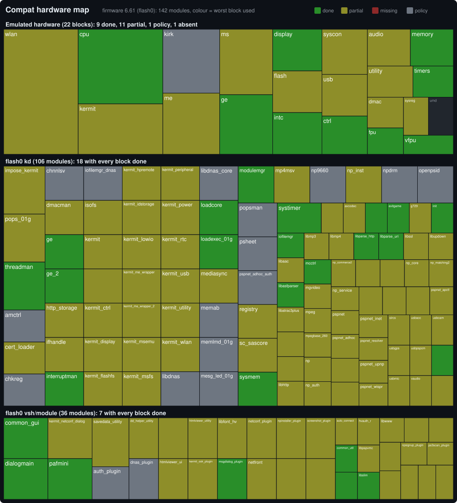

<!-- pair: progress.md sha256=023b97d717ccfb505eb24ebc15082eb651d0ba804660d016733fd9522c645ade -->
# Cobertura do hardware do Compat

*English: [progress.md](progress.md).*

<!-- Gerado por build/hle-status (VitaSharp.Desktop compat-coverage --status) a partir de docs/compat/coverage.json; não edite à mão. -->

O que o firmware do Compat (o núcleo de compatibilidade do Vita: o Allegrex dentro do SoC, que o firmware chama de SceCompat) precisa do hardware emulado. O VitaSharp não reimplementa os módulos que rodam nele (não há HLE deste lado): como um Vita, ele roda o firmware 6.61 que vem no `pcff` (o flash0 kermit que vem no app de sistema do emulador de PSP) nesse núcleo ([psp-compat.pt-BR.md](../notes/psp-compat.pt-BR.md)). Por isso esta página mede o hardware: **89.7%** dos itens de contrato implementados (122/136).

## Como a porcentagem é medida

- Cada bloco lista os seus **itens de contrato**: a interface que o firmware usa nele (os registradores de um bloco MMIO, os grupos de instruções de uma unidade da CPU, o caminho de pedidos e o serviço do Vita de um canal kermit), tirados das fontes que o código do bloco cita (uOFW, Jpcsp, o SDK do IPL, Adrenaline, [psp-compat.pt-BR.md](../notes/psp-compat.pt-BR.md)).
- Um item está **implementado** quando tem uma *sonda*: um texto (o rótulo `case` do registrador, o nome do tratador ou da função HLE) que precisa estar num dos arquivos de código do bloco. O `compat-coverage` e o `CompatCoverageReportTests` recusam uma sonda que o código não tem, então a porcentagem segue o código e não uma opinião. Um item que o código não faz tem uma *lacuna* que diz por quê.
- **Bloco:** itens implementados ÷ itens; o estado sai da conta (todos: feito, nenhum: falta, senão parcial). Só o KIRK (não emulado por política) e o drive de UMD (ausente no Vita) são declarados.
- **Módulo do flash0:** itens implementados ÷ itens dos blocos que ele usa (a média das porcentagens desses blocos ponderada pelo número de itens). **Região e selo:** a soma do mesmo jeito; a global é a de todos os blocos (o ausente fica fora).
- Os canais kermit (Memory Stick, flash, áudio, Media Engine, Wi-Fi, USB, syscon, utilitários) chegam ao ScePspemu real como pedidos; o item que falta em todos é rodá-los de ponta a ponta com ele.
- Todo módulo do flash0 é cifrado (`~PSP`) e carregado pelo `memlmd`, que precisa do KIRK: não emulado por política, contado nos módulos que o chamam (memlmd e os de DRM). O código de boot (`pcbc`) continua cifrado para o processador seguro: o núcleo só sobe o firmware real com um `pcbc.bin` tirado pelo usuário (psp-compat.pt-BR.md).
- Os nomes dos módulos vêm da tabela de arquivos do `pcff`; os papéis, do uOFW, dos canais kermit e das listas de módulos do psdevwiki ("a confirmar" onde nenhuma fonte dá o papel).

<picture>
  <source media="(prefers-color-scheme: light)" srcset="../assets/status/progress-map-compat-light.svg">
  
</picture>

| Estado | Blocos | Itens | Módulos (pior bloco) |
|---|---:|---:|---:|
| feito | 9 | 69/69 | 25 |
| parcial | 11 | 53/66 | 100 |
| falta | 0 | 0/0 | 0 |
| não emulado por política | 1 | 0/1 | 17 |
| ausente no Vita | 1 | - | - |
| Total | 22 | 122/136 (89.7%) | 142 |

## Blocos de hardware (22)

| Bloco | Id | % | Itens | Estado | Usado por | Código | Notas |
|---|---|---:|---:|---|---:|---|---|
| CPU Allegrex | `cpu` | 100% | 11/11 | feito | 34 | [AllegrexCore.cs](../../src/VitaSharp.Core/Compat/Allegrex/AllegrexCore.cs), [AllegrexCore.Blocks.cs](../../src/VitaSharp.Core/Compat/Allegrex/AllegrexCore.Blocks.cs), [AllegrexCore.Il.cs](../../src/VitaSharp.Core/Compat/Allegrex/AllegrexCore.Il.cs), [AllegrexCore.Alu.cs](../../src/VitaSharp.Core/Compat/Allegrex/AllegrexCore.Alu.cs), [AllegrexCore.Branch.cs](../../src/VitaSharp.Core/Compat/Allegrex/AllegrexCore.Branch.cs), [AllegrexCore.Memory.cs](../../src/VitaSharp.Core/Compat/Allegrex/AllegrexCore.Memory.cs), [AllegrexCore.MultiplyDivide.cs](../../src/VitaSharp.Core/Compat/Allegrex/AllegrexCore.MultiplyDivide.cs), [AllegrexCore.Extensions.cs](../../src/VitaSharp.Core/Compat/Allegrex/AllegrexCore.Extensions.cs), [AllegrexCore.System.cs](../../src/VitaSharp.Core/Compat/Allegrex/AllegrexCore.System.cs) | o ISA inteiro com as adições do Allegrex, COP0, exceções, interrupções, instruções de cache; cache de blocos e camada IL |
| FPU (COP1) | `fpu` | 100% | 5/5 | feito | 0 | [AllegrexCore.Fpu.cs](../../src/VitaSharp.Core/Compat/Allegrex/AllegrexCore.Fpu.cs) | resultados exatos em software nos quatro modos de arredondamento, causas, flags e enables IEEE, o NaN e o flush-to-zero do Allegrex |
| VFPU (COP2) | `vfpu` | 100% | 8/8 | feito | 0 | [AllegrexCore.Vfpu.cs](../../src/VitaSharp.Core/Compat/Allegrex/AllegrexCore.Vfpu.cs), [AllegrexVfpuMath.cs](../../src/VitaSharp.Core/Compat/Allegrex/AllegrexVfpuMath.cs), [AllegrexCore.VfpuVector.cs](../../src/VitaSharp.Core/Compat/Allegrex/AllegrexCore.VfpuVector.cs), [AllegrexCore.VfpuMatrix.cs](../../src/VitaSharp.Core/Compat/Allegrex/AllegrexCore.VfpuMatrix.cs) | todos os opcodes, prefixos, visões de registradores; as transcendentais batem bit a bit com o pspautotests |
| Memória (RAM, VRAM, scratchpad) | `memory` | 100% | 5/5 | feito | 4 | [PspBus.cs](../../src/VitaSharp.Core/Compat/PspBus.cs) | os quatro bancos de 16 MB da janela do SceCompat, o buraco, VRAM e scratchpad no topo do banco 3, a SRAM compartilhada |
| Controlador de interrupções | `intc` | 100% | 5/5 | feito | 7 | [PspInterruptController.cs](../../src/VitaSharp.Core/Compat/Psp/PspInterruptController.cs) | 0xBC300000: 64 linhas, pendentes mascaradas/brutas e enable, saída no IP2 |
| Timers e tempo do sistema | `timers` | 100% | 8/8 | feito | 2 | [PspHardwareTimers.cs](../../src/VitaSharp.Core/Compat/Psp/PspHardwareTimers.cs), [PspSystemTime.cs](../../src/VitaSharp.Core/Compat/Psp/PspSystemTime.cs) | os quatro timers em 0xBC500000 (interrupções 15-18), a contagem de 1 MHz e o alarme em 0xBC600000 (interrupção 19), no tempo do próprio núcleo |
| Controladores de DMA | `dmac` | 90.9% | 10/11 | parcial | 1 | [PspDmac.cs](../../src/VitaSharp.Core/Compat/Psp/PspDmac.cs) | 0xBC900000/0xBCA00000 (PL080): itens e listas de memória para memória; canais que esperam um periférico (controle de fluxo) não são emulados |
| GE (motor gráfico) | `ge` | 100% | 16/16 | feito | 14 | [GeEngine.cs](../../src/VitaSharp.Core/Compat/Ge/GeEngine.cs), [GeEngine.Draw.cs](../../src/VitaSharp.Core/Compat/Ge/GeEngine.Draw.cs), [GeVulkanRasterizer.cs](../../src/VitaSharp.Renderer.Vulkan/GeVulkanRasterizer.cs), [GeEngine.Patches.cs](../../src/VitaSharp.Core/Compat/Ge/GeEngine.Patches.cs), [GeTextureDecoder.cs](../../src/VitaSharp.Core/Compat/Ge/GeTextureDecoder.cs), [GeVertexTransformer.cs](../../src/VitaSharp.Core/Compat/Ge/GeVertexTransformer.cs), [GeCommand.cs](../../src/VitaSharp.Core/Compat/Ge/GeCommand.cs) | 0xBD400000/0xBD500000: listas de display, estado dos comandos, decodificação de vértices, texturas e CLUT, patches, rasterizados no Vulkan |
| Display e LCD DMA | `display` | 100% | 9/9 | feito | 7 | [PspDisplayController.cs](../../src/VitaSharp.Core/Compat/Psp/PspDisplayController.cs), [PspLcdc.cs](../../src/VitaSharp.Core/Compat/Psp/PspLcdc.cs), [CompatLcdDma.cs](../../src/VitaSharp.Core/Compat/CompatLcdDma.cs) | temporização e vblank (interrupção 30) em 0xBE740000, o canal de scan-out em 0xBC800100, o LCD DMA para o framebuffer do ScePspemu (a origem é inferida) |
| Controle do sistema e clocks | `sysreg` | 75% | 6/8 | parcial | 0 | [PspSystemControl.cs](../../src/VitaSharp.Core/Compat/Psp/PspSystemControl.cs) | 0xBC100000/0xBC200000: reset, enables de clock e IO, PLL, razões do barramento; versão do chip e fuse id do núcleo de compatibilidade desconhecidos (leem 0) |
| Kermit (mailbox, SRAM compartilhada) | `kermit` | 75% | 6/8 | parcial | 21 | [CompatMailbox.cs](../../src/VitaSharp.Core/Compat/CompatMailbox.cs), [CompatSharedSram.cs](../../src/VitaSharp.Core/Compat/CompatSharedSram.cs), [PspDdrController.cs](../../src/VitaSharp.Core/Compat/Psp/PspDdrController.cs), [Compat.cs](../../src/VitaSharp.Core/Hle/Modules/Compat.cs) | pedidos, respostas, interrupções virtuais e o flush DDR como o SceCompat 3.74 os move; o número de interrupção das campainhas no núcleo e os registradores de pendente/confirmação são inferidos até o trace do boot |
| Controle (SRAM compartilhada) | `ctrl` | 100% | 2/2 | feito | 5 | [Compat.cs](../../src/VitaSharp.Core/Hle/Modules/Compat.cs) | sceCompatWriteSharedCtrl grava as três palavras do controle que o núcleo compat lê |
| Media Engine (canal 6) | `me` | 80% | 4/5 | parcial | 16 | [Compat.cs](../../src/VitaSharp.Core/Hle/Modules/Compat.cs), [Audiodec.cs](../../src/VitaSharp.Core/Hle/Modules/Audiodec.cs) | sem ME no núcleo compat: o kermit_me_wrapper manda os codecs para o ScePspemu real (LLE) e os codecs do Vita; ainda não rodado de ponta a ponta |
| Memory Stick (canal 3) | `ms` | 75% | 3/4 | parcial | 16 | [Compat.cs](../../src/VitaSharp.Core/Hle/Modules/Compat.cs), [IoFileMgr.cs](../../src/VitaSharp.Core/Hle/Modules/IoFileMgr.cs) | pedidos do kermit_msfs atendidos pelo ScePspemu real sobre o sistema de arquivos do Vita (ux0:pspemu); ainda não rodado de ponta a ponta |
| flash0/NAND e ID storage (canal 4) | `flash` | 80% | 4/5 | parcial | 7 | [Compat.cs](../../src/VitaSharp.Core/Hle/Modules/Compat.cs), [IoFileMgr.cs](../../src/VitaSharp.Core/Hle/Modules/IoFileMgr.cs) | kermit_flashfs atendido pelo ScePspemu real; sceCompatIdStorageLookup responde as folhas do ID storage; ainda não rodado de ponta a ponta |
| Áudio (canais 5 e 11) | `audio` | 80% | 4/5 | parcial | 4 | [Compat.cs](../../src/VitaSharp.Core/Hle/Modules/Compat.cs), [Audio.cs](../../src/VitaSharp.Core/Hle/Modules/Audio.cs) | o kermit_audio manda PCM que o ScePspemu real toca com sceAudioOut (interrupções virtuais 1-3); ainda não rodado de ponta a ponta |
| Syscon: energia, RTC, IO baixo (canais 7 e 9) | `syscon` | 80% | 4/5 | parcial | 7 | [Compat.cs](../../src/VitaSharp.Core/Hle/Modules/Compat.cs), [SystemMisc.cs](../../src/VitaSharp.Core/Hle/Modules/SystemMisc.cs) | sem syscon no núcleo compat: energia, relógio, LEDs, controle remoto e periféricos vão ao ScePspemu real como pedidos kermit (energia: interrupção virtual 10); ainda não rodado de ponta a ponta |
| Wi-Fi (canal 10) | `wlan` | 83.3% | 5/6 | parcial | 53 | [Compat.cs](../../src/VitaSharp.Core/Hle/Modules/Compat.cs), [KernelTwins.cs](../../src/VitaSharp.Core/Hle/Modules/KernelTwins.cs), [Online.cs](../../src/VitaSharp.Core/Hle/Modules/Online.cs) | kermit_wlan atendido pelo ScePspemu real sobre o HLE de rede do Vita (interrupções virtuais 7-8); ainda não rodado de ponta a ponta |
| USB (canais 8 e 12) | `usb` | 75% | 3/4 | parcial | 6 | [Compat.cs](../../src/VitaSharp.Core/Hle/Modules/Compat.cs), [MtpIf.cs](../../src/VitaSharp.Core/Hle/Modules/MtpIf.cs) | kermit_usb atendido pelo ScePspemu real; do lado do Vita o cabo fica sempre desconectado (a resposta do firmware sem host) |
| Utilitários: OSK e diálogos (canal 13) | `utility` | 80% | 4/5 | parcial | 3 | [Compat.cs](../../src/VitaSharp.Core/Hle/Modules/Compat.cs), [CommonDialog.cs](../../src/VitaSharp.Core/Hle/Modules/CommonDialog.cs) | pedidos do kermit_utility (teclado na tela, diálogo de rede) mostrados pelo ScePspemu real com os diálogos do Vita; ainda não rodado de ponta a ponta |
| Leitor de UMD / ATA | `umd` | - | - | ausente no Vita | 0 | - | o Vita não tem leitor de UMD e este flash0 não tem driver de UMD nem de ATA: os títulos ISO são lidos pelo np9660/isofs pelo canal do Memory Stick |
| Motor criptográfico KIRK | `kirk` | 0% | 0/1 | não emulado por política | 17 | - | decifra todo módulo ~PSP (memlmd) e o DRM; não emulado por política (as chaves são decisão do lead) |

## Itens que faltam

| Bloco | Item | Por quê |
|---|---|---|
| `dmac` | peripheral flow control | canais que esperam um periférico são registrados no log e não rodam |
| `sysreg` | fuse id and fuse configuration (0x090..0x098) | os valores do núcleo de compatibilidade são desconhecidos: lidos como 0 |
| `sysreg` | chip version (0x040 high bits) | a versão do chip do núcleo de compatibilidade é desconhecida: lida como 0 |
| `kermit` | the doorbells' interrupt line on the core | o número de interrupção do PSP não é conhecido: a mailbox segura o IP2 direto até o trace de boot achá-lo |
| `kermit` | run end to end with the real ScePspemu | nenhum teste nem trace de boot roda ainda os pedidos deste canal pelo ScePspemu real |
| `me` | run end to end with the real ScePspemu | nenhum teste nem trace de boot roda ainda os pedidos deste canal pelo ScePspemu real |
| `ms` | run end to end with the real ScePspemu | nenhum teste nem trace de boot roda ainda os pedidos deste canal pelo ScePspemu real |
| `flash` | run end to end with the real ScePspemu | nenhum teste nem trace de boot roda ainda os pedidos deste canal pelo ScePspemu real |
| `audio` | run end to end with the real ScePspemu | nenhum teste nem trace de boot roda ainda os pedidos deste canal pelo ScePspemu real |
| `syscon` | run end to end with the real ScePspemu | nenhum teste nem trace de boot roda ainda os pedidos deste canal pelo ScePspemu real |
| `wlan` | run end to end with the real ScePspemu | nenhum teste nem trace de boot roda ainda os pedidos deste canal pelo ScePspemu real |
| `usb` | run end to end with the real ScePspemu | nenhum teste nem trace de boot roda ainda os pedidos deste canal pelo ScePspemu real |
| `utility` | run end to end with the real ScePspemu | nenhum teste nem trace de boot roda ainda os pedidos deste canal pelo ScePspemu real |
| `kirk` | decryption of ~PSP modules and DRM | não emulado por política (as chaves são decisão do lead) |

## Itens implementados (sondas)

| Bloco | Item | Sonda no código |
|---|---|---|
| `cpu` | integer ALU with the overflow exception | `Overflow` |
| `cpu` | shifts and rotates (rotr/rotrv) | `rotr` |
| `cpu` | branches and jumps, branch-likely annul | `BranchLikelyIf(` |
| `cpu` | loads and stores, unaligned lwl/lwr/swl/swr | `lwl/lwr/swl/swr` |
| `cpu` | multiply/divide and madd/msub | `madd` |
| `cpu` | Allegrex additions (ext/ins, seb/seh, wsbh/wsbw, bitrev, clz/clo, min/max) | `bitrev` |
| `cpu` | COP0 moves and eret | `eret` |
| `cpu` | exceptions (syscall, break, address errors) | `syscall` |
| `cpu` | interrupt line IP2 | `IP2` |
| `cpu` | halt and $ic (mfic/mtic) | `mfic` |
| `cpu` | decoded-block cache and IL tier | `MaxRegionBlocks` |
| `fpu` | arithmetic and sqrt, exact in every rounding mode | `sqrt` |
| `fpu` | conversions (cvt, round/trunc/ceil/floor) | `cvt.w.s` |
| `fpu` | FCR31 flags, enables and causes (cfc1/ctc1) | `Fcr31WriteMask` |
| `fpu` | compare and the condition bit | `Fcr31Condition` |
| `fpu` | flush-to-zero | `Fcr31FlushToZero` |
| `vfpu` | register views and COP2 moves (mfv/mtv/mfvc/mtvc) | `mfvc` |
| `vfpu` | S/T/D prefixes | `vpfxs` |
| `vfpu` | loads and stores (lv/sv .s/.q, unaligned) | `lv.q` |
| `vfpu` | vector arithmetic and the VFPU4 table | `vsin` |
| `vfpu` | matrix instructions | `vmmul` |
| `vfpu` | transcendental functions bit-exact | `vrnds` |
| `vfpu` | conversions and colour packing | `vt4444` |
| `vfpu` | vsync/vflush/vnop | `vsync` |
| `memory` | main RAM: four 16 MB banks | `BankSize` |
| `memory` | VRAM 2 MB with its mirrors | `VramMirrorsEnd` |
| `memory` | scratchpad 16 KB | `ScratchpadSize` |
| `memory` | shared SRAM window | `CompatSharedSram` |
| `memory` | unknown MMIO logged for the boot trace | `UnknownLogLimit` |
| `intc` | low group 0x00/0x04/0x08 (lines 0..31) | `case 0x08:` |
| `intc` | high group 0x10/0x14/0x18 (lines 32..63) | `case 0x18:` |
| `intc` | compact group 0x20/0x24/0x28 (38, 39, 46, 47) | `case 0x28:` |
| `intc` | latched sources acknowledged on 0x00 (vblank, ME) | `_latched &= ~(ulong)value` |
| `intc` | output on Cause.IP2 | `OutputChanged` |
| `timers` | timer status and acknowledge (+0x00) | `ResetOverflow` |
| `timers` | timer count (+0x04) | `case 0x4:` |
| `timers` | prescaler numerator/denominator (+0x08/+0x0C) | `case 0x8:` |
| `timers` | status without acknowledge (+0x100) | `ReadOnlyStatus` |
| `timers` | timer interrupts 15-18 | `InterruptEnable` |
| `timers` | system time count in microseconds (+0x00) | `case 0x00:` |
| `timers` | system time alarm, interrupt 19 (+0x04) | `case 0x04:` |
| `timers` | boot registers +0x08..+0x10 | `case 0x10:` |
| `dmac` | interrupt status (0x000) | `case 0x000:` |
| `dmac` | terminal count status/clear (0x004/0x008) | `case 0x008:` |
| `dmac` | error status/clear (0x00C/0x010) | `case 0x010:` |
| `dmac` | raw status (0x014/0x018) | `case 0x018:` |
| `dmac` | enabled channels (0x01C) | `case 0x01C:` |
| `dmac` | software requests (0x020..0x02C) | `case 0x02C:` |
| `dmac` | configuration and sync (0x030/0x034) | `case 0x034:` |
| `dmac` | channel registers (source, destination, LLI, control, configuration) | `ChannelStride` |
| `dmac` | memory-to-memory items and linked lists | `ControlSourceIncrement` |
| `dmac` | terminal count interrupts 22/23 | `ControlTerminalCountInterrupt` |
| `ge` | list registers (EXEC, LIST, STALL, CALL return levels) | `RegisterStall` |
| `ge` | SIGNAL/END/FINISH interrupt status, mask and acknowledge | `RegisterInterruptAcknowledge` |
| `ge` | command words at +0x800 and matrices at +0xC00 | `RegisterMatricesEnd` |
| `ge` | EDRAM controller | `EdramPhysicalBase` |
| `ge` | vertex decode and index buffers | `IndexAddress` |
| `ge` | primitives (points, lines, strips, fans, rectangles) | `PrimitiveTriangleFan` |
| `ge` | bezier and spline patches | `Spline` |
| `ge` | bounding box test | `BoundingBoxJump` |
| `ge` | textures, swizzle and CLUT | `ClutAddress` |
| `ge` | DXT textures | `FormatDxt5` |
| `ge` | lighting and materials | `MaterialSpecular` |
| `ge` | skinning and morphing | `MorphWeight0` |
| `ge` | fog, blending, alpha/colour/stencil/depth tests, logic op | `LogicOpEnable` |
| `ge` | clear mode | `ClearMode` |
| `ge` | block transfer | `TransferStart` |
| `ge` | rasterized on Vulkan | `GeVulkanRasterizer` |
| `display` | scan line (+0x04) | `case 0x04:` |
| `display` | vertical blanks count (+0x08) | `case 0x08:` |
| `display` | busy status (+0x20) | `case 0x20:` |
| `display` | vblank interrupt 30 | `PspInterrupt` |
| `display` | scan-out channel address and pixel format | `case 0x00:` |
| `display` | scan-out width and stride | `case 0x0C:` |
| `display` | scan-out enable | `ScanOutEnabled` |
| `display` | LCD DMA into ScePspemu's framebuffer | `OnVblank` |
| `display` | pixel format conversion to A8B8G8R8 | `ConvertLine(` |
| `sysreg` | RAM size (0x040) | `case RamSizeRegister:` |
| `sysreg` | Media Engine interrupt (0x044) | `case MeInterruptRegister:` |
| `sysreg` | reset bits (0x04C) | `case ResetRegister:` |
| `sysreg` | PLL (0x068) | `case PllRegister:` |
| `sysreg` | USB and Memory Stick state (0x080) | `case UsbMemoryStickRegister:` |
| `sysreg` | CPU/bus clock ratios (0xBC200000) | `PspClockFrequency` |
| `kermit` | ARM-side doorbells (0xE5070000) | `ArmPhysicalBase` |
| `kermit` | core-side pending/acknowledge registers | `PspAcknowledgeRegister` |
| `kermit` | command entries in the shared SRAM (16 channels) | `CommandEntries` |
| `kermit` | requests and answers (sceCompatWaitAndGetRequest, sceCompatReturnValueEx) | `int sceCompatReturnValueEx(` |
| `kermit` | virtual interrupts (sceCompatInterrupt) | `int sceCompatInterrupt(` |
| `kermit` | DDR flush before the doorbell | `FlushRegister` |
| `ctrl` | the three pad words in the shared SRAM (sceCompatWriteSharedCtrl) | `int sceCompatWriteSharedCtrl(` |
| `ctrl` | controller area of the shared SRAM | `ControllerWords` |
| `me` | requests reach the ARM side (ring, sceCompatWaitAndGetRequest) | `int sceCompatWaitAndGetRequest(` |
| `me` | answers return to the core (sceCompatReturnValueEx) | `int sceCompatReturnValueEx(` |
| `me` | ME DMA virtual interrupts 4-6 | `int sceCompatInterrupt(` |
| `me` | Vita audio codecs the real ScePspemu calls | `int sceAudiodecDecode(` |
| `ms` | requests reach the ARM side (ring, sceCompatWaitAndGetRequest) | `int sceCompatWaitAndGetRequest(` |
| `ms` | answers return to the core (sceCompatReturnValueEx) | `int sceCompatReturnValueEx(` |
| `ms` | files on the Vita file system (sceIo) | `int sceIoOpen(` |
| `flash` | requests reach the ARM side (ring, sceCompatWaitAndGetRequest) | `int sceCompatWaitAndGetRequest(` |
| `flash` | answers return to the core (sceCompatReturnValueEx) | `int sceCompatReturnValueEx(` |
| `flash` | ID storage leaves (sceCompatIdStorageLookup) | `int sceCompatIdStorageLookup(` |
| `flash` | files on the Vita file system (sceIo) | `int sceIoOpen(` |
| `audio` | requests reach the ARM side (ring, sceCompatWaitAndGetRequest) | `int sceCompatWaitAndGetRequest(` |
| `audio` | answers return to the core (sceCompatReturnValueEx) | `int sceCompatReturnValueEx(` |
| `audio` | audio virtual interrupts 1-3 | `int sceCompatInterrupt(` |
| `audio` | PCM played with sceAudioOut | `int sceAudioOutOutput(` |
| `syscon` | requests reach the ARM side (ring, sceCompatWaitAndGetRequest) | `int sceCompatWaitAndGetRequest(` |
| `syscon` | answers return to the core (sceCompatReturnValueEx) | `int sceCompatReturnValueEx(` |
| `syscon` | power virtual interrupt 10 | `int sceCompatInterrupt(` |
| `syscon` | battery and power state (scePower) | `int scePowerGetBatteryLifePercent(` |
| `wlan` | requests reach the ARM side (ring, sceCompatWaitAndGetRequest) | `int sceCompatWaitAndGetRequest(` |
| `wlan` | answers return to the core (sceCompatReturnValueEx) | `int sceCompatReturnValueEx(` |
| `wlan` | WLAN virtual interrupts 7-8 | `int sceCompatInterrupt(` |
| `wlan` | sockets (sceNet) | `sceNetSocket(` |
| `wlan` | connection state (sceNetCtl) | `int sceNetCtlInetGetState(` |
| `usb` | requests reach the ARM side (ring, sceCompatWaitAndGetRequest) | `int sceCompatWaitAndGetRequest(` |
| `usb` | answers return to the core (sceCompatReturnValueEx) | `int sceCompatReturnValueEx(` |
| `usb` | cable state, always disconnected (sceUdcd) | `sceUdcdGetDeviceState` |
| `utility` | requests reach the ARM side (ring, sceCompatWaitAndGetRequest) | `int sceCompatWaitAndGetRequest(` |
| `utility` | answers return to the core (sceCompatReturnValueEx) | `int sceCompatReturnValueEx(` |
| `utility` | on-screen keyboard (sceImeDialog) | `int sceImeDialogInit(` |
| `utility` | network dialog (sceNetCheckDialog) | `int sceNetCheckDialogInit(` |

## Módulos do firmware 6.61 (142)

| Módulo | Papel | Blocos | % | Pior |
|---|---|---|---:|---|
| `kd/sysmem.prx` | gerenciador de memória | `cpu`, `memory` | 100% | feito |
| `kd/loadcore.prx` | carregador e ligador de módulos | `cpu`, `memory` | 100% | feito |
| `kd/exceptionman.prx` | tratadores de exceção | `cpu` | 100% | feito |
| `kd/interruptman.prx` | gerenciador de interrupções | `cpu`, `intc` | 100% | feito |
| `kd/threadman.prx` | threads, sincronização, alarmes | `cpu`, `intc`, `timers` | 100% | feito |
| `kd/systimer.prx` | driver dos timers de hardware | `timers`, `intc` | 100% | feito |
| `kd/dmacman.prx` | gerenciador dos controladores de DMA | `dmac`, `intc` | 93.7% | parcial |
| `kd/iofilemgr.prx` | gerenciador de arquivos de I/O | `cpu` | 100% | feito |
| `kd/iofilemgr_dnas.prx` | gerenciador de I/O para arquivos protegidos por DNAS | `cpu`, `kirk` | 91.6% | não emulado por política |
| `kd/modulemgr.prx` | gerenciador de módulos | `cpu`, `memory` | 100% | feito |
| `kd/init.prx` | carregador de módulos do boot | `cpu` | 100% | feito |
| `kd/loadexec_01g.prx` | carregador de executáveis e reboot | `cpu`, `memory` | 100% | feito |
| `kd/memlmd_01g.prx` | decifra os módulos ~PSP antes de carregar | `cpu`, `kirk` | 91.6% | não emulado por política |
| `kd/mesg_led_01g.prx` | decifração de módulos (de jogos e do atualizador) | `cpu`, `kirk` | 91.6% | não emulado por política |
| `kd/registry.prx` | registro do sistema (flash1) | `cpu`, `flash` | 93.7% | parcial |
| `kd/chkreg.prx` | checagem de região pelo ID storage | `flash`, `kirk` | 66.6% | não emulado por política |
| `kd/ifhandle.prx` | handles das interfaces de rede | `cpu`, `wlan` | 94.1% | parcial |
| `kd/usersystemlib.prx` | biblioteca do kernel em modo usuário | `cpu` | 100% | feito |
| `kd/memab.prx` | criptografia de autenticação do ad hoc | `cpu`, `kirk` | 91.6% | não emulado por política |
| `kd/openpsid.prx` | ID do console (OpenPSID) | `flash`, `kirk` | 66.6% | não emulado por política |
| `kd/npdrm.prx` | NPDRM do PSP (licenças, EDAT) | `cpu`, `kirk` | 91.6% | não emulado por política |
| `kd/amctrl.prx` | decifração do DRM do conteúdo da PSN | `cpu`, `kirk` | 91.6% | não emulado por política |
| `kd/chnnlsv.prx` | criptografia dos saves | `cpu`, `kirk` | 91.6% | não emulado por política |
| `kd/cert_loader.prx` | carrega os certificados SSL do flash0 | `cpu`, `flash` | 93.7% | parcial |
| `kd/exitgame.prx` | callback de sair do jogo | `cpu` | 100% | feito |
| `kd/mediasync.prx` | espera a mídia do jogo | `cpu`, `ms` | 93.3% | parcial |
| `kd/isofs.prx` | sistema de arquivos ISO 9660 da imagem do disco | `cpu`, `ms` | 93.3% | parcial |
| `kd/np9660.prx` | imagem de disco da PSN (NPUMDIMG) como UMD | `ms`, `kirk` | 60% | não emulado por política |
| `kd/impose_kermit.prx` | ajustes do overlay HOME (volume, brilho) | `kermit`, `syscon`, `display` | 86.3% | parcial |
| `kd/kermit.prx` | transporte dos pedidos kermit para o ARM | `kermit`, `intc` | 84.6% | parcial |
| `kd/kermit_audio.prx` | driver de saída de áudio | `kermit`, `audio` | 76.9% | parcial |
| `kd/kermit_ctrl.prx` | driver do controle | `kermit`, `ctrl` | 80% | parcial |
| `kd/kermit_display.prx` | driver do display | `kermit`, `display` | 88.2% | parcial |
| `kd/kermit_flashfs.prx` | sistema de arquivos do flash0/flash1 | `kermit`, `flash` | 76.9% | parcial |
| `kd/kermit_hpremote.prx` | controle remoto do fone | `kermit`, `syscon` | 76.9% | parcial |
| `kd/kermit_idstorage.prx` | ID storage | `kermit`, `flash` | 76.9% | parcial |
| `kd/kermit_lowio.prx` | I/O de baixo nível (energia, LEDs) | `kermit`, `syscon` | 76.9% | parcial |
| `kd/kermit_me_wrapper.prx` | chamadas do Media Engine para o ARM | `kermit`, `me` | 76.9% | parcial |
| `kd/kermit_me_wrapper_2.prx` | chamadas do Media Engine para o ARM (segunda variante) | `kermit`, `me` | 76.9% | parcial |
| `kd/kermit_msemu.prx` | dispositivo do Memory Stick | `kermit`, `ms` | 75% | parcial |
| `kd/kermit_msfs.prx` | sistema de arquivos do Memory Stick | `kermit`, `ms` | 75% | parcial |
| `kd/kermit_peripheral.prx` | estado dos periféricos | `kermit`, `syscon` | 76.9% | parcial |
| `kd/kermit_power.prx` | energia, bateria, suspensão | `kermit`, `syscon` | 76.9% | parcial |
| `kd/kermit_rtc.prx` | relógio de tempo real | `kermit`, `syscon` | 76.9% | parcial |
| `kd/kermit_usb.prx` | driver USB | `kermit`, `usb` | 75% | parcial |
| `kd/kermit_utility.prx` | pedidos de utilitários (OSK, diálogos) | `kermit`, `utility` | 76.9% | parcial |
| `kd/kermit_wlan.prx` | driver de Wi-Fi | `kermit`, `wlan` | 78.5% | parcial |
| `kd/ge.prx` | driver do GE (listas de display) | `ge`, `intc` | 100% | feito |
| `kd/ge_2.prx` | driver do GE (segunda variante) | `ge`, `intc` | 100% | feito |
| `kd/audiocodec_260.prx` | interface dos codecs de áudio | `me` | 80% | parcial |
| `kd/avcodec.prx` | núcleo dos codecs de áudio/vídeo | `me` | 80% | parcial |
| `kd/videocodec_260.prx` | interface dos codecs de vídeo | `me` | 80% | parcial |
| `kd/mpegbase_260.prx` | base MPEG (decodificação de vídeo) | `me` | 80% | parcial |
| `kd/mpeg.prx` | biblioteca do player de filmes PSMF | `me` | 80% | parcial |
| `kd/libatrac3plus.prx` | decodificador ATRAC3/ATRAC3plus | `me` | 80% | parcial |
| `kd/libmp3.prx` | decodificador MP3 | `me` | 80% | parcial |
| `kd/libaac.prx` | decodificador AAC | `me` | 80% | parcial |
| `kd/libaudiocodec2.prx` | biblioteca de codecs de áudio (segunda interface) | `me` | 80% | parcial |
| `kd/g729.prx` | codec de voz G.729 | `me` | 80% | parcial |
| `kd/sc_sascore.prx` | sintetizador de som SAS | `me`, `audio` | 80% | parcial |
| `kd/vaudio.prx` | saída de áudio de vídeo | `audio` | 80% | parcial |
| `kd/libmp4.prx` | reprodução de MP4 | `me` | 80% | parcial |
| `kd/mp4msv.prx` | vídeo MP4 do Memory Stick | `me`, `ms` | 77.7% | parcial |
| `kd/libasfparser.prx` | leitor do contêiner ASF (WMA) | `cpu` | 100% | feito |
| `kd/mgvideo.prx` | reprodução de vídeo (papel a confirmar) | `me` | 80% | parcial |
| `kd/mcctrl.prx` | papel a confirmar | `cpu` | 100% | feito |
| `kd/pops_01g.prx` | emulador de PSone | `cpu`, `display`, `audio` | 96% | parcial |
| `kd/popsman.prx` | gerenciador das imagens de PSone (decifração) | `ms`, `kirk` | 60% | não emulado por política |
| `kd/psheet.prx` | folha de DRM do conteúdo da PSN | `cpu`, `kirk` | 91.6% | não emulado por política |
| `kd/sircs.prx` | controle remoto infravermelho (SIRCS) | `syscon` | 80% | parcial |
| `kd/http_storage.prx` | download HTTP para o armazenamento | `wlan`, `ms` | 80% | parcial |
| `kd/libhttp.prx` | cliente HTTP | `wlan` | 83.3% | parcial |
| `kd/libparse_http.prx` | leitor de cabeçalhos HTTP | `cpu` | 100% | feito |
| `kd/libparse_uri.prx` | leitor de URI | `cpu` | 100% | feito |
| `kd/libssl.prx` | SSL/TLS | `wlan` | 83.3% | parcial |
| `kd/libupdown.prx` | biblioteca de upload/download | `wlan` | 83.3% | parcial |
| `kd/libgameupdate.prx` | checagem de atualização de jogo | `wlan` | 83.3% | parcial |
| `kd/libdnas.prx` | autenticação DNAS | `wlan`, `kirk` | 71.4% | não emulado por política |
| `kd/libdnas_core.prx` | núcleo do DNAS | `wlan`, `kirk` | 71.4% | não emulado por política |
| `kd/pspnet.prx` | núcleo de rede | `wlan` | 83.3% | parcial |
| `kd/pspnet_inet.prx` | sockets TCP/IP | `wlan` | 83.3% | parcial |
| `kd/pspnet_apctl.prx` | conexão ao ponto de acesso | `wlan` | 83.3% | parcial |
| `kd/pspnet_resolver.prx` | resolvedor de DNS | `wlan` | 83.3% | parcial |
| `kd/pspnet_upnp.prx` | UPnP | `wlan` | 83.3% | parcial |
| `kd/pspnet_wispr.prx` | login de hotspot WISPr | `wlan` | 83.3% | parcial |
| `kd/pspnet_adhoc.prx` | PDP/PTP ad hoc | `wlan` | 83.3% | parcial |
| `kd/pspnet_adhocctl.prx` | controle de grupos ad hoc | `wlan` | 83.3% | parcial |
| `kd/pspnet_adhoc_auth.prx` | autenticação ad hoc | `wlan`, `kirk` | 71.4% | não emulado por política |
| `kd/pspnet_adhoc_discover.prx` | descoberta ad hoc | `wlan` | 83.3% | parcial |
| `kd/pspnet_adhoc_download.prx` | download do compartilhamento de jogo ad hoc | `wlan` | 83.3% | parcial |
| `kd/pspnet_adhoc_matching.prx` | matching ad hoc | `wlan` | 83.3% | parcial |
| `kd/pspnet_adhoc_transfer_int.prx` | transferência ad hoc | `wlan` | 83.3% | parcial |
| `kd/np.prx` | biblioteca da PSN | `wlan` | 83.3% | parcial |
| `kd/np_core.prx` | núcleo da PSN | `wlan` | 83.3% | parcial |
| `kd/np_auth.prx` | autenticação da PSN | `wlan` | 83.3% | parcial |
| `kd/np_service.prx` | serviços da PSN | `wlan` | 83.3% | parcial |
| `kd/np_commerce2.prx` | loja da PSN | `wlan` | 83.3% | parcial |
| `kd/np_commerce2_regcam.prx` | loja da PSN (códigos de campanha) | `wlan` | 83.3% | parcial |
| `kd/np_commerce2_store.prx` | navegação da loja da PSN | `wlan` | 83.3% | parcial |
| `kd/np_matching2.prx` | matching da PSN | `wlan` | 83.3% | parcial |
| `kd/np_inst.prx` | instalação de conteúdo da PSN | `wlan`, `ms` | 80% | parcial |
| `kd/usbacc.prx` | acessórios USB | `usb` | 75% | parcial |
| `kd/usbcam.prx` | câmera USB | `usb` | 75% | parcial |
| `kd/usbgps.prx` | GPS USB | `usb` | 75% | parcial |
| `kd/usbmic.prx` | microfone USB | `usb` | 75% | parcial |
| `kd/usbpspcm.prx` | comunicação USB do PSP (PSP-PS3) | `usb` | 75% | parcial |
| `vsh/module/pafmini.prx` | toolkit de interface dos utilitários | `cpu`, `ge`, `display` | 100% | feito |
| `vsh/module/common_gui.prx` | interface comum | `ge`, `display`, `ctrl` | 100% | feito |
| `vsh/module/common_util.prx` | utilitários comuns | `cpu` | 100% | feito |
| `vsh/module/dialogmain.prx` | base dos diálogos de utilitário | `ge`, `display`, `ctrl` | 100% | feito |
| `vsh/module/msgdialog_plugin.prx` | diálogo de mensagem | `ge`, `ctrl` | 100% | feito |
| `vsh/module/savedata_utility.prx` | utilitário de saves | `ms`, `ge`, `ctrl` | 95.4% | parcial |
| `vsh/module/savedata_auto_dialog.prx` | diálogo de save automático | `ms`, `ge` | 95% | parcial |
| `vsh/module/kermit_osk_plugin.prx` | teclado na tela (mostrado pelo Vita) | `kermit`, `utility` | 76.9% | parcial |
| `vsh/module/kermit_netconf_dialog.prx` | diálogo de rede (mostrado pelo Vita) | `kermit`, `utility`, `wlan` | 78.9% | parcial |
| `vsh/module/netconf_plugin.prx` | diálogo de configuração de rede | `wlan`, `ge` | 95.4% | parcial |
| `vsh/module/auto_connect.prx` | conexão de rede automática | `wlan` | 83.3% | parcial |
| `vsh/module/screenshot_plugin.prx` | capturas de tela | `display`, `ms` | 92.3% | parcial |
| `vsh/module/game_install_plugin.prx` | instalação de dados do jogo | `ms`, `ge` | 95% | parcial |
| `vsh/module/libfont_hv.prx` | biblioteca de fontes | `cpu`, `flash` | 93.7% | parcial |
| `vsh/module/libpspvmc.prx` | memory card virtual do PSone | `ms` | 75% | parcial |
| `vsh/module/file_parser_base.prx` | base do leitor de arquivos | `cpu` | 100% | feito |
| `vsh/module/libslim.prx` | papel a confirmar | `cpu` | 100% | feito |
| `vsh/module/dd_helper_utility.prx` | auxiliar de download | `wlan`, `ms` | 80% | parcial |
| `vsh/module/htmlviewer_ui.prx` | interface do visualizador HTML | `wlan`, `ge` | 95.4% | parcial |
| `vsh/module/htmlviewer_utility.prx` | utilitário do visualizador HTML | `wlan`, `ge` | 95.4% | parcial |
| `vsh/module/hvauth_r.prx` | autenticação do visualizador HTML | `wlan` | 83.3% | parcial |
| `vsh/module/netfront.prx` | motor do navegador | `wlan`, `ge` | 95.4% | parcial |
| `vsh/module/libwww.prx` | biblioteca web | `wlan` | 83.3% | parcial |
| `vsh/module/auth_plugin.prx` | diálogo de autenticação | `wlan`, `kirk` | 71.4% | não emulado por política |
| `vsh/module/dnas_plugin.prx` | diálogo do DNAS | `wlan`, `kirk` | 71.4% | não emulado por política |
| `vsh/module/netplay_server_utility.prx` | servidor de compartilhamento de jogo | `wlan` | 83.3% | parcial |
| `vsh/module/netplay_server_plus_utility.prx` | servidor de compartilhamento de jogo (plus) | `wlan` | 83.3% | parcial |
| `vsh/module/netplay_server2_utility.prx` | servidor de compartilhamento de jogo (2) | `wlan` | 83.3% | parcial |
| `vsh/module/ps3scan_plugin.prx` | busca do PS3 (recursos remotos) | `wlan` | 83.3% | parcial |
| `vsh/module/psn_utility.prx` | utilitário da PSN | `wlan` | 83.3% | parcial |
| `vsh/module/npinstaller_plugin.prx` | instalador de conteúdo da PSN | `wlan`, `ms` | 80% | parcial |
| `vsh/module/npsignin_plugin.prx` | login na PSN | `wlan` | 83.3% | parcial |
| `vsh/module/npsignup_plugin.prx` | cadastro na PSN | `wlan` | 83.3% | parcial |
| `vsh/module/store_browser_plugin.prx` | navegação da loja no jogo | `wlan`, `ge` | 95.4% | parcial |
| `vsh/module/store_checkout_plugin.prx` | compra na loja no jogo | `wlan` | 83.3% | parcial |
| `vsh/module/store_checkout_utility.prx` | utilitário de compra na loja | `wlan` | 83.3% | parcial |
