# Compatibility

Games VitaSharp has been tested with, back to the [README](../README.md).

## More screenshots

<table>
<tr>
<td>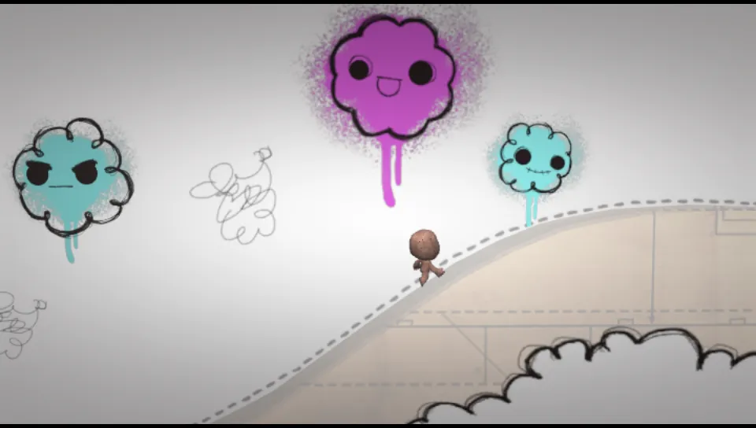 <b>LittleBigPlanet</b>, notebook intro</td>
<td>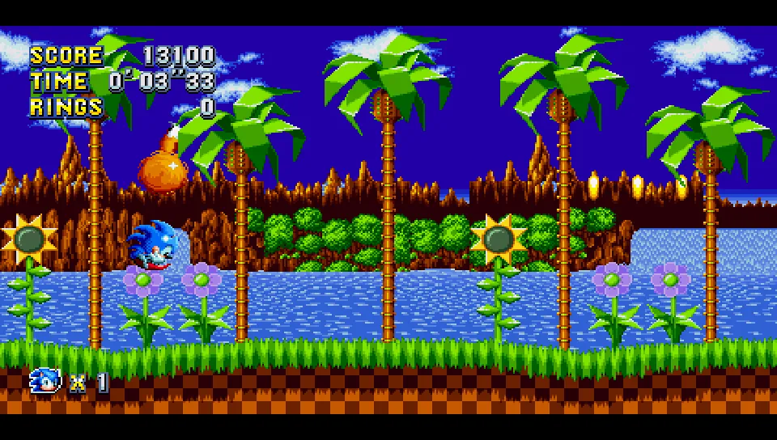 <b>Sonic Mania</b> (homebrew port), gameplay</td>
<td>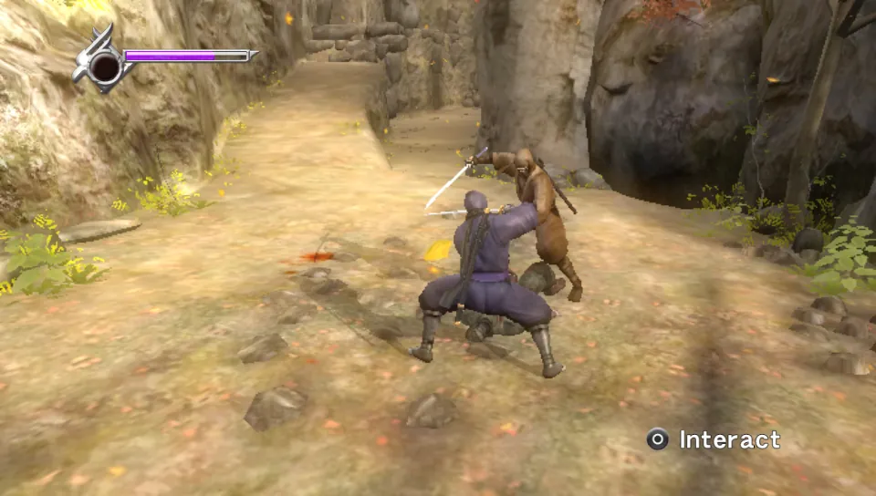 <b>Ninja Gaiden Σ Plus</b>, gameplay</td>
</tr>
<tr>
<td>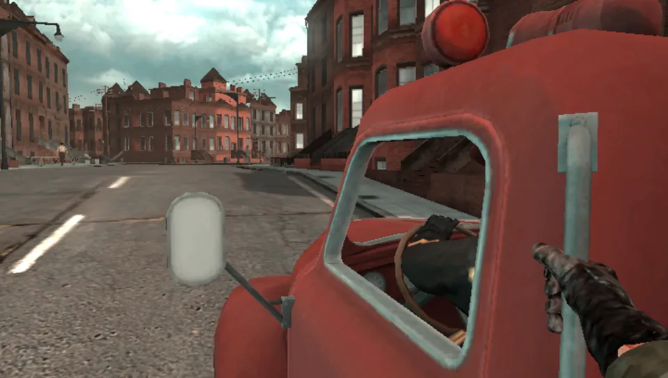 <b>Resistance: Burning Skies</b>, first scene</td>
<td>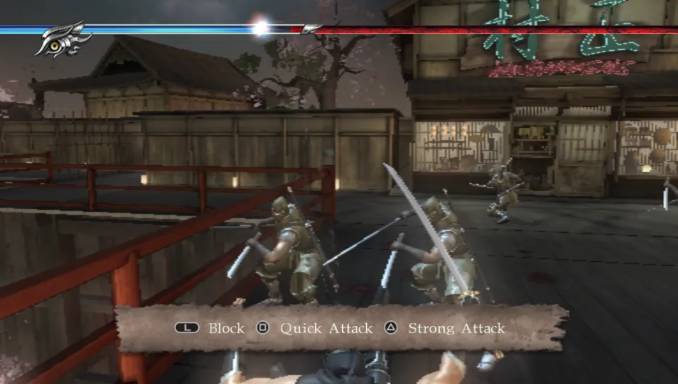 <b>Ninja Gaiden Σ2 Plus</b>, chapter 1</td>
<td>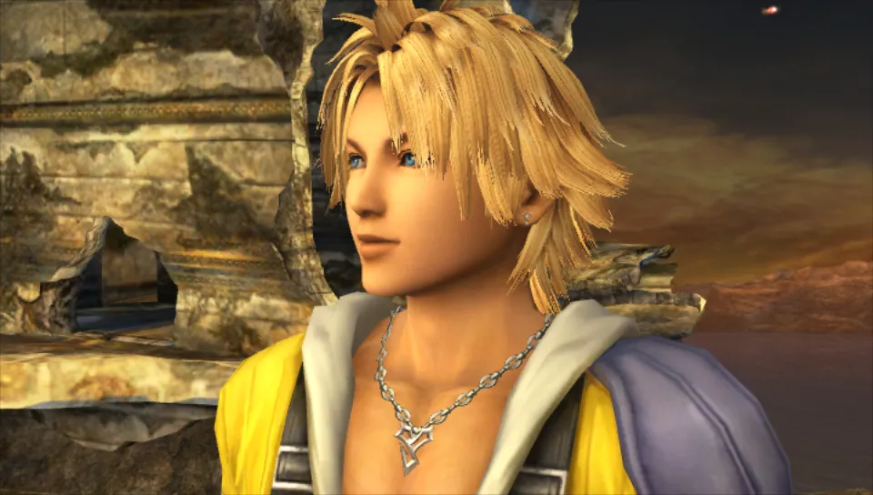 <b>Final Fantasy X HD Remaster</b>, opening</td>
</tr>
<tr>
<td>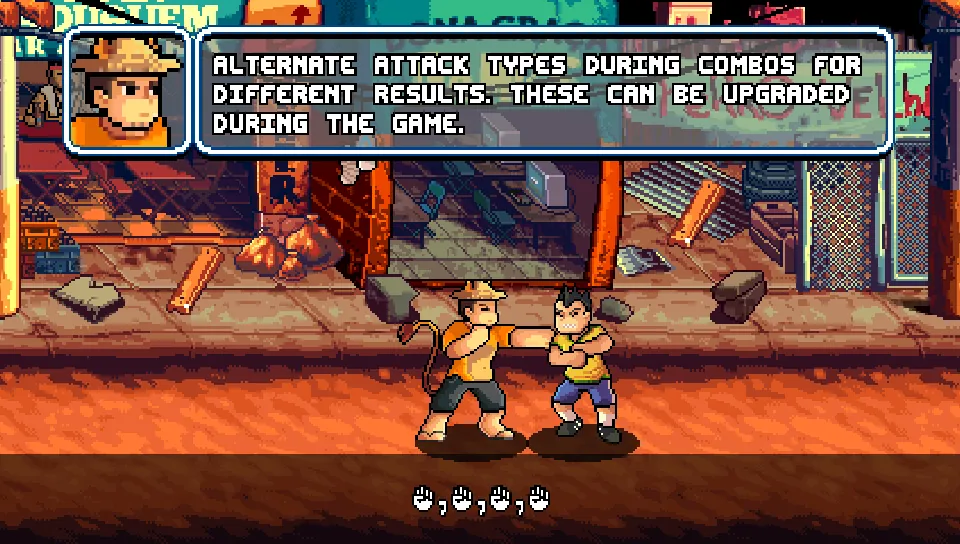 <b>99Vidas</b>, tutorial stage</td>
<td>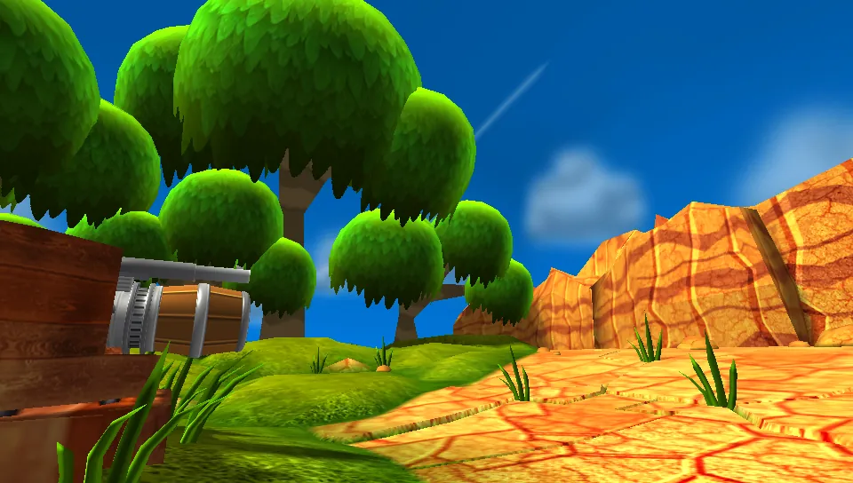 <b>Blast 'Em Bunnies</b>, first level</td>
<td>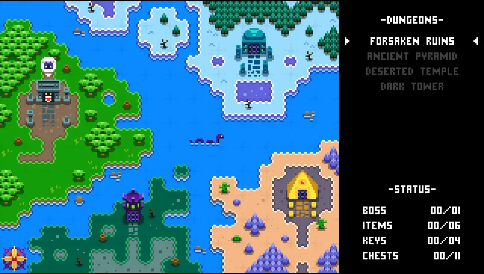 <b>Knightin'+</b>, world map</td>
</tr>
<tr>
<td>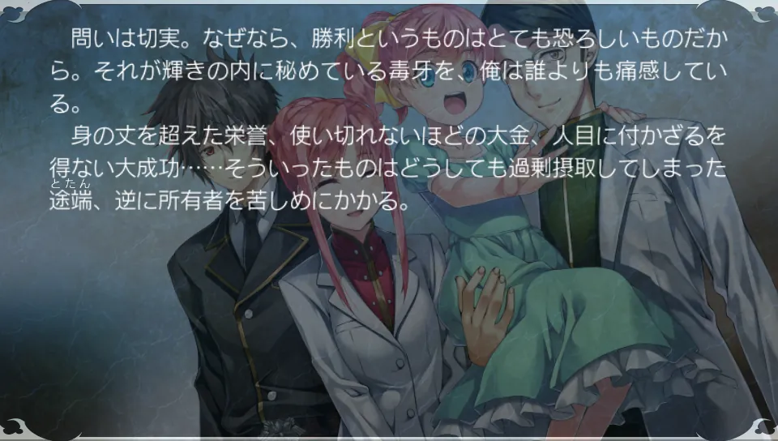 <b>Silverio Vendetta -Verse of Orpheus-</b>, story</td>
<td>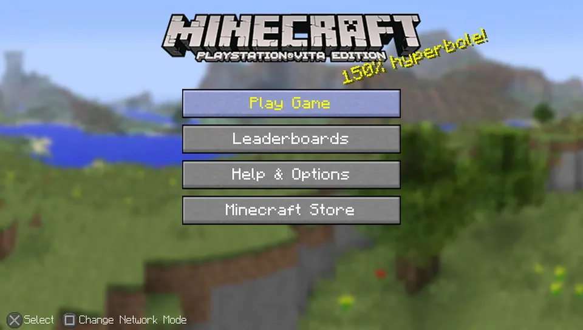 <b>Minecraft</b>, main menu</td>
<td>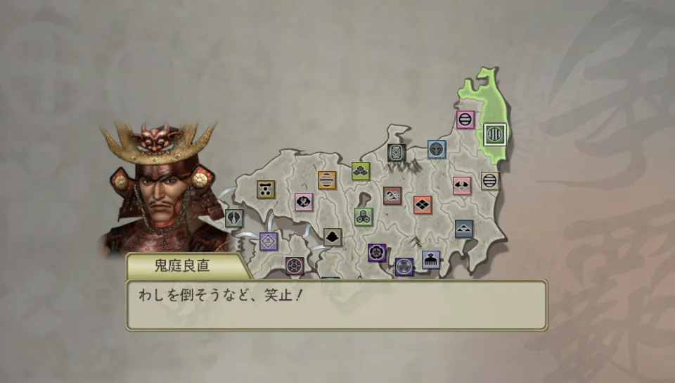 <b>Sengoku Musou 2 Empires HD</b>, campaign map</td>
</tr>
<tr>
<td>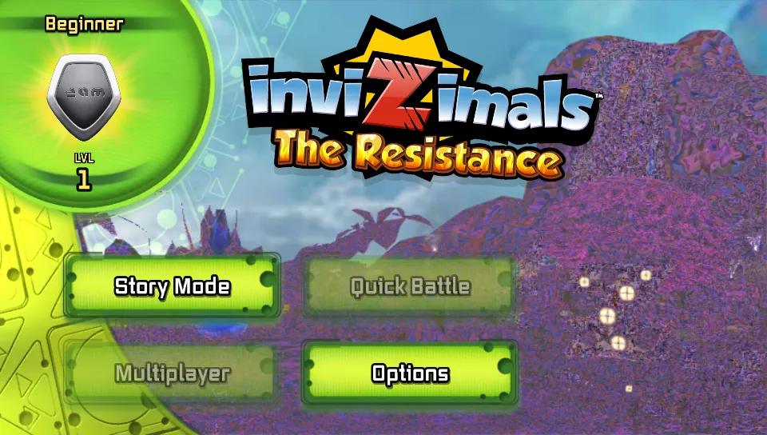 <b>Invizimals: The Resistance</b>, main menu</td>
<td>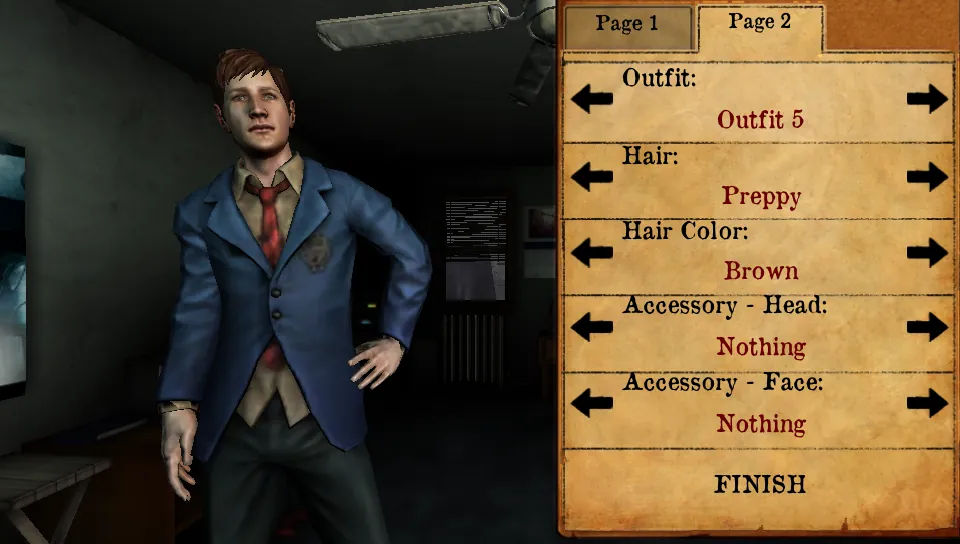 <b>Silent Hill: Book of Memories</b>, character creation</td>
<td>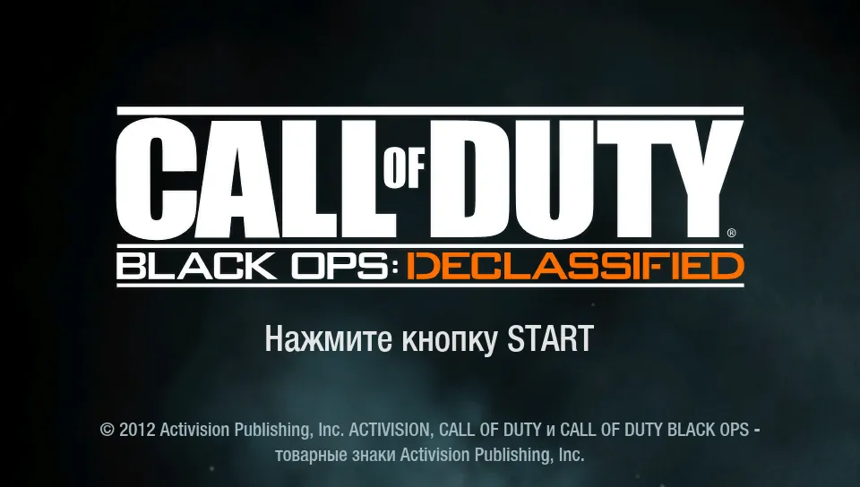 <b>Call of Duty: Black Ops Declassified</b>, title</td>
</tr>
</table>

## Tested games

VitaSharp is tested against the games below through automated scenarios in [`tests/scenarios`](../tests/scenarios)
(see [Testing](../README.md#testing)). The table lists what has been observed so far; it is not a promise, and the furthest
point a scenario reaches is not the end of the game.

| Status | Meaning |
| --- | --- |
| **In-game** | Gameplay reached and rendered correctly in the tested part |
| **Menus** | Title screen, menus or the opening work; gameplay not reached by the scenario yet |

| Game | Title ID | Status | Notes | Scenario |
| --- | --- | --- | --- | --- |
| 99Vidas | PCSE00914 | In‑game | Tutorial stage and first fights; Cross-Save through the local PSN services | `99vidas_boot` |
| Blast 'Em Bunnies | PCSE00328 | In‑game | First level and tutorial | `bunnies_boot` |
| Call of Duty: Black Ops Declassified | PCSB00232 | Menus | Logos and title screen | `cod_boot` |
| Devious Dungeon | PCSB01240 | In‑game | 60 fps; also starts from the real shell's LiveArea | `dd_boot` |
| F1 2011 | PCSE00002 | In‑game | Races with HUD, menus and video (from an existing profile: with fresh data the scenario stops at the driver name keyboard) | `f1_drive` |
| Final Fantasy X HD Remaster | PCSE00293 | Menus | Launcher menu, then the game's opening scene with credits | `ffx_boot` |
| God of War Collection | PCSA00126 | In‑game | Combat, cutscenes and audio | `gow_game` |
| Gravity Rush | PCSF00024 | In‑game | Opening and first gameplay; a tap on the "Tap the Apple" title does not always advance | `gr_boot` |
| Invizimals: The Resistance | PCSA00552 | Menus | Title and main menu; uses the webcam and motion sensors | `inv_boot` |
| Killzone: Mercenary | PCSC00045 | In‑game | Campaign at ~30 fps; open issues in the [roadmap](roadmap.md) (muzzle flash brightness, slowdowns in some areas) | `kzl_walk3`, `kz_skin` |
| Knightin'+ | PCSE01444 | Menus | Title, save select, world map | `knightin_boot` |
| LittleBigPlanet PS Vita | PCSA00017 | In‑game | Notebook intro with Sackboy walking | `lbp_boot` |
| Minecraft: PlayStation Vita Edition | PCSE00491 | Menus | Terms of use, main menu, new world options | `minecraft_boot` |
| Ninja Gaiden Σ Plus | PCSB00097 | In‑game | Intro movie, menus, new game and the first fights | `ngs_boot` |
| Ninja Gaiden Σ2 Plus | PCSE00233 | In‑game | Title, new game, first fights of chapter 1 | `ngs2_boot` |
| Persona 4 Golden | PCSB00245 | In‑game | New game up to the station scene (the scenario types a full name on the game's own letter grid); cannot start from the real shell yet (fixed-address executable) | `p4g_newgame` |
| Resistance: Burning Skies | PCSA00008 | In‑game | New game, intro movie, first scene | `rbs_boot` |
| Sakatsuku (J.League Pro Soccer Club wo Tsukurou!) 2013 | PCSG00198 | Menus | Title, save flow, new-game creation | `st_boot`, `st_game2` |
| Sengoku Musou 2 Empires HD | PCSG00230 | Menus | Empire mode setup, army cutscene, first strategy turn | `sm2e_play` |
| Silent Hill: Book of Memories | PCSE00011 | In‑game | Character creation and intro cutscene | `shbom_boot` |
| Silverio Vendetta -Verse of Orpheus- | PCSG00845 | In‑game | Visual novel: title, prologue and story text (needs the firmware fonts) | `verse_orpheus_boot` |
| Skullgirls 2nd Encore | PCSE00606 | In‑game | Fights | `skullgirls_boot` |
| Sonic Mania (homebrew port) | MANIA0001 | In‑game | Gameplay at 60 fps; menus at 50-54 fps | `mania_boot` |
| Tearaway (Trial & Unlock) | PCSF00476 | In‑game | New profile up to the first papercraft tutorial | `tearaway_tutorial` |
| Uncharted: Golden Abyss | PCSA00029 | In‑game | First level | `uc_walk` |
| WRC 4 FIA World Rally Championship | PCSE00411 | In‑game | Fresh profile to a stage start and driving | `wrc4_boot` |

Missing system functions are tracked one by one in [`docs/hle`](hle/README.md), with priorities based on what
the tested games actually import. Known bugs and future work are in the [roadmap](roadmap.md).
