<!-- pair: compatibility.md sha256=c35b030a77f0e92c172a4aef0f037d749c14831f5abeccd50c0496309787a198 -->
# Compatibilidade

[English](compatibility.md) | **Português**

Jogos com que o VitaSharp foi testado; de volta ao [README](../README.pt-BR.md).

## Mais capturas

<table>
<tr>
<td>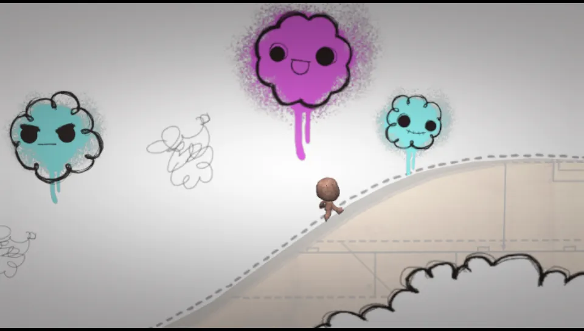 <b>LittleBigPlanet</b>, introdução do caderno</td>
<td>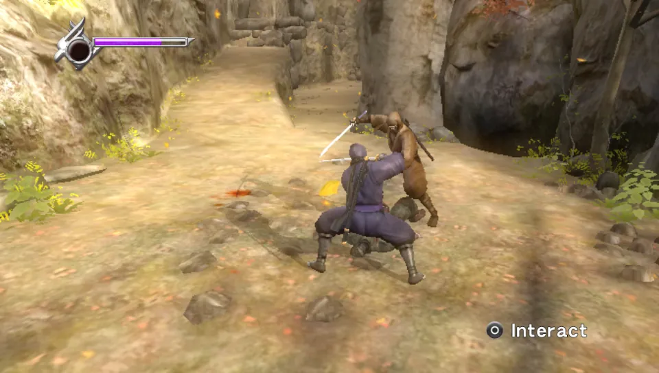 <b>Ninja Gaiden Σ Plus</b>, gameplay</td>
</tr>
<tr>
<td>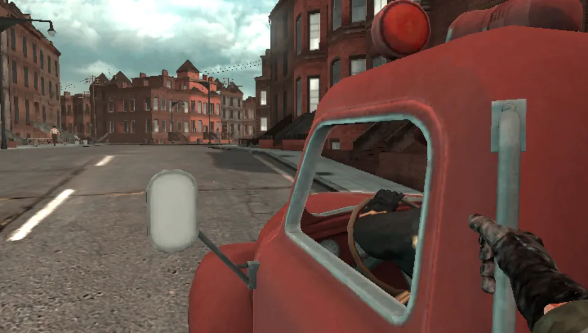 <b>Resistance: Burning Skies</b>, primeira cena</td>
<td>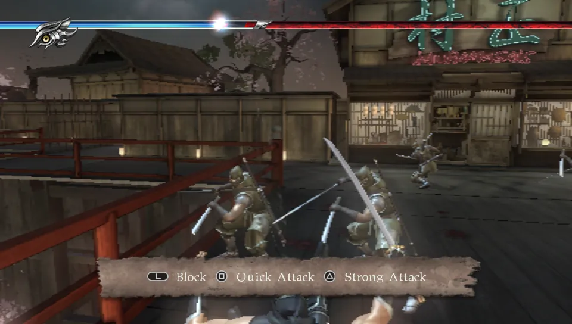 <b>Ninja Gaiden Σ2 Plus</b>, capítulo 1</td>
<td>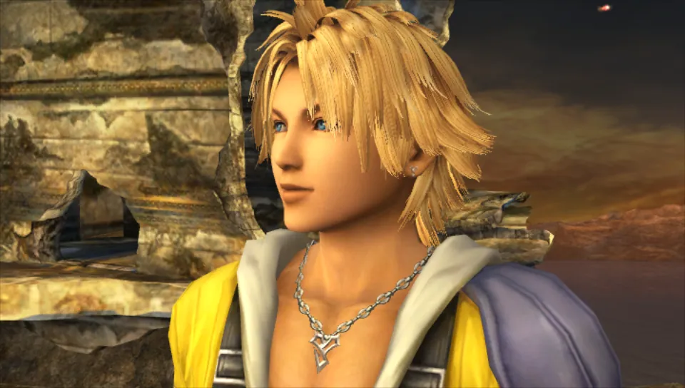 <b>Final Fantasy X HD Remaster</b>, abertura</td>
</tr>
<tr>
<td>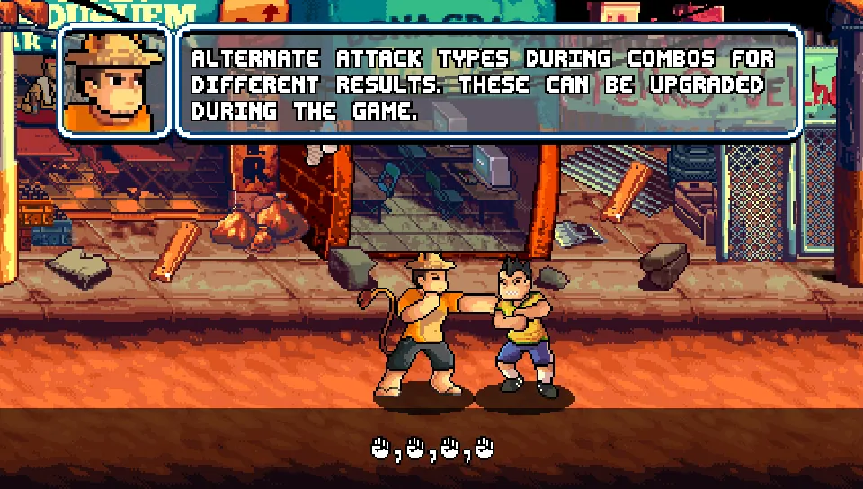 <b>99Vidas</b>, fase tutorial</td>
<td>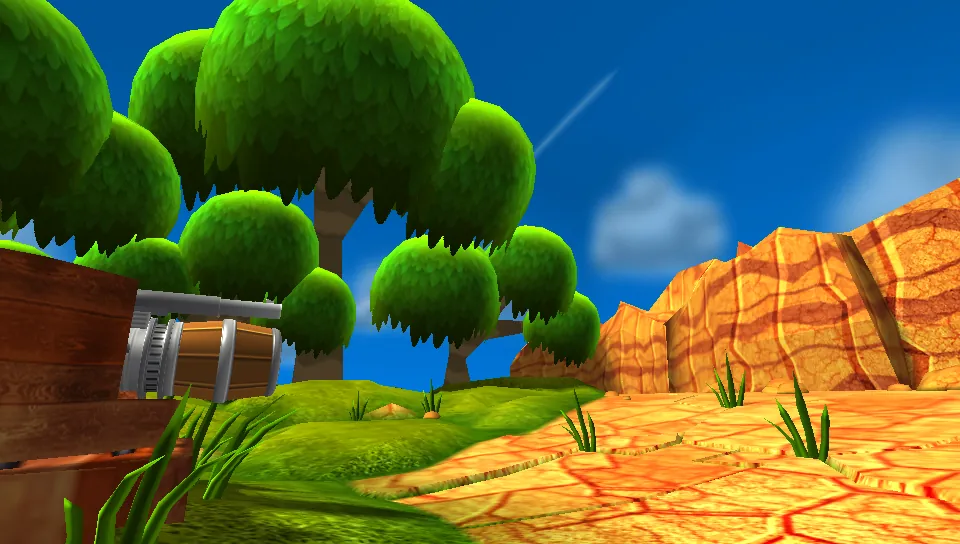 <b>Blast 'Em Bunnies</b>, primeira fase</td>
<td>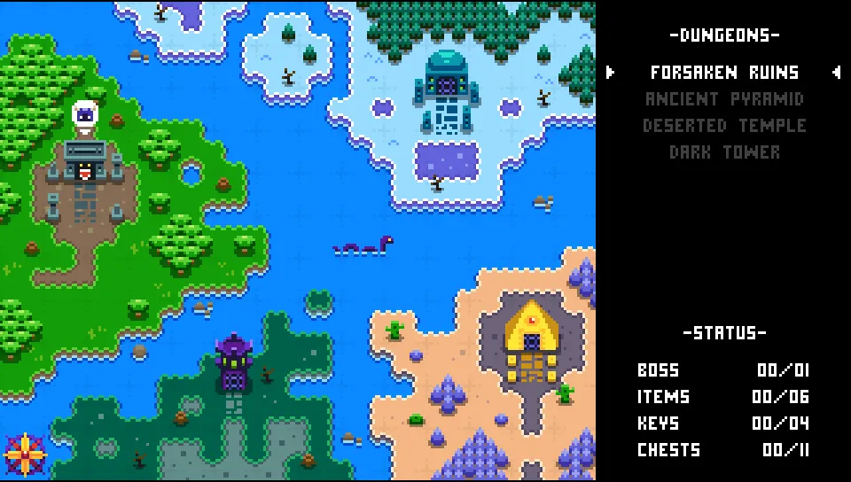 <b>Knightin'+</b>, mapa-múndi</td>
</tr>
<tr>
<td>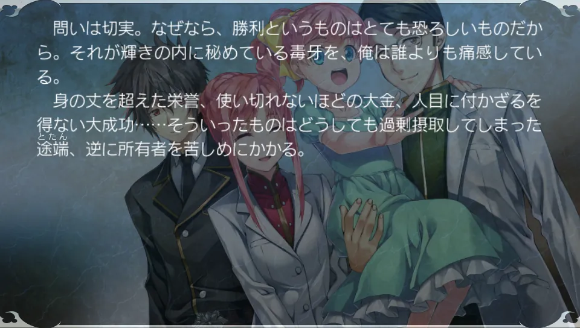 <b>Silverio Vendetta -Verse of Orpheus-</b>, história</td>
<td>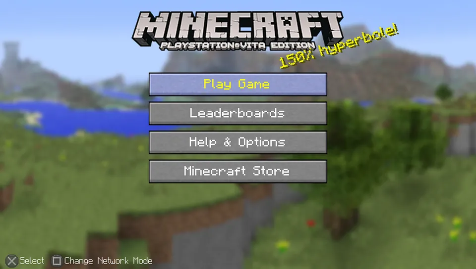 <b>Minecraft</b>, menu principal</td>
<td>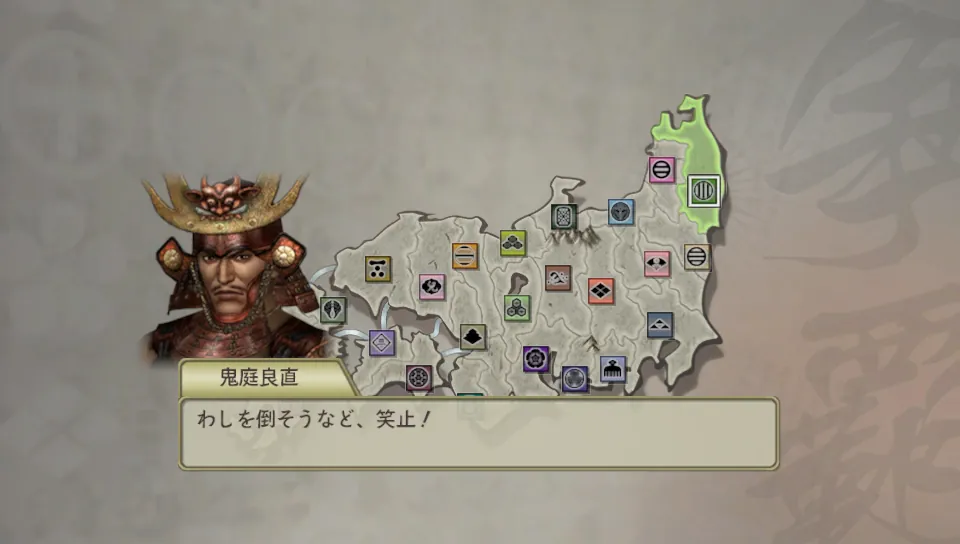 <b>Sengoku Musou 2 Empires HD</b>, mapa da campanha</td>
</tr>
<tr>
<td>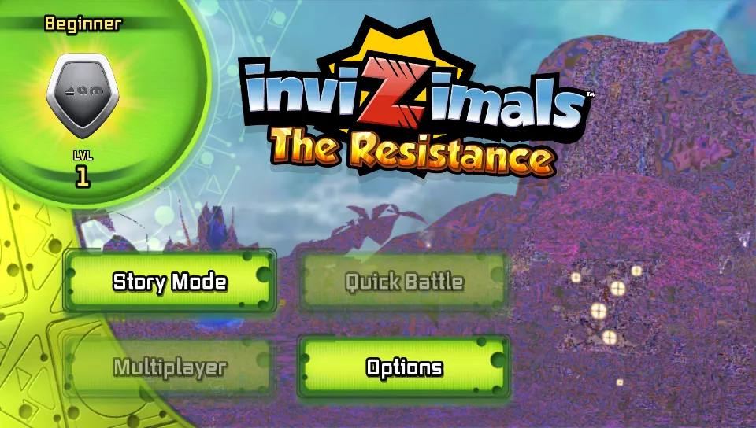 <b>Invizimals: The Resistance</b>, menu principal</td>
<td>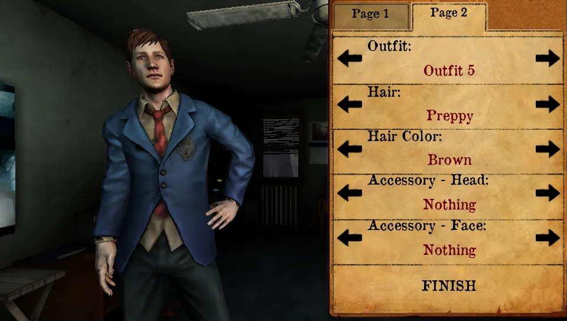 <b>Silent Hill: Book of Memories</b>, criação de personagem</td>
<td>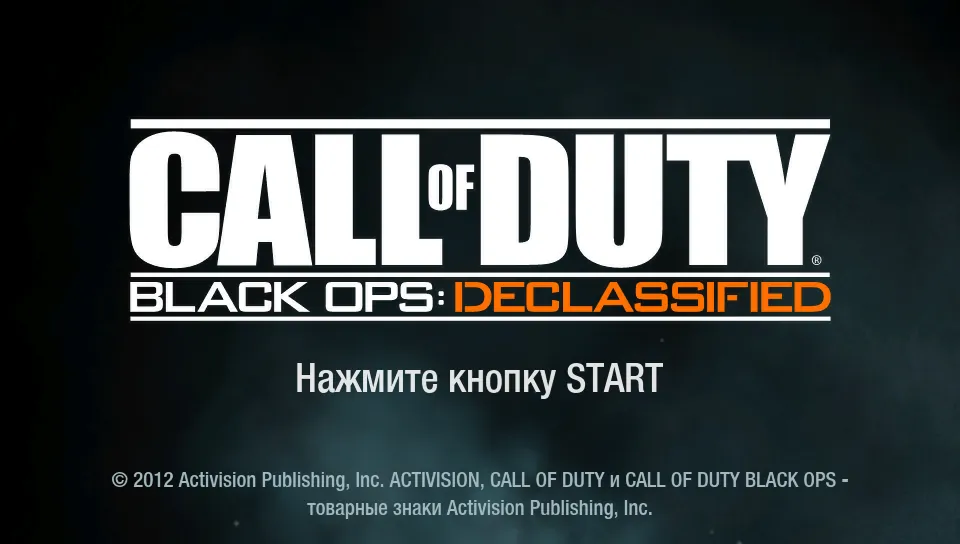 <b>Call of Duty: Black Ops Declassified</b>, título</td>
</tr>
</table>

## Jogos testados

O VitaSharp é testado com os jogos abaixo por cenários automáticos em [`tests/scenarios`](../tests/scenarios)
(veja [Compilar e testar](../README.pt-BR.md#compilar-e-testar)). A tabela mostra o que foi observado até agora; não é
uma promessa, e o ponto mais distante a que um cenário chega não é o fim do jogo.

| Estado | Significado |
| --- | --- |
| **No jogo** | Gameplay alcançado e desenhado certo na parte testada |
| **Menus** | Tela de título, menus ou abertura funcionam; o cenário ainda não chega ao gameplay |
| **Trava** | Para antes da primeira tela |
| **Não roda** | Precisa de algo que o VitaSharp não fornece (veja as notas) |

| Jogo | Title ID | Estado | Notas | Cenário |
| --- | --- | --- | --- | --- |
| 99Vidas | PCSE00914 | No jogo | Fase tutorial e primeiras lutas; Cross-Save pelos serviços PSN locais | `99vidas_boot` |
| Army Corps of Hell | PCSE00006 | Menus | Logos e a introdução a 30 fps, sem falhas de áudio | — |
| Blast 'Em Bunnies | PCSE00328 | No jogo | Primeira fase e tutorial | `bunnies_boot` |
| Call of Duty: Black Ops Declassified | PCSB00232 | Menus | Logos e tela de título | `cod_boot` |
| Crazy Market | PCSE00291 | Menus | Logos e os termos de serviço (16 fps nessa tela, a confirmar) | `crazymarket` |
| Croixleur Sigma | PCSG00537 | No jogo | Páginas de ajuda, abertura, menu de título, seleção de personagem com o modelo 3D, diálogos da história sobre a cena 3D a ~30 fps (versão japonesa: Círculo confirma; o Vita3K trava ao gerar os shaders dele) | `croixleur_boot` |
| Devious Dungeon | PCSB01240 | No jogo | 60 fps; também abre pela LiveArea do shell de verdade | `dd_boot` |
| F1 2011 | PCSE00002 | No jogo | Corridas com HUD, menus e vídeo (a partir de um perfil existente: com dados novos o cenário para no teclado do nome do piloto) | `f1_drive` |
| FIFA 13 | PCSE00093 | No jogo | Tela de título, menus e treino na Arena com os jogadores com as peles certas (o Vita3K não abre); os cubos de reflexo dos jogadores são lidos com o espaçamento certo entre faces desde 04/11/2026 (blocos ciano/verdes nos uniformes, a confirmar no jogo) | `fifa13` |
| Final Fantasy X HD Remaster | PCSE00293 | Menus | Menu do launcher, depois a cena de abertura do jogo com os créditos | `ffx_boot` |
| Gal Gunvolt | PCSG00704 | No jogo | Título, seleção de arquivo e a primeira fase a 60 fps; o fundo da área de jogo aparece desde 04/11/2026 (superfícies RGBA lidas na ordem da memória) (o Vita3K trava ao iniciar) | — |
| God of War Collection | PCSA00126 | No jogo | Combate, cenas e áudio em God of War I e II; em celulares Mali desde 31/10/2026 (atributos de vértice desalinhados) | `gow_game` |
| Gravity Rush | PCSF00024 | No jogo | Abertura e primeiro gameplay; um toque no título "Tap the Apple" nem sempre avança | `gr_boot` |
| Invizimals: The Resistance | PCSA00552 | Menus | Título e menu principal; usa a webcam e os sensores de movimento | `inv_boot` |
| Jak and Daxter Collection | PCSA00080 | Menus | Logos, filme de abertura e o menu da coleção a 30 fps; iniciar o Jak 1 executa `Jak1.self` (não conferido além disso); a faixa animada de prévia do menu sai embaralhada (decodificação MJPEG um quadro à frente da thread de renderização, ver o roadmap) | — |
| Killzone: Mercenary | PCSC00045 | No jogo | Campanha a ~30 fps; problemas em aberto no [roadmap](roadmap.md) (brilho do clarão dos tiros, lentidão em algumas áreas) | `kzl_walk3`, `kz_skin` |
| Knightin'+ | PCSE01444 | Menus | Título, seleção de save, mapa-múndi | `knightin_boot` |
| LittleBigPlanet PS Vita | PCSA00017 | No jogo | Introdução do caderno com o Sackboy andando | `lbp_boot` |
| Minecraft: PlayStation Vita Edition | PCSE00491 | Menus | Termos de uso, menu principal, opções de mundo novo | `minecraft_boot` |
| Shinobido 2: Revenge of Zen | PCSE00015 | Menus | Logos e o filme de introdução | `shinobido2` |
| Ninja Gaiden Σ Plus | PCSB00097 | No jogo | Filme de introdução, menus, novo jogo e as primeiras lutas | `ngs_boot` |
| Ninja Gaiden Σ2 Plus | PCSE00233 | No jogo | Filme de abertura, título, novo jogo, primeiras lutas do capítulo 1 | `ngs2_boot` |
| Persona 4 Golden | PCSB00245 | No jogo | Novo jogo até a cena da estação (o cenário digita um nome completo na grade de letras do próprio jogo); ainda não abre pelo shell de verdade (executável de endereço fixo) | `p4g_newgame` |
| Resistance: Burning Skies | PCSA00008 | No jogo | Novo jogo, filme de introdução, primeira cena | `rbs_boot` |
| Sakatsuku (J.League Pro Soccer Club wo Tsukurou!) 2013 | PCSG00198 | Menus | Título, fluxo de save, criação de novo jogo | `st_boot`, `st_game2` |
| Sengoku Musou 2 Empires HD | PCSG00230 | Menus | Preparação do modo Empire, cena do exército, primeiro turno de estratégia | `sm2e_play` |
| Sonic & All-Stars Racing Transformed | PCSE00056 | Jogável | Abre e joga (correção do sceTouchPeek 63c125a; confirmado pelo usuário em 05/11/2026) | `sasrt` |
| Soul Sacrifice Delta | PCSA00152 | No jogo | Primeira área; lento no fogo e na fumaça (a confirmar) | `soulsac_boot` |
| Silent Hill: Book of Memories | PCSE00011 | No jogo | Criação de personagem e cena de introdução | `shbom_boot` |
| Silverio Vendetta -Verse of Orpheus- | PCSG00845 | No jogo | Visual novel: título, prólogo e texto da história (precisa das fontes do firmware) | `verse_orpheus_boot` |
| Skullgirls 2nd Encore | PCSE00606 | No jogo | Lutas | `skullgirls_boot` |
| Sonic Mania (port homebrew) | MANIA0001 | Não roda | Precisa do taiHEN, que não consegue iniciar no VitaSharp (o início dele precisa de patches nas checagens de assinatura e de DRM do firmware): veja [plugins](notes/plugins.pt-BR.md). Chegava ao gameplay a 60 fps enquanto o emulador tinha um substituto próprio do taiHEN, removido para só rodarem módulos de verdade | — |
| The Deer God | PCSB01070 | Menus | Menus e o texto de introdução; quadros sem ritmo (214-348 fps) | `deergod` |
| Tearaway (Trial & Unlock) | PCSF00476 | No jogo | Perfil novo até o primeiro tutorial de papel | `tearaway_tutorial` |
| Unit 13 | PCSF00034 | No jogo | Primeira missão com HUD | `unit13_boot` |
| Uncharted: Golden Abyss | PCSA00029 | No jogo | Primeira fase | `uc_walk` |
| WRC 4 FIA World Rally Championship | PCSE00411 | No jogo | Perfil novo até o início de um estágio e pilotando | `wrc4_boot` |
| Zero Escape: Zero Time Dilemma | PCSE00781 | No jogo | Logos, menu de título a 60 fps, New Game, abertura e os primeiros ~2,5 minutos de cenas da história a 30 fps (não abre no Vita3K) | `ztd_boot` |

As funções do sistema que faltam são acompanhadas uma a uma em [`docs/hle`](hle/README.md), com prioridades pelo que
os jogos testados de fato importam. Os defeitos conhecidos e o trabalho futuro estão no [roadmap](roadmap.md).
