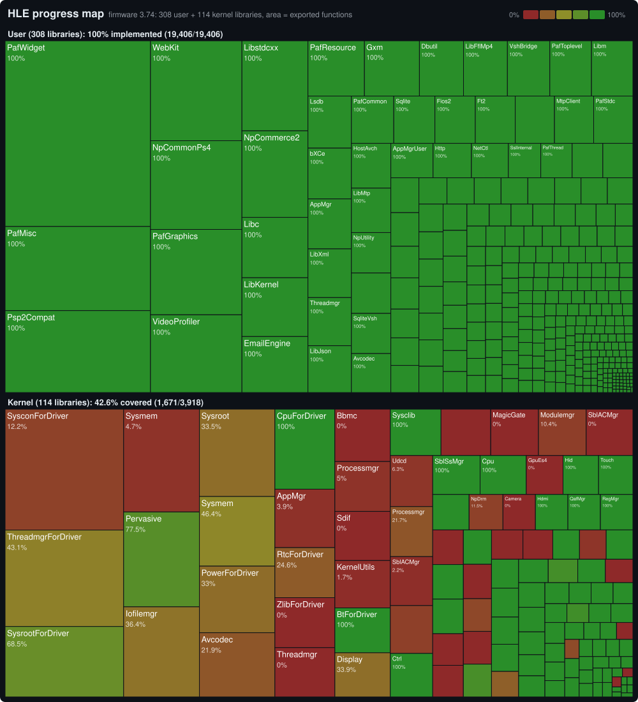

# HLE progress

<!-- Generated by build/hle-status.ps1 (VitaSharp.Desktop hle-coverage --status) from docs/hle/data/hle-status.tsv; do not edit by hand. -->

How many of the functions that the PS Vita firmware 3.74 exports to user code (the export tables of its user modules and the syscall libraries of its kernel modules) have an HLE implementation in VitaSharp. "Games" are the exported functions that the 64 installed test games import, "system" the ones only the system software (shell, system apps and modules) imports, "general" the rest. This is not a count of every PS Vita system function: functions that only kernel code calls, and imports no installed firmware module exports, are not counted. The VitaSDK row counts the user functions of the VitaSDK NID list (`docs/hle/data/vitasdk-user-functions.tsv`). A function counts as implemented when it has an `[Hle]` entry point. "Default" is the part of those that needs hardware or a service the emulator does not have (Bluetooth, USB, game card authentication, system update, PSP ad hoc, debug hooks...) and returns the result the firmware gives for that case (success or its specific error) without doing anything; "real" is the rest. "LLE" counts the functions of libraries the emulator provides by loading and running the real module (the game's own copy in app0:sce_module, or the firmware module the loader gives the programs that import a library the HLE does not emulate; found by scanning the installed modules, listed below), and the functions the HLE has only as a stand-in for a missing firmware module (libc, libpaf, sqlite...: system programs get the real module): they are covered, with no HLE.

<picture>
  <source media="(prefers-color-scheme: light)" srcset="../assets/status/progress-map-light.svg">
  
</picture>

| Group | Covered | Real | Default | LLE | Total | % |
|---|---:|---:|---:|---:|---:|---:|
| Games imports | 2,220 | 2,212 | 8 | 0 | 2,220 | 100% |
| System imports | 7,270 | 6,882 | 388 | 0 | 7,270 | 100% |
| General | 9,916 | 9,537 | 379 | 0 | 9,916 | 100% |
| All firmware 3.74 exports | 19,406 | 5,140 | 775 | 13,491 | 19,406 | 100% |
| VitaSDK user functions | 7,006 | 4,509 | 373 | 2,124 | 7,006 | 100% |

## Libraries provided by LLE

| Library | Module | LLE functions |
|---|---|---:|
| SceAACPromoter | `vs0:vsh/common/mms/AACPromoter.suprx` | 4 |
| SceAacenc | `vs0:sys/external/libnaac.suprx` | 12 |
| SceAacencInternal | `vs0:sys/external/libnaac.suprx` | 12 |
| SceActivityDb | `vs0:sys/external/activity_db.suprx` | 78 |
| SceAppSettings | `vs0:vsh/common/app_settings.suprx` | 24 |
| SceAppUtilAppEventUserDefined | `vs0:sys/external/apputil.suprx` | 1 |
| SceAppUtilDevice | `vs0:sys/external/apputil.suprx` | 1 |
| SceAppUtilExtMarlinIptv | `vs0:sys/external/apputil_ext.suprx` | 2 |
| SceAppUtilExtPlayReady | `vs0:sys/external/apputil_ext.suprx` | 4 |
| SceAppUtilExtPsNow | `vs0:sys/external/apputil_ext.suprx` | 2 |
| SceAppUtilLaunchApp | `vs0:sys/external/apputil.suprx` | 2 |
| SceAppUtilNpSignin | `vs0:sys/external/apputil.suprx` | 1 |
| SceAppUtilUmass | `vs0:sys/external/apputil.suprx` | 5 |
| SceAppUtilWebBrowserCBLimited | `vs0:sys/external/apputil.suprx` | 1 |
| SceAudiocodec | `vs0:sys/external/audiocodec.suprx` | 6 |
| SceAvcdecForPlayer | `vs0:sys/external/avcdec_for_player.suprx` | 13 |
| SceBEAVCorePlayer | `vs0:vsh/common/libBEAVCorePlayer.suprx` | 15 |
| SceBackupRestore | `vs0:vsh/common/backup_restore.suprx` | 24 |
| SceBeisobmf | `vs0:sys/external/libSceBeisobmf.suprx` | 18 |
| SceBemp2sys | `vs0:sys/external/libSceBemp2sys.suprx` | 27 |
| SceBgAppUtil | `vs0:sys/external/bgapputil.suprx` | 1 |
| SceBmpPromoter | `vs0:vsh/common/mms/bmp_promoter.suprx` | 3 |
| SceCommonDialogMain | `vs0:sys/external/libcdlg_main.suprx` | 15 |
| SceCommonGuiDialog | `vs0:sys/external/common_gui_dialog.suprx` | 54 |
| SceCompanionUtil | `vs0:sys/external/libSceCompanionUtil.suprx` | 14 |
| SceContentOperation | `vs0:vsh/common/content_operation.suprx` | 10 |
| SceDbRecovery | `vs0:vsh/common/dbrecovery_plugin.suprx` | 1 |
| SceDbSetup | `vs0:vsh/common/dbsetup.suprx` | 1 |
| SceDbrecoveryUtility | `vs0:sys/external/dbrecovery_utility.suprx` | 1 |
| SceDbutil | `vs0:sys/external/dbutil.suprx` | 214 |
| SceDrmPsmKdc | `vs0:sys/external/psmkdc.suprx` | 14 |
| SceDtcpIp | `vs0:sys/external/libSceDtcpIp.suprx` | 25 |
| SceEmailEngine | `vs0:app/NPXS10072/email_engine.suprx` | 325 |
| SceFios2 | `vs0:sys/external/libfios2.suprx` | 168 |
| SceFt2 | `vs0:sys/external/libSceFt2.suprx` | 166 |
| SceGifPromoter | `vs0:vsh/common/mms/gif_promoter.suprx` | 3 |
| SceGpuEs4User | `os0:us/libgpu_es4.suprx` | 1 |
| SceGriefReportDialog | `vs0:app/NPXS10065/grief_report_dialog.suprx` | 9 |
| SceHostAvch | `vs0:vsh/common/av_content_handler.suprx` | 155 |
| SceHttp | `vs0:sys/external/libhttp.suprx` | 2 |
| SceImeVsh | `vs0:sys/external/libime.suprx` | 17 |
| SceIniFileProcessor | `vs0:sys/external/ini_file_processor.suprx` | 24 |
| SceIpmi | `vs0:sys/external/libshellsvc.suprx` | 83 |
| SceIpmiNonGameApp | `vs0:sys/external/libipmi_nongame.suprx` | 26 |
| SceJpegPromoter | `vs0:vsh/common/mms/jpeg_promoter.suprx` | 3 |
| SceLibFflMp4 | `vs0:vsh/common/libFflMp4.suprx` | 213 |
| SceLibFflVuMp4 | `vs0:vsh/common/libSenvuabsFFsdk.suprx` | 61 |
| SceLibGcc | `os0:us/libkernel.suprx` | 2 |
| SceLibLocationFactory | `vs0:sys/external/liblocation_factory.suprx` | 1 |
| SceLibLocationInternal | `vs0:sys/external/liblocation_internal.suprx` | 5 |
| SceLibLocationPermission | `vs0:vsh/shell/liblocation_permission.suprx` | 10 |
| SceLibLocationProvider | `vs0:vsh/shell/liblocation_provider.suprx` | 4 |
| SceLibMtp | `vs0:vsh/common/libmtp.suprx` | 154 |
| SceLibMtpHttp | `vs0:vsh/common/libmtphttp.suprx` | 28 |
| SceLibMtpHttpWrapper | `vs0:vsh/common/libmtphttp_wrapper.suprx` | 28 |
| SceLibVitaJSExtObj | `vs0:data/external/webcore/vita_jsextobj.suprx` | 10 |
| SceLibXml | `vs0:sys/external/libSceXml.suprx` | 186 |
| SceLibc | `vs0:sys/external/libc.suprx` | 350 |
| SceLibm | `vs0:sys/external/libc.suprx` | 201 |
| SceLibstdcxx | `vs0:sys/external/libc.suprx` | 522 |
| SceLsdb | `vs0:vsh/shell/livespace_db.suprx` | 199 |
| SceMarlin | `vs0:sys/external/libmln.suprx` | 42 |
| SceMetaGen | `vs0:vsh/common/mms/meta_gen.suprx` | 16 |
| SceMp3Promoter | `vs0:vsh/common/mms/Mp3Promoter.suprx` | 32 |
| SceMsvPromoter | `vs0:vsh/common/mms/MsvPromoter.suprx` | 3 |
| SceMtpClient | `vs0:vsh/common/mtp_client.suprx` | 163 |
| SceMtpr3 | `vs0:vsh/common/mtpr3.suprx` | 7 |
| SceNearProfile | `vs0:sys/external/near_profile.suprx` | 8 |
| SceNpActivityNet | `vs0:sys/external/np_activity.suprx` | 30 |
| SceNpCommonPs4 | `vs0:sys/external/np_common_ps4.suprx` | 713 |
| SceNpFriendPrivacyLevel | `vs0:sys/external/np_friend_privacylevel.suprx` | 16 |
| SceNpGriefReport | `vs0:vsh/common/np_grief_report.suprx` | 18 |
| SceNpKdc | `vs0:sys/external/np_kdc.suprx` | 7 |
| SceNpManagerOAuth | `vs0:sys/external/np_manager.suprx` | 1 |
| SceNpManagerSP | `vs0:sys/external/np_manager.suprx` | 1 |
| SceNpManagerTicket | `vs0:sys/external/np_manager.suprx` | 5 |
| SceNpMessageContacts | `vs0:sys/external/np_message_contacts.suprx` | 16 |
| SceNpMessageDialogPlugin | `vs0:sys/external/np_message_dialog_impl.suprx` | 5 |
| SceNpPartyAppUtil | `vs0:app/NPXS10001/np_party_app.suprx` | 15 |
| SceNpUtilityAvatarN | `vs0:sys/external/np_utility.suprx` | 2 |
| ScePafCommon | `vs0:sys/external/libpaf.suprx` | 176 |
| ScePafGraphics | `vs0:sys/external/libpaf.suprx` | 686 |
| ScePafLowlayer | `vs0:sys/external/libpaf.suprx` | 20 |
| ScePafMisc | `vs0:sys/external/libpaf.suprx` | 1,075 |
| ScePafResource | `vs0:sys/external/libpaf.suprx` | 274 |
| ScePafStdc | `vs0:sys/external/libpaf.suprx` | 163 |
| ScePafThread | `vs0:sys/external/libpaf.suprx` | 95 |
| ScePafToplevel | `vs0:sys/external/libpaf.suprx` | 202 |
| ScePafWebMapView | `vs0:sys/external/libpaf_web_map_view.suprx` | 140 |
| ScePafWidget | `vs0:sys/external/libpaf.suprx` | 2,372 |
| ScePartyMemberListPlugin | `vs0:sys/external/party_member_list.suprx` | 5 |
| ScePerfInternal | `vs0:sys/external/libperf.suprx` | 6 |
| ScePngPromoter | `vs0:vsh/common/mms/png_promoter.suprx` | 3 |
| ScePromoterUtil | `vs0:sys/external/libScePromoterUtil.suprx` | 26 |
| ScePsp2Compat | `vs0:data/external/webcore/ScePsp2Compat.suprx` | 1,047 |
| SceRiffPromoter | `vs0:vsh/common/mms/RiffPromoter.suprx` | 6 |
| SceSblQafMgr | `os0:kd/ss_mgr.skprx` | 3 |
| SceSecondScreen | `vs0:app/NPXS10013/libSceSecondScreen.suprx` | 3 |
| SceSensMe | `vs0:vsh/common/mms/SensMe.suprx` | 21 |
| SceShellSvc | `vs0:sys/external/libshellsvc.suprx` | 10 |
| SceShellUtil | `vs0:sys/external/libshellsvc.suprx` | 40 |
| SceShellUtilLaunchApp | `vs0:sys/external/libshellsvc.suprx` | 1 |
| SceShellUtilUketorne | `vs0:sys/external/libshellsvc.suprx` | 7 |
| SceSqlite | `vs0:sys/external/libSceSqlite.suprx` | 171 |
| SceSqliteVsh | `vs0:sys/external/sqlite.suprx` | 139 |
| SceSslInternal | `vs0:sys/external/libssl.suprx` | 3 |
| SceStitchAdapter | `vs0:app/NPXS10095/stitch_prx.suprx` | 14 |
| SceStitcherCoreAdapter | `vs0:app/NPXS10095/stitch_core_prx.suprx` | 57 |
| SceSulpha | `vs0:sys/external/libsulpha.suprx` | 23 |
| SceSvcCtrl | `vs0:sys/external/libshellsvc.suprx` | 4 |
| SceSystemSettingsCore | `vs0:app/NPXS10015/system_settings_core.suprx` | 93 |
| SceTelephonyUtil | `vs0:sys/external/libSceTelephonyUtil.suprx` | 3 |
| SceTeleportClient | `vs0:sys/external/libSceTeleportClient.suprx` | 13 |
| SceTeleportServer | `vs0:sys/external/libSceTeleportServer.suprx` | 1 |
| SceThreadmgr | `os0:kd/threadmgr.skprx` | 1 |
| SceTiffPromoter | `vs0:vsh/common/mms/tiff_promoter.suprx` | 3 |
| SceVideoExportData | `vs0:sys/external/libSceVideoExport.suprx` | 3 |
| SceVideoExportEmpr | `vs0:sys/external/libSceVideoExport.suprx` | 1 |
| SceVideoProfiler | `vs0:vsh/common/libvideoprofiler.suprx` | 625 |
| SceVideoSearchEmpr | `vs0:sys/external/libSceVideoSearchEmpr.suprx` | 8 |
| SceWebFiltering | `vs0:data/external/webcore/jx_web_filtering.suprx` | 8 |
| SceWebKit | `vs0:data/external/webcore/SceWebKitModule.suprx` | 803 |
| SceWebUIPlugin | `vs0:sys/external/web_ui_plugin.suprx` | 30 |
| ScebXCe | `vs0:sys/external/bXCe.suprx` | 194 |
| WebPlugin | `vs0:data/external/webcore/jx_web_filtering.suprx` | 2 |
| gaikai_player | `vs0:app/NPXS10013/gaikai-player.suprx` | 86 |
| libical | `vs0:vsh/common/libical.suprx` | 58 |
| libicalss | `vs0:vsh/common/libicalss.suprx` | 5 |
| mail_api_for_local | `vs0:vsh/common/mail_api_for_local.suprx` | 1 |
| mail_api_for_local_libc | `vs0:sys/external/mail_api_for_local_libc.suprx` | 1 |
| mlnapplib | `vs0:sys/external/libmlnapplib.suprx` | 11 |
| mlndl | `vs0:sys/external/libmlndownloader.suprx` | 17 |
| stitch_core_prx | `vs0:app/NPXS10095/stitch_core_prx.suprx` | 57 |
| stitch_prx | `vs0:app/NPXS10095/stitch_prx.suprx` | 14 |

VitaSDK user functions provided by LLE (the modules the installed games ship in app0:sce_module): 2,124.

## Kernel (114 libraries)

The functions the kernel modules of firmware 3.74 export to other kernel code (`*ForDriver`, `*ForKernel`...: what a kernel plugin can import), from the census in [kernel-exports.md](kernel-exports.md) (`VitaSharp.Desktop kernel-census`, `data/kernel-exports.tsv`). "Imported" are the ones some firmware kernel module or installed kernel plugin imports: the order of the work.

| Kernel exports | Covered | Real | Default | Total | % |
|---|---:|---:|---:|---:|---:|
| All | 1,671 | 1,468 | 203 | 3,918 | 42.6% |
| Imported | 898 | - | - | 2,062 | 43.5% |

| Library | Implemented / total | % | Default | Imported |
|---|---:|---:|---:|---:|
| SceAVConfigForDriver | 6 / 6 | 100% | - | 2 / 2 |
| SceAppMgrForDriver | 3 / 76 | 3.9% | - | 0 / 24 |
| SceAudioForDriver | 3 / 20 | 15% | - | 1 / 11 |
| SceAudioInForDriver | 10 / 10 | 100% | - | 6 / 6 |
| SceAvcodecForDriver | 23 / 105 | 21.9% | - | 0 / 1 |
| SceBacktraceForDriver | 3 / 3 | 100% | - | - |
| SceBbmcForDriver | 0 / 63 | 0% | - | 0 / 14 |
| SceBtForDriver | 54 / 54 | 100% | 47 | 17 / 17 |
| SceBusErrorForKernel | 1 / 1 | 100% | 1 | - |
| SceCameraForDriver | 0 / 25 | 0% | - | 0 / 2 |
| SceCdramForDriver | 3 / 3 | 100% | 2 | - |
| SceClockgenForDriver | 14 / 14 | 100% | 1 | 8 / 8 |
| SceCodecEngineWrapperForDebugger | 1 / 1 | 100% | 1 | - |
| SceCodecEngineWrapperForDriver | 0 / 50 | 0% | - | 0 / 47 |
| SceCodecForDriver | 9 / 9 | 100% | 9 | 7 / 7 |
| SceCompatForDriver | 1 / 1 | 100% | - | 1 / 1 |
| SceCoredumpForDriver | 0 / 21 | 0% | - | 0 / 19 |
| SceCpuForDriver | 104 / 104 | 100% | - | 35 / 35 |
| SceCpuForKernel | 39 / 39 | 100% | - | 6 / 6 |
| SceCsiForDriver | 6 / 6 | 100% | 6 | 6 / 6 |
| SceCtrlForDriver | 40 / 40 | 100% | - | 23 / 23 |
| SceDebugForDriver | 16 / 16 | 100% | - | 8 / 8 |
| SceDebugForKernel | 17 / 17 | 100% | - | 6 / 6 |
| SceDebugLedForDriver | 9 / 9 | 100% | - | 3 / 3 |
| SceDipswForDriver | 4 / 4 | 100% | - | 2 / 2 |
| SceDisplayForDriver | 18 / 53 | 33.9% | - | 8 / 27 |
| SceDmacmgrForDriver | 4 / 15 | 26.6% | - | 1 / 11 |
| SceDsiForDriver | 15 / 15 | 100% | 4 | 10 / 10 |
| SceExcpmgrForKernel | 1 / 17 | 5.8% | - | 1 / 6 |
| SceFios2KernelForDriver | 0 / 20 | 0% | - | 0 / 9 |
| SceGpioForDriver | 10 / 10 | 100% | - | 7 / 7 |
| SceGpsForDriver | 7 / 7 | 100% | - | 6 / 6 |
| SceGpuEs4ForDriver | 0 / 31 | 0% | - | 0 / 28 |
| SceGrabForDriver | 8 / 8 | 100% | 8 | 5 / 5 |
| SceHdmiForDriver | 25 / 25 | 100% | 12 | 19 / 19 |
| SceHidForDriver | 30 / 30 | 100% | 1 | 1 / 1 |
| SceHpremoteForDriver | 11 / 11 | 100% | 1 | 6 / 6 |
| SceI2cForDriver | 8 / 8 | 100% | - | 3 / 3 |
| SceIdStorageForDriver | 17 / 17 | 100% | - | 16 / 16 |
| SceIftuForDriver | 8 / 9 | 88.8% | - | 8 / 9 |
| SceIntrmgrForDriver | 0 / 23 | 0% | - | 0 / 13 |
| SceIntrmgrForKernel | 0 / 21 | 0% | - | 0 / 12 |
| SceIofilemgrForDriver | 54 / 148 | 36.4% | - | 28 / 96 |
| SceKernelSuspendForDriver | 28 / 28 | 100% | - | 13 / 13 |
| SceKernelUtilsForDriver | 1 / 57 | 1.7% | - | 0 / 33 |
| SceLcdForDriver | 23 / 23 | 100% | 4 | 13 / 13 |
| SceLedForDriver | 1 / 1 | 100% | 1 | 1 / 1 |
| SceMagicGateForDriver | 0 / 48 | 0% | - | 0 / 37 |
| SceModulemgrForDriver | 13 / 15 | 86.6% | - | 13 / 13 |
| SceModulemgrForKernel | 5 / 48 | 10.4% | - | 1 / 24 |
| SceMotionDevForDriver | 23 / 23 | 100% | 9 | 9 / 9 |
| SceMsifForDriver | 12 / 12 | 100% | 4 | 8 / 8 |
| SceMtpIfForDriver | 17 / 17 | 100% | 12 | 11 / 11 |
| SceNetPsForDriver | 17 / 20 | 85% | - | 1 / 3 |
| SceNpDrmForDriver | 3 / 26 | 11.5% | - | 3 / 20 |
| SceOledForDriver | 21 / 21 | 100% | 2 | 12 / 12 |
| ScePervasiveForDriver | 121 / 156 | 77.5% | 5 | 77 / 88 |
| ScePfsFacadeForKernel | 0 / 6 | 0% | - | 0 / 6 |
| ScePfsMgrForKernel | 0 / 14 | 0% | - | 0 / 11 |
| ScePmMgrForDriver | 2 / 2 | 100% | - | 1 / 1 |
| ScePowerForDriver | 36 / 109 | 33% | - | 16 / 52 |
| SceProcEventForDriver | 3 / 3 | 100% | - | 3 / 3 |
| SceProcessmgrForDriver | 10 / 46 | 21.7% | - | 7 / 32 |
| SceProcessmgrForKernel | 3 / 60 | 5% | - | 0 / 30 |
| ScePsmDrmForDriver | 1 / 6 | 16.6% | 1 | 1 / 3 |
| ScePwmForDriver | 5 / 5 | 100% | - | 3 / 3 |
| SceQafMgrForDriver | 25 / 25 | 100% | - | 23 / 23 |
| SceRegMgrForDebugger | 9 / 9 | 100% | - | - |
| SceRegMgrForDriver | 25 / 25 | 100% | - | 7 / 7 |
| SceRegMgrForTool | 13 / 13 | 100% | - | - |
| SceRegMgrServiceForDriver | 5 / 5 | 100% | - | - |
| SceRtcForDriver | 16 / 65 | 24.6% | - | 5 / 30 |
| SceSblACMgrForDriver | 1 / 45 | 2.2% | - | 1 / 40 |
| SceSblACMgrForKernel | 0 / 47 | 0% | - | 0 / 12 |
| SceSblAIMgrForDriver | 17 / 17 | 100% | - | 17 / 17 |
| SceSblAuthMgrForDriver | 3 / 3 | 100% | 3 | 3 / 3 |
| SceSblAuthMgrForKernel | 9 / 9 | 100% | 6 | 7 / 7 |
| SceSblFwLoaderForDriver | 3 / 3 | 100% | 1 | 3 / 3 |
| SceSblGcAuthMgrDrmBBForDriver | 0 / 20 | 0% | - | 0 / 7 |
| SceSblGcAuthMgrGcAuthForDriver | 1 / 1 | 100% | 1 | 1 / 1 |
| SceSblGcAuthMgrMlnpsnlForDriver | 0 / 2 | 0% | - | 0 / 2 |
| SceSblGcAuthMgrMsSaveBBForDriver | 6 / 6 | 100% | 4 | 6 / 6 |
| SceSblGcAuthMgrPkgForDriver | 1 / 1 | 100% | 1 | 1 / 1 |
| SceSblGcAuthMgrPsmactForDriver | 1 / 1 | 100% | 1 | 1 / 1 |
| SceSblGcAuthMgrSclkForDriver | 0 / 2 | 0% | - | - |
| SceSblMgKeyMgrForDriver | 14 / 14 | 100% | 13 | 2 / 2 |
| SceSblPostSsMgrForDriver | 5 / 44 | 11.3% | 5 | 0 / 25 |
| SceSblSmCommForKernel | 4 / 4 | 100% | 2 | 4 / 4 |
| SceSblSmSchedProxyForKernel | 16 / 16 | 100% | 2 | 9 / 9 |
| SceSblSsMgrForDriver | 40 / 40 | 100% | 10 | 33 / 33 |
| SceSblSsMgrForKernel | 5 / 5 | 100% | - | 5 / 5 |
| SceSdifForDriver | 0 / 59 | 0% | - | 0 / 31 |
| SceSysclibForDriver | 51 / 51 | 100% | - | 31 / 31 |
| SceSysconForDriver | 38 / 311 | 12.2% | - | 21 / 198 |
| SceSysmemForDriver | 53 / 114 | 46.4% | - | 53 / 79 |
| SceSysmemForKernel | 8 / 169 | 4.7% | - | 8 / 77 |
| SceSysrootForDriver | 124 / 181 | 68.5% | - | 65 / 111 |
| SceSysrootForKernel | 48 / 143 | 33.5% | - | 16 / 67 |
| SceSystimerForDriver | 14 / 14 | 100% | - | 8 / 8 |
| SceThreadmgrForDriver | 107 / 248 | 43.1% | - | 80 / 135 |
| SceThreadmgrForKernel | 0 / 64 | 0% | - | 0 / 15 |
| SceTouchForDriver | 29 / 29 | 100% | - | 9 / 9 |
| SceUartForKernel | 4 / 4 | 100% | 3 | 1 / 1 |
| SceUdcdForDriver | 3 / 47 | 6.3% | - | 2 / 33 |
| SceUlobjMgrForDriver | 0 / 19 | 0% | - | 0 / 12 |
| SceUsbAudioForDriver | 5 / 5 | 100% | 3 | - |
| SceUsbEtherRtlForDriver | 3 / 3 | 100% | 3 | - |
| SceUsbMassForDriver | 6 / 6 | 100% | - | 6 / 6 |
| SceUsbMtpForDriver | 12 / 12 | 100% | 12 | 12 / 12 |
| SceUsbServForDriver | 7 / 7 | 100% | 2 | 6 / 6 |
| SceUsbdForDriver | 0 / 21 | 0% | - | 0 / 20 |
| SceUsbstorForDriver | 9 / 9 | 100% | - | 7 / 7 |
| SceWlanBtForDriver | 4 / 4 | 100% | - | 2 / 2 |
| SceZlibForDriver | 0 / 65 | 0% | - | 0 / 6 |

## Per library (308)

| Library | Module | Implemented / total | % | Default | Games | System |
|---|---|---:|---:|---:|---:|---:|
| SceAACPromoter | `vs0:vsh/common/mms/AACPromoter.suprx` | 4 / 4 | 100% | - | - | - |
| SceAVConfig | `os0:kd/bootimage.skprx/SceAVConfig` | 34 / 34 | 100% | - | - | 31 / 31 |
| SceAacenc | `vs0:sys/external/libnaac.suprx` | 12 / 12 | 100% | - | - | - |
| SceAacencInternal | `vs0:sys/external/libnaac.suprx` | 12 / 12 | 100% | - | - | 6 / 6 |
| SceActivityDb | `vs0:sys/external/activity_db.suprx` | 78 / 78 | 100% | - | - | 57 / 57 |
| SceAppMgr | `os0:kd/bootimage.skprx/SceAppMgr` | 191 / 191 | 100% | - | 6 / 6 | 171 / 171 |
| SceAppMgrUser | `os0:us/driver_us.suprx` | 128 / 128 | 100% | - | 14 / 14 | 95 / 95 |
| SceAppSettings | `vs0:vsh/common/app_settings.suprx` | 24 / 24 | 100% | - | - | 15 / 15 |
| SceAppUtil | `vs0:sys/external/apputil.suprx` | 56 / 56 | 100% | - | 33 / 33 | 9 / 9 |
| SceAppUtilAddcontForce | `vs0:sys/external/apputil.suprx` | 1 / 1 | 100% | - | - | - |
| SceAppUtilAppEventUserDefined | `vs0:sys/external/apputil.suprx` | 1 / 1 | 100% | - | - | - |
| SceAppUtilBook | `vs0:sys/external/apputil.suprx` | 2 / 2 | 100% | - | - | - |
| SceAppUtilCache | `vs0:sys/external/apputil.suprx` | 3 / 3 | 100% | - | - | 3 / 3 |
| SceAppUtilDevice | `vs0:sys/external/apputil.suprx` | 1 / 1 | 100% | - | - | - |
| SceAppUtilExt | `vs0:sys/external/apputil_ext.suprx` | 2 / 2 | 100% | - | - | - |
| SceAppUtilExtMarlinIptv | `vs0:sys/external/apputil_ext.suprx` | 2 / 2 | 100% | - | - | - |
| SceAppUtilExtPlayReady | `vs0:sys/external/apputil_ext.suprx` | 4 / 4 | 100% | - | - | - |
| SceAppUtilExtPsNow | `vs0:sys/external/apputil_ext.suprx` | 2 / 2 | 100% | - | - | - |
| SceAppUtilLaunchApp | `vs0:sys/external/apputil.suprx` | 2 / 2 | 100% | - | - | - |
| SceAppUtilNpSignin | `vs0:sys/external/apputil.suprx` | 1 / 1 | 100% | - | - | - |
| SceAppUtilPsm | `vs0:sys/external/apputil.suprx` | 1 / 1 | 100% | - | - | - |
| SceAppUtilUmass | `vs0:sys/external/apputil.suprx` | 5 / 5 | 100% | - | - | - |
| SceAppUtilWebBrowserCBLimited | `vs0:sys/external/apputil.suprx` | 1 / 1 | 100% | - | - | 1 / 1 |
| SceAtrac | `vs0:sys/external/libatrac.suprx` | 24 / 24 | 100% | - | 14 / 14 | - |
| SceAudio | `os0:kd/bootimage.skprx/SceAudio` | 16 / 16 | 100% | - | 8 / 8 | 3 / 3 |
| SceAudioIn | `os0:kd/bootimage.skprx/SceAudioin` | 12 / 12 | 100% | - | 5 / 5 | 2 / 2 |
| SceAudiocodec | `vs0:sys/external/audiocodec.suprx` | 6 / 6 | 100% | - | - | 3 / 3 |
| SceAudiodecUser | `os0:us/avcodec_us.suprx` | 15 / 15 | 100% | - | 11 / 11 | 1 / 1 |
| SceAudioencUser | `os0:us/avcodec_us.suprx` | 14 / 14 | 100% | - | - | 5 / 5 |
| SceAvPlayer | `vs0:sys/external/libsceavplayer.suprx` | 20 / 20 | 100% | - | 17 / 17 | - |
| SceAvcdecForPlayer | `vs0:sys/external/avcdec_for_player.suprx` | 13 / 13 | 100% | - | - | - |
| SceAvcodec | `os0:kd/bootimage.skprx/SceAvcodec` | 135 / 135 | 100% | - | - | 135 / 135 |
| SceBEAVCorePlayer | `vs0:vsh/common/libBEAVCorePlayer.suprx` | 15 / 15 | 100% | - | - | 12 / 12 |
| SceBacktrace | `os0:kd/modulemgr.skprx` | 1 / 1 | 100% | - | - | 1 / 1 |
| SceBackupRestore | `vs0:vsh/common/backup_restore.suprx` | 24 / 24 | 100% | - | - | 21 / 21 |
| SceBbmc | `os0:kd/bootimage.skprx/SceBbmc` | 77 / 77 | 100% | 75 | - | 50 / 50 |
| SceBeisobmf | `vs0:sys/external/libSceBeisobmf.suprx` | 18 / 18 | 100% | - | - | 18 / 18 |
| SceBemp2sys | `vs0:sys/external/libSceBemp2sys.suprx` | 27 / 27 | 100% | - | - | 15 / 15 |
| SceBgAppUtil | `vs0:sys/external/bgapputil.suprx` | 1 / 1 | 100% | - | - | - |
| SceBmpPromoter | `vs0:vsh/common/mms/bmp_promoter.suprx` | 3 / 3 | 100% | - | - | - |
| SceBt | `os0:kd/bootimage.skprx/SceBt` | 54 / 54 | 100% | 46 | - | 18 / 18 |
| SceCamera | `os0:kd/bootimage.skprx/SceCamera` | 46 / 46 | 100% | - | 35 / 35 | 2 / 2 |
| SceClipboard | `vs0:sys/external/libclipboard.suprx` | 2 / 2 | 100% | - | 2 / 2 | - |
| SceCodecEngineUser | `os0:us/avcodec_us.suprx` | 6 / 6 | 100% | - | 4 / 4 | 2 / 2 |
| SceCodecEngineWrapper | `os0:kd/bootimage.skprx/SceCodecEngineWrapper` | 16 / 16 | 100% | - | - | 6 / 6 |
| SceCommonDialog | `vs0:sys/external/libcdlg.suprx` | 163 / 163 | 100% | - | 83 / 83 | 58 / 58 |
| SceCommonDialogMain | `vs0:sys/external/libcdlg_main.suprx` | 15 / 15 | 100% | - | - | 11 / 11 |
| SceCommonGuiDialog | `vs0:sys/external/common_gui_dialog.suprx` | 54 / 54 | 100% | - | - | 40 / 40 |
| SceCompanionUtil | `vs0:sys/external/libSceCompanionUtil.suprx` | 14 / 14 | 100% | - | - | 14 / 14 |
| SceCompat | `os0:kd/bootimage.skprx/SceCompat` | 34 / 34 | 100% | 3 | 3 / 3 | 30 / 30 |
| SceCompatForVsh | `os0:kd/bootimage.skprx/SceCompat` | 3 / 3 | 100% | 1 | - | 3 / 3 |
| SceContentOperation | `vs0:vsh/common/content_operation.suprx` | 10 / 10 | 100% | - | - | 10 / 10 |
| SceCoredump | `os0:kd/bootimage.skprx/SceCoredump` | 2 / 2 | 100% | - | 2 / 2 | - |
| SceCoredumpNounlink | `os0:kd/bootimage.skprx/SceCoredump` | 1 / 1 | 100% | - | 1 / 1 | - |
| SceCpu | `os0:kd/sysmem.skprx` | 1 / 1 | 100% | - | 1 / 1 | - |
| SceCtrl | `os0:kd/bootimage.skprx/SceCtrl` | 37 / 37 | 100% | - | 13 / 13 | 11 / 11 |
| SceDbRecovery | `vs0:vsh/common/dbrecovery_plugin.suprx` | 1 / 1 | 100% | - | - | - |
| SceDbSetup | `vs0:vsh/common/dbsetup.suprx` | 1 / 1 | 100% | - | - | 1 / 1 |
| SceDbg | `vs0:sys/external/libdbg.suprx` | 5 / 5 | 100% | - | 2 / 2 | - |
| SceDbrecoveryUtility | `vs0:sys/external/dbrecovery_utility.suprx` | 1 / 1 | 100% | - | - | 1 / 1 |
| SceDbutil | `vs0:sys/external/dbutil.suprx` | 214 / 214 | 100% | - | - | 100 / 100 |
| SceDebugLed | `os0:kd/sysmem.skprx` | 4 / 4 | 100% | - | 2 / 2 | - |
| SceDipsw | `os0:kd/sysmem.skprx` | 3 / 3 | 100% | - | - | 3 / 3 |
| SceDisplay | `os0:kd/display.skprx` | 21 / 21 | 100% | - | 12 / 12 | 8 / 8 |
| SceDisplayUser | `os0:us/driver_us.suprx` | 7 / 7 | 100% | - | 3 / 3 | 4 / 4 |
| SceDmacmgr | `os0:kd/dmacmgr.skprx` | 2 / 2 | 100% | - | 2 / 2 | - |
| SceDrmBridge | `os0:kd/bootimage.skprx/SceVshBridge` | 5 / 5 | 100% | 1 | - | 5 / 5 |
| SceDrmBridgeUser | `os0:us/driver_us.suprx` | 5 / 5 | 100% | 1 | - | 5 / 5 |
| SceDrmPsmKdc | `vs0:sys/external/psmkdc.suprx` | 14 / 14 | 100% | - | 4 / 4 | 9 / 9 |
| SceDtcpIp | `vs0:sys/external/libSceDtcpIp.suprx` | 25 / 25 | 100% | - | - | - |
| SceEmailEngine | `vs0:app/NPXS10072/email_engine.suprx` | 325 / 325 | 100% | - | - | 223 / 223 |
| SceError | `os0:kd/bootimage.skprx/SceError` | 6 / 6 | 100% | - | - | 6 / 6 |
| SceErrorUser | `os0:us/driver_us.suprx` | 6 / 6 | 100% | - | - | 6 / 6 |
| SceFiber | `vs0:sys/external/libfiber.suprx` | 16 / 16 | 100% | - | 9 / 9 | - |
| SceFios2 | `vs0:sys/external/libfios2.suprx` | 168 / 168 | 100% | - | 93 / 93 | - |
| SceFios2Kernel | `os0:kd/bootimage.skprx/SceFios2Kernel` | 20 / 20 | 100% | - | 20 / 20 | - |
| SceFios2Kernel02 | `os0:kd/bootimage.skprx/SceFios2Kernel` | 10 / 10 | 100% | - | - | 10 / 10 |
| SceFios2User | `os0:us/driver_us.suprx` | 10 / 10 | 100% | - | 8 / 8 | - |
| SceFt2 | `vs0:sys/external/libSceFt2.suprx` | 166 / 166 | 100% | - | 14 / 14 | 11 / 11 |
| SceG729 | `vs0:sys/external/libg729.suprx` | 8 / 8 | 100% | - | - | 6 / 6 |
| SceGameUpdate | `vs0:sys/external/libgameupdate.suprx` | 4 / 4 | 100% | - | - | - |
| SceGifPromoter | `vs0:vsh/common/mms/gif_promoter.suprx` | 3 / 3 | 100% | - | - | - |
| SceGps | `os0:kd/bootimage.skprx/SceGps` | 11 / 11 | 100% | - | - | 11 / 11 |
| SceGpuEs4ForUser | `os0:kd/bootimage.skprx/SceGpuEs4` | 7 / 7 | 100% | 1 | - | 4 / 4 |
| SceGpuEs4User | `os0:us/libgpu_es4.suprx` | 49 / 49 | 100% | 40 | - | 42 / 42 |
| SceGpuEs4UserForVsh | `os0:us/libgpu_es4.suprx` | 5 / 5 | 100% | 5 | - | 5 / 5 |
| SceGriefReportDialog | `vs0:app/NPXS10065/grief_report_dialog.suprx` | 9 / 9 | 100% | - | - | 7 / 7 |
| SceGxm | `os0:us/libgxm_es4.suprx` | 267 / 267 | 100% | - | 247 / 247 | - |
| SceGxmInternal | `os0:us/libgxm_es4.suprx` | 16 / 16 | 100% | - | - | 10 / 10 |
| SceGxmInternalForGles | `os0:us/libgxm_es4.suprx` | 1 / 1 | 100% | - | - | - |
| SceGxmInternalForReplay | `os0:us/libgxm_es4.suprx` | 1 / 1 | 100% | - | - | - |
| SceGxmInternalForTest | `os0:us/libgxm_es4.suprx` | 15 / 15 | 100% | - | - | - |
| SceGxmInternalForVsh | `os0:us/libgxm_es4.suprx` | 5 / 5 | 100% | - | 1 / 1 | 4 / 4 |
| SceHandwriting | `vs0:sys/external/libhandwriting.suprx` | 11 / 11 | 100% | - | - | - |
| SceHid | `os0:kd/bootimage.skprx/SceHid` | 28 / 28 | 100% | - | 4 / 4 | 7 / 7 |
| SceHostAvch | `vs0:vsh/common/av_content_handler.suprx` | 155 / 155 | 100% | - | - | 96 / 96 |
| SceHttp | `vs0:sys/external/libhttp.suprx` | 116 / 116 | 100% | 2 | 46 / 46 | 20 / 20 |
| SceIme | `vs0:sys/external/libime.suprx` | 6 / 6 | 100% | - | 6 / 6 | - |
| SceImeVsh | `vs0:sys/external/libime.suprx` | 17 / 17 | 100% | - | - | - |
| SceIncomingDialog | `vs0:sys/external/incoming_dialog.suprx` | 6 / 6 | 100% | - | - | 2 / 2 |
| SceIniFileProcessor | `vs0:sys/external/ini_file_processor.suprx` | 24 / 24 | 100% | - | - | 19 / 19 |
| SceIofilemgr | `os0:kd/iofilemgr.skprx` | 59 / 59 | 100% | - | 6 / 6 | 40 / 40 |
| SceIpmi | `vs0:sys/external/libshellsvc.suprx` | 83 / 83 | 100% | - | 2 / 2 | 40 / 40 |
| SceIpmiNonGameApp | `vs0:sys/external/libipmi_nongame.suprx` | 26 / 26 | 100% | - | - | - |
| SceJpegArm | `vs0:sys/external/libscejpegarm.suprx` | 6 / 6 | 100% | - | - | 1 / 1 |
| SceJpegEncArm | `vs0:sys/external/libscejpegencarm.suprx` | 9 / 9 | 100% | - | - | 9 / 9 |
| SceJpegEncUser | `os0:us/avcodec_us.suprx` | 10 / 10 | 100% | - | 7 / 7 | 3 / 3 |
| SceJpegPromoter | `vs0:vsh/common/mms/jpeg_promoter.suprx` | 3 / 3 | 100% | - | - | - |
| SceJpegUser | `os0:us/avcodec_us.suprx` | 11 / 11 | 100% | - | 8 / 8 | - |
| SceKernelForMono | `os0:us/libkernel.suprx` | 6 / 6 | 100% | - | 5 / 5 | - |
| SceKernelForVM | `os0:us/libkernel.suprx` | 3 / 3 | 100% | - | - | - |
| SceKrm | `os0:kd/bootimage.skprx/SceKrm` | 19 / 19 | 100% | 19 | - | - |
| SceLibFflMp4 | `vs0:vsh/common/libFflMp4.suprx` | 213 / 213 | 100% | - | - | 113 / 113 |
| SceLibFflVuMp4 | `vs0:vsh/common/libSenvuabsFFsdk.suprx` | 61 / 61 | 100% | - | - | 13 / 13 |
| SceLibGcc | `os0:us/libkernel.suprx` | 20 / 20 | 100% | - | - | - |
| SceLibJson | `vs0:sys/external/libSceJson.suprx` | 179 / 179 | 100% | - | 54 / 54 | 15 / 15 |
| SceLibKernel | `os0:us/libkernel.suprx` | 341 / 341 | 100% | 32 | 123 / 123 | 67 / 67 |
| SceLibLocation | `vs0:sys/external/liblocation.suprx` | 33 / 33 | 100% | 5 | 11 / 11 | 19 / 19 |
| SceLibLocationExtension | `vs0:sys/external/liblocation_extension.suprx` | 3 / 3 | 100% | - | - | 1 / 1 |
| SceLibLocationFactory | `vs0:sys/external/liblocation_factory.suprx` | 1 / 1 | 100% | - | - | - |
| SceLibLocationInternal | `vs0:sys/external/liblocation_internal.suprx` | 5 / 5 | 100% | - | - | 4 / 4 |
| SceLibLocationPermission | `vs0:vsh/shell/liblocation_permission.suprx` | 10 / 10 | 100% | - | - | 10 / 10 |
| SceLibLocationProvider | `vs0:vsh/shell/liblocation_provider.suprx` | 4 / 4 | 100% | - | - | 4 / 4 |
| SceLibMp4Recorder | `vs0:sys/external/libSceMp4Rec.suprx` | 10 / 10 | 100% | - | - | - |
| SceLibMtp | `vs0:vsh/common/libmtp.suprx` | 154 / 154 | 100% | - | - | 153 / 153 |
| SceLibMtpHttp | `vs0:vsh/common/libmtphttp.suprx` | 28 / 28 | 100% | - | - | 28 / 28 |
| SceLibMtpHttpWrapper | `vs0:vsh/common/libmtphttp_wrapper.suprx` | 28 / 28 | 100% | - | - | 26 / 26 |
| SceLibRng | `os0:us/libkernel.suprx` | 1 / 1 | 100% | - | 1 / 1 | - |
| SceLibRudp | `vs0:sys/external/librudp.suprx` | 31 / 31 | 100% | - | 25 / 25 | - |
| SceLibSsp | `os0:us/libkernel.suprx` | 1 / 1 | 100% | - | - | - |
| SceLibVitaJSExtObj | `vs0:data/external/webcore/vita_jsextobj.suprx` | 10 / 10 | 100% | - | - | 7 / 7 |
| SceLibXml | `vs0:sys/external/libSceXml.suprx` | 186 / 186 | 100% | - | - | 19 / 19 |
| SceLibc | `vs0:sys/external/libc.suprx` | 350 / 350 | 100% | - | 203 / 203 | 4 / 4 |
| SceLibm | `vs0:sys/external/libc.suprx` | 201 / 201 | 100% | - | 68 / 68 | 6 / 6 |
| SceLibstdcxx | `vs0:sys/external/libc.suprx` | 522 / 522 | 100% | - | 87 / 87 | 3 / 3 |
| SceLiveAreaUtil | `vs0:sys/external/livearea_util.suprx` | 14 / 14 | 100% | - | 6 / 6 | 6 / 6 |
| SceLiveAreaUtilBgApp | `vs0:sys/external/livearea_util.suprx` | 1 / 1 | 100% | - | - | - |
| SceLsdb | `vs0:vsh/shell/livespace_db.suprx` | 199 / 199 | 100% | - | 1 / 1 | 161 / 161 |
| SceMarlin | `vs0:sys/external/libmln.suprx` | 42 / 42 | 100% | - | - | 29 / 29 |
| SceMarlinHci | `os0:kd/marlin_hci.skprx` | 44 / 44 | 100% | 34 | - | 20 / 20 |
| SceMetaGen | `vs0:vsh/common/mms/meta_gen.suprx` | 16 / 16 | 100% | - | - | 12 / 12 |
| SceMgVideo | `os0:kd/mgvideo.skprx` | 29 / 29 | 100% | 29 | - | 20 / 20 |
| SceMgVideoForMiniApp | `os0:kd/mgvideo.skprx` | 4 / 4 | 100% | 4 | - | - |
| SceModulemgr | `os0:kd/modulemgr.skprx` | 16 / 16 | 100% | - | 2 / 2 | 14 / 14 |
| SceMotion | `os0:us/driver_us.suprx` | 41 / 41 | 100% | - | 17 / 17 | 15 / 15 |
| SceMotionDev | `os0:kd/bootimage.skprx/SceMotionDev` | 32 / 32 | 100% | 5 | - | 26 / 26 |
| SceMp3Promoter | `vs0:vsh/common/mms/Mp3Promoter.suprx` | 32 / 32 | 100% | - | - | - |
| SceMp4 | `vs0:sys/external/libscemp4.suprx` | 21 / 21 | 100% | - | 21 / 21 | - |
| SceMsvPromoter | `vs0:vsh/common/mms/MsvPromoter.suprx` | 3 / 3 | 100% | - | - | - |
| SceMtpClient | `vs0:vsh/common/mtp_client.suprx` | 163 / 163 | 100% | - | - | 103 / 103 |
| SceMtpIf | `os0:kd/bootimage.skprx/SceMtpIfDriver` | 15 / 15 | 100% | - | 2 / 2 | 13 / 13 |
| SceMtpr3 | `vs0:vsh/common/mtpr3.suprx` | 7 / 7 | 100% | - | - | - |
| SceMusicExport | `vs0:sys/external/libSceMusicExport.suprx` | 2 / 2 | 100% | - | - | 1 / 1 |
| SceNearDialogUtil | `vs0:sys/external/libSceNearDialogUtil.suprx` | 33 / 33 | 100% | - | - | - |
| SceNearProfile | `vs0:sys/external/near_profile.suprx` | 8 / 8 | 100% | - | - | 8 / 8 |
| SceNearUtil | `vs0:sys/external/libSceNearUtil.suprx` | 49 / 49 | 100% | - | 46 / 46 | - |
| SceNet | `vs0:sys/external/libnet.suprx` | 62 / 62 | 100% | - | 47 / 47 | 4 / 4 |
| SceNetAdhocMatching | `vs0:sys/external/adhoc_matching.suprx` | 14 / 14 | 100% | - | 13 / 13 | - |
| SceNetCtl | `vs0:sys/external/libnetctl.suprx` | 112 / 112 | 100% | - | 16 / 16 | 76 / 76 |
| SceNetInternal | `vs0:sys/external/libnet.suprx` | 58 / 58 | 100% | 5 | - | 45 / 45 |
| SceNetPsForSyscalls | `os0:kd/bootimage.skprx/SceNetPs` | 34 / 34 | 100% | - | - | 34 / 34 |
| SceNgs | `vs0:sys/external/libngs.suprx` | 68 / 68 | 100% | - | 57 / 57 | - |
| SceNgsInternal | `os0:kd/bootimage.skprx/SceNgs` | 62 / 62 | 100% | 5 | - | 61 / 61 |
| SceNotificationUtil | `vs0:sys/external/notification_util.suprx` | 2 / 2 | 100% | - | - | - |
| SceNotificationUtilBgApp | `vs0:sys/external/notification_util.suprx` | 1 / 1 | 100% | - | - | - |
| SceNotificationUtilProgress | `vs0:sys/external/notification_util.suprx` | 3 / 3 | 100% | - | - | - |
| SceNpActivity | `vs0:sys/external/np_activity_sdk.suprx` | 4 / 4 | 100% | - | 3 / 3 | - |
| SceNpActivityNet | `vs0:sys/external/np_activity.suprx` | 30 / 30 | 100% | - | - | 26 / 26 |
| SceNpBasic | `vs0:sys/external/np_basic.suprx` | 41 / 41 | 100% | 6 | 25 / 25 | 4 / 4 |
| SceNpCommerce2 | `vs0:sys/external/np_commerce2.suprx` | 502 / 502 | 100% | - | 41 / 41 | 391 / 391 |
| SceNpCommon | `vs0:sys/external/np_common.suprx` | 71 / 71 | 100% | - | 14 / 14 | 50 / 50 |
| SceNpCommonPs4 | `vs0:sys/external/np_common_ps4.suprx` | 713 / 713 | 100% | - | - | 246 / 246 |
| SceNpDrm | `os0:kd/bootimage.skprx/SceNpDrm` | 8 / 8 | 100% | 6 | - | 8 / 8 |
| SceNpDrmPackage | `os0:kd/bootimage.skprx/SceNpDrm` | 16 / 16 | 100% | 3 | - | 16 / 16 |
| SceNpFriendPrivacyLevel | `vs0:sys/external/np_friend_privacylevel.suprx` | 16 / 16 | 100% | - | - | 8 / 8 |
| SceNpGriefReport | `vs0:vsh/common/np_grief_report.suprx` | 18 / 18 | 100% | - | - | 14 / 14 |
| SceNpKdc | `vs0:sys/external/np_kdc.suprx` | 7 / 7 | 100% | - | - | 7 / 7 |
| SceNpManager | `vs0:sys/external/np_manager.suprx` | 91 / 91 | 100% | 7 | 15 / 15 | 65 / 65 |
| SceNpManagerOAuth | `vs0:sys/external/np_manager.suprx` | 1 / 1 | 100% | - | - | - |
| SceNpManagerSP | `vs0:sys/external/np_manager.suprx` | 1 / 1 | 100% | - | - | - |
| SceNpManagerTicket | `vs0:sys/external/np_manager.suprx` | 5 / 5 | 100% | - | - | - |
| SceNpMatching2 | `vs0:sys/external/np_matching2.suprx` | 55 / 55 | 100% | - | 44 / 44 | 3 / 3 |
| SceNpMessage | `vs0:sys/external/np_message.suprx` | 11 / 11 | 100% | - | 10 / 10 | - |
| SceNpMessageContacts | `vs0:sys/external/np_message_contacts.suprx` | 16 / 16 | 100% | - | - | 12 / 12 |
| SceNpMessageDialogPlugin | `vs0:sys/external/np_message_dialog_impl.suprx` | 5 / 5 | 100% | - | - | 4 / 4 |
| SceNpPartyAppUtil | `vs0:app/NPXS10001/np_party_app.suprx` | 15 / 15 | 100% | - | - | 15 / 15 |
| SceNpPartyGameUtil | `vs0:sys/external/np_party.suprx` | 13 / 13 | 100% | 2 | 8 / 8 | - |
| SceNpScore | `vs0:sys/external/np_ranking.suprx` | 32 / 32 | 100% | - | 26 / 26 | - |
| SceNpSignaling | `vs0:sys/external/np_signaling.suprx` | 18 / 18 | 100% | - | 12 / 12 | - |
| SceNpSnsFacebook | `vs0:sys/external/np_sns_facebook.suprx` | 61 / 61 | 100% | 42 | 6 / 6 | 23 / 23 |
| SceNpTrophy | `vs0:sys/external/np_trophy.suprx` | 59 / 59 | 100% | 38 | 15 / 15 | 16 / 16 |
| SceNpTus | `vs0:sys/external/np_tus.suprx` | 67 / 67 | 100% | - | 46 / 46 | - |
| SceNpUtility | `vs0:sys/external/np_utility.suprx` | 140 / 140 | 100% | 68 | 33 / 33 | 46 / 46 |
| SceNpUtilityAvatarN | `vs0:sys/external/np_utility.suprx` | 2 / 2 | 100% | - | - | - |
| SceNpWebApi | `vs0:sys/external/np_webapi.suprx` | 63 / 63 | 100% | 1 | 19 / 19 | 25 / 25 |
| SceNpWebApiCommonDialog | `vs0:sys/external/libcdlg.suprx` | 10 / 10 | 100% | - | 8 / 8 | 2 / 2 |
| ScePafCommon | `vs0:sys/external/libpaf.suprx` | 176 / 176 | 100% | - | - | 72 / 72 |
| ScePafGraphics | `vs0:sys/external/libpaf.suprx` | 686 / 686 | 100% | - | - | 214 / 214 |
| ScePafLowlayer | `vs0:sys/external/libpaf.suprx` | 20 / 20 | 100% | - | - | 18 / 18 |
| ScePafMisc | `vs0:sys/external/libpaf.suprx` | 1075 / 1075 | 100% | - | - | 421 / 421 |
| ScePafResource | `vs0:sys/external/libpaf.suprx` | 274 / 274 | 100% | - | - | 63 / 63 |
| ScePafStdc | `vs0:sys/external/libpaf.suprx` | 163 / 163 | 100% | - | - | 100 / 100 |
| ScePafThread | `vs0:sys/external/libpaf.suprx` | 95 / 95 | 100% | - | - | 61 / 61 |
| ScePafToplevel | `vs0:sys/external/libpaf.suprx` | 202 / 202 | 100% | - | - | 65 / 65 |
| ScePafWebMapView | `vs0:sys/external/libpaf_web_map_view.suprx` | 140 / 140 | 100% | - | - | 71 / 71 |
| ScePafWidget | `vs0:sys/external/libpaf.suprx` | 2372 / 2372 | 100% | - | - | 732 / 732 |
| ScePartyMemberListPlugin | `vs0:sys/external/party_member_list.suprx` | 5 / 5 | 100% | - | - | 5 / 5 |
| ScePerf | `vs0:sys/external/libperf.suprx` | 26 / 26 | 100% | - | 1 / 1 | 2 / 2 |
| ScePerfInternal | `vs0:sys/external/libperf.suprx` | 6 / 6 | 100% | - | - | - |
| ScePgf | `vs0:sys/external/libpgf.suprx` | 23 / 23 | 100% | - | 9 / 9 | - |
| ScePhotoExport | `vs0:sys/external/libScePhotoExport.suprx` | 10 / 10 | 100% | 4 | 4 / 4 | 6 / 6 |
| ScePngPromoter | `vs0:vsh/common/mms/png_promoter.suprx` | 3 / 3 | 100% | - | - | - |
| ScePower | `os0:kd/bootimage.skprx/ScePower` | 42 / 42 | 100% | - | 20 / 20 | 11 / 11 |
| SceProcessmgr | `os0:kd/processmgr.skprx` | 31 / 31 | 100% | - | 12 / 12 | 17 / 17 |
| ScePromoterUtil | `vs0:sys/external/libScePromoterUtil.suprx` | 26 / 26 | 100% | - | 8 / 8 | 13 / 13 |
| ScePsmDrm | `os0:kd/bootimage.skprx/SceNpDrm` | 6 / 6 | 100% | 4 | 6 / 6 | - |
| ScePsp2Compat | `vs0:data/external/webcore/ScePsp2Compat.suprx` | 1047 / 1047 | 100% | - | - | 537 / 537 |
| ScePspnetAdhoc | `vs0:sys/external/pspnet_adhoc.suprx` | 32 / 32 | 100% | 2 | 11 / 11 | 3 / 3 |
| ScePvf | `vs0:sys/external/libpvf.suprx` | 43 / 43 | 100% | - | 22 / 22 | 2 / 2 |
| SceRegMgr | `os0:kd/bootimage.skprx/SceRegistryMgr` | 22 / 22 | 100% | - | - | 20 / 20 |
| SceRegMgrForGame | `os0:kd/bootimage.skprx/SceRegistryMgr` | 7 / 7 | 100% | - | 2 / 2 | 4 / 4 |
| SceRegMgrForSDK | `os0:kd/bootimage.skprx/SceRegistryMgr` | 6 / 6 | 100% | - | - | 3 / 3 |
| SceRegMgrService | `os0:kd/bootimage.skprx/SceRegistryMgr` | 5 / 5 | 100% | - | - | 4 / 4 |
| SceRiffPromoter | `vs0:vsh/common/mms/RiffPromoter.suprx` | 6 / 6 | 100% | - | - | - |
| SceRtabi | `os0:us/libkernel.suprx` | 16 / 16 | 100% | - | - | 4 / 4 |
| SceRtc | `os0:kd/rtc.skprx` | 17 / 17 | 100% | - | 1 / 1 | 16 / 16 |
| SceRtcUser | `os0:us/driver_us.suprx` | 44 / 44 | 100% | - | 32 / 32 | 10 / 10 |
| SceSas | `vs0:sys/external/libsas.suprx` | 65 / 65 | 100% | - | 10 / 10 | - |
| SceSblACMgr | `os0:kd/acmgr.skprx` | 1 / 1 | 100% | - | - | 1 / 1 |
| SceSblAimgr | `os0:kd/ss_mgr.skprx` | 1 / 1 | 100% | - | - | 1 / 1 |
| SceSblDmac5Mgr | `os0:kd/ss_mgr.skprx` | 4 / 4 | 100% | 3 | 1 / 1 | 3 / 3 |
| SceSblGcAuthMgr | `os0:kd/gcauthmgr.skprx` | 34 / 34 | 100% | 32 | - | 34 / 34 |
| SceSblLicMgr | `os0:kd/bootimage.skprx/SceSblPostSsMgr` | 8 / 8 | 100% | 8 | - | 1 / 1 |
| SceSblPmMgr | `os0:kd/bootimage.skprx/SceSblPostSsMgr` | 5 / 5 | 100% | 4 | - | 1 / 1 |
| SceSblQafMgr | `os0:kd/ss_mgr.skprx` | 18 / 18 | 100% | 7 | - | 8 / 8 |
| SceSblRng | `os0:kd/ss_mgr.skprx` | 1 / 1 | 100% | - | - | 1 / 1 |
| SceSblRtcMgr | `os0:kd/bootimage.skprx/SceSblPostSsMgr` | 7 / 7 | 100% | 7 | - | - |
| SceSblSsUpdateMgr | `os0:kd/bootimage.skprx/SceSblUpdateMgr` | 25 / 25 | 100% | 24 | - | 25 / 25 |
| SceSblUtMgr | `os0:kd/bootimage.skprx/SceSblPostSsMgr` | 5 / 5 | 100% | 5 | - | - |
| SceScreenShot | `vs0:sys/external/libSceScreenShot.suprx` | 9 / 9 | 100% | - | 5 / 5 | 1 / 1 |
| SceSecondScreen | `vs0:app/NPXS10013/libSceSecondScreen.suprx` | 3 / 3 | 100% | - | - | 3 / 3 |
| SceSensMe | `vs0:vsh/common/mms/SensMe.suprx` | 21 / 21 | 100% | - | - | 18 / 18 |
| SceSharedFb | `os0:kd/bootimage.skprx/SceAppMgr` | 12 / 12 | 100% | - | 5 / 5 | 7 / 7 |
| SceShell | `vs0:vsh/shell/shell.self` | 33 / 33 | 100% | 32 | - | 27 / 27 |
| SceShellSvc | `vs0:sys/external/libshellsvc.suprx` | 10 / 10 | 100% | - | - | 9 / 9 |
| SceShellUtil | `vs0:sys/external/libshellsvc.suprx` | 40 / 40 | 100% | - | 3 / 3 | 31 / 31 |
| SceShellUtilLaunchApp | `vs0:sys/external/libshellsvc.suprx` | 1 / 1 | 100% | - | - | - |
| SceShellUtilUketorne | `vs0:sys/external/libshellsvc.suprx` | 7 / 7 | 100% | - | - | - |
| SceShutterSound | `vs0:sys/external/libSceShutterSound.suprx` | 1 / 1 | 100% | - | 1 / 1 | - |
| SceSqlite | `vs0:sys/external/libSceSqlite.suprx` | 171 / 171 | 100% | - | - | - |
| SceSqliteVsh | `vs0:sys/external/sqlite.suprx` | 139 / 139 | 100% | - | - | 75 / 75 |
| SceSsl | `vs0:sys/external/libssl.suprx` | 11 / 11 | 100% | - | 10 / 10 | 1 / 1 |
| SceSslInternal | `vs0:sys/external/libssl.suprx` | 98 / 98 | 100% | 38 | - | 70 / 70 |
| SceStitchAdapter | `vs0:app/NPXS10095/stitch_prx.suprx` | 14 / 14 | 100% | - | - | 11 / 11 |
| SceStitcherCoreAdapter | `vs0:app/NPXS10095/stitch_core_prx.suprx` | 57 / 57 | 100% | - | - | 53 / 53 |
| SceSulpha | `vs0:sys/external/libsulpha.suprx` | 23 / 23 | 100% | - | - | 10 / 10 |
| SceSvcCtrl | `vs0:sys/external/libshellsvc.suprx` | 4 / 4 | 100% | - | - | 4 / 4 |
| SceSysmem | `os0:kd/sysmem.skprx` | 20 / 20 | 100% | - | 13 / 13 | 6 / 6 |
| SceSysmodule | `os0:kd/bootimage.skprx/SceSysmodule` | 8 / 8 | 100% | - | 8 / 8 | - |
| SceSystemGesture | `vs0:sys/external/libsystemgesture.suprx` | 17 / 17 | 100% | - | 12 / 12 | - |
| SceSystemSettingsCore | `vs0:app/NPXS10015/system_settings_core.suprx` | 93 / 93 | 100% | - | - | 71 / 71 |
| SceTelephonyUtil | `vs0:sys/external/libSceTelephonyUtil.suprx` | 3 / 3 | 100% | - | - | 2 / 2 |
| SceTeleportClient | `vs0:sys/external/libSceTeleportClient.suprx` | 13 / 13 | 100% | - | - | 13 / 13 |
| SceTeleportServer | `vs0:sys/external/libSceTeleportServer.suprx` | 1 / 1 | 100% | - | - | 1 / 1 |
| SceThreadmgr | `os0:kd/threadmgr.skprx` | 184 / 184 | 100% | - | 54 / 54 | 102 / 102 |
| SceTiffPromoter | `vs0:vsh/common/mms/tiff_promoter.suprx` | 3 / 3 | 100% | - | - | - |
| SceTouch | `os0:kd/bootimage.skprx/SceTouch` | 27 / 27 | 100% | - | 7 / 7 | 12 / 12 |
| SceTriggerUtil | `vs0:sys/external/trigger_util.suprx` | 19 / 19 | 100% | 7 | - | 12 / 12 |
| SceUdcd | `os0:kd/bootimage.skprx/SceUdcd` | 8 / 8 | 100% | - | 1 / 1 | 6 / 6 |
| SceUlobjDbg | `vs0:sys/external/libfiber.suprx` | 2 / 2 | 100% | - | 2 / 2 | - |
| SceUlobjMgr | `os0:kd/bootimage.skprx/SceUlobjMgr` | 3 / 3 | 100% | - | 1 / 1 | 2 / 2 |
| SceUlt | `vs0:sys/external/libult.suprx` | 62 / 62 | 100% | - | 34 / 34 | - |
| SceUsbAudioIn | `os0:kd/bootimage.skprx/SceUsbAudio` | 9 / 9 | 100% | 9 | - | - |
| SceUsbDevSerial | `os0:kd/usbdev_serial.skprx` | 8 / 8 | 100% | 8 | - | - |
| SceUsbPspcm | `os0:kd/bootimage.skprx/SceUsbPspcm` | 12 / 12 | 100% | 12 | - | 12 / 12 |
| SceUsbSerial | `os0:kd/bootimage.skprx/SceUsbSerial` | 14 / 14 | 100% | 14 | - | - |
| SceUsbServ | `os0:kd/bootimage.skprx/SceUsbServ` | 2 / 2 | 100% | 2 | - | - |
| SceUsbdForUser | `os0:kd/bootimage.skprx/SceUsbd` | 23 / 23 | 100% | 21 | - | 2 / 2 |
| SceUsbstor | `os0:kd/bootimage.skprx/SceUsbstorDriver` | 1 / 1 | 100% | 1 | - | - |
| SceUsbstorVStor | `os0:kd/bootimage.skprx/SceUsbstorVStorDriver` | 4 / 4 | 100% | 4 | 4 / 4 | - |
| SceVideoExport | `vs0:sys/external/libSceVideoExport.suprx` | 1 / 1 | 100% | - | - | 1 / 1 |
| SceVideoExportData | `vs0:sys/external/libSceVideoExport.suprx` | 3 / 3 | 100% | - | - | - |
| SceVideoExportEmpr | `vs0:sys/external/libSceVideoExport.suprx` | 1 / 1 | 100% | - | - | 1 / 1 |
| SceVideoProfiler | `vs0:vsh/common/libvideoprofiler.suprx` | 625 / 625 | 100% | - | - | 29 / 29 |
| SceVideoSearchEmpr | `vs0:sys/external/libSceVideoSearchEmpr.suprx` | 8 / 8 | 100% | - | - | - |
| SceVideodecAsyncUser | `os0:us/avcodec_us.suprx` | 6 / 6 | 100% | - | - | 2 / 2 |
| SceVideodecLowDelayUser | `os0:us/avcodec_us.suprx` | 1 / 1 | 100% | - | - | 1 / 1 |
| SceVideodecRecoveryPointUser | `os0:us/avcodec_us.suprx` | 1 / 1 | 100% | - | - | - |
| SceVideodecUser | `os0:us/avcodec_us.suprx` | 56 / 56 | 100% | - | 11 / 11 | 33 / 33 |
| SceVideoencUser | `os0:us/avcodec_us.suprx` | 21 / 21 | 100% | - | - | 11 / 11 |
| SceVoice | `vs0:sys/external/libvoice.suprx` | 28 / 28 | 100% | - | 18 / 18 | 2 / 2 |
| SceVoiceQoS | `vs0:sys/external/libvoiceqos.suprx` | 17 / 17 | 100% | - | 10 / 10 | - |
| SceVshBridge | `os0:kd/bootimage.skprx/SceVshBridge` | 206 / 206 | 100% | 41 | 4 / 4 | 136 / 136 |
| SceWebFiltering | `vs0:data/external/webcore/jx_web_filtering.suprx` | 8 / 8 | 100% | - | - | 7 / 7 |
| SceWebKit | `vs0:data/external/webcore/SceWebKitModule.suprx` | 803 / 803 | 100% | - | - | 58 / 58 |
| SceWebUIPlugin | `vs0:sys/external/web_ui_plugin.suprx` | 30 / 30 | 100% | - | - | 11 / 11 |
| SceWlan | `os0:kd/bootimage.skprx/SceWlanBt` | 5 / 5 | 100% | - | - | 5 / 5 |
| ScebXCe | `vs0:sys/external/bXCe.suprx` | 194 / 194 | 100% | - | - | 98 / 98 |
| WebPlugin | `vs0:data/external/webcore/jx_web_filtering.suprx` | 2 / 2 | 100% | - | - | - |
| gaikai_player | `vs0:app/NPXS10013/gaikai-player.suprx` | 86 / 86 | 100% | - | - | 16 / 16 |
| libical | `vs0:vsh/common/libical.suprx` | 58 / 58 | 100% | - | - | 39 / 39 |
| libicalss | `vs0:vsh/common/libicalss.suprx` | 5 / 5 | 100% | - | - | 4 / 4 |
| mail_api_for_local | `vs0:vsh/common/mail_api_for_local.suprx` | 1 / 1 | 100% | - | - | 1 / 1 |
| mail_api_for_local_libc | `vs0:sys/external/mail_api_for_local_libc.suprx` | 1 / 1 | 100% | - | - | - |
| mlnapplib | `vs0:sys/external/libmlnapplib.suprx` | 11 / 11 | 100% | - | - | - |
| mlndl | `vs0:sys/external/libmlndownloader.suprx` | 17 / 17 | 100% | - | - | 7 / 7 |
| stitch_core_prx | `vs0:app/NPXS10095/stitch_core_prx.suprx` | 57 / 57 | 100% | - | - | - |
| stitch_prx | `vs0:app/NPXS10095/stitch_prx.suprx` | 14 / 14 | 100% | - | - | - |
