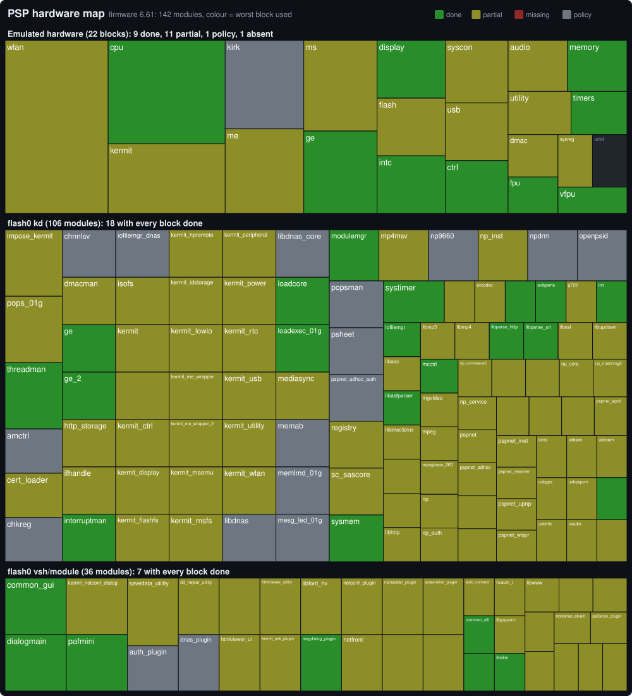

<!-- pair: progress.md sha256=1c720e29582f8e9f2a1da74b6716c7d65e90fae431c7c3d49d323775d1e4e7a7 -->
# Cobertura do hardware do PSP

*English: [progress.md](progress.md).*

<!-- Gerado por build/hle-status (VitaSharp.Desktop psp-coverage --status) a partir de docs/psp/coverage.json; não edite à mão. -->

O que o firmware do PSP que o Vita roda precisa do hardware emulado. O VitaSharp não reimplementa os módulos do PSP (não há HLE deste lado): como um Vita, ele roda o firmware 6.61 do PSP que vem no `pcff` (o flash0 kermit em `vs0:app/NPXS10028`) no núcleo Allegrex dentro do SceCompat ([psp-compat.pt-BR.md](../notes/psp-compat.pt-BR.md)). Por isso esta página mede o hardware: uma linha por bloco emulado com o estado dele no VitaSharp e uma linha por módulo do firmware com os blocos que ele usa; a cor do módulo é a do pior bloco.

- Os blocos que o Vita atende do lado ARM (Memory Stick, flash, áudio, Media Engine, Wi-Fi, USB, syscon, utilitários) chegam ao ScePspemu real como pedidos kermit; ficam parciais até esse caminho rodar de ponta a ponta.
- Todo módulo do flash0 é cifrado (`~PSP`) e carregado pelo `memlmd`, que precisa do KIRK: não emulado por política, mostrado nos módulos que o chamam (memlmd e os de DRM) em vez de repetido em todos.
- O código de boot (`pcbc`) continua cifrado para o processador seguro: o núcleo só sobe o firmware real com um `pcbc.bin` tirado pelo usuário (psp-compat.pt-BR.md).
- Os nomes dos módulos vêm da tabela de arquivos do `pcff`; os papéis, do uOFW, dos canais kermit e das listas de módulos do psdevwiki ("a confirmar" onde nenhuma fonte dá o papel). O estado de cada bloco é o que `src/VitaSharp.Core/Compat` implementa.

<picture>
  <source media="(prefers-color-scheme: light)" srcset="../assets/status/progress-map-psp-light.svg">
  
</picture>

| Estado | Blocos | Módulos (pior bloco) |
|---|---:|---:|
| feito | 9 | 25 |
| parcial | 11 | 100 |
| falta | 0 | 0 |
| não emulado por política | 1 | 17 |
| ausente no Vita | 1 | - |
| Total |22 | 142 |

## Blocos de hardware (22)

| Bloco | Id | Estado | Usado por | Código | Notas |
|---|---|---|---:|---|---|
| CPU Allegrex | `cpu` | feito | 34 | [AllegrexCore.cs](../../src/VitaSharp.Core/Compat/Allegrex/AllegrexCore.cs), [AllegrexCore.Blocks.cs](../../src/VitaSharp.Core/Compat/Allegrex/AllegrexCore.Blocks.cs), [AllegrexCore.Il.cs](../../src/VitaSharp.Core/Compat/Allegrex/AllegrexCore.Il.cs) | o ISA inteiro com as adições do Allegrex, COP0, exceções, interrupções, instruções de cache; cache de blocos e camada IL |
| FPU (COP1) | `fpu` | feito | 0 | [AllegrexCore.Fpu.cs](../../src/VitaSharp.Core/Compat/Allegrex/AllegrexCore.Fpu.cs) | resultados exatos em software nos quatro modos de arredondamento, causas, flags e enables IEEE, o NaN e o flush-to-zero do PSP |
| VFPU (COP2) | `vfpu` | feito | 0 | [AllegrexCore.Vfpu.cs](../../src/VitaSharp.Core/Compat/Allegrex/AllegrexCore.Vfpu.cs), [AllegrexVfpuMath.cs](../../src/VitaSharp.Core/Compat/Allegrex/AllegrexVfpuMath.cs) | todos os opcodes, prefixos, visões de registradores; as transcendentais batem bit a bit com o pspautotests |
| Memória (RAM, VRAM, scratchpad) | `memory` | feito | 4 | [PspBus.cs](../../src/VitaSharp.Core/Compat/PspBus.cs) | os quatro bancos de 16 MB da janela do SceCompat, o buraco, VRAM e scratchpad no topo do banco 3, a SRAM compartilhada |
| Controlador de interrupções | `intc` | feito | 7 | [PspInterruptController.cs](../../src/VitaSharp.Core/Compat/Psp/PspInterruptController.cs) | 0xBC300000: 64 linhas, pendentes mascaradas/brutas e enable, saída no IP2 |
| Timers e tempo do sistema | `timers` | feito | 2 | [PspHardwareTimers.cs](../../src/VitaSharp.Core/Compat/Psp/PspHardwareTimers.cs), [PspSystemTime.cs](../../src/VitaSharp.Core/Compat/Psp/PspSystemTime.cs) | os quatro timers em 0xBC500000 (interrupções 15-18), a contagem de 1 MHz e o alarme em 0xBC600000 (interrupção 19), no tempo do próprio núcleo |
| Controladores de DMA | `dmac` | parcial | 1 | [PspDmac.cs](../../src/VitaSharp.Core/Compat/Psp/PspDmac.cs) | 0xBC900000/0xBCA00000 (PL080): itens e listas de memória para memória; canais que esperam um periférico (controle de fluxo) não são emulados |
| GE (motor gráfico) | `ge` | feito | 14 | [GeEngine.cs](../../src/VitaSharp.Core/Compat/Ge/GeEngine.cs), [GeEngine.Draw.cs](../../src/VitaSharp.Core/Compat/Ge/GeEngine.Draw.cs), [GeVulkanRasterizer.cs](../../src/VitaSharp.Renderer.Vulkan/GeVulkanRasterizer.cs) | 0xBD400000/0xBD500000: listas de display, estado dos comandos, decodificação de vértices, texturas e CLUT, patches, rasterizados no Vulkan |
| Display e LCD DMA | `display` | feito | 7 | [PspDisplayController.cs](../../src/VitaSharp.Core/Compat/Psp/PspDisplayController.cs), [PspLcdc.cs](../../src/VitaSharp.Core/Compat/Psp/PspLcdc.cs), [CompatLcdDma.cs](../../src/VitaSharp.Core/Compat/CompatLcdDma.cs) | temporização e vblank (interrupção 30) em 0xBE740000, o canal de scan-out em 0xBC800100, o LCD DMA para o framebuffer do ScePspemu (a origem é inferida) |
| Controle do sistema e clocks | `sysreg` | parcial | 0 | [PspSystemControl.cs](../../src/VitaSharp.Core/Compat/Psp/PspSystemControl.cs) | 0xBC100000/0xBC200000: reset, enables de clock e IO, PLL, razões do barramento; versão do chip e fuse id do núcleo de compatibilidade desconhecidos (leem 0) |
| Kermit (mailbox, SRAM compartilhada) | `kermit` | parcial | 21 | [CompatMailbox.cs](../../src/VitaSharp.Core/Compat/CompatMailbox.cs), [CompatSharedSram.cs](../../src/VitaSharp.Core/Compat/CompatSharedSram.cs), [PspDdrController.cs](../../src/VitaSharp.Core/Compat/Psp/PspDdrController.cs), [Compat.cs](../../src/VitaSharp.Core/Hle/Modules/Compat.cs) | pedidos, respostas, interrupções virtuais e o flush DDR como o SceCompat 3.74 os move; o número de interrupção PSP das campainhas e os registradores de pendente/confirmação são inferidos até o trace do boot |
| Controle (SRAM compartilhada) | `ctrl` | feito | 5 | [Compat.cs](../../src/VitaSharp.Core/Hle/Modules/Compat.cs) | sceCompatWriteSharedCtrl grava as três palavras do controle que o lado PSP lê |
| Media Engine (canal 6) | `me` | parcial | 16 | [Compat.cs](../../src/VitaSharp.Core/Hle/Modules/Compat.cs) | sem ME do lado PSP: o kermit_me_wrapper manda os codecs para o ScePspemu real (LLE) e os codecs do Vita; ainda não rodado de ponta a ponta |
| Memory Stick (canal 3) | `ms` | parcial | 16 | [Compat.cs](../../src/VitaSharp.Core/Hle/Modules/Compat.cs) | pedidos do kermit_msfs atendidos pelo ScePspemu real sobre o sistema de arquivos do Vita (ux0:pspemu); ainda não rodado de ponta a ponta |
| flash0/NAND e ID storage (canal 4) | `flash` | parcial | 7 | [Compat.cs](../../src/VitaSharp.Core/Hle/Modules/Compat.cs) | kermit_flashfs atendido pelo ScePspemu real; sceCompatIdStorageLookup responde as folhas do ID storage; ainda não rodado de ponta a ponta |
| Áudio (canais 5 e 11) | `audio` | parcial | 4 | [Compat.cs](../../src/VitaSharp.Core/Hle/Modules/Compat.cs) | o kermit_audio manda PCM que o ScePspemu real toca com sceAudioOut (interrupções virtuais 1-3); ainda não rodado de ponta a ponta |
| Syscon: energia, RTC, IO baixo (canais 7 e 9) | `syscon` | parcial | 7 | [Compat.cs](../../src/VitaSharp.Core/Hle/Modules/Compat.cs) | sem syscon do lado PSP: energia, relógio, LEDs, controle remoto e periféricos vão ao ScePspemu real como pedidos kermit (energia: interrupção virtual 10); ainda não rodado de ponta a ponta |
| Wi-Fi (canal 10) | `wlan` | parcial | 53 | [Compat.cs](../../src/VitaSharp.Core/Hle/Modules/Compat.cs) | kermit_wlan atendido pelo ScePspemu real sobre o HLE de rede do Vita (interrupções virtuais 7-8); ainda não rodado de ponta a ponta |
| USB (canais 8 e 12) | `usb` | parcial | 6 | [Compat.cs](../../src/VitaSharp.Core/Hle/Modules/Compat.cs) | kermit_usb atendido pelo ScePspemu real; do lado do Vita o cabo fica sempre desconectado (a resposta do firmware sem host) |
| Utilitários: OSK e diálogos (canal 13) | `utility` | parcial | 3 | [Compat.cs](../../src/VitaSharp.Core/Hle/Modules/Compat.cs) | pedidos do kermit_utility (teclado na tela, diálogo de rede) mostrados pelo ScePspemu real com os diálogos do Vita; ainda não rodado de ponta a ponta |
| Leitor de UMD / ATA | `umd` | ausente no Vita | 0 | - | o Vita não tem leitor de UMD e este flash0 não tem driver de UMD nem de ATA: os títulos ISO são lidos pelo np9660/isofs pelo canal do Memory Stick |
| Motor criptográfico KIRK | `kirk` | não emulado por política | 17 | - | decifra todo módulo ~PSP (memlmd) e o DRM; não emulado por política (as chaves são decisão do lead) |

## Módulos do firmware 6.61 (142)

| Módulo | Papel | Blocos | Pior |
|---|---|---|---|
| `kd/sysmem.prx` | gerenciador de memória | `cpu`, `memory` | feito |
| `kd/loadcore.prx` | carregador e ligador de módulos | `cpu`, `memory` | feito |
| `kd/exceptionman.prx` | tratadores de exceção | `cpu` | feito |
| `kd/interruptman.prx` | gerenciador de interrupções | `cpu`, `intc` | feito |
| `kd/threadman.prx` | threads, sincronização, alarmes | `cpu`, `intc`, `timers` | feito |
| `kd/systimer.prx` | driver dos timers de hardware | `timers`, `intc` | feito |
| `kd/dmacman.prx` | gerenciador dos controladores de DMA | `dmac`, `intc` | parcial |
| `kd/iofilemgr.prx` | gerenciador de arquivos de I/O | `cpu` | feito |
| `kd/iofilemgr_dnas.prx` | gerenciador de I/O para arquivos protegidos por DNAS | `cpu`, `kirk` | não emulado por política |
| `kd/modulemgr.prx` | gerenciador de módulos | `cpu`, `memory` | feito |
| `kd/init.prx` | carregador de módulos do boot | `cpu` | feito |
| `kd/loadexec_01g.prx` | carregador de executáveis e reboot | `cpu`, `memory` | feito |
| `kd/memlmd_01g.prx` | decifra os módulos ~PSP antes de carregar | `cpu`, `kirk` | não emulado por política |
| `kd/mesg_led_01g.prx` | decifração de módulos (de jogos e do atualizador) | `cpu`, `kirk` | não emulado por política |
| `kd/registry.prx` | registro do sistema (flash1) | `cpu`, `flash` | parcial |
| `kd/chkreg.prx` | checagem de região pelo ID storage | `flash`, `kirk` | não emulado por política |
| `kd/ifhandle.prx` | handles das interfaces de rede | `cpu`, `wlan` | parcial |
| `kd/usersystemlib.prx` | biblioteca do kernel em modo usuário | `cpu` | feito |
| `kd/memab.prx` | criptografia de autenticação do ad hoc | `cpu`, `kirk` | não emulado por política |
| `kd/openpsid.prx` | ID do console (OpenPSID) | `flash`, `kirk` | não emulado por política |
| `kd/npdrm.prx` | NPDRM do PSP (licenças, EDAT) | `cpu`, `kirk` | não emulado por política |
| `kd/amctrl.prx` | decifração do DRM do conteúdo da PSN | `cpu`, `kirk` | não emulado por política |
| `kd/chnnlsv.prx` | criptografia dos saves | `cpu`, `kirk` | não emulado por política |
| `kd/cert_loader.prx` | carrega os certificados SSL do flash0 | `cpu`, `flash` | parcial |
| `kd/exitgame.prx` | callback de sair do jogo | `cpu` | feito |
| `kd/mediasync.prx` | espera a mídia do jogo | `cpu`, `ms` | parcial |
| `kd/isofs.prx` | sistema de arquivos ISO 9660 da imagem do disco | `cpu`, `ms` | parcial |
| `kd/np9660.prx` | imagem de disco da PSN (NPUMDIMG) como UMD | `ms`, `kirk` | não emulado por política |
| `kd/impose_kermit.prx` | ajustes do overlay HOME (volume, brilho) | `kermit`, `syscon`, `display` | parcial |
| `kd/kermit.prx` | transporte dos pedidos kermit para o ARM | `kermit`, `intc` | parcial |
| `kd/kermit_audio.prx` | driver de saída de áudio | `kermit`, `audio` | parcial |
| `kd/kermit_ctrl.prx` | driver do controle | `kermit`, `ctrl` | parcial |
| `kd/kermit_display.prx` | driver do display | `kermit`, `display` | parcial |
| `kd/kermit_flashfs.prx` | sistema de arquivos do flash0/flash1 | `kermit`, `flash` | parcial |
| `kd/kermit_hpremote.prx` | controle remoto do fone | `kermit`, `syscon` | parcial |
| `kd/kermit_idstorage.prx` | ID storage | `kermit`, `flash` | parcial |
| `kd/kermit_lowio.prx` | I/O de baixo nível (energia, LEDs) | `kermit`, `syscon` | parcial |
| `kd/kermit_me_wrapper.prx` | chamadas do Media Engine para o ARM | `kermit`, `me` | parcial |
| `kd/kermit_me_wrapper_2.prx` | chamadas do Media Engine para o ARM (segunda variante) | `kermit`, `me` | parcial |
| `kd/kermit_msemu.prx` | dispositivo do Memory Stick | `kermit`, `ms` | parcial |
| `kd/kermit_msfs.prx` | sistema de arquivos do Memory Stick | `kermit`, `ms` | parcial |
| `kd/kermit_peripheral.prx` | estado dos periféricos | `kermit`, `syscon` | parcial |
| `kd/kermit_power.prx` | energia, bateria, suspensão | `kermit`, `syscon` | parcial |
| `kd/kermit_rtc.prx` | relógio de tempo real | `kermit`, `syscon` | parcial |
| `kd/kermit_usb.prx` | driver USB | `kermit`, `usb` | parcial |
| `kd/kermit_utility.prx` | pedidos de utilitários (OSK, diálogos) | `kermit`, `utility` | parcial |
| `kd/kermit_wlan.prx` | driver de Wi-Fi | `kermit`, `wlan` | parcial |
| `kd/ge.prx` | driver do GE (listas de display) | `ge`, `intc` | feito |
| `kd/ge_2.prx` | driver do GE (segunda variante) | `ge`, `intc` | feito |
| `kd/audiocodec_260.prx` | interface dos codecs de áudio | `me` | parcial |
| `kd/avcodec.prx` | núcleo dos codecs de áudio/vídeo | `me` | parcial |
| `kd/videocodec_260.prx` | interface dos codecs de vídeo | `me` | parcial |
| `kd/mpegbase_260.prx` | base MPEG (decodificação de vídeo) | `me` | parcial |
| `kd/mpeg.prx` | biblioteca do player de filmes PSMF | `me` | parcial |
| `kd/libatrac3plus.prx` | decodificador ATRAC3/ATRAC3plus | `me` | parcial |
| `kd/libmp3.prx` | decodificador MP3 | `me` | parcial |
| `kd/libaac.prx` | decodificador AAC | `me` | parcial |
| `kd/libaudiocodec2.prx` | biblioteca de codecs de áudio (segunda interface) | `me` | parcial |
| `kd/g729.prx` | codec de voz G.729 | `me` | parcial |
| `kd/sc_sascore.prx` | sintetizador de som SAS | `me`, `audio` | parcial |
| `kd/vaudio.prx` | saída de áudio de vídeo | `audio` | parcial |
| `kd/libmp4.prx` | reprodução de MP4 | `me` | parcial |
| `kd/mp4msv.prx` | vídeo MP4 do Memory Stick | `me`, `ms` | parcial |
| `kd/libasfparser.prx` | leitor do contêiner ASF (WMA) | `cpu` | feito |
| `kd/mgvideo.prx` | reprodução de vídeo (papel a confirmar) | `me` | parcial |
| `kd/mcctrl.prx` | papel a confirmar | `cpu` | feito |
| `kd/pops_01g.prx` | emulador de PSone | `cpu`, `display`, `audio` | parcial |
| `kd/popsman.prx` | gerenciador das imagens de PSone (decifração) | `ms`, `kirk` | não emulado por política |
| `kd/psheet.prx` | folha de DRM do conteúdo da PSN | `cpu`, `kirk` | não emulado por política |
| `kd/sircs.prx` | controle remoto infravermelho (SIRCS) | `syscon` | parcial |
| `kd/http_storage.prx` | download HTTP para o armazenamento | `wlan`, `ms` | parcial |
| `kd/libhttp.prx` | cliente HTTP | `wlan` | parcial |
| `kd/libparse_http.prx` | leitor de cabeçalhos HTTP | `cpu` | feito |
| `kd/libparse_uri.prx` | leitor de URI | `cpu` | feito |
| `kd/libssl.prx` | SSL/TLS | `wlan` | parcial |
| `kd/libupdown.prx` | biblioteca de upload/download | `wlan` | parcial |
| `kd/libgameupdate.prx` | checagem de atualização de jogo | `wlan` | parcial |
| `kd/libdnas.prx` | autenticação DNAS | `wlan`, `kirk` | não emulado por política |
| `kd/libdnas_core.prx` | núcleo do DNAS | `wlan`, `kirk` | não emulado por política |
| `kd/pspnet.prx` | núcleo de rede | `wlan` | parcial |
| `kd/pspnet_inet.prx` | sockets TCP/IP | `wlan` | parcial |
| `kd/pspnet_apctl.prx` | conexão ao ponto de acesso | `wlan` | parcial |
| `kd/pspnet_resolver.prx` | resolvedor de DNS | `wlan` | parcial |
| `kd/pspnet_upnp.prx` | UPnP | `wlan` | parcial |
| `kd/pspnet_wispr.prx` | login de hotspot WISPr | `wlan` | parcial |
| `kd/pspnet_adhoc.prx` | PDP/PTP ad hoc | `wlan` | parcial |
| `kd/pspnet_adhocctl.prx` | controle de grupos ad hoc | `wlan` | parcial |
| `kd/pspnet_adhoc_auth.prx` | autenticação ad hoc | `wlan`, `kirk` | não emulado por política |
| `kd/pspnet_adhoc_discover.prx` | descoberta ad hoc | `wlan` | parcial |
| `kd/pspnet_adhoc_download.prx` | download do compartilhamento de jogo ad hoc | `wlan` | parcial |
| `kd/pspnet_adhoc_matching.prx` | matching ad hoc | `wlan` | parcial |
| `kd/pspnet_adhoc_transfer_int.prx` | transferência ad hoc | `wlan` | parcial |
| `kd/np.prx` | biblioteca da PSN | `wlan` | parcial |
| `kd/np_core.prx` | núcleo da PSN | `wlan` | parcial |
| `kd/np_auth.prx` | autenticação da PSN | `wlan` | parcial |
| `kd/np_service.prx` | serviços da PSN | `wlan` | parcial |
| `kd/np_commerce2.prx` | loja da PSN | `wlan` | parcial |
| `kd/np_commerce2_regcam.prx` | loja da PSN (códigos de campanha) | `wlan` | parcial |
| `kd/np_commerce2_store.prx` | navegação da loja da PSN | `wlan` | parcial |
| `kd/np_matching2.prx` | matching da PSN | `wlan` | parcial |
| `kd/np_inst.prx` | instalação de conteúdo da PSN | `wlan`, `ms` | parcial |
| `kd/usbacc.prx` | acessórios USB | `usb` | parcial |
| `kd/usbcam.prx` | câmera USB | `usb` | parcial |
| `kd/usbgps.prx` | GPS USB | `usb` | parcial |
| `kd/usbmic.prx` | microfone USB | `usb` | parcial |
| `kd/usbpspcm.prx` | comunicação USB do PSP (PSP-PS3) | `usb` | parcial |
| `vsh/module/pafmini.prx` | toolkit de interface dos utilitários | `cpu`, `ge`, `display` | feito |
| `vsh/module/common_gui.prx` | interface comum | `ge`, `display`, `ctrl` | feito |
| `vsh/module/common_util.prx` | utilitários comuns | `cpu` | feito |
| `vsh/module/dialogmain.prx` | base dos diálogos de utilitário | `ge`, `display`, `ctrl` | feito |
| `vsh/module/msgdialog_plugin.prx` | diálogo de mensagem | `ge`, `ctrl` | feito |
| `vsh/module/savedata_utility.prx` | utilitário de saves | `ms`, `ge`, `ctrl` | parcial |
| `vsh/module/savedata_auto_dialog.prx` | diálogo de save automático | `ms`, `ge` | parcial |
| `vsh/module/kermit_osk_plugin.prx` | teclado na tela (mostrado pelo Vita) | `kermit`, `utility` | parcial |
| `vsh/module/kermit_netconf_dialog.prx` | diálogo de rede (mostrado pelo Vita) | `kermit`, `utility`, `wlan` | parcial |
| `vsh/module/netconf_plugin.prx` | diálogo de configuração de rede | `wlan`, `ge` | parcial |
| `vsh/module/auto_connect.prx` | conexão de rede automática | `wlan` | parcial |
| `vsh/module/screenshot_plugin.prx` | capturas de tela | `display`, `ms` | parcial |
| `vsh/module/game_install_plugin.prx` | instalação de dados do jogo | `ms`, `ge` | parcial |
| `vsh/module/libfont_hv.prx` | biblioteca de fontes | `cpu`, `flash` | parcial |
| `vsh/module/libpspvmc.prx` | memory card virtual do PSone | `ms` | parcial |
| `vsh/module/file_parser_base.prx` | base do leitor de arquivos | `cpu` | feito |
| `vsh/module/libslim.prx` | papel a confirmar | `cpu` | feito |
| `vsh/module/dd_helper_utility.prx` | auxiliar de download | `wlan`, `ms` | parcial |
| `vsh/module/htmlviewer_ui.prx` | interface do visualizador HTML | `wlan`, `ge` | parcial |
| `vsh/module/htmlviewer_utility.prx` | utilitário do visualizador HTML | `wlan`, `ge` | parcial |
| `vsh/module/hvauth_r.prx` | autenticação do visualizador HTML | `wlan` | parcial |
| `vsh/module/netfront.prx` | motor do navegador | `wlan`, `ge` | parcial |
| `vsh/module/libwww.prx` | biblioteca web | `wlan` | parcial |
| `vsh/module/auth_plugin.prx` | diálogo de autenticação | `wlan`, `kirk` | não emulado por política |
| `vsh/module/dnas_plugin.prx` | diálogo do DNAS | `wlan`, `kirk` | não emulado por política |
| `vsh/module/netplay_server_utility.prx` | servidor de compartilhamento de jogo | `wlan` | parcial |
| `vsh/module/netplay_server_plus_utility.prx` | servidor de compartilhamento de jogo (plus) | `wlan` | parcial |
| `vsh/module/netplay_server2_utility.prx` | servidor de compartilhamento de jogo (2) | `wlan` | parcial |
| `vsh/module/ps3scan_plugin.prx` | busca do PS3 (recursos remotos) | `wlan` | parcial |
| `vsh/module/psn_utility.prx` | utilitário da PSN | `wlan` | parcial |
| `vsh/module/npinstaller_plugin.prx` | instalador de conteúdo da PSN | `wlan`, `ms` | parcial |
| `vsh/module/npsignin_plugin.prx` | login na PSN | `wlan` | parcial |
| `vsh/module/npsignup_plugin.prx` | cadastro na PSN | `wlan` | parcial |
| `vsh/module/store_browser_plugin.prx` | navegação da loja no jogo | `wlan`, `ge` | parcial |
| `vsh/module/store_checkout_plugin.prx` | compra na loja no jogo | `wlan` | parcial |
| `vsh/module/store_checkout_utility.prx` | utilitário de compra na loja | `wlan` | parcial |
